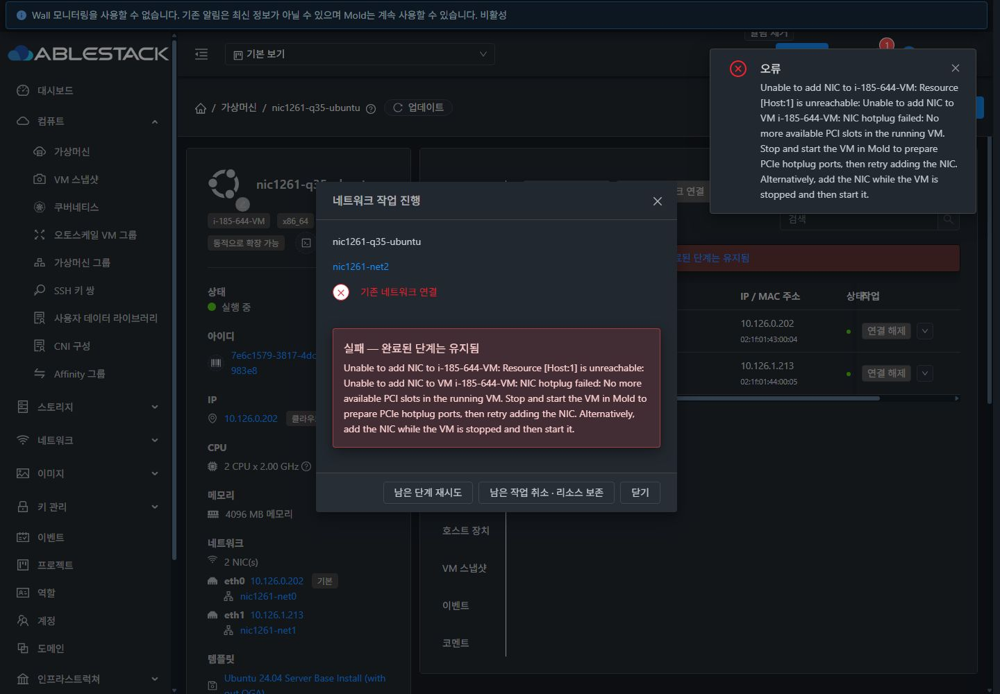
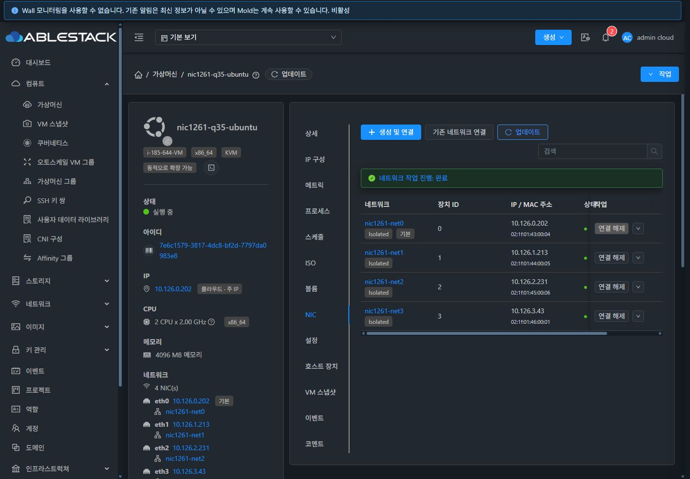

# #1261 클러스터 31 NIC 핫플러그 검증

2026-10-18~19 KST. 기준 소스 `ablestack-europa` / `5b6751ff0f86919601c3b8036bf5fe430659b114`.

## 결론

NIC 두 개만으로 슬롯이 부족해지는 근본 원인은 x86 Q35 VM 기동 XML의 PCIe root-port 사전 확보 누락이다. 전용 Ubuntu VM에서 1 NIC 부팅 → 두 번째 NIC hotplug 성공 → 세 번째 NIC 실패를 실제 재현했다. 수정 배포 후 Mold 정지·시작으로 root-port 32개를 생성했고, 세 번째 및 네 번째 NIC 추가와 게스트 통신이 성공했다.

포트 사전 확보는 **KVM `q35` / `pc-q35-*`에만 적용**한다. x86 `pc`, i440fx의 XML 구성은 유지한다. 기존 aarch64/s390x의 32포트 구성도 유지한다. 오류 전달과 실패 NIC 정리는 공통 NIC 추가 경로 개선이다.

## 기능 검증

| 구분 | 관측 결과 | 판정 |
|---|---|---|
| 수정 전 Ubuntu 1 NIC 부팅 | root-port 6개, 빈 포트 1개 | 원인 확인 |
| 수정 전 두 번째 hotplug | 2 NIC, 빈 포트 0개 | 성공 |
| 수정 전 세 번째 hotplug | API 530 / `null job execution result` | 장애 재현 |
| 수정 배포 직후 실행 VM | 기존 토폴로지 유지. UI에 `No more available PCI slots`와 Mold 정지·시작 복구 방법 표시 | 통과 |
| 하위 작업 실패 | VmWorkAddVmToNetwork 13148 / FAILED(2), 상위 API도 FAILED(2) | 통과 |
| 실패 정리 | 기존 NIC ID/MAC/IP 동일. 실패 NIC는 removed/Deallocating, 대상 network count 0, active DHCP hosts/options 0. VR 처리 캐시는 `remove=true` 삭제 기록만 존재 | 통과 |
| 기존 통신/데이터 | 실패 중 주 NIC ping 160/160, 두 번째 NIC ping 3/3, 게스트 파일 SHA256 동일 | 통과 |
| Mold 정지·시작 | 실제 XML root-port 32개, 2 NIC 상태에서 빈 포트 26개 | 통과 |
| 세 번째 NIC UI 추가 | API/UI 완료, 호스트 및 게스트에 새 virtio NIC 존재 | 통과 |
| 네 번째 NIC API 추가 | 4 NIC, 빈 root-port 24개. 네 게이트웨이 각각 ping 3/3 | 통과 |
| 네 번째 NIC UI hot-remove | 3 NIC, 기존 주 NIC ping 120/120 및 파일 해시 동일 | 통과 |
| 정지 상태 네 번째 NIC 추가 → 시작 | Stopped 상태 3→4 NIC, 기동 후 root-port 32개, 네 게이트웨이 각각 ping 3/3 및 파일 해시 동일 | 통과 |
| 권한 경계 | 타 계정 요청을 API 531 permission 오류로 차단 | 통과 |

Ubuntu Base Install 템플릿은 QGA가 없는 것으로 표시되며 SSH로 게스트 NIC와 통신을 확인했다. 템플릿이 주 NIC만 자동 구성하므로 추가 NIC는 MAC을 대조하여 API가 할당한 IP로 게스트 OS에서 별도 구성했다. 따라서 새 NIC의 자동 DHCP 설정까지 제품 기능으로 주장하지 않는다. 냉기동 시 비주 NIC의 OS 장치 이름이 달라질 수 있으므로 운영 설정에는 MAC 매칭을 권장한다.

초기 준비 시 Q35 BIOS/IDE 조합은 libvirt 정의에서 거부됐고, 별도 Rocky cloud image는 UEFI 부팅 옵션이 없었다. 두 fixture는 정리했고 게스트 기능/데이터 판정에 사용하지 않았다. 정상 Ubuntu 재시험과 구분한다. 정지 상태 추가 후 첫 즉시 SSH 시도는 부팅 준비 중 connection refused였으며, SSH 준비 후 네 NIC 검증은 통과했다.

## 빌드 및 회귀

WSL ext4 작업 트리에서 변경 Maven 모듈만 package 빌드했다.

- `engine/orchestration`: 새 실패 처리 8 + 기존 NetworkOrchestrator 61 = **69 통과**.
- `server`: 새 정확한 NIC rollback **5 통과**.
- `plugins/hypervisors/kvm`: 새 topology 8 + Agent 실패/정리 4 + 기존 VMDef 30 + 기존 plug/unplug 7 = **49 통과**.
- 합계 **123개**, 실패/오류/skip 0. 최종 테스트 소스 정리 후 새 25개도 다시 통과했다.
- `pc`/i440fx/LXC 비적용, canonical Q35, component 순서, 반복 직렬화, 기존 ARM/s390x를 포함한다.

전체 Cloud 빌드/Release CI를 실행하지 않았다. 모듈 빌드의 Checkstyle/RAT는 skip했으며 `git diff --check`는 통과했다. 이 결과를 전체 CI 통과로 해석하지 않는다.

## 배포와 보존

관리 서버와 호스트 3대의 설치 JAR를 먼저 백업하고, 기존 JAR에 변경 클래스 family만 덮어썼다. 다른 엔트리의 바이트가 같음을 검증했다. 관리 서버의 기존 #1410 변경도 보존했다.

- Management JAR: `9d3108f...` → `ee673ee599dc823f1256fb7c0e968973b32a2cdb54a9aa622c2b799c1e4534ad`.
- KVM Agent JAR 3대: `3863b850...` → `1634db40375b45ff3c91d4712faceee1efd92bc0de8a14544470374137020e16`.
- `mold` 및 `mold-agent` active, API에서 세 Routing host Up.
- `/client/` HTTP 200, UI/WEB-INF/config **12,717 파일 해시 동일**.
- 각 Agent 재시작 전후 실행 도메인 목록 동일. VM 정지 동작은 전용 fixture에만 수행했다.
- 운영 NFS VM 168은 조회만 수행. 전체 domain XML SHA256 `3e2e613c5cefee369cac0e0353d92aead4d9d4f18247960b6c1c3694c064cf1b` 동일, 도메인 ID 90 유지.

## 정리 결과

전용 VM, 네트워크 4개, 계정 2개 및 도메인을 정상 API로 정리했다. active VM/NIC/volume/network/allocated IP/DHCP option/account/domain/진행 중 VM work/API job **10개 항목 모두 0**이다. 관련 호스트 도메인 잔여도 없다. removed/Expunged 이력은 제품 동작대로 남긴다.

기존 VM **111개**의 ID/상태/호스트/계정/주요 구성/NIC 속성을 비교해 차이가 없었다. 기존 Kubernetes **7개**와 CNI **3개**의 API 응답도 동일하다. userdata/Kubernetes/annotation/account/project/domain의 기존 DB 36행 SHA256은 전후 모두 `2d61f159980ac4fa490f62c74e16ce6024ac1f8bb9210c2c6caaa366c74357f7`이다.

## 증빙

- [설계](../../docs/design/issue-1261-q35-nic-hotplug.md)
- [기능·작업 ID·토폴로지·정리 결과](qualification.json)
- [모듈별 테스트 수](focused-tests.json)
- [배포 백업·PID·JAR 해시](deployment.json)
- [실패 중 통신](failed-add-ping.txt), [hot-remove 중 통신](hot-remove-ping.txt)
- [4 NIC 게스트 통신](guest-four-nics.txt), [정지 상태 추가 후 게스트 통신](guest-stopped-add-started.txt)

