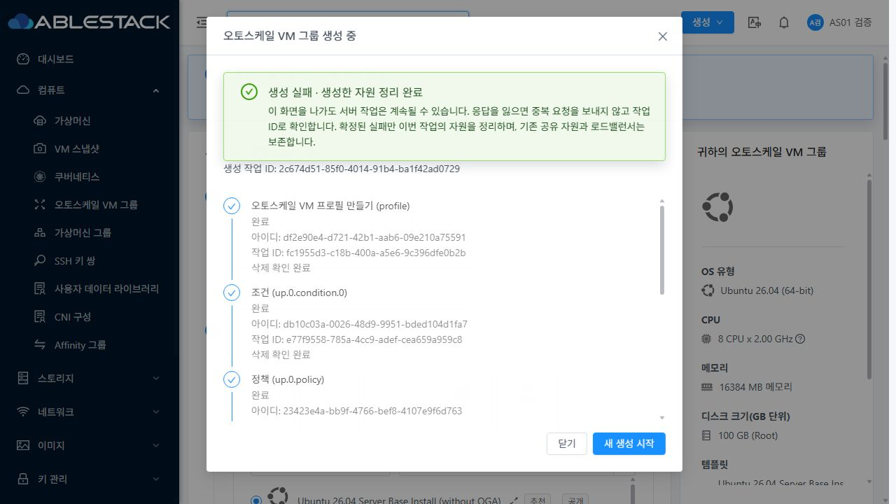
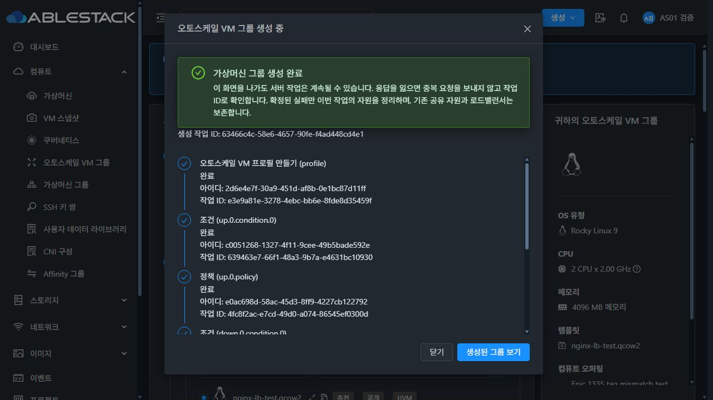

<!--
Licensed to the Apache Software Foundation (ASF) under one
or more contributor license agreements.  See the NOTICE file
distributed with this work for additional information
regarding copyright ownership.  The ASF licenses this file
to you under the Apache License, Version 2.0 (the
"License"); you may not use this file except in compliance
with the License.  You may obtain a copy of the License at

  http://www.apache.org/licenses/LICENSE-2.0

Unless required by applicable law or agreed to in writing,
software distributed under the License is distributed on an
"AS IS" BASIS, WITHOUT WARRANTIES OR CONDITIONS OF ANY
KIND, either express or implied.  See the License for the
specific language governing permissions and limitations
under the License.
-->

# AS-02 / #1348 구현·배포·UI 검증 완료 기록

검증일: 2026-10-11. Epic #1346의 다단계 생성·비동기 종료·중복 방지·복구·이번 작업 자원 보상 범위를 완료했다. 누적 Draft PR [#1356](https://github.com/ablecloud-team/ablestack-cloud/pull/1356)에 반영한다. 다음 작업은 #1350이며 사용자 지시까지 대기한다.

## 구현 결과

- 기존 Cloud async job의 실행 책임을 유지하고 프로필·조건·정책·그룹 생성에 선택적 `customjobid`, `creationoperationid`, `creationstage`를 연결했다. 서버 요청 영수증은 시작 사용자/소유자/명세 해시를 검증해 같은 UUID의 동일 요청에 기존 자원/job을 반환한다. 다른 명세/사용자의 재요청은 거부한다.
- `queryAutoScaleCreationRequest`로 응답 유실을 재조정한다. Cloud 응답 envelope, 일반 사용자 역할 API 노출, Spring DAO/manager 등록, TIMESTAMP 매핑 및 CGLIB의 자원 UUID 저장 계약을 실제 환경과 테스트로 확인했다. 완료된 async job의 `removed` 표시도 기존 완료 결과 조회에 반영한다.
- 브라우저 작업 기록은 서버·사용자·계정·도메인·프로젝트별로 분리한다. 추가 서버 저널과 브라우저 기록에 프로필 UserData/SNMP/사용자 변수/인증 값의 원문을 보관하지 않는다. 이미 접수된 프로필은 폼의 비밀 값을 다시 입력하지 않고 영수증으로 복구한다.
- POST 45초, 조회 15초, 폴링 실패 재시도 3회 및 추적 기한 15분을 적용했다. 결과 불명확 상태는 실패/취소로 단정하지 않는다. 자동 생성 POST 반복과 자동 삭제를 막고 작업·자원 ID 및 명시적 재조회 동작을 제공한다.
- 사용자가 복구를 선택하고 영수증이 NOTFOUND이며 자원/job 식별자가 없는 경우에만 원래 UUID와 명세로 재요청한다. 원래 요청의 늦은 접수도 서버에서 중복 방지한다. 미접수 프로필은 폼을 다시 확인하도록 안내한다.
- 확정된 실패에는 이번 작업 소유 자원만 역순으로 정리한다. 사용 중 조건/정책은 보존하고 잔여 식별자와 정리 재시도를 표시한다. 실제 VR 설정 실패의 NEW 그룹은 그룹 매핑·통계·스케줄·모니터 연결까지 정리한다. 기존 LB/템플릿/망은 보상 대상에 넣지 않는다.
- 현재 Mold의 Modal/Steps/Alert/Button을 사용한다. 한국어 상태·작업 ID·자원 ID·정리 결과를 표시하고, 다크 모드 글자 대비와 작은 화면의 하단 버튼 접근성을 보완했다. VM 목록의 오토스케일 그룹 ID 필터 한국어/영어 번역을 추가했다.

## 빌드 및 배포 출처

WSL ext4 `/home/ablecloud/work/autoscale-review-20261010/source`에서 변경 Maven 모듈 `api`, `engine/schema`, `server`만 빌드했다. 전체 Cloud/RPM 빌드 및 GitHub Actions 전체 CI는 이번 요청에서 실행하지 않았다. qemu 패키지는 변경하지 않았다.

| 검증 | 결과 |
|---|---|
| 서버 집중 테스트 | 152건: AutoScaleManager 128, 요청 manager 16, API command 6, 실제 DAO/VO 2 통과 |
| 변경 모듈 | Maven BUILD SUCCESS, Checkstyle 오류 0 |
| UI 집중/회귀 | 6 suites / 100건 통과 |
| UI lint / production build | 최종 변경 파일 lint 및 production build 통과 |
| 배포 UI 해시 | 양쪽 활성 정적 파일 840개 일치 |
| 관리 서비스/웹 | 양쪽 mold active, WEB-INF/config 보존, `/client/` HTTP 200 |

관리 클래스/SQL/Spring 정의의 빌드 소스는 `bcaec71090e8b73a68f3f48d658ee77d1d4ae804`다. 이후 커밋은 UI 및 문서에만 적용했다. 기존 활성 관리 fat JAR에 변경 모듈의 34개 항목을 반영하고 나머지 환경별 항목을 보존했다.

| 환경 | 활성 JAR SHA256 | 최종 관리 배포 백업 |
|---|---|---|
| 31 GFS2 | `e3695f3229911913de080fff2beedcaa6e88de7b849313086f18ffcf129bb867` | `/root/epic1346-as02-20261011-032911` |
| 32 krbd | `3b0ace848d040fde741c7a42e48ad6665773ea3a6ee5c4637245ac97c8cc374a` | `/root/epic1346-as02-20261011-032948` |

최종 UI 소스/컴파일/번역은 모두 `9c6cab5734329db5e9d75e9040a74637c6b48c45`, 파일 `ui-as02-9c6cab57343.tgz`, SHA256 `4d7dcac8b50610eec172f6baffdac4197dc449071f319ab78013113a681433b5`다. UI 배포 백업은 31 `/root/epic1346-as02-ui-20261011-041817`, 32 `/root/epic1346-as02-ui-20261011-041830`이다. WEB-INF/META-INF/config는 보존했고 관리 PID는 각각 327487/769771로 UI 배포 전후 동일했다. 화면 footer의 기존 제품 버전 값은 이 배포 소스 식별자를 대신하지 않는다.

## 실제 UI 검증

일반 사용자로 31 프로젝트 / 32 계정 문맥에서 기존 Mold 생성 화면의 버튼을 직접 사용했다. 개발 도구의 API 요청/응답 장애 주입은 명시적으로 구분한다. 상태 전환은 배포 UI에서 확인하고 실제 서버 영수증·DB·libvirt·krbd·HTTP와 대조했다. DB 상태를 수정해 PASS를 만들지 않았다.

| 사례 | 실행 및 결과 |
|---|---|
| ASY-01 | 양쪽 프로필 요청의 잘못된 오퍼링 UUID로 실제 HTTP 431 유도. 단계 실패/정리 완료, 뒤 단계 POST 없음 |
| ASY-02 | 양쪽 스케일업 및 스케일다운 조건 요청의 잘못된 연산자 주입. 앞 단계 소유 자원 역순 정리 |
| ASY-03 | 양쪽 확장·축소 정책 각각 잘못된 action 주입. 실패 종료 및 앞 단계 정리 |
| ASY-04 | maxmembers=0의 실제 그룹 검증 실패 및 VR 관리 연결만 잠시 차단한 실제 그룹 설정 jobstatus=2를 양쪽 UI에서 확인. NEW 그룹·앞 단계 자원 정리, 기존 LB 보존 |
| ASY-05 | 32 실제 접수된 프로필 응답을 jobid 없는 동기 응답으로 바꾸고 실제 job ID를 보존한 PENDING/jobstatus=0 조회 주입. 이후 실제 성공 영수증으로 복구. 양쪽 실제 그룹 jobstatus=2도 확인 |
| ASY-06 | 32 job 조회 네 번 연결 유실 후 결과 확인 상태. 실제 세션 만료/재로그인 복구. 배포 UI에 PENDING/0 응답을 유지하며 CDP 가상 시간 900100ms(진행 응답 891회)를 진행해 15분 추적 기한 종료·ID 보존 확인 |
| ASY-07 | 32 생성 버튼 중복 클릭 후 프로필 영수증/자원 1개. 진행 중 조회 상태에서 닫기→VM 메뉴 이탈→복귀 후 같은 작업 복구. 늦은 응답이 종료된 뷰를 덮어쓰지 않음 |
| ASY-08 | 31 프로필 / 32 그룹 POST의 실제 서버 200 이후 응답과 영수증 조회를 유실시킴. 새로고침 후 원래 작업 ID로 복구. 양쪽 각 6단계·6요청·6자원, 그룹/VM 각 1개 |
| ASY-09 | 부분 자원 생성 뒤 공유 조건의 in-use 정리 실패를 양쪽 UI에 잔여 ID로 표시. 별도 보호 정책 해제 후 UI 정리 재시도 성공. 32 미접수 프로필 NOTFOUND는 명시적 복구 시 같은 UUID로 재요청 |
| ASY-10 | 다른 정책이 참조하는 조건 및 기존 LB를 보존. 31 프로젝트 전환 / 32 로그아웃·제한 역할 로그인에서 다른 문맥의 복구 기록 노출 없음. 제한 역할 직접 생성 URL의 한국어 권한 안내 확인 |

실제 VR 장애 주입은 검증 VR 관리 SSH(3922) 목적지에만 호스트 OUTPUT REJECT를 임시 적용했다. 120초 자동 해제와 수동 복원으로 시험 후 규칙이 없음을 확인했고 기존 AS-01 LB는 HTTP 200을 유지했다. 검증 전용 실패 LB도 워크플로가 보존한 사실을 확인한 후 별도 fixture 정리로 제거했다. 시간/응답/화면 크기/테마의 개발 도구 override는 모두 제거했다.

| 실제 실패 | 31 | 32 |
|---|---|---|
| 작업 UUID | `2c674d51-85f0-4014-91b4-ba1f42ad0729` | `56d1ac8c-faf8-4c19-b4be-ecd70708455e` |
| 그룹 생성 job UUID | `1f8b1e76-4003-4b9f-a7b5-39271bfe7772` | `09688718-c205-472b-85ce-5ad7668128de` |
| 실제 결과 | jobstatus=2 / UI 정리 완료 | jobstatus=2 / UI 정리 완료 |
| 실패 NEW 그룹 | `4138ad10-d070-45a9-8ad0-2f96684721f1` removed | `fe84771a-e58d-4d1f-b038-30bd7e2e17c7` removed |
| 매핑·통계·스케줄 | 잔여 0 | 잔여 0 |

## 정상 복구 및 스토리지

| 항목 | 31 GFS2 | 32 Glue(Ceph) krbd |
|---|---|---|
| 작업 UUID | `d926ae1c-0e52-49d3-8eba-5c281fbe4286` | `63466c4c-58e6-4657-90fe-f4ad448cd4e1` |
| 그룹 UUID | `3b532b36-1a5f-431f-976a-50caf26fb8ac` | `7cfc210d-169a-43ac-b10f-7a0ed385272f` |
| 실제 VM | `i-35-396-VM` / ablecube31-2 | `i-6-72-VM` / ablecube32-3 |
| UI 상태 | 실행 중 1대 | 실행 중 1대 |
| ROOT | `16afe561-d12d-467b-a463-bef331c75e43` | `6de31aec-667e-45a4-87a9-386e17e5c79e` |
| 실제 드라이버 | `/mnt/glue-gfs/<ROOT>` 독립 QCOW2, backing 없음 | `/dev/rbd/rbd/<ROOT>` raw, 실제 `/dev/rbd12` 매핑 |
| 프로비저닝 | **SPARSE / 100GiB**; 확인 시 실제 할당 약 5.1GiB. THIN 미사용 | RBD Thin / 100GiB (GFS2 Thin 금지와 구분) |
| 신규 LB | `10.10.31.104:8082` HTTP 200 / 브라우저 AS01 HTTP OK | `10.10.32.169:8082` HTTP 200 / 브라우저 AS01 HTTP OK |
| 완료 후 | UI에서 DISABLED, VM/LB 보존 | UI에서 DISABLED, VM/LB 보존 |

31 Ubuntu 기본 설치 템플릿에는 cloud-init 비활성화 설정이 남아 있었다. 이번 전용 VM에서 해당 설정을 백업하고 CloudStack datasource를 준비한 뒤 **UI 재부팅**하여 UserData HTTP 서비스를 확인했다. 최초 부팅부터 애플리케이션 준비까지 Cloud가 무조건 보장한다고 보고하지 않는다. 32 Rocky Cloud 이미지에서는 기존 UserData로 정상 서비스가 실행됐다.

최종 DB 대조: 각 정상 작업은 중복 없이 6개 요청/단계/자원이며, 그 밖의 이번 생성 저널이 가리키는 활성 자원은 양쪽 모두 0이다. 기존 AS-01 자원은 유지했다. 활성 수는 31 그룹 2/프로필 3/조건 7/정책 6, 32 그룹 3/프로필 4/조건 8/정책 8로 각각 기준 대비 정상 AS-02 한 세트만 늘었다. 호스트 6대 모두 Up/Enabled다. 초기 배포 진단에서 남은 자원 UUID 없는 저널 2행은 자원 잔여/PASS로 계산하지 않는다.

## 최종 UI 가독성

최종 배포에서 한국어 상태·자원/작업 ID·실패·잔여 정리·권한 안내를 검토했다. 밝은/다크 테마를 양쪽 클러스터에서 확인했다. 다크 단계 제목/설명/ID는 `rgb(217,226,236)`으로 읽힌다. 1280×720, 768×600, 390×844에서 단계 영역은 내부 스크롤하고 후속 버튼은 화면 안에 유지된다. 32 VM 목록의 그룹 ID 필터도 한국어로 표시된다. 최종 페이지에서 TypeError/ReferenceError/ChunkLoadError/Unhandled 런타임 오류는 관찰되지 않았다. 장애 시험의 예상 API 실패/세션 오류를 오류 0이라고 보고하지 않는다.

31 실제 VR 실패 후 정리 완료, 밝은 테마:

32 실제 응답 유실 후 복구 완료, 다크 테마:

## 판정 범위와 다음 작업

#1348의 ASY-01~10 생성/복구/보상 범위는 완료다. 이는 Epic 전체 프로덕션 전환이나 실제 자동 확장·축소 정책 평가/동시성/재시작 복구/VM 삭제 수명주기 전체 통과를 의미하지 않는다. Basic Zone 및 외부 LB provider 실환경은 두 클러스터에 없어 검증하지 않았다. 전체 RAT는 앞선 AS-01에서 기존 문서 7개 항목으로 실패한 상태이며 이번 집중 빌드를 전체 RAT/전체 CI 통과로 표현하지 않는다. 장시간 운영 관찰은 아직 수행하지 않았고 모든 기능·UI 통합 완료 뒤 #1354의 마지막 단계에서 확인한다.

다음 대상: [#1350 — AS-04 동시성·활성화/중지 경쟁·재시작 복구](https://github.com/ablecloud-team/ablestack-cloud/issues/1350). 현재 착수하지 않으며 사용자 지시를 기다린다.
