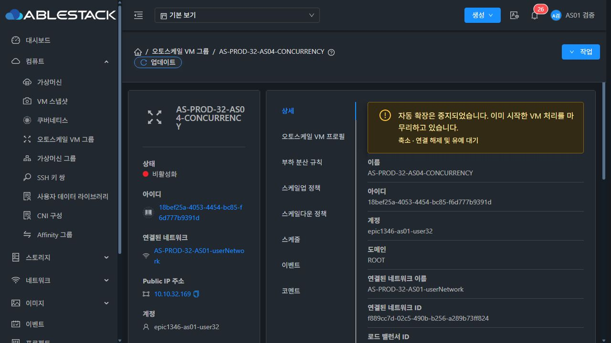
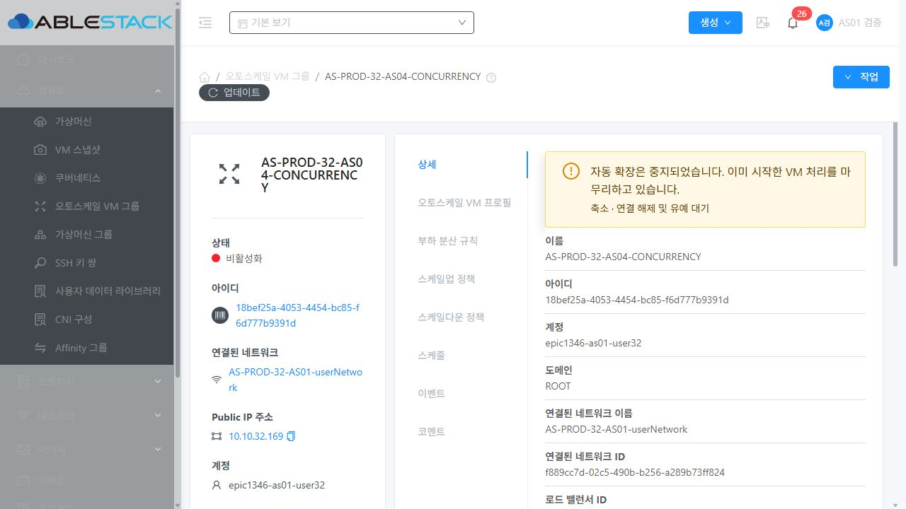
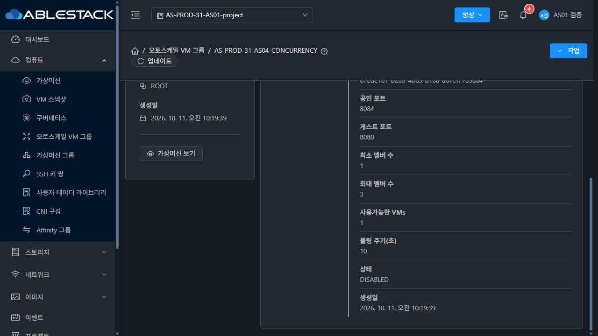
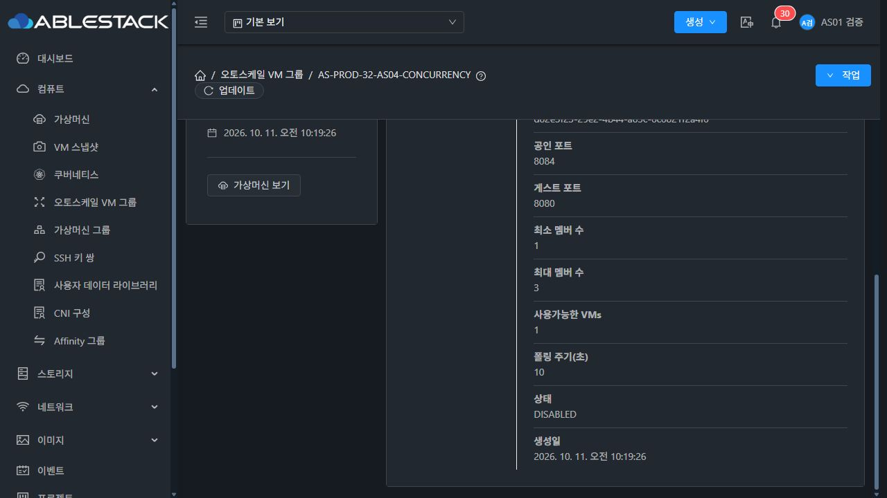

<!--
Licensed to the Apache Software Foundation (ASF) under one
or more contributor license agreements.  See the NOTICE file
distributed with this work for additional information
regarding copyright ownership.  The ASF licenses this file
to you under the Apache License, Version 2.0 (the
"License"); you may not use this file except in compliance
with the License.  You may obtain a copy of the License at

  http://www.apache.org/licenses/LICENSE-2.0

Unless required by applicable law or agreed to in writing,
software distributed under the License is distributed on an
"AS IS" BASIS, WITHOUT WARRANTIES OR CONDITIONS OF ANY
KIND, either express or implied.  See the License for the
specific language governing permissions and limitations
under the License.
-->

# AS-04 완료 검증 기록 (#1350)

완료일: 2026-10-11. 대상: Epic #1346 / 누적 Draft PR #1356. 구현·빌드·배포 소스는 `ab86c636070e7d0d33778beec810d4b1307f9a4d`다. 이 기록을 추가한 후속 커밋에는 문서와 검증 증거만 포함한다. AS-04 범위는 완료했으며 Epic 전체 프로덕션 판정은 남은 이슈 완료 후 수행한다.

## 최종 동작과 설계

그룹 상태를 원자적으로 비교·변경하고, 그룹별 분산 작업 잠금과 별도 제어 잠금으로 자동 조정·사용자 명령을 보호한다. VM 처리의 UUID·방향·단계·대상·축소 유예 종료 시각을 저장하여 관리 프로세스가 재시작해도 같은 VM을 재조정한다. 준비 중 VM도 최대 인원에 포함한다. 축소는 LB 제외 후 유예를 기다리고, 실제 삭제가 확인될 때까지 그룹 매핑을 보존한다.

중지는 DISABLED 의도를 먼저 저장한다. 이미 수락한 현재 VM 처리만 마무리하며 새 VM 처리를 시작하지 않는다. 작업 완료가 중지 상태를 ENABLED로 덮어쓰지 않는다. 진행 중에는 활성화·그룹 변경/삭제뿐 아니라 연관 프로필·정책·조건 변경도 UI/API에서 차단한다. 동일 LB 생성 경쟁과 모니터 등록/취소 경쟁도 보호한다. [설계 및 명령 허용 표](AS-04.ko.md)를 참조한다.

현재 Mold ResourceLayout·상세 탭·Alert·작업 메뉴를 사용했다. 진행 방향/단계, 중지 후 현재 VM 처리 완료, 편집 재시도 사유를 한글로 표시했다. 전체 가상머신 메뉴 UI 표준 통합은 #1355에서 수행한다.

## 빌드와 집중 검증

| 구분 | 최종 결과 |
| --- | --- |
| Java | 고유 테스트 184건 통과: DAO/VO 6 + AutoScaleManager 138 + 생성 관리 16 + LB 관리 18 + API 할당/변경 6 |
| Maven | WSL ext4 소스에서 변경 `api`, `engine/schema`, `server` 모듈만 install 성공, Checkstyle 오류 0 |
| 라이선스 | 변경 3개 Maven 모듈 RAT 통과. 생성된 systemvm 메타데이터 2개는 소스 검사 전 작업 아티팩트로 옮겼으며 소스 라이선스 제외를 추가하지 않음 |
| UI | 집중 테스트 87건/2 suites, 변경 파일 lint, 최종 production build 통과 |
| 제한 | 전체 Cloud/RPM 빌드 및 GitHub Actions 전체 CI는 실행하지 않음. qemu/Agent 소스 변경 없음. UI 빌드의 기존 번들 크기/Browserslist 경고는 유지 |

Java 계약 검증에는 SCALING 자기 전이/중복 획득 거부, 이전 UUID의 완료 거부, DISABLED 보존, 동일 그룹 확장/축소 경쟁, 작업 잠금 중 변경 거부, 같은 LB 경쟁, STARTING/DRAINING 복구 및 모니터 중복 방지가 포함된다. 실환경은 클러스터별 관리 서버 1대이므로 실제 다중 관리 노드 경쟁은 검증하지 않았다. 분산 잠금의 경쟁은 집중 테스트 근거와 구분한다.

## 배포 및 활성 자산 확인

| 대상 | 활성 관리 JAR SHA-256 | JAR 롤백 백업 |
| --- | --- | --- |
| 31 GFS2 | `e56c0c4daa3c06176516a48e9fdddffb5101687f646e818b9ed28acd264376d2` | `/root/epic1346-as04-r3-20261011-103515` |
| 32 krbd | `4c1e12f06394af8acbe81742eeb6458d5a885e3bdc65d26a0cf7e9a53cd5ee52` | `/root/epic1346-as04-r3-20261011-103552` |

변경 모듈의 클래스들을 각 클러스터의 기존 관리 JAR에 반영했다. 전체 Cloud fat JAR를 새로 빌드한 결과가 아니다. UI 패키지는 `ui-as04-ab86c636070.tgz`, SHA-256 `ccdbc092b4e35c71e54db78b63d9ae6da9c7796da61bd8589f6be3b78e07d326`다. UI 롤백 백업은 각각 `/root/epic1346-as04-ui-r3-20261011-103948`, `/root/epic1346-as04-ui-r3-20261011-104001`이다.

두 환경 모두 활성 `/usr/share/cloudstack-management/webapp`의 정적 파일 840개 해시가 빌드 산출물과 일치했다. WEB-INF/config를 보존하고 `mold active`, `/client/` HTTP 200을 확인했다. 기존 FTCTL async/progress 마커와 신규 `operationinprogress` 마커도 활성 번들에서 확인했다. [최종 배포 해시/런타임 기록](evidence/AS-04/deployment.json)을 참조한다.

## 실제 UI·API·스토리지 판정

| 항목 | 31 GFS2 Sparse | 32 krbd | 근거/범위 |
| --- | --- | --- | --- |
| OPS-01 활성/중지 및 멱등 | PASS | PASS | UI 활성/중지, 직접 API의 이미 활성/이미 중지 반복 요청에서 상태·VM/LB 변화 없음 |
| OPS-02 조정 중 중지와 변경 차단 | PASS | PASS | UI DRAINING 중 중지→DISABLED/처리 중, 활성/변경/삭제 메뉴와 프로필/정책/조건 편집 차단. 직접 API 부정 검증 5건씩 거절 |
| OPS-03 소유권/min/max/LB 일관성 | PASS | PASS | 반복 UI 증감과 CPU 정책 증감 중 최대 초과 없음. 완료 시 Running VM/그룹/LB 집합 일치. 분산·동시 획득의 집중 테스트 병행 |
| OPS-04 관리 재시작 복구 | PASS | PASS | 실제 DRAINING 중 재시작 후 같은 대상·UUID·유예 시각으로 재개, 중복 VM 없음. STARTING 및 실제 다중 관리 노드 재시작은 실환경 PASS에 포함하지 않음 |
| LIF-01 짧은 10회 왕복 | PASS | PASS | 현재 Mold UI에서 min/max를 3/3과 1/1로 변경, 10회 각각 1↔3. 매 방향 완료 상태/표시 개수 확인 |
| LIF-02 CPU 1→2→3·max 유지 | PASS | PASS | UI에서 min=1/max=3 설정. 실제 부하와 자동 정책으로 2·3대 확인, 추가 부하 중 약 99초 최대 3 유지 |
| LIF-03 부하 해제 3→2→1 | PASS | PASS | min/max 변경 없이 자동 축소, UI 2→1 및 최소 1 유지, 완료 시 LB HTTP 200 |
| 한글·라이트/다크·권한 | PASS / 해당 변경 | PASS / 해당 변경 | 일반 계정/프로젝트 문맥의 기존 Mold 화면과 새 Alert/편집 제한 확인. 전체 UI 표준은 #1355 범위 |

UI 조작은 생성·설정·활성·중지 및 결과 확인 경로로 사용했다. API/DB/호스트 검사는 UI 결과를 보강했다. 모든 HTTP 요청의 무중단이나 성능 목표 통과를 의미하지 않는다. [UI 2~10회 왕복](evidence/AS-04/cycles-ui.jsonl), [첫 왕복 31 확장](evidence/AS-04/cycle01-up-27-verified.txt), [첫 왕복 32 축소](evidence/AS-04/cycle01-down-28-verified.txt), [CPU 축소 UI 관찰](evidence/AS-04/cpu-ui-down-transitions.jsonl), [진행 중 직접 API 차단](evidence/AS-04/pending-negative.json), [멱등 검증](evidence/AS-04/idempotency.json)을 참조한다.

약 3초 간격의 보조 관찰은 31 1,089건 / 32 1,049건이다. 관찰한 SCALEUP에서 준비 중 포함 VM 수의 max 초과 및 min=max 완료 시 VM/LB/Running 불일치가 0건이었다. 최초 수집기는 예정된 31 관리 재시작의 연결 중단으로 종료됐고 이후 재시작한 수집기는 정상 종료했다. 이를 제품 무중단이나 모든 시점의 연속 관측으로 표현하지 않는다. [수집 요약](evidence/AS-04/runtime-summary.json)을 참조한다.

### 실제 재시작의 소스와 의미

- 32: `73bca51fc21` 배포에서 SCALING/DRAINING 대상 VM 75와 기존 유예 시각을 재시작 후 그대로 이어서 축소했다. 후속 VM 74도 처리하여 baseline VM 73으로 수렴하고 HTTP 200을 확인했다.
- 31: 같은 소스의 DISABLED/DRAINING 재시작에서 현재 대상 399만 마무리하고 2대/중지 상태를 유지했다. 이후 UI 활성화를 통해 1대로 수렴했다.
- 최종 소스 `ab86c636070`에서도 31 DISABLED/DRAINING 대상 421, UUID `fbd61ba9-977b-4dfc-ba0d-2f6f69f44622`, 종료 시각 `2026-10-11 02:10:00 UTC`가 재시작 전후 동일했다. 현재 VM만 삭제하고 DISABLED/2대 상태를 유지했다. 두 환경의 최종 설정 변경 차단과 반복/CPU 검증은 모두 이 최종 소스에서 수행했다.
- 처음 시도한 STARTING 재시작은 프로세스 정지 직전에 VM 처리가 완료되어 STARTING 도중의 실환경 복구 근거로 사용하지 않았다. 이 단계는 집중 테스트로 확인했다.

### 실제 스토리지와 삭제 확인

CPU 최대 3대 시점에 두 환경의 6개 ROOT를 libvirt/qemu/블록 장치로 대조했다. 31의 397/422/423은 `/mnt/glue-gfs/<UUID>`의 독립 QCOW2 파일, 100GiB 가상 크기, 실제 약 3.6GB 할당, backing file 없음이다. 오퍼링과 실제 결과 모두 **Sparse이며 Thin은 사용하지 않았다**. 32의 73/98/99는 실제 `/dev/rbd/rbd/<UUID>` krbd 블록 매핑과 raw 드라이버다. [6대 실제 디스크 증거](evidence/AS-04/storage-max.json)를 참조한다.

AS04에서 클러스터마다 VM 27대를 생성했고 최종 1대를 보존했다. 축소된 26대씩은 Cloud VM removed 및 ROOT Expunged/removed를 확인했다. GFS2 파일과 `rbd ls`에서도 해당 26개 이미지가 모두 없고 보존 ROOT 1개는 실제 존재했다. 수동 삭제로 성공 상태를 만든 것이 아니다. [최종 VM/LB/스토리지 정리 기록](evidence/AS-04/resources-final.json)을 참조한다.

### 한글과 테마 UI 증거

중지 후 진행 작업이 남으면 “진행 중인 VM 처리가 완료된 후 다시 시도하세요.”를 표시하고 편집을 제한한다. 32 밝은/다크 모드의 현재 Mold 화면에서 읽기와 버튼 상태를 확인했다. 다크 정보 Alert는 배경 `rgb(23,43,61)`/글자 `rgb(214,235,255)`, 다크 경고는 `rgb(51,42,22)`/`rgb(255,231,163)`, 밝은 경고는 `rgb(255,248,230)`/`rgb(92,59,0)`였다. 테스트의 임시 테마 에뮬레이션은 해제했다. 31 프로젝트 화면은 원래 다크 테마였다.

## 보존한 그룹과 다음 테스트 준비

| 환경 | 남긴 그룹 | 최종 상태 | 실행 VM/서비스 |
| --- | --- | --- | --- |
| 31 | `AS-PROD-31-AS04-CONCURRENCY` / `bf0f5385-ae2c-4da4-aec4-eb985dbdeba4` | DISABLED, 작업 없음, min1/max3, grace60초 | `i-35-397-VM`, VM/LB 각 1, `10.10.31.104:8084` HTTP 200 |
| 32 | `AS-PROD-32-AS04-CONCURRENCY` / `18bef25a-4053-4454-bc85-f6d777b9391d` | DISABLED, 작업 없음, min1/max3, grace60초 | `i-6-73-VM`, VM/LB 각 1, `10.10.32.169:8084` HTTP 200 |

31은 **AS-PROD-31-AS01-project** 프로젝트를 선택해야 기존 AS01/AS02 및 AS04 그룹을 볼 수 있다. 기본 보기에서 안 보인다고 삭제된 것이 아니다. 프로젝트 선택이 적용되지 않으면 프로젝트 목록의 해당 행에서 진입한다. 32 그룹은 `epic1346-as01-user32` 소유이며 관리자 전체 조회 또는 해당 계정에서 볼 수 있다. 기존 AS01/AS02 검증 자원도 보존했다.

31은 기존 100GiB VM 2대와 AS04 최대 3대 검증을 위해 프로젝트 기본 스토리지 한도를 200→600GiB로 확장했다. 보존 VM 3대가 총 300GiB를 사용하므로 한도 600GiB는 유지한다. CPU 조건은 31 GT20/LT10, 32 GT5/LT1이고 평가 주기10초, 기간60초, quiet10초다. 모든 테스트 부하는 중지했다.

## 남은 제한 및 기존 이슈로 추적하는 항목

- 32의 제한된 HTTP 부하 생성기에는 최초 66,650회 중 실패120회, 추가 16,679회 중 실패116회가 기록됐다. 원인별 분류를 수집하지 않았으므로 원인을 단정하지 않는다. 정상 수렴 시 서비스 HTTP200은 확인했으나 무중단/성능 합격으로 확대하지 않는다. [부하 집계](evidence/AS-04/load-http.json). 서비스/드레인/실패 보상은 #1351 및 최종 #1354에서 구분하여 검증한다.
- 프로젝트 공유 비공개 템플릿의 생성 UI 선택 범위와 프로필 저장 성공 후 모달/상세 자동 갱신 누락은 기존 #1355의 [후속 기록](https://github.com/ablecloud-team/ablestack-cloud/issues/1355#issuecomment-6104240038)에 등록했다. AS04 전용 템플릿은 프로젝트 직접 소유, 프로필 저장은 닫기/갱신 후 반영을 확인했다. 해당 별도 개선 구현에는 착수하지 않았다.
- 정책의 시간/기간/쿨다운 정확성·결측 통계·복수 조건/정책은 **다음 #1349**에서 진행한다. 실제 다중 관리 노드, 외부 LB provider 및 전체 Cloud CI는 이번 검증에 포함되지 않는다.
- Epic과 PR은 계속 Open/Draft다. 다음 이슈는 사용자 지시까지 대기한다. 장시간 운영은 모든 기능·최종 Mold UI 통합 및 기능 검증을 마친 뒤 #1354 마지막 단계에서만 수행한다.
