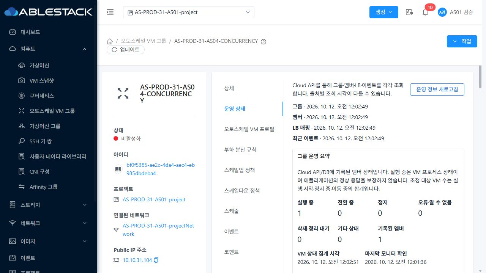
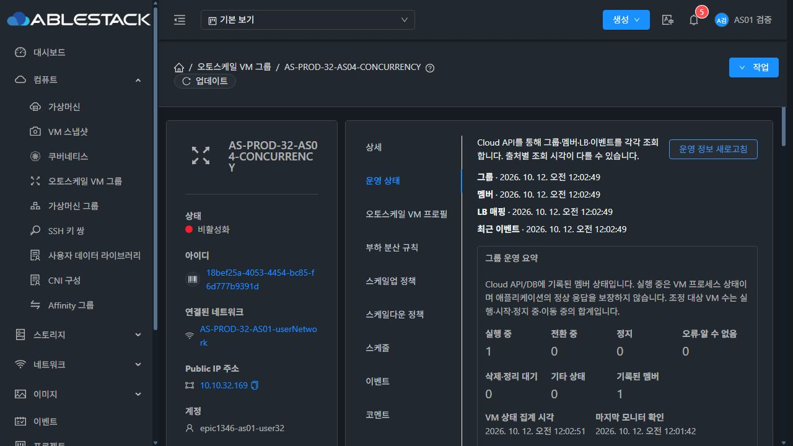

<!--
Licensed to the Apache Software Foundation (ASF) under one
or more contributor license agreements.  See the NOTICE file
distributed with this work for additional information
regarding copyright ownership.  The ASF licenses this file
to you under the Apache License, Version 2.0 (the
"License"); you may not use this file except in compliance
with the License.  You may obtain a copy of the License at

  http://www.apache.org/licenses/LICENSE-2.0

Unless required by applicable law or agreed to in writing,
software distributed under the License is distributed on an
"AS IS" BASIS, WITHOUT WARRANTIES OR CONDITIONS OF ANY
KIND, either express or implied.  See the License for the
specific language governing permissions and limitations
under the License.
-->

# AS-07 공개 근거

[검증·배포·정리 기록](../../AS-07-validation.ko.md)이 판정 범위다. r6/f8628299a6c 최종 UI와 관리 소스9b1363af4f2를 검증했다. 공개 텍스트는 줄 끝 공백만 정규화하고 라이선스 머리말을 추가했으며 원본 캡처는 로컬에 보존한다. JSON은 필요한 상태·식별자·해시만 보존하며 계정 비밀번호/개인 키/API 키/UserData 및 비공개 프로필 원문을 포함하지 않는다.

- `test-summary.json`, `*-r6.log.txt`, `module-*-r2.log.txt`: 최종 집중 테스트/변경 모듈·UI 빌드의 일부 종료 기록. 전체 원본 로그는 로컬 검증 폴더에 보존한다.
- `as07-management-artifacts.json`, `as07-ui-artifact-r6.json`: 실제 빌드 소스·아티팩트 및 변경 클래스별 해시.
- `running-storage-physical.json`: 3VM씩 확장 시 실제 GFS2 Sparse qcow2 및 krbd block/raw 경로·연결.
- `three-running-api.json`, `final-stopped-api.json`, `final-restarted-api.json`: 실제 멤버·집계·볼륨 변화. `evaluation-api-contract.json`은 초기3멤버의 응답 계약이며 최종 UI의2멤버 재검증은 `*-final-*.txt`로 구분한다.
- `before-shrink-api.json`, `protected-retry-api.json`, `disabled-retry-api.json`, `retry-recovered-api.json`, `success-time-check.json`: 삭제 보호 오류/재시도·Disabled 수락 작업 복구와 성공 시각 보존.
- `final-draining-api.json`, `31/32-final-draining.png`/`.txt`: 최종 실제 드레인·유예 종료 예정·LB 등록 구분. `32-final-destroying`은 후속 VM 삭제 단계다.
- `31/32-final-stopped/corrupt/no-evaluation/unknown` 이미지·텍스트: 최종 배포본의 집계·평가 손상/없음/알 수 없음. 해석 실패를0으로 치환하지 않는다.
- `32-final-partial-failure`, `32-final-read-denied`, `permission-api.json`: 부분 조회 실패 시 이전 정보 보존과 권한 없음 시 제거. `31-restricted-other-project`은 제한 계정의 소유 외 그룹 상세 비노출이다.
- `32-final-search-preserved`, `31-parent-event-link`, `31-manual-stop-blocked`: 검색/탭 보존·실제 이벤트 상세 연결·진행 작업의 수동 정지 거절. 이벤트 상세 링크 이미지는 날짜 수정 후r4 기록이며 동적 상태 라벨의 최종 판정 자료는r6다.
- `contrast-final.json`, `console-final.json`: 운영 주요 텍스트 각60표본의 실제 CSS 대비와 최종 배포 후 수집 콘솔 오류0. 전체 WCAG/전체 UI 무오류 인증이 아니다.
- `cleanup-db-final.json`, `cleanup-physical-final.json`: 전용4VM/ROOT400GiB removed/Expunged, 활성 참조0 및6호스트의 물리 자원 부재와 원본 보존.
- `cleanup-baseline-resources-31/32.json`, `final-fixture-state.json`, `final-policy-equality.json`, `protection-restore-original.json`: 기준 그룹3/4·VM3/4·primary300/400GiB, 프로필8항목 동일·CPU 정책 동일·예약6개 Disabled·원본 보호 복원.
- `cleanup-management-health.json`, `final-static-health.json`: 최종 활성 JAR/PID·mold active·WEB-INF/config·HTTP200 및정적843파일 해시 재검증.
- `31-final-stable-light`, `32-final-stable-dark`: 최종 Disabled/min1max3/원본VM1/LB1의 실제 Mold 화면. `final-fixture-state.json`의HTTP는각20/20 짧은 확인이며 장시간/무손실 성능은이번 판정이 아니다.

## 최종 화면

