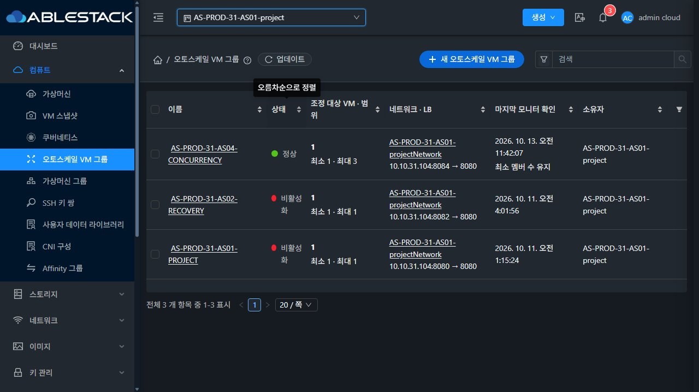
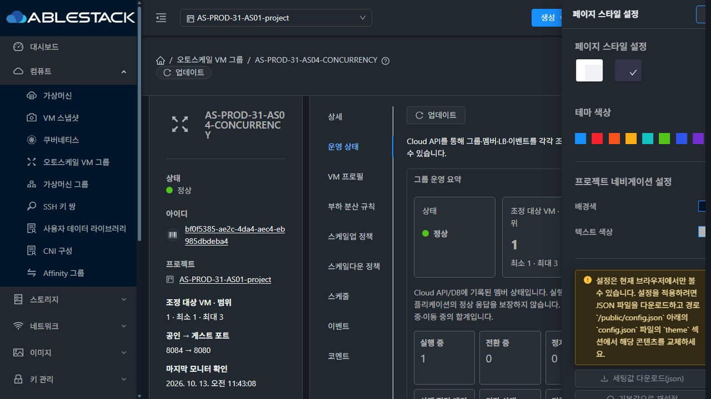
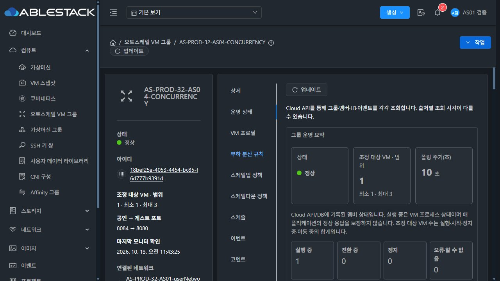
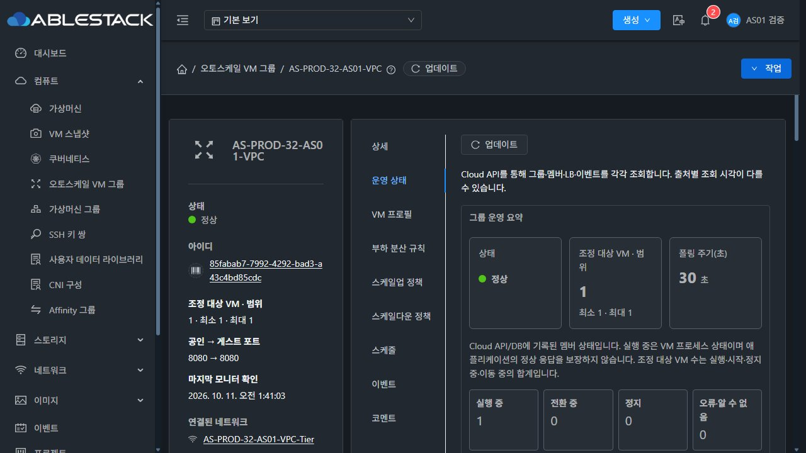
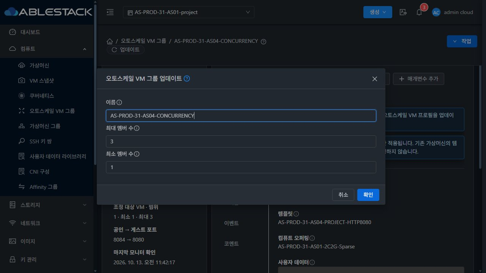

<!--
Licensed to the Apache Software Foundation (ASF) under one
or more contributor license agreements.  See the NOTICE file
distributed with this work for additional information
regarding copyright ownership.  The ASF licenses this file
to you under the Apache License, Version 2.0 (the
"License"); you may not use this file except in compliance
with the License.  You may obtain a copy of the License at

  http://www.apache.org/licenses/LICENSE-2.0

Unless required by applicable law or agreed to in writing,
software distributed under the License is distributed on an
"AS IS" BASIS, WITHOUT WARRANTIES OR CONDITIONS OF ANY
KIND, either express or implied.  See the License for the
specific language governing permissions and limitations
under the License.
-->

# AS-08 시작 증거

24시간 완료 기록이 아니라 최종 게이트·관찰 시작 증거다. 인증 정보/전체 UserData/개인 키는 포함하지 않는다.

- 배포: restore31-result/deployment-preflight/autoscale-runtime-parity JSON.
- 실제 디스크: expanded-storage JSON; GFS2 qcow2 Sparse와 krbd raw.
- 정리: post-e2e-physical-cleanup JSON; 신규4VM/ROOT만 전체6호스트에서 부재.
- 기능/보존: post-e2e-gate JSON과 UI observations/대표사진.
- 예약/기간: soak-launch JSON. 연속 기록과 종료 판정은 추후 추가한다.

