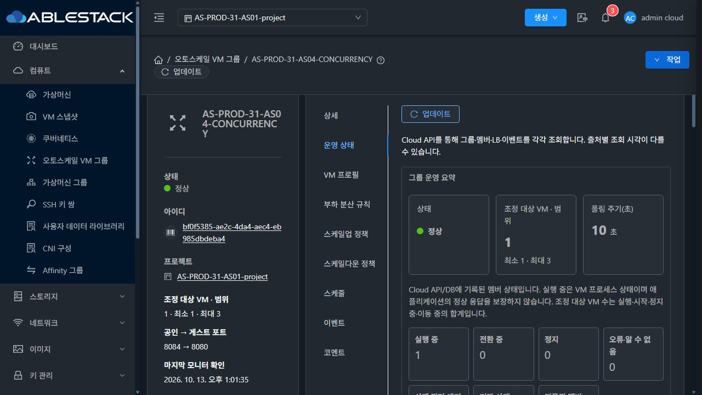
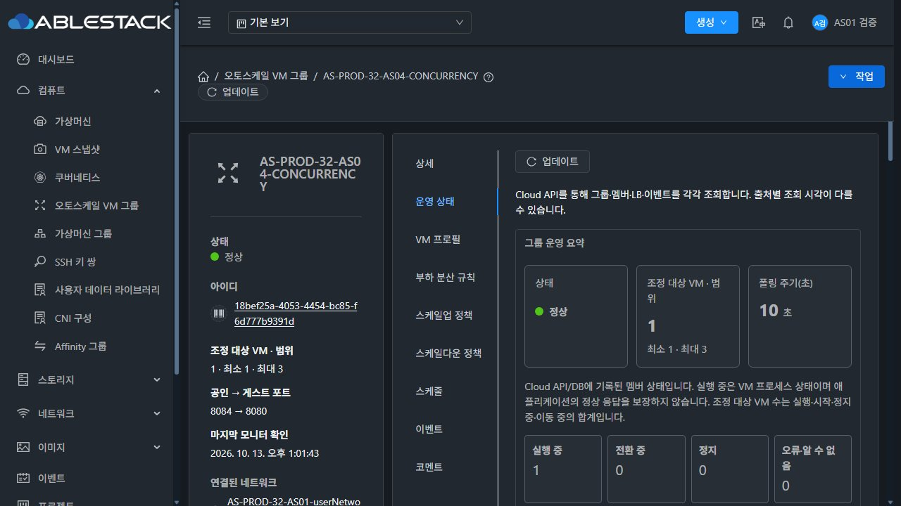
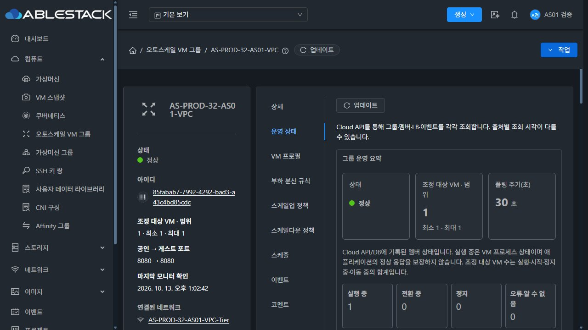

<!--
Licensed to the Apache Software Foundation (ASF) under one
or more contributor license agreements.  See the NOTICE file
distributed with this work for additional information
regarding copyright ownership.  The ASF licenses this file
to you under the Apache License, Version 2.0 (the
"License"); you may not use this file except in compliance
with the License.  You may obtain a copy of the License at

  http://www.apache.org/licenses/LICENSE-2.0

Unless required by applicable law or agreed to in writing,
software distributed under the License is distributed on an
"AS IS" BASIS, WITHOUT WARRANTIES OR CONDITIONS OF ANY
KIND, either express or implied.  See the License for the
specific language governing permissions and limitations
under the License.
-->

# AS-08 1시간 체크포인트

24시간 완료 판정이 아니라1시간 이상 실제 기록의 중간 확인이다. 시작11:44:15 KST, 이번 서버 기록 확인은13:03경(약79분), UI는13:01~13:02, 원본 전체 인벤토리를 다시 대조했다.

| HTTP 대상 | 요청 | 본문 일치200 | 실패 |
|---|---|---|---|
| 31-AS04 | 948 | 948 | 0 |
| 32-AS04 | 948 | 948 | 0 |
| 32-VPC | 948 | 948 | 0 |

- 두 서버 각각 API79회, DB16회. API/DB/그룹 ERROR·수집 anomaly0, HTTP최대수집간격5초/API약60.05초. 세 그룹은모두Enabled/원본Running1/LB1, 범위내 유지 및 배포/PID/설정fingerprint 유지.
- 원본7VM·7그룹 및 각 서비스 응답을 보존했다. 고아 VM 매핑/삭제 VM 활성볼륨0. 실제 한글·다크 UI에서31프로젝트/32일반 사용자·VPC의 최신 조회·평가·멤버를 확인했다.32의 브라우저 유휴 세션은 기존 계정으로 재로그인했고 서버 연속 수집은중단되지 않았다.
- DB통계보존7200초(2시간). 현재 통계 행 증가는 해당 보존 구간 안이므로,2시간 이후 정리/범위 유지로 최종판정한다.
- 프로세스RSS/실제JVMheap/스레드/fd를 시계열로 보존했다.32의 스레드 증가를추가 확인했다. 양쪽db.cloud.maxActive=250, 소스의fixed API/Work풀상한은125/166.12:55경32 OS스레드416중 API풀73/Work풀32를 관측했다. 동시에32에서이번관찰그룹밖의VM/볼륨/템플릿작업이수행돼, 전체프로세스증감을오토스케일누수로단정하지않는다. 제한된풀증가와지속추이를함께확인한다.
- 관찰 중 배포/재시작/장애/VM시험/그룹설정 변경은하지 않았다. 이번32의다른대상작업은이관찰에서 실행한시험이아니다. 대상그룹의24시간기록과프로세스전체공유부하의판정범위를구분한다.

원시요약은[summary.json](summary.json), UI문맥/텍스트는[checkpoint-1h-ui.json](checkpoint-1h-ui.json)이다. 전체UserData/인증정보/다른대상의작업매개변수는포함하지않는다.

