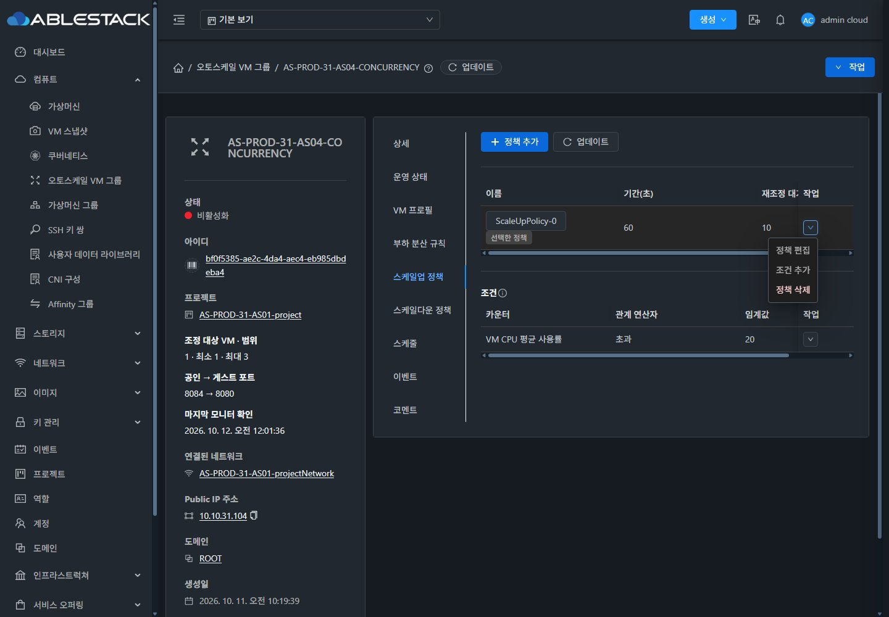
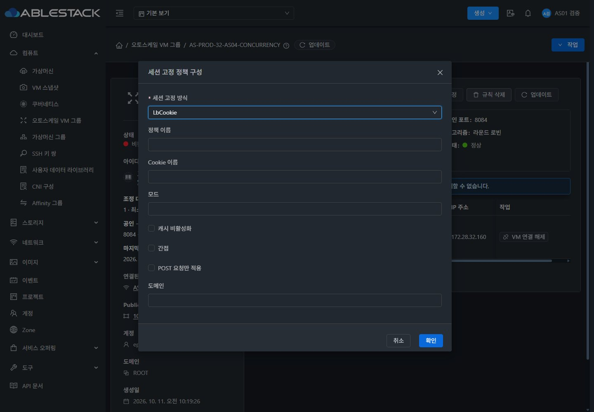
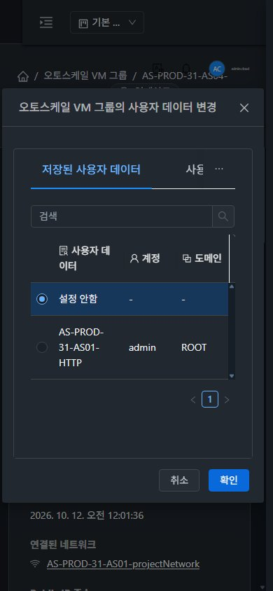
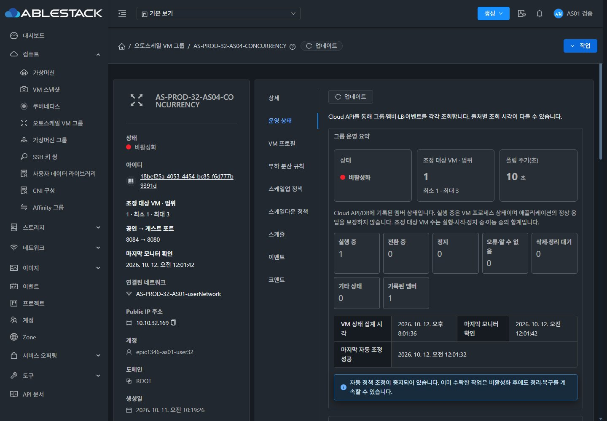
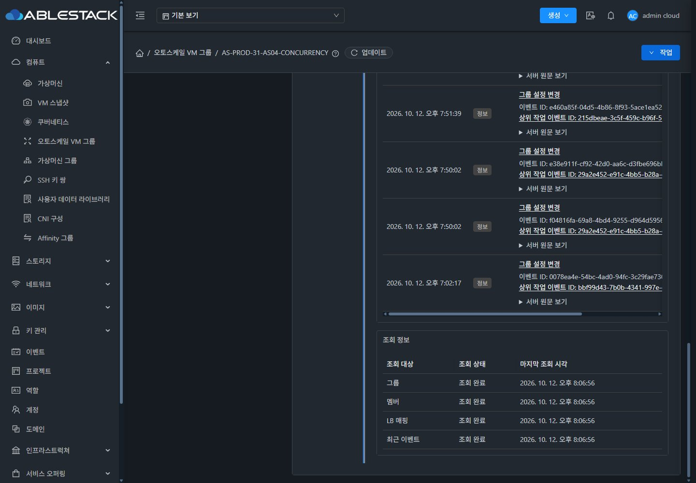
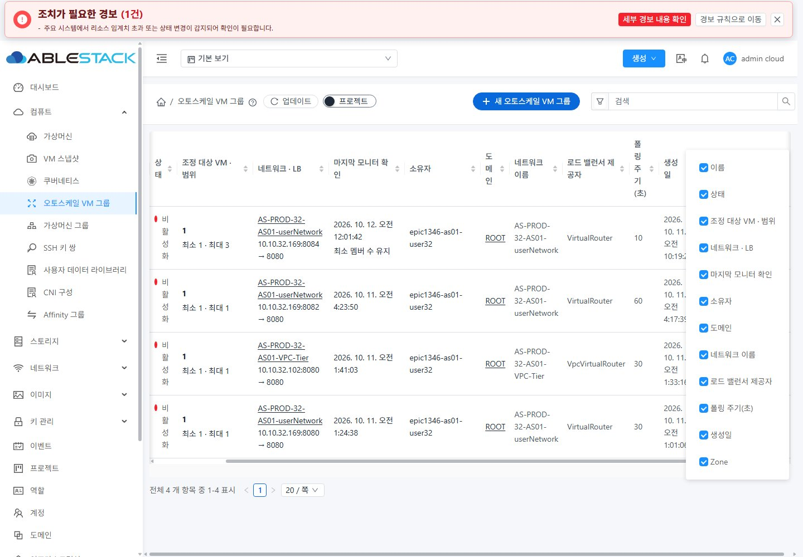
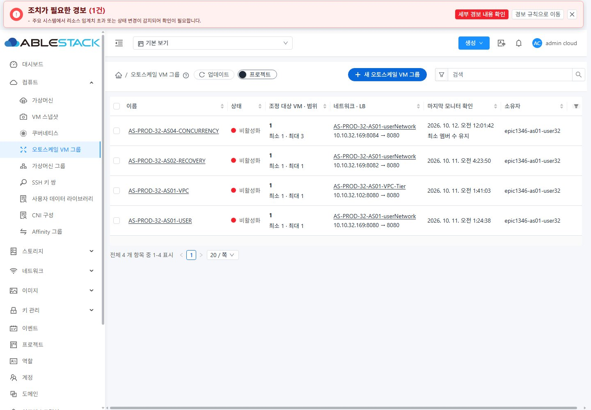

# AS-09 행 작업·대화상자·운영 상태 보완 증거

#1355 / Epic #1346 / PR #1356, 2026-10-12. 실제 배포 UI의 네이티브 JPEG입니다. 목업 이미지가 아닙니다.

컴파일 소스 `6790065c011555b7bb9c1950cadcde2cba2b6194`, UI SHA256 `05684413d62b183f5c7332028b98143da3e89c16deef0707d79012b1ca8d4303`.

- `screenshots.json`: 41개 공개 화면의 SHA256와 촬영한 번들의 소스 SHA. 3c4712에서 전체 기능을 검증한 뒤, 투명한 고정 작업 칼럼 배경만 6790065에서 추가 수정했습니다. Vue/JS/API 입력은 두 revision에서 동일합니다. 6790065의 31·32 양 테마, 일반 사용자, 고정 칼럼·행 메뉴·모바일 확인·지연 갱신을 재확인했습니다.
- `ui-audits.json`: 168개 실제 DOM/스크린샷 관측. 대화상자/본문/폼/취소·확인 좌표, 표 행 작업·상단 툴바, 색상 대비, 응답 지연 중 행 보존/표 전체 spinner·blur 없음. 프로필/UserData 원문은 저장하지 않고 본문 hash로 대체했습니다.
- `artifact.json`, `management-final-health.json`: 컴파일/산출물과 843개 정적 파일 일치, 서버 측 디렉터리/config/관리 PID·JAR 보존, 서비스/HTTP200.
- `fixture-preservation.json`, `owner-inventory.json`, `final-policy-equality.json`: 원본 프로필8항목·정책/조건·예약/VM/LB·그룹/볼륨 수와 짧은 HTTP20/20 보존.
- `dropdown-test-*-cleanup.json`: 실제 UI에서 생성·수정·연결 해제한 전용 정책/조건의 비참조 확인 후 API 정리. VM/볼륨은 생성·삭제하지 않았습니다.
- `focused-tests.log`, `final-lint.json`, `focused-lint.log`: 13 suites / 321 tests, 보완 revision의 Vue/JS18파일 no-fix lint.
- `console-summary.json`: 검증 로드 이후 오류0/경고0. 전체 서비스 로그/CI/접근성 인증을 의미하지 않습니다.
- `common-isolation.json`: 공통/VM/진단 Java9파일 byte 동일. ListView의 AS Zone 중복 분기만 조정했으며 VM Zone 한 번 표시 회귀도 통과했습니다. config router에는 AS optionalColumns 전달만 추가했습니다.

## 대표 화면

표는 좁은 콘텐츠 영역에서 VM 표와 동일하게 가로 스크롤을 제공합니다. 대화상자의 화면 밖 잘림과 구분합니다. 고정 작업 칼럼은 불투명 테마 배경을 사용해 스크롤 내용이 겹쳐 보이지 않습니다.
