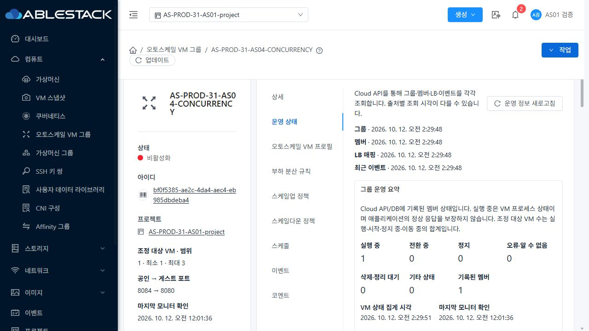
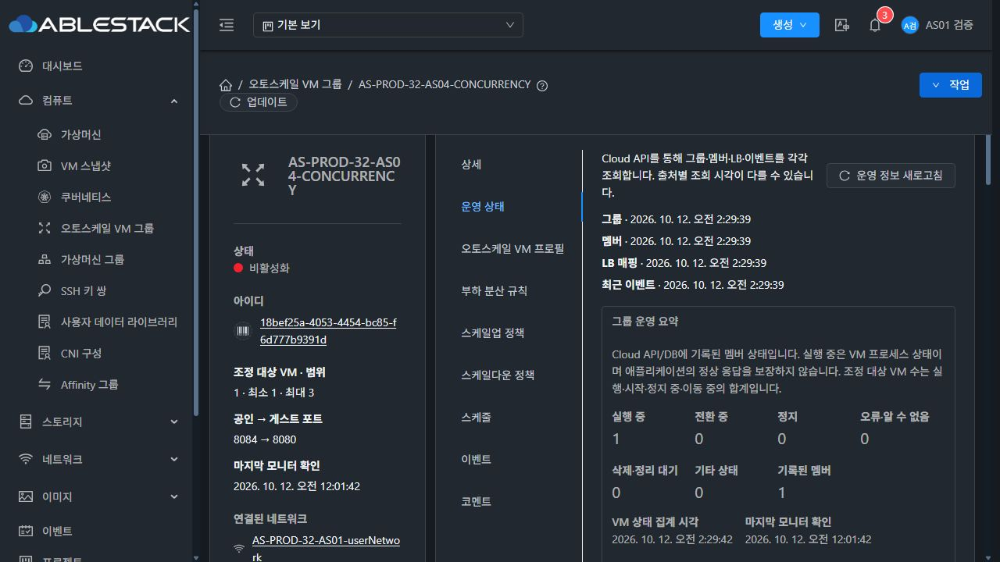

<!--
Licensed to the Apache Software Foundation (ASF) under one
or more contributor license agreements.  See the NOTICE file
distributed with this work for additional information
regarding copyright ownership.  The ASF licenses this file
to you under the Apache License, Version 2.0 (the
"License"); you may not use this file except in compliance
with the License.  You may obtain a copy of the License at

  http://www.apache.org/licenses/LICENSE-2.0

Unless required by applicable law or agreed to in writing,
software distributed under the License is distributed on an
"AS IS" BASIS, WITHOUT WARRANTIES OR CONDITIONS OF ANY
KIND, either express or implied.  See the License for the
specific language governing permissions and limitations
under the License.
-->

# AS-09 공개 검증 근거

[검증·배포·제한](../../AS-09-validation.ko.md)이 완료 판정 범위다. 계정 비밀번호·개인키·API 키·세션·UserData/비공개 프로필 원문은 제외했다. 원본 UI 캡처와 전체 빌드 로그는 로컬 검증 폴더에 보존한다.

- `test-summary.json`, `*log.txt`: 지정 테스트/변경 모듈·lint·UI build 종료 기록. 전체 CI가 아니다.
- `as09-management-artifacts.json`, `as09-ui-artifact.json`, `ui-change-isolation.json`: 소스·클래스별 해시·공통 탭 byte 격리.
- `as09-*-list-deployed-final-matrix.json`: 마지막 번들의 2테마×4폭 실제 목록 대비. 프로젝트 스위치의 수정 전 낮은 대비는 완료 자료에서 제외했다.
- `as09-*-operations-*-matrix.json`, `as09-32-condition-final-matrix.json`, `as09-32-profile-final-matrix.json`, `as09-31-creation-inputs-corrected.json`: 실제 본문/입력 대비·footer 좌표. 이 폼/운영 측정의 UI는2cbb6703이며 이후 수정한 CSS는 목록 페이지 번호/프로젝트 스위치다.
- `created-groups.json`, `running-storage-physical.json`, `new-groups-http.json`: UI 생성 뒤 API와6호스트 GFS2 Sparse/krbd 실연결·짧은 HTTP.
- `cleanup-db-final.json`, `cleanup-physical-final.json`, `support-cleanup-final.json`: UI 삭제 후 removed/Expunged·활성 참조0·물리 이미지 부재. revoke/removed LB 이력 행은 보존한다.
- `baseline-fixture-state.json`, `final-owner-inventory.json`, `final-policy-equality.json`: 기존3/4그룹·3/4VM·ROOT300/400GiB·원 프로필/CPU정책/예약 보존 및8089 잔여 방화벽 없음.
- `management-runtime-after.json`, `final-static-health.json`, `ui-deploy-*.log.txt`: 최종 JAR/PID/843정적파일/설정·서버 디렉터리 보존과HTTP200.
- `as09-31-shared-creation-success`, `as09-31-final-creation-summary`, `as09-31-vm-sparse-final`, `as09-32-vm-volumes-final`: 실제 생성 진행·요약·저장소 UI.
- `as09-32-common-events-final`, `as09-32-volume-common-details-final`, `as09-32-condition-error-final-dark`: 기존 공통 탭/입력 오류 화면.

- `as09-final-baseline-operations-contrast.json`, `as09-32-project-switch-final.json`, `as09-32-error-toast-final.json`: 마지막 번들의 운영 상태·스위치 켜짐/꺼짐·라이트/다크 오류 메시지 실제 색상.
- `as09-32-condition-error-deployed-final`: 마지막 번들에서 한국어 오류가 실제 표시된 화면 및 취소 후 기존 임계값5 보존.

## 최종 현재 Mold 화면

