<!--
Licensed to the Apache Software Foundation (ASF) under one
or more contributor license agreements.  See the NOTICE file
distributed with this work for additional information
regarding copyright ownership.  The ASF licenses this file
to you under the Apache License, Version 2.0 (the
"License"); you may not use this file except in compliance
with the License.  You may obtain a copy of the License at

  http://www.apache.org/licenses/LICENSE-2.0

Unless required by applicable law or agreed to in writing,
software distributed under the License is distributed on an
"AS IS" BASIS, WITHOUT WARRANTIES OR CONDITIONS OF ANY
KIND, either express or implied.  See the License for the
specific language governing permissions and limitations
under the License.
-->

# #1355 Mold 상단 액션 목업 v2

[배치 원칙·기존 액션 범위·승인 기준](../../AS-09-toolbar-v2.ko.md). 사용자 승인용 고정 데이터 목업이며 배포 화면이 아니다. 현재 저장소의 Vue3/AntD, 공통 ResourceLayout과 Mold 테마를 사용한다.

## 실행

WSL ext4의 현재 클론 ui에서 기존 node_modules를 사용한다. 공개 소스 디렉터리 외에 제품 코드를 바꾸지 않는다.

```bash
NODE_OPTIONS=--openssl-legacy-provider node node_modules/@vue/cli-service/bin/vue-cli-service.js serve ../docs/design/autoscale-vm-group-production-20261010/mockups/AS-09-toolbar-v2/entry.js --host 127.0.0.1 --port 18755
```

`http://localhost:18755/?tab=up&theme=light` 또는 theme=dark. tab은 operations/profile/lb/up/down/schedules다. 실제 탭으로 전환할 수도 있다. 정책/조건 대화상자는 레이아웃 예시이며 Cloud 변경 동작은 연결하지 않는다.

## 기존 액션 탭별 이미지

### 운영 상태

라이트

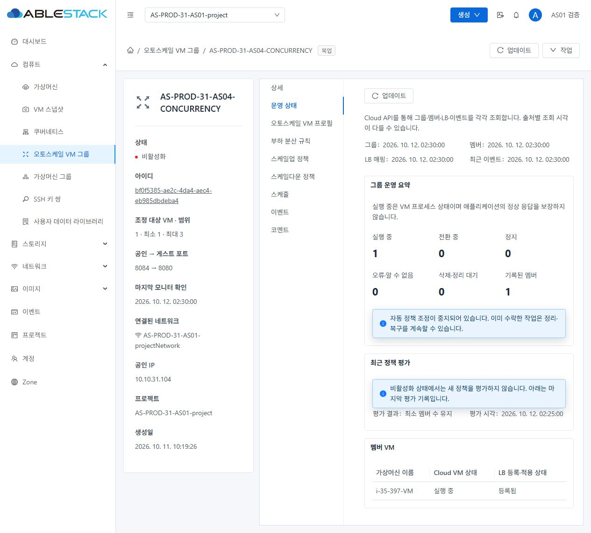

다크

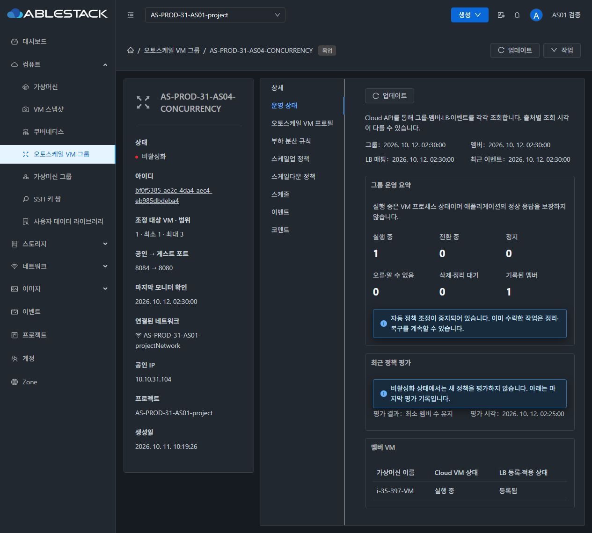

### VM 프로필

라이트

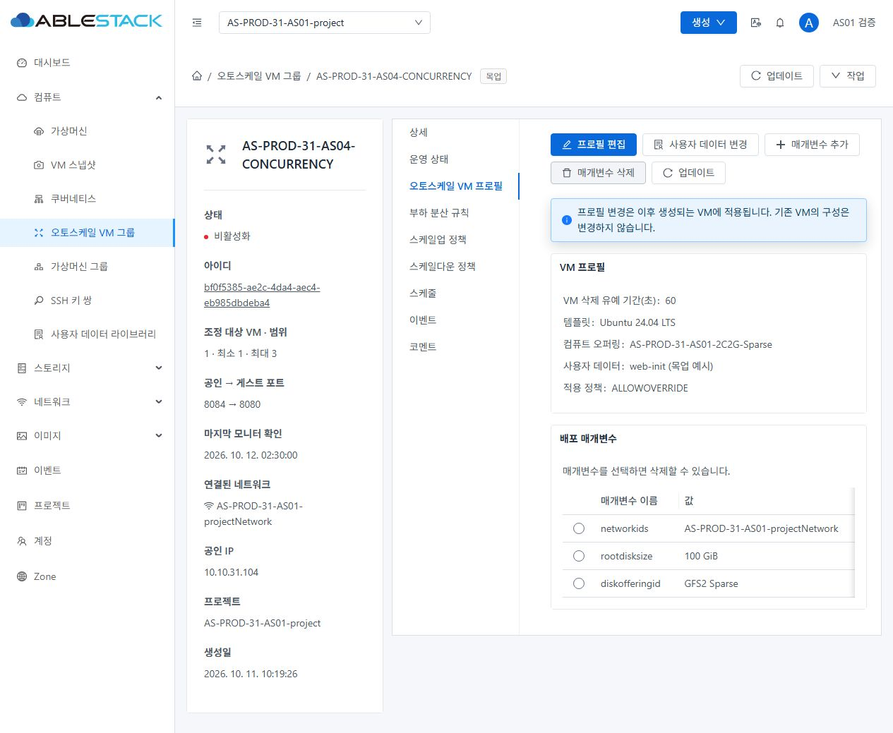

다크

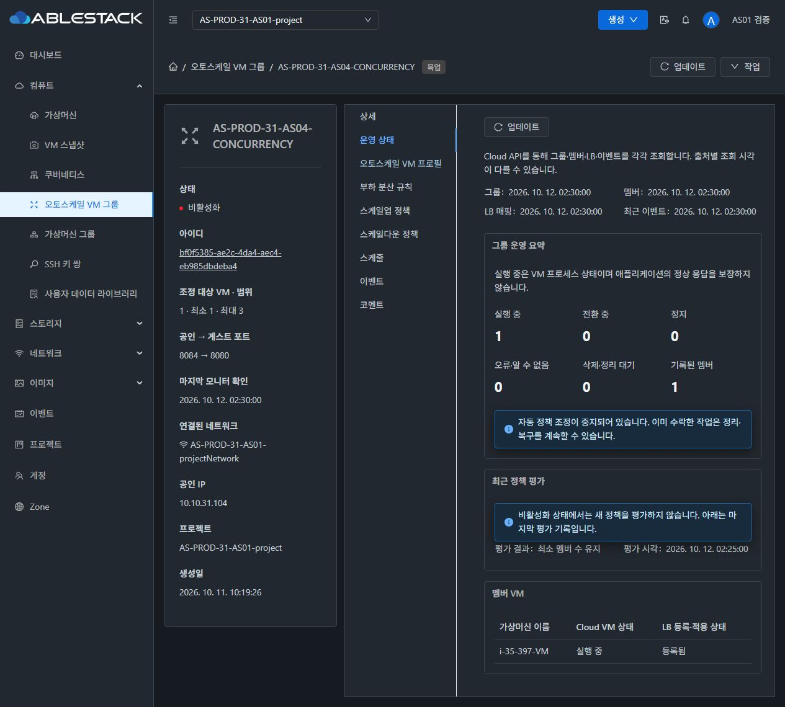

### 부하 분산 규칙

라이트

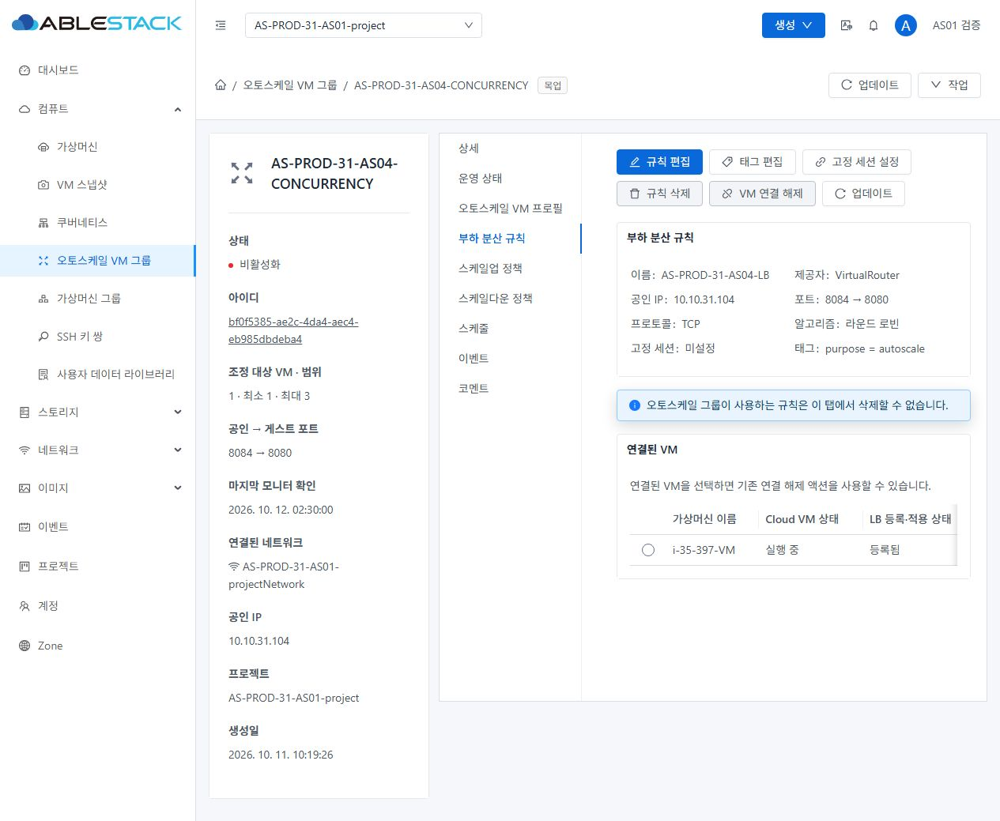

다크

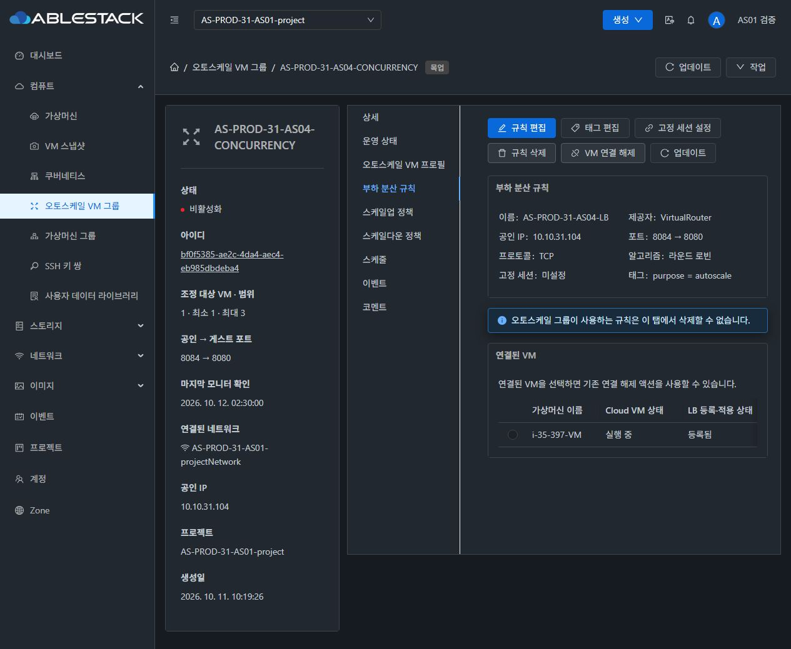

### 스케일업 정책

라이트

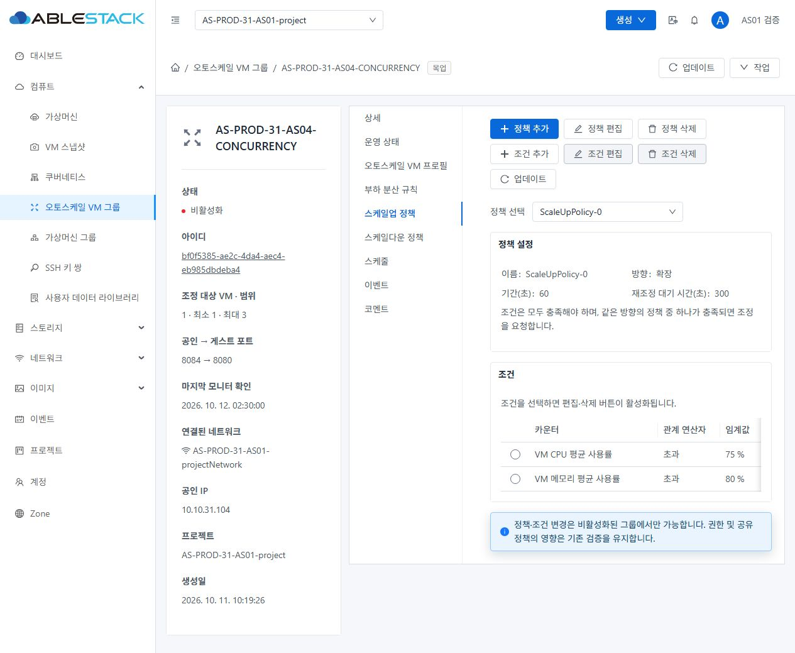

다크

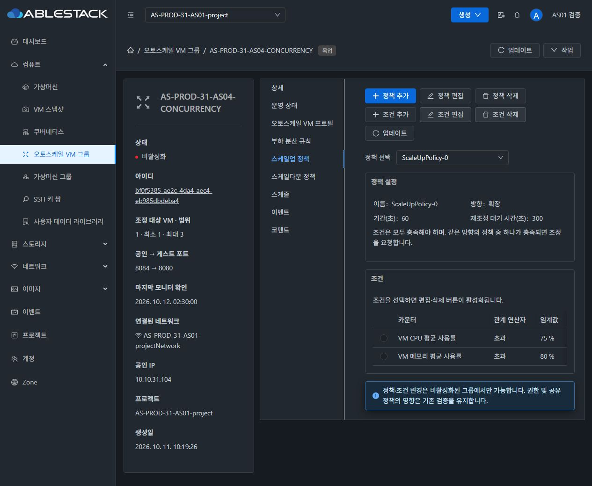

### 스케일다운 정책

라이트


다크


### 스케줄

라이트

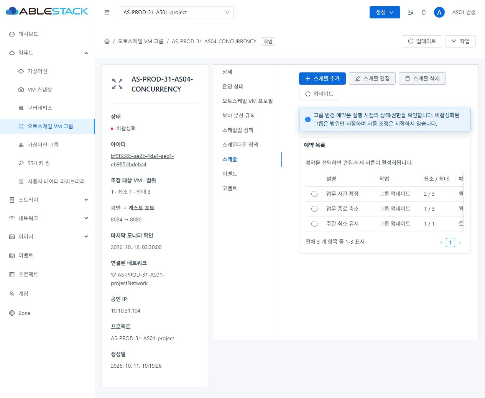

다크

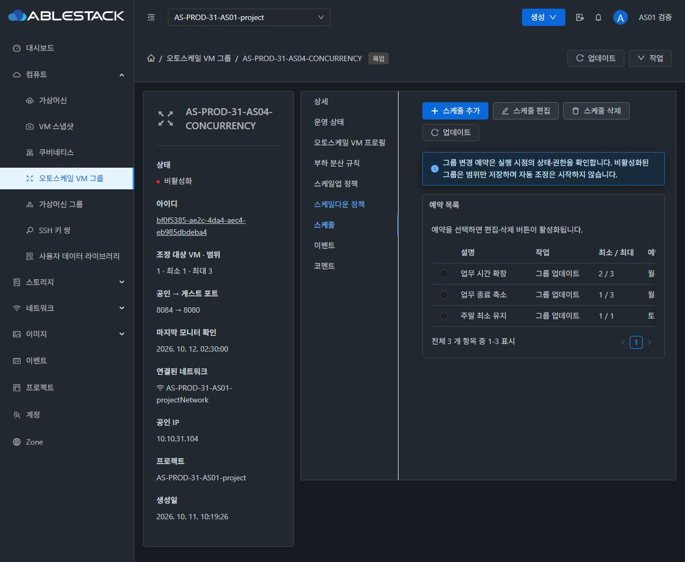

## 조건 선택 후 기존 편집·삭제 활성화 예시

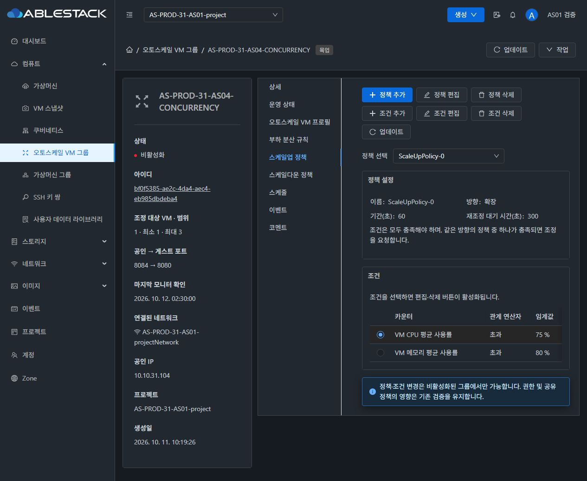

mockup-audit.json은12개 화면의 버튼 순서/아이콘/primary/간격·표본 대비, responsive-audit.json은1024/390px 줄바꿈·문서 폭, scope-audit.json은 제외 탭의 새 툴바0개를 기록한다. versions.json은 실제 런타임 라이브러리 버전이다. 이미지의 예시 정책/조건/시각은 실제 클러스터 설정값을 의미하지 않는다.

shell-audit.json은 최종 라이트/다크 헤더 사용자명·아바타·선택 메뉴의 실제 색상/대비를 별도 기록한다. 기본 검정색 상속을 보정한 최종13장으로 교체했다.
