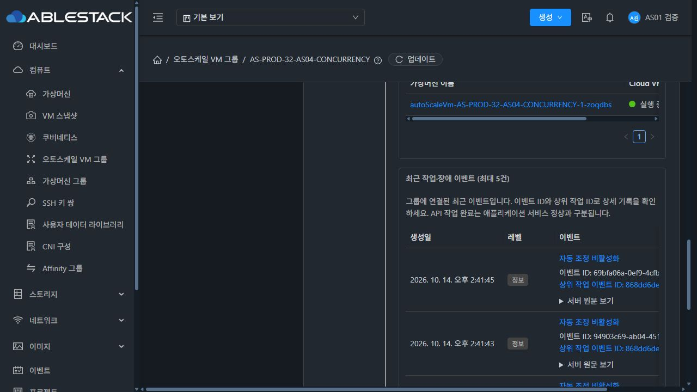
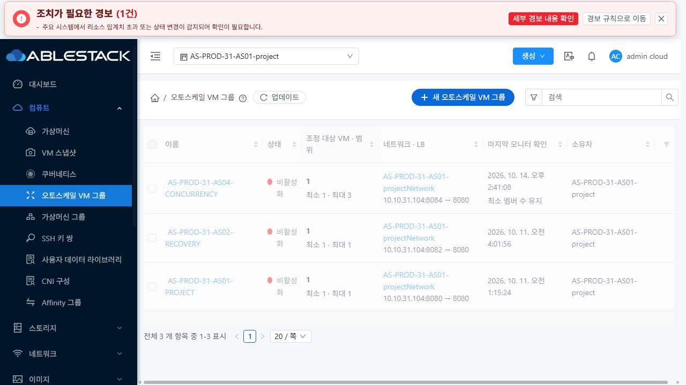
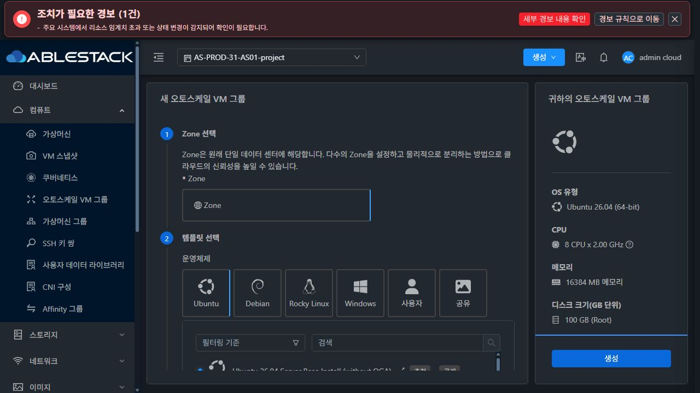

<!--
Licensed to the Apache Software Foundation (ASF) under one
or more contributor license agreements. See the NOTICE file
distributed with this work for additional information
regarding copyright ownership. The ASF licenses this file
to you under the Apache License, Version 2.0 (the
"License"); you may not use this file except in compliance
with the License. You may obtain a copy of the License at

  http://www.apache.org/licenses/LICENSE-2.0

Unless required by applicable law or agreed to in writing,
software distributed under the License is distributed on an
"AS IS" BASIS, WITHOUT WARRANTIES OR CONDITIONS OF ANY
KIND, either express or implied. See the License for the
specific language governing permissions and limitations
under the License.
-->

# 오토스케일 VM 그룹 UI 개선 검증 (#1365)

목록·상세 정보 카드·운영 상태의 VM/이벤트 링크에 남아 있던 오토스케일 전용 색상·밑줄 재정의를 제거하여 기존 VM 공통 링크 스타일을 사용한다. 생성 화면은 실제 가용 본문 높이를 측정하여 두 카드의 상단과 높이를 맞추고, 폼과 선택 정보 내용만 각각 독립적으로 스크롤한다.

## 구현

- `AutoScaleListCell.vue`, `AutoScaleOperations.vue`, `autoscale.less`: 공통 링크 스타일을 덮어쓰는 규칙 제거. 기본 밑줄 제거, 테마·hover·focus는 공통 처리 재사용.
- `CreateAutoScaleVmGroup.vue`: 오른쪽 sticky 16px 오프셋과 고정 높이 계산 제거. ResizeObserver/resize로 본문 영역 측정. 카드 제목/버튼은 고정, 내부 내용은 숨긴 스크롤바로 스크롤.
- 992px 미만은 단일 열 폼/요약과 별도 고정 버튼을 사용. Tab 이동과 검증 오류는 내부 폼 영역에서 표시하며 오류 메시지를 포함하여 중앙으로 이동.
- `InfoCard.vue`: 선택적인 scrollable 속성으로 키보드 접근 가능한 내용 영역 제공. 기본값 false로 기존 VM 화면 유지.

## 테스트 범위와 한계

- 오토스케일 관련 10개 Jest suite, 280개 테스트 통과.
- 검증 오류 위치 변경 후 생성 preflight 53개, 운영 상태 CSS 변경 후 운영 상태 31개 재실행 통과.
- 변경 Vue 파일 린트와 UI production build 통과. 일반 webpack 크기 경고는 남아 있다.
- 광범위 테스트 호출 중 기존 VM NIC 테스트 실패를 발견했다. 기준 커밋과 동일한 vmNicActions.js/spec에서 독립 재현: 2개 실패 / 12개 통과. 이 UI 변경에서 수정하지 않았다.
- 실제 UI에서는 빈 생성 폼 검증·이동·입력/요약 반영을 확인하고 유효한 VM/그룹 생성은 제출하지 않았다. 실제 생성 완료의 새 end-to-end PASS를 주장하지 않는다.
- 사용자 지침에 따라 전체 Cloud Maven/Actions 빌드를 시작하지 않는다. PR head의 [skip ci]로 pull_request 자동 전체 빌드를 방지하며 Actions 성공을 주장하지 않는다.

## 배포 중 32번 백업 공간 문제

초기 helper가 webapp 전체를 백업하면서 webapp에 있던 약 29GB monitoring-vm.qcow2도 복사했다. 후속 배포 시 백업 단계에서 공간 부족으로 중단되었으며 새 정적 파일 복사 전이었다. 이번 작업이 만든 두 백업의 QCOW2 복사본만 정리하고 약 32GB 공간을 복구했다. 원본 이미지의 크기·mtime·inode·할당 크기가 그대로임을 확인했다. helper를 영향받는 정적 파일과 서버 설정만 백업하도록 수정하고 재배포했다. 원본 이미지, WEB-INF, config와 관리 PID는 유지됐다.

## 빌드·배포 식별

- 기준 Europa: `8e450f5c716b6532f5b574ab9ccb5197155c350e`.
- 빌드 소스: `7df7134962d366e53657f981e0b165976d93fb6c`. 이후 문서 커밋은 UI 소스를 변경하지 않는다.
- WSL ext4의 dhslove 작업 브랜치 `codex/issue1365-autoscale-ui`에서 Node 20.20.2와 `NODE_OPTIONS="--openssl-legacy-provider --max-old-space-size=6144" npm run build` 사용.
- 산출물 `ui-issue1365-7df7134962d3.tgz`, SHA256 `cd9bcd9c17201e9ce48d9675ad0054befc87768ffec8a244f1501991009d5156`.
- 활성 번들 `app.3d2c3ab2.js`. 두 서버에서 실제 로드된 번들을 확인했다.

| 클러스터 | 백업 경로 | 배포 검증 파일 | 관리 PID 전/후 | 서비스 / client HTTP |
| --- | --- | --- | --- | --- |
| 31 | `/root/issue1365-ui-20261014-170230` | 849 | 834619 유지 | active / 200 |
| 32 | `/root/issue1365-ui-20261014-170240` | 849 | 1293012 유지 | active / 200 |

정적 UI 파일만 갱신하고 `index.html`은 마지막에 교체했다. 기존 `config.json`, `WEB-INF` 파일의 hash와 관리 PID를 전/후 비교했다. 31의 config는 `/etc/cloudstack/management/config.json`에 대한 symlink여서 정적 자산 경로 검사에서 한 번 배포가 중단됐다. config를 별도 백업/보존하도록 처리한 후 재시도했으며 서버 설정과 symlink는 바꾸지 않았다.

## 실제 UI 확인

31의 AS-PROD-31-AS01-project와 32 일반 사용자에서 확인했다. 31은 라이트/다크, 32는 기존 다크 테마를 검증했다. 테스트용 테마와 화면 크기 변경은 종료 후 복원했다.

| 확인 대상 | 실제 결과 |
| --- | --- |
| 목록 / 상세 정보 카드 | 그룹·프로젝트·네트워크·공인 IP·도메인 링크 기본색 rgb(24,144,255), 밑줄 없음 |
| 운영 상태 | 31·32 VM, 이벤트, 상위 이벤트 링크 모두 같은 파란색, 밑줄 없음 |
| 부하 분산 규칙 | 31 라이트 / 32 다크의 멤버 VM 링크 파란색, 밑줄 없음 |
| 기존 VM과 비교 | 기존 VM 정보 카드 링크도 같은 기본색. 네트워크 링크의 실제 hover는 양쪽 rgb(64,169,255), 밑줄 없음. focus는 같은 기본색/outline none |
| 실제 링크 이동 | 31 AS 정보 카드 → 해당 네트워크, 32 운영 상태 → 해당 VM의 키보드 Enter 이동 확인 |
| 두 생성 카드 | 31·32 1280×720에서 top 차이 0px / 높이 차이 0px, 외부 본문 overflow 0px |
| 독립 스크롤 | 폼 PageDown 390px일 때 정보 패널 0px, 이어서 정보 패널 351px일 때 폼 390px 유지. 휠은 폼 200px / 정보 0px → 폼 200px / 정보 200px. 외부 본문은 모두 0px |
| 다양한 화면 크기 | 실제 DOM viewport 1280×720, 1440×900, 1920×1080, 1024×576, 768×768, 375×812 확인. 992px 미만은 단일 열, 생성 버튼 노출 유지. 본문 overflow 0px |
| 맨 아래 접근 / 검증 오류 | 375px에서 End로 폼 scrollTop 4927px, 외부 본문 0px. 첫 오류 메시지가 폼 영역 안에 표시됨. Tab 이동도 내부 스크롤만 이동 |
| 입력·요약 반영 | 임시 그룹 이름 입력을 우측 요약에 즉시 반영. 빈 폼 제출 검증에서 create/deploy API 요청 없음 |
| 원본 자원 | 7개 그룹 Disabled, 원본 7VM Running / 7ROOT Ready·100GiB·동일 ID, min/max·프로필·LB ID 유지. 각 그룹 멤버/LB 매핑 1개 유지. 앱 7개 현재 HTTP 200 |

화면 크기 검증은 브라우저의 CSS viewport를 실제로 변경하고 DOM의 width/height와 패널 위치를 확인한 결과다. 운영체제 터치패드 실물 입력이나 브라우저 메뉴의 확대율 변경 자체를 별도로 검증하지 않았다. 마우스 휠·키보드와 좁아진 가용 영역 검증을 구분하여 기록한다. 앱 HTTP 200은 최종 시점 표본이며 새로운 장시간 무중단 관찰 결과가 아니다.

[정리한 측정값과 배포 결과](evidence/verification.json)

### 운영 상태의 VM·이벤트 링크

### 목록 링크와 생성 패널

