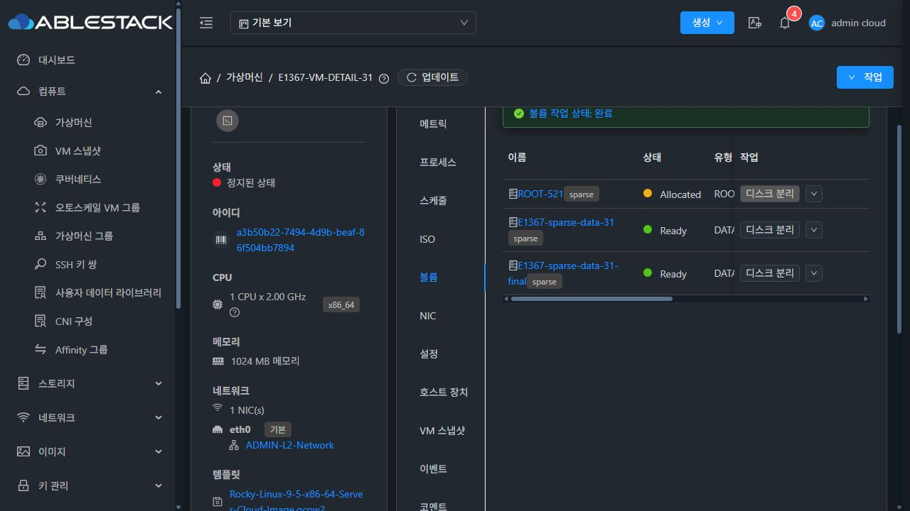
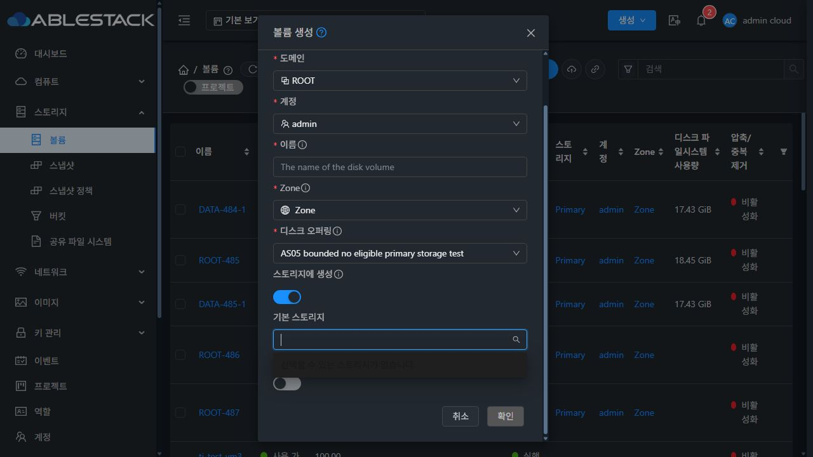

<!--
Licensed to the Apache Software Foundation (ASF) under one
or more contributor license agreements. See the NOTICE file
distributed with this work for additional information
regarding copyright ownership. The ASF licenses this file
to you under the Apache License, Version 2.0 (the
"License"); you may not use this file except in compliance
with the License. You may obtain a copy of the License at

  http://www.apache.org/licenses/LICENSE-2.0

Unless required by applicable law or agreed to in writing,
software distributed under the License is distributed on an
"AS IS" BASIS, WITHOUT WARRANTIES OR CONDITIONS OF ANY
KIND, either express or implied. See the License for the
specific language governing permissions and limitations
under the License.
-->

# VM 상세 탭 갱신 및 스토리지 태그 필터 개선 검증 (#1367)

## 변경과 원인

- 스케줄: 성공한 빈 목록도 VM·사용자 조회 완료 범위를 기억해 후속 갱신의 표 마스크를 표시하지 않는다. 같은 행은 배열 교체를 생략한다.
- 호스트 장치: 최초 조회와 갱신 표시를 분리하고, 보이는 탭만 공통 10초 자동 조회를 사용한다. 작업 직전 새 조회·호스트/상태/스냅샷·파티션 확인은 유지한다.
- 볼륨: ROOT 1행은 원래 표 로딩 마스크를 재현하지 못했다. 실제 원인은 스냅샷 재검증마다 `미확인` 경고가 생겨 표가 328px에서 402px로 이동하는 것이다. 이전 조회 결과는 화면에 유지하되 재검증 중 작업을 차단한다. 조회 실패 후에는 미확인 안내와 차단을 표시한다.
- 읽기 실패: 공통 API 처리기의 네트워크 오류 로그아웃 경로를 실물 검증에서 확인했다. 이번 범위의 조회에 기존 `preserveOnFailure` 옵션을 적용하여 실패 표시/재시도를 탭이 처리한다. 현재 세션 401은 기존대로 로그아웃한다. 공통 API 처리기의 다른 호출 정책은 바꾸지 않았다.
- 기본 스토리지: 모든 페이지를 수집한 다음 Up 상태와 디스크 오퍼링의 일반 태그 전체 일치를 확인한다. 공백/중복/부분 문자열/후보 없음·오래된 선택·늦은 Zone 응답을 처리한다. 지원하지 않는 API 인자를 추가하지 않았다.
- 규칙형 태그는 서버 `GenericRuleHelper`의 규칙 실행 계약이다. 현재 listStoragePools에는 규칙 평가 결과 조회가 없다. 요구 태그가 있을 때 규칙형 pool을 임의로 일치 처리하지 않고 수동 후보에서 제외하며, 서버 자동 배치 경로를 안내한다. 브라우저 규칙 실행 및 백엔드 변경은 없다.
- 스냅샷 생성 경로는 기존대로 수동 스토리지 선택을 숨긴다. 이 경로를 임의의 기본 오퍼링 태그로 필터하지 않는다.

## 소스·로컬 검증

최신 upstream Europa `5c07cb2142192ba2518ad21c92994bea23de6034`를 기준으로 dhslove의 별도 WSL ext4 작업 폴더에서 구현했다. 원래 FTCTL 작업 폴더는 수정하지 않았다.

- 변경 범위 Jest 9개 suite / 102개 테스트 통과.
- Vue/유틸리티/테스트 린트 통과.
- WSL UI 빌드 완료. 소스 `9b5435d3a7c85981a5ac61f52611bb47c8e7a523`, 활성 번들 `app.6c866dc6.js`.
- 아카이브 SHA-256 `ab51ed657657816b3b690f3a6ca603ae1b650e05f39f185245c5aa15186dba17`. 850개 파일 중 서버 설정을 제외한 849개 배포 파일의 해시를 대조했다.
- 전체 Cloud 빌드·GitHub Actions 전체 빌드는 실행하지 않았다. 사용자 요청 범위는 UI 빌드이며 PR head에 [skip ci]를 사용한다.

## 실제 배포 및 화면 검증

| 검증 | 최종 결과 |
| --- | --- |
| 31 관리자·32 일반 사용자 / 스케줄·볼륨·호스트 장치 | 각 탭의 반복 조회에서 같은 표 DOM 유지, 표 spinner/blur 0, 행 수 유지. 800ms 브라우저 지연 조건의 요청 중 위치가 일정했다. |
| 빈 목록과 실제 행 | 32 빈 스케줄·양쪽 빈 장치·31 스케줄 1행·31 볼륨 2행·32 ROOT 1행을 확인했다. |
| 볼륨의 이전 반복 경고 | 재검증 중 미확인 안내를 새로 삽입하지 않아 이전 74px 위치 변동이 사라졌다. 실제 검증 실패의 경고는 표시한다. |
| 스케줄 데이터 변경 | 비활성 검증 예약의 설명 수정 후 같은 행 DOM으로 갱신됨. 검색어 E1367 및 페이지 크기 20 유지. |
| 세 탭의 조회 실패/재시도 | 각 조회 XHR만 실패시켜 기존 행·빈 목록·표 DOM·로그인 세션 보존, 실패 안내, 정상 재시도 시 안내 해제를 확인했다. |
| 스냅샷·호스트 장치 안전성 조회 실패 | 생성/연결·장치 변경 버튼 차단. 기존 행은 유지하고 성공으로 표시하지 않음. |
| 일반 볼륨 생성 / 태그 불일치 | 기존 UI는 as05-no-eligible-storage-pool 요구에 glue-gfs Primary를 표시했다. 최종 UI는 후보 0개와 확인 버튼 비활성 상태를 표시한다. |
| 일치 → 불일치 오퍼링 전환 | 선택된 Primary가 자동 해제되고 제출이 차단됨. |
| 스토리지 조회 실패 | 입력한 이름·크기와 세션 유지, 목록 실패 안내 및 선택 비활성. 확인 클릭에도 createVolume 요청 0건. 스위치 off/on 재시도 후 정상 조회됨. |
| 최종 번들 실제 생성·연결 | 31 별도 VM에서 Custom-GFS-Sparse → Primary → 1GiB → Device ID 7. createVolume/attachVolume 각 1회, UI 완료 및 API Ready·연결 VM/스토리지 ID 일치. |
| 32 권한 및 열린 입력 | 일반 사용자 생성 대화상자에 관리자용 스토리지 선택 스위치가 없음. 열린 대화상자의 이름·크기 입력이 유지됨. 제출 없이 닫음. |
| 배포 안전성 | 31 PID 834619 / 32 PID 1293012 유지, mold active, /client/ HTTP 200, WEB-INF 및 config 보존. JAR 배포/서비스 재시작 없음. |

800ms는 실제 서버 지연 측정이 아닌 브라우저 재현 조건이다. XHR 실패도 해당 브라우저 조회만 대상으로 했다. 전체 브라우저 오프라인 시도에서 기존 공통 API의 로그아웃 경로를 발견했으며 이를 PASS로 기록하지 않았다. 이후 이번 범위의 읽기에 기존 preserveOnFailure 계약을 적용하고, 최종 번들에서 특정 조회 실패와 복구를 위와 같이 재검증했다. 전체 앱의 다른 API 호출 정책은 수정하지 않았다. 임시 지연·가로채기 설정은 모두 복원했다.

다중 태그·태그 없음·태그 없는 pool·부분 문자열·여러 페이지·페이지 누락·늦은 Zone 응답은 단위/컴포넌트 테스트로 검증했다. 현재 두 클러스터는 각각 pool 1개로, 여러 pool/페이지의 실물 검증은 수행하지 않았다. 규칙형 태그는 수동 후보 제외/서버 자동 배치 안내 계약을 테스트했으며 실제 규칙형 pool은 두 클러스터에 없다. 스냅샷 경로의 수동 선택 숨김은 컴포넌트 회귀 테스트이며 실제 스냅샷 기반 볼륨 생성은 수행하지 않았다. 검증 VM은 Stopped 상태로 게스트 I/O 테스트는 포함하지 않는다.

## 검증 자원 및 보존

- 31: E1367-VM-DETAIL-31, ROOT sparse 100GiB, 정지 상태. 스케줄 1건은 disabled이며 미래 시작일이다.
- 32: E1367-VM-DETAIL-32, 일반 사용자 소유, RBD ROOT 100GiB, 정지 상태.
- 31 원본 R10-Sparse/ROOT-14의 ID·상태·크기는 변경 전후 동일했다.
- GFS2 Thin은 생성하지 않았다. 31 실제 데이터 디스크 검증에는 Custom-GFS-Sparse를 사용한다.

검증 VM 두 대와 31의 1GiB Sparse 데이터 디스크 두 개(Device ID 6·7)는 검토용으로 보존한다. 두 VM은 Stopped이며 검증 예약은 Disabled다. 첫 디스크는 이전 검증 빌드, 두 번째는 최종 빌드에서 생성·연결했다. 정지 VM의 ROOT는 초기 Allocated 상태를 유지한다.

## 증거

[evidence/verification.json](evidence/verification.json)에 최종 아카이브·배포·조회·실패/회복·VM/볼륨 상태를 기록했다. 원본 로그 대신 필요한 값만 보존했다. 비밀번호·API 키·세션키·개인 키·전체 UserData는 포함하지 않는다.
