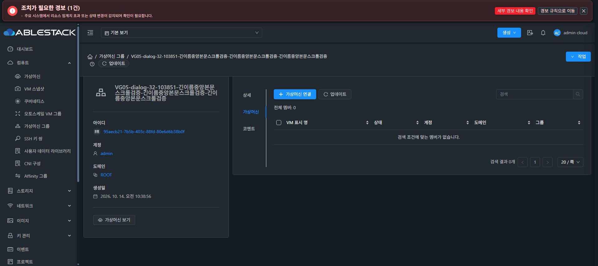
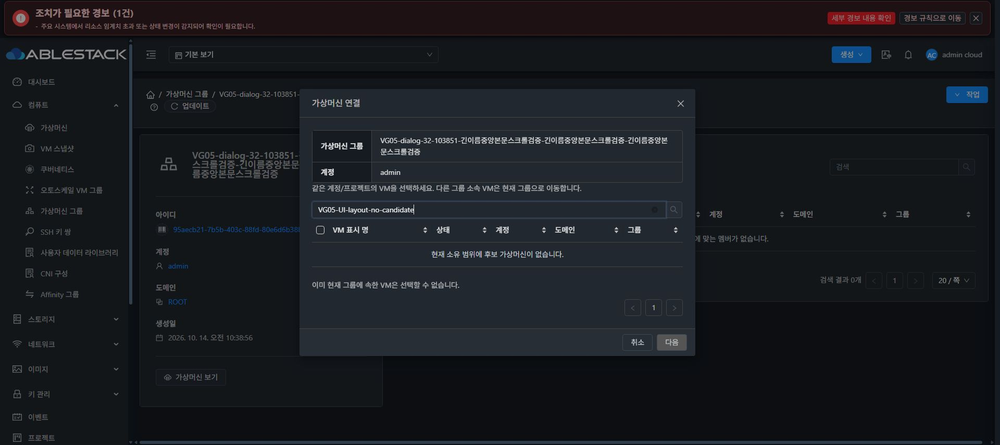

# VG-05 탭 배치·멤버 대화상자 후속 수정

## 변경

- 멤버 탭 상단에 액션 버튼을 왼쪽, 검색을 오른쪽에 배치했습니다. 검색 너비는 기존 VM 탭과 같은 280px이며 좁은 화면에서는 버튼 다음 행으로 이동합니다. 전체 멤버·상태 요약은 툴바 아래에 표시합니다.
- 멤버 목록과 연결 후보 목록의 페이지네이션은 기존 Ant Design Vue 스타일·페이지 크기 옵션을 유지하며 오른쪽에 정렬합니다.
- 멤버 대화상자는 기존 VM 일정 대화상자의 중앙 배치·높이 제한 방식을 적용합니다. 화면 가장자리 여백을 확보하고 헤더·푸터는 축소하지 않으며 본문만 스크롤합니다.
- 상단 정보에는 그룹 이름과 계정명만 각각 한 행에 표시합니다. 그룹 UUID와 도메인 표시를 제거하고 긴 이름은 영역 안에서 줄바꿈합니다.

## 소스와 검증

- 최종 UI 소스: `5046c5c8cf15792b53085bb26478f538382f8183`. 탭 배치 `dc05633d1d0`, 대화상자 중앙 배치 `bd96ff50ff3`, 긴 이름의 계정 행 분리 `5046c5c8cf1`을 누적했습니다.
- 최종 변경 파일 lint·UI 운영 빌드 PASS. 기존 멤버 기능 회귀 검사 **1 suite/10 tests PASS**. 전체 Cloud 빌드·GitHub Actions를 시작하지 않았으며 기존 Browserslist·번들 크기 경고는 남습니다.
- 31 라이트·32 다크의 데스크톱과 390px 화면에서 **17개 대표 배치·대화상자 검사 PASS**. 버튼/검색 위치, 요약 순서, 기존 페이지 버튼 32px·테두리 1px·모서리 4px 유지, 연결 후보 우측 페이지네이션·실제 2페이지, 긴 한글 그룹 이름·계정명 표시를 확인했습니다.
- 대화상자는 사용 가능한 뷰포트 중앙에 배치됩니다. 후보 20개에서도 화면 안에 들어가며 본문만 스크롤하고 제목/푸터 좌표와 바깥 래퍼 scrollTop=0을 유지했습니다. 390px에서 폭358px·높이796px, 상단24px·하단820px로 844px 화면 안에 배치됩니다.
- 관련 API 요청 표본64건은 이 후속 수정의 여러 빌드에 걸친 누적 표본입니다. 브라우저의 VM 소속 변경 요청은0건입니다. 검색·갱신·페이지 크기10·연결 후보 페이지2와 검색 빈 결과를 확인했습니다.
- 두 서버 모두 최종 정적 파일 **849개 해시 일치**, WEB-INF·config·JAR·PID 보존, 기존 FTCTL marker·새 대화상자 marker 존재, mold active·HTTP200을 재확인했습니다. JAR/프로세스 재시작은 없습니다. 최종 정적 롤백 백업은 각1개이며 가용 공간31 326.5GiB/32 31.4GiB입니다.
- 전용 빈 그룹4개를 API로 정리했습니다. API 목록에서 사라지고 DB의 대상 활성 그룹과 새 그룹의 매핑은0입니다. 삭제 이력 행의 removed 시각은 정상 보존됩니다. 브라우저의 캐시/뷰포트 임시 설정은 복구했습니다.

[UI 좌표·스크롤·요청 근거](evidence/VG-05/layout-followup/ui-evidence.json), [빌드 요약](evidence/VG-05/layout-followup/build-summary.json), [31 최종 상태](evidence/VG-05/layout-followup/final-verify-31.json), [32 최종 상태](evidence/VG-05/layout-followup/final-verify-32.json)

공개 대화상자 화면은 실제 검색 빈 결과를 사용했습니다. 후보20개를 표시한 상태의 높이·스크롤은 위 JSON의 desktop/mobile 측정값으로 기록하며 기존 VM 이름이 포함된 전체 후보 화면은 로컬 검증 자료에만 보관합니다.

## 범위

전용 빈 그룹과 기존 VM의 읽기 전용 연결 후보 조회로 배치·스크롤·검색·페이지 이동을 검증했습니다. 기존 VM의 소속·전원·볼륨은 변경하지 않았습니다. 이번 후속 수정의 Maven/JAR 변경은 없으며 전체 Cloud 빌드·전체 CI를 실행하지 않았습니다. 기존 VG-05 멤버 변경·권한 검증과 그 제한은 [기존 보고서](VG-05-validation.ko.md)에 보존합니다. 최종 종합 회귀 VG-06과 Epic PR의 Draft 상태를 유지합니다.
