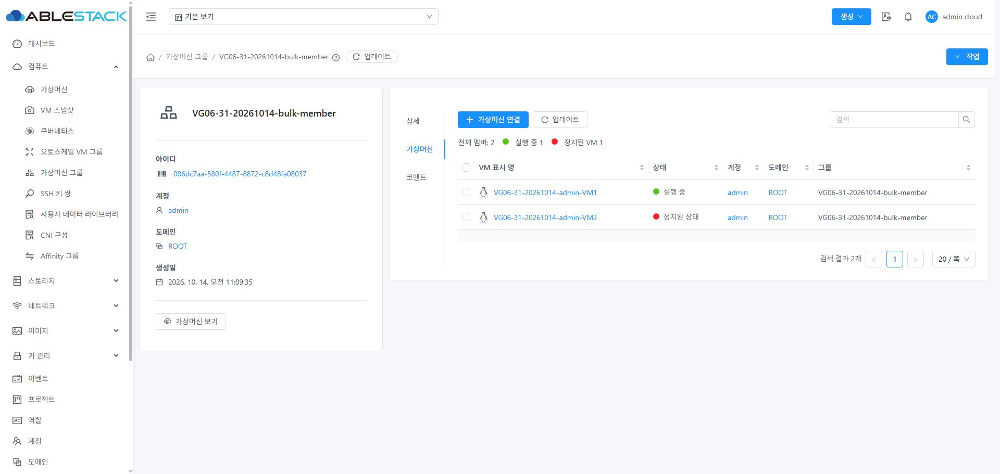
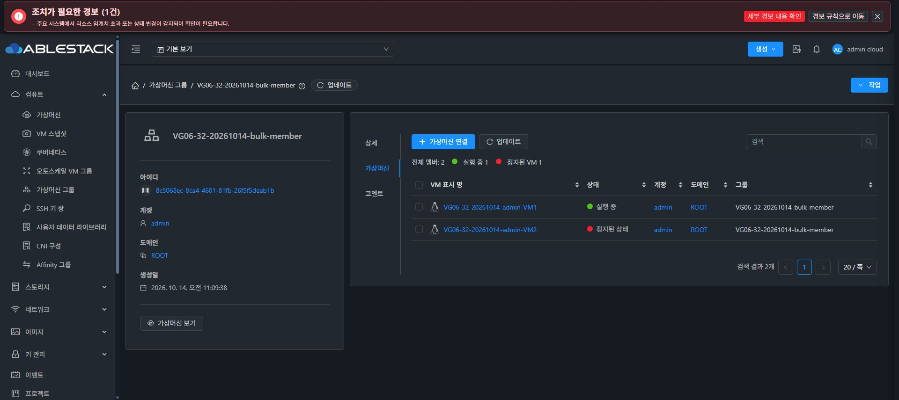
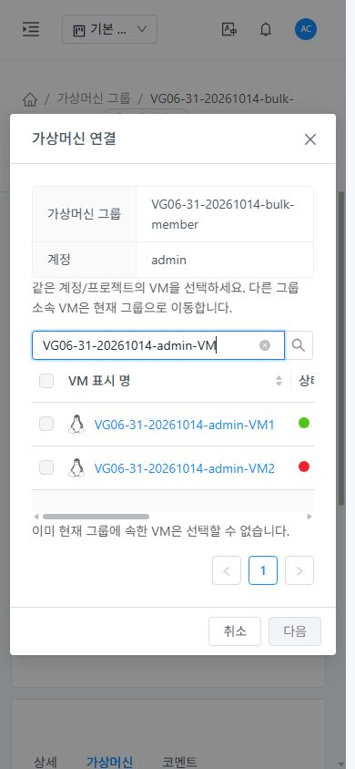
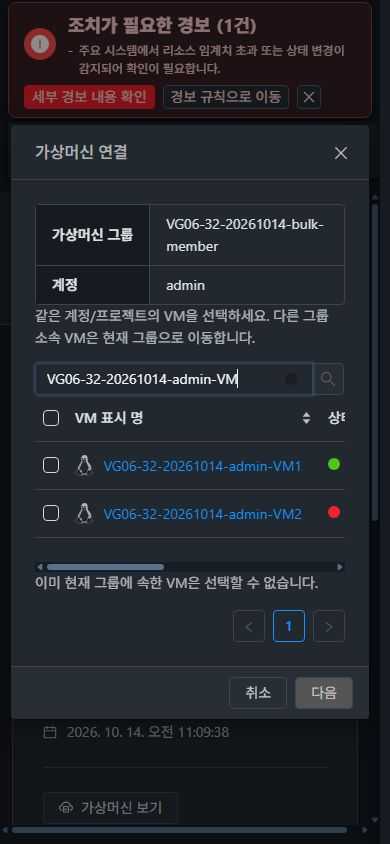
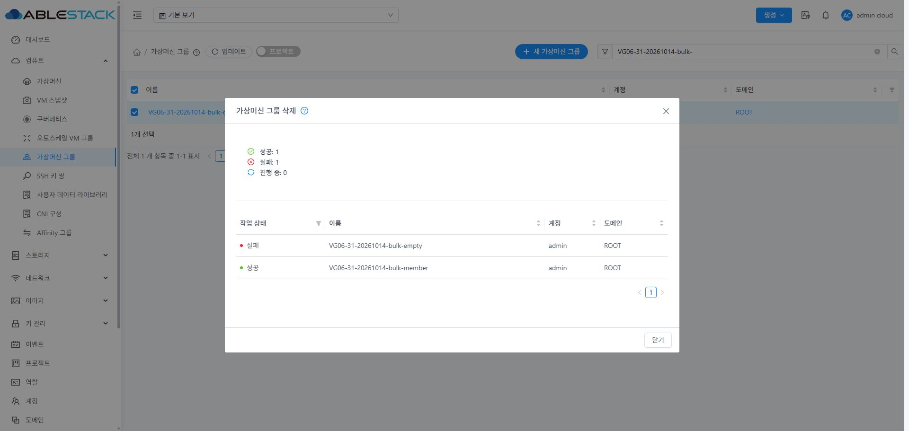
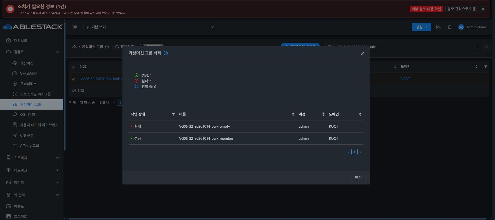

# VG-06 가상머신 그룹 최종 회귀 검증

검증일: 2026-10-14. 대상: 클러스터 31·32. 이슈 [#1363](https://github.com/ablecloud-team/ablestack-cloud/issues/1363), Epic [#1357](https://github.com/ablecloud-team/ablestack-cloud/issues/1357), 누적 PR [#1364](https://github.com/ablecloud-team/ablestack-cloud/pull/1364).

**판정: 아래 필수 기능 행렬, 자원 보존, 전용 자원 정리 PASS. 전체 Cloud 빌드·전체 CI는 미실행.**

## 설계와 구현

`VG-06-design.ko.md`의 전용 대상·오류 주입·복원 기준으로 VG-01~05의 실제 UI를 API·DB·하이퍼바이저 상태와 대조했다. 기존 VM은 소속 변경 시험 대상으로 사용하지 않았다. API/DB 계약·경합 CLI와 9개 안전성 테스트를 추가했다. CLI는 31/32, VG06 이름 범위, UUID와 실제 현재 이름을 확인하고, 자원/매핑/소유권/FTCTL 상태를 대조한다. 비밀번호는 환경 변수로 받고 SSH/DB 비밀번호를 명령행 인자로 보내지 않는다. 인증 자료와 실제 manifest는 공개하지 않는다.

실제 UI에서 발견한 세 부분을 수정했다.

1. 프로젝트 그룹 API가 계정을 생략할 때 대화상자가 비어 있었다. 로그인 사용자 아이디로 표시하고 계정 그룹은 자원 소유 계정을 표시한다.
2. 혼합 목록의 일반 그룹이 `/project/undefined` 링크를 만들었다. 유효한 프로젝트 UUID와 라우트가 있을 때만 링크를 만든다.
3. 멤버 조회 권한 오류에서 이전 집계가 남았다. 권한 오류/VM 조회 권한 부재 상태에서는 집계·행·선택을 숨기고 작업을 차단한다. 정상 조회 후 복구한다.

공통 VM 상세 탭/컨텐츠 패턴과 `ListView`를 사용한다. 버튼은 상단 좌측, 검색은 우측, 집계는 버튼 아래, 페이지네이션은 우측이다. 연결 대화상자는 가운데에서 본문만 스크롤하며 상단 정보는 그룹 이름·사용자 아이디만 표시한다. 정상 조회 완료 리본은 없다.

## 소스·검증·배포

| 항목 | 근거 |
| --- | --- |
| 최신 Upstream | `9fa65ce2a27b977e848440cb7c787411c11d585b`, 시작/종료 시 확인·Epic 브랜치에 포함 |
| 작업 브랜치 | `codex/epic-1357-vm-group-ui`, dhslove WSL ext4 소스 |
| API/server 빌드 소스 | `44b5c8c7d1bf8167efb1943c780bf5e68c903e7a` |
| 최종 UI 배포 소스 | `df54d81d7bc051f8128e08cd03aa6b7b0896ee11` |
| 변경 Maven 모듈 | api/server 각각 clean install PASS, 전체 Cloud 빌드 미실행 |
| Java / RAT / Python | API 12+server 56=68 PASS, api/server RAT PASS, Python 9 PASS |
| UI | 17 suite/235 PASS(17c4151), 최종 집계 수정 뒤 해당 컴포넌트 13 PASS(df54d81), 변경 파일 lint·최종 production build PASS |
| 실제 API/DB | 계약 21개+경합 10개/클러스터 PASS, 자원 보존·매핑 복원 |
| 실제 배포 | Epic 클래스 57개+Spring XML 1개, UI 정적 파일 849개 전체 빌드 바이트/SHA256 일치 |

최종 추가 수정은 UI/테스트에 한정돼 API/server 빌드 클래스는 계속 동일하다. 기존 JAR의 Epic 대상 58개 항목만 갱신하고 나머지 항목은 보존했다. 31/32의 기존 전체 JAR·버전 메타데이터가 달라 전체 서버 버전이 동일하다고 추정하지 않았다.

활성 `/usr/share/cloudstack-management/webapp`의 정적 자산만 갱신했다. WEB-INF, 기존 META-INF 유무, config.json을 보존했다. 최종 UI 배포에서는 JAR/PID를 유지했다. 기존 Epic 배포 데이터/백업·stage를 정리하고 이번 UI 복구 백업 한 개씩을 보관한다. 새 빌드 JS에서 FTCTL `blockingLoadingState`, `fetchSyncProgress`, `extractJobId`와 그룹 삭제 표식을 확인했다. qemu/FTCTL 소스·패키지·타이머는 변경하지 않았다.

| 최종 상태 | 31 | 32 |
| --- | --- | --- |
| mold / client | active / HTTP 200 | active / HTTP 200 |
| PID | 834619 | 1293012 |
| WEB-INF / META-INF | 존재 / 원래 없음 | 존재 / 원래 없음 |
| 여유 공간 | 325.9 GiB | 31.4 GiB |
| index SHA256 | `7017481f75e3d75634399db6560f6b1db7d97a13fcf21b0a3cf5dcb6e2defce1` | 동일 |
| JAR SHA256 | `b7cb2cf969589e837466e4a1b22c2665cb0c6d107196fbfbba2aa015f266f65f` | `626e11add02f429548df6d4ad366608dedebf2d878802f698d9fc274bf79e088` |

## UI·API·DB 필수 행렬

각 클러스터에서 기본 그룹 33개, VM 5개(Running 1·Stopped 4), L2 네트워크 4개, 계정 2개, 프로젝트 1개를 만들었다. 생성 UI 최대 길이 시험에서 그룹 1개를 추가했다. 그룹 조회 불가·쓰기 불가·VM 조회 불가의 제한 역할 3종을 검증했다.

| 항목 | 31 | 32 | 결과 |
| --- | --- | --- | --- |
| 관리자 무소속→A→B→무소속 | PASS | PASS | Running 1·Stopped 1 VM, 실제 확인 제출, 매핑 0/1·상태 집계 일치 |
| 관리자 타계정·일반 사용자 | PASS | PASS | 소유 VM만 후보, 일반 사용자 전체 연결/이동/해제와 단계별 DB 대조 |
| 프로젝트 전환·동일 이름 | PASS | PASS | 사용자 로그인·프로젝트 A→B→해제, 동일 이름 소유 범위 격리·소유 외 API 접근 거부 |
| 그룹 조회 권한 없음 | PASS | PASS | 입력 비활성화, 표시명 저장은 그룹 인자 미전달·기존 소속 유지, 표시명 UI 복구 |
| 쓰기·VM 조회 권한 없음 | PASS | PASS | 쓰기 API 432 거부, 집계 API 미반환·UI 집계/행 숨김 |
| 이름 생성·변경 | PASS | PASS | 빈 값/공백/256자 거부, 255자 한글·공백 정규화·중복 거부·오류 입력 유지 |
| 미변경·서버 실패 안내 | PASS | PASS | 미변경 POST 0건, 실제 431 중복 한국어 안내, 서버 오류 재시도 |
| 빈 그룹 단건 삭제·취소 | PASS | PASS | 취소 유지와 실제 UI 최종 제출·그룹 제거 |
| 멤버/코멘트 포함 삭제 | PASS | PASS | 매핑 2·코멘트 1→0, VM/볼륨/전원/호스트 보존 |
| 일괄 삭제·취소·부분 실패 | PASS | PASS | 빈/멤버 그룹 2개 최종 제출, 성공 1/실패 1 구분 |
| 일괄 재시도 | PASS | PASS | 실패 그룹만 재선택·POST 1건, 성공 그룹 재요청 없음 |
| 멤버 부분 실패·재시도 | PASS | PASS | 한 VM 실패/한 VM 완료, 실패 VM만 POST 1건 재실행 |
| 이동/삭제·동일 VM 동시 쓰기 | PASS | PASS | 실제 병렬 요청 두 종류 각 5회, 고아/중복/다른 소유 매핑 0 |
| 문맥 변경·늦은 응답 | PASS | PASS | 이전 A 응답을 B 진입 후 재개해도 B의 정상 0개 유지, 프로젝트 문맥 불일치 차단 |
| 검색·정렬·페이지·URL | PASS | PASS | 그룹 22개 20/2 페이지·정렬 URL·재진입, 후보 다음 페이지 |
| 탭·코멘트 초안 | PASS | PASS | 상세/멤버/코멘트 전환, 초안 유지·코멘트 실제 등록 |
| 조회 오류·권한 상실·정상 0개 | PASS | PASS | 오류 이전 행 유지+쓰기 차단, 권한 오류 행/집계 제거, 정상 빈 목록 별도 표시 |
| 빈 템플릿·오퍼링 응답 | PASS | PASS | 200/빈 배열 주입, 동적 확장 변경 차단·그룹 선택 계속 허용 |
| 라이트/다크·데스크톱·390px | PASS | PASS | 버튼/검색/집계/페이지 좌표 확인, 화면 안 대화상자·본문 스크롤 |
| 키보드·취소·포커스 | PASS | PASS | 양쪽 Shift+F10/Enter/Escape 동작, 원 행 포커스 복귀는 31 DOM과 공통 컴포넌트 테스트로 확인 |
| 프로젝트 링크·콘솔 | PASS | PASS | 잘못된 프로젝트 링크 0, 최종 신규 관측 구간 미처리 JS 예외 0·큐 누락 없음 |

멤버 집계는 해당 그룹의 API/DB 매핑·상태와 일치했다. 소스/집중 테스트에서 페이지의 그룹 ID를 묶어 집계를 조회함을 확인했고 실제 제한 역할에서 집계 필드가 반환되지 않음을 확인했다. 고부하 성능 수치나 원자적 비교·교환(CAS) 보장을 검증한 결과는 아니다.

## 보존·정리

그룹 작업 전후 VM의 UUID/이름/표시명/상태/호스트/인스턴스/템플릿/오퍼링/CPU/메모리/HA/삭제 보호, 볼륨의 UUID/상태/크기/장치/스토리지/경로, NIC의 UUID/네트워크/MAC을 초기 스냅샷과 비교했다. 표시명 시험 중 의도한 변경 외 차이는 없었고 표시명도 UI로 복구했다.

31의 i-2-512-VM과 32의 i-2-183-VM은 그룹 시험 종료 시 초기 호스트에서 Running을 유지했다. 두 대상의 QMP block jobs/FTCTL 프로필과 DB 시험 VM의 FTCTL 보호/상세는 0개였다. 이후 전용 시험 VM을 의도적으로 종료·expunge하고 그룹/코멘트/네트워크/프로젝트/계정/역할을 정리했다.

| 최종 전용 자원·참조 | 31 | 32 |
| --- | --- | --- |
| 활성 VM / 볼륨 / NIC | 0 / 0 / 0 | 0 / 0 / 0 |
| 그룹 매핑 / 활성 그룹 / 코멘트 | 0 / 0 / 0 | 0 / 0 / 0 |
| 활성 네트워크 / 계정 / 프로젝트 | 0 / 0 / 0 | 0 / 0 / 0 |
| 생성 제한 역할 | 3개 제거 | 3개 제거 |

API 성공만으로 정리를 판정하지 않았다. 삭제 전 UUID/숫자 ID를 저장해 DB 활성 행·잔여 참조를 다시 확인하고, 32 최초 준비 실패의 이전 VM/네트워크도 포함했다. 정리 후 실제 UI는 정상 0개를 표시하며 조회 완료 리본은 없다. Soft delete 이력과 활성 자원을 구분하고 removed IS NULL 잔여 자원도 확인했다.

## 실패 처리와 검증 경계

- 32 최초 시작은 브릿지 이름의 Linux 길이 제한으로 실패했다. 전용 VM/네트워크를 폐기하고 3자리 VLAN으로 재준비했다. 그 실패를 그룹 기능 PASS에 포함하지 않았다.
- 최초 실패 VM의 ROOT 볼륨 1개가 Destroy 상태로 남았다. 해당 VM 소유·실제 RBD 이미지·도메인 부재를 확인하고 libvirt 저장소 캐시 갱신 뒤 Cloud deleteVolume으로 삭제했다. DB 잔여 0·실제 이미지 부재를 확인했으며 DB 직접 수정은 없었다.
- 오류 주입 해제 때 후속 요청이 정지하는 도구 설정을 수정했다. 그 시도는 PASS에서 제외하고 양쪽에서 정상 요청 재개를 포함해 부분 실패/재시도를 다시 실행했다.
- 과거 콘솔 큐 일부는 잘렸다. 최종 그룹 경로/대화상자/탭을 새 커서로 관측해 예외 0·큐 누락 없음으로 확인했다. 기존 32의 시스템 경보는 그룹 기능 검증과 구분했다.
- 전체 Cloud 빌드/전체 GitHub Actions CI, 고부하 성능, 모든 기존 VM 회귀, qemu/FTCTL 기능 시험은 미실행이다. 집중 테스트/실제 배포 결과를 전체 CI 통과로 해석하지 않는다.
- 누적 Epic PR은 Draft로 유지한다. Upstream 병합은 이번 완료 판정에 포함하지 않았다.

## 화면 증거

전용 시험 자원을 촬영한 뒤 정리했다. 배포/정리/계약·화면 해시는 VG-06-evidence.json에 기록했다. 인증 자료·manifest·상세 출력은 비공개 검증 디렉터리에 보관한다.

