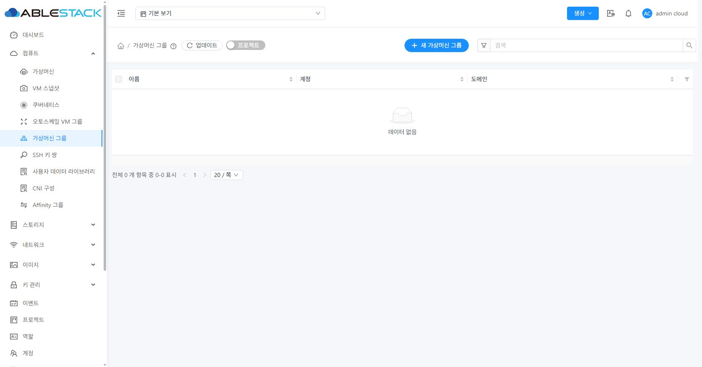
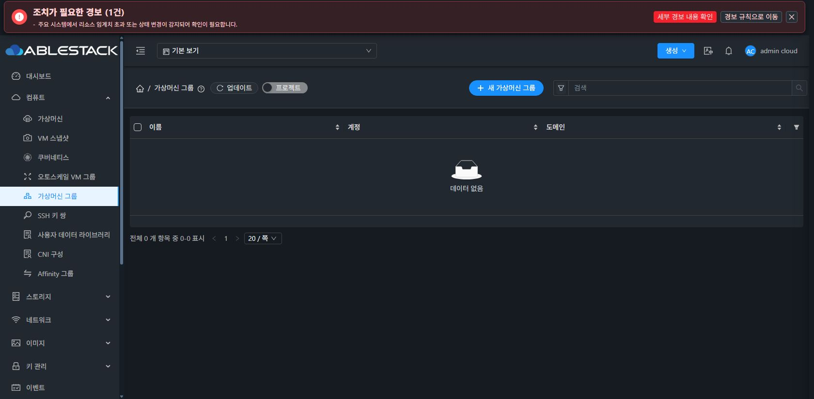

<!--
Licensed to the Apache Software Foundation (ASF) under one
or more contributor license agreements. See the NOTICE file
distributed with this work for additional information
regarding copyright ownership. The ASF licenses this file
to you under the Apache License, Version 2.0 (the
"License"); you may not use this file except in compliance
with the License. You may obtain a copy of the License at

http://www.apache.org/licenses/LICENSE-2.0

Unless required by applicable law or agreed to in writing,
software distributed under the License is distributed on an
"AS IS" BASIS, WITHOUT WARRANTIES OR CONDITIONS OF ANY
KIND, either express or implied. See the License for the
specific language governing permissions and limitations
under the License.
-->

# VG-03 UI·API·DB 근거

배포 소스 `d725040444c21a2e6e4dcd2b40c9be15d5228df8`, 2026-10-13. 실제 Chrome/CUA로 31 라이트·32 다크 화면을 조작했다. 인증 정보와 전체 네트워크 URL은 제외했다.

## 이름 흐름

| 흐름 | 관찰 |
| --- | --- |
| 공백 3개 / 한글 256단위 | 양쪽 폼 검증으로 전송 차단, 입력 유지 |
| 경계 공백을 포함한 한글 생성 | 31 `VG03-31-한글-20261013`, 32 `VG03-32-한글-20261013`로 정규화해 POST, 목록 갱신 |
| 중복 생성 | 31 실제 431와 한글 알림, 원본 입력·모달 보존. 32 중복 POST 후 폼·대상 보존도 확인했지만 알림이 닫힌 뒤 관찰했으므로 한글 알림 판정은 실제 중복 rename으로 확인 |
| 중복 이름 변경 | 양쪽 한글 `선택한 계정 또는 프로젝트에 같은 이름의 그룹이 있습니다. 다른 이름을 입력해 주세요.` 확인, 입력·UUID 유지 |
| 정상 변경 | 같은 UUID에 trim한 새 이름 저장, 상세 갱신 |
| 미변경 | 양쪽 `그룹 이름이 변경되지 않았습니다.`와 POST 0건 |
| 31 오류 주입 | Request 단계 HTTP 500 / errorcode 530, `VG03-private-detail`은 사용자 안내에 노출되지 않음. 원본 입력 유지 후 동일 UUID 재시도 성공 |

서버 오류 한글 안내: `그룹 작업에 실패했습니다. 입력은 유지되며, 재시도 전에 목록을 갱신해 처리 결과를 확인해 주세요.`

## 실제 삭제 요청

취소에서는 추가 delete POST가 없었다. 확인에서 아래 UUID에만 deleteInstanceGroup을 전송했다. 행 우클릭 일괄 경로의 요약과 결과 DOM을 대조했다.

| 사이트 | 단건 빈 그룹 | 일괄 멤버 그룹 | 일괄 빈 그룹 |
| --- | --- | --- | --- |
| 31 | a93f004d-0414-4877-a01b-26e286199a91 | 0e42650e-522f-4361-ae15-b30bf44663cb | 06914e50-3ccf-4ab0-b156-711e8ee7a805 |
| 32 | bbbf4a0e-b27f-4b5e-8c5e-c6657133a2bb | 7d276be5-7367-40d4-b580-3e78e8fdee88 | e27f6c9a-4878-4ce2-af9a-918a18ad901c |

두 일괄 확인 DOM은 `삭제할 그룹: 2개`, 각 이름·UUID·계정 admin·도메인 ROOT를 표시했다. 영향 안내는 `선택한 그룹을 삭제하면 그룹 소속 연결과 코멘트가 제거됩니다. 가상머신과 볼륨은 보존되며, 가상머신의 전원 상태와 배치는 바뀌지 않습니다. 이 작업은 되돌릴 수 없습니다.`였다. 결과 DOM은 `성공: 2`, `실패: 0`, `진행 중: 0`이었다. VM 수 조회는 추가하지 않았다.

## 삭제 전후 DB

취소 후 아래 VM·볼륨·매핑 값이 기준과 정확히 같았다. 삭제 후 VM/VOL 값은 동일하고 MAP만 NULL로 바뀌었다. 삭제된 일괄 두 그룹의 활성 그룹·매핑·활성 코멘트 건수는 사이트별 0/0/0이었다. 빈 그룹과 멤버 그룹에 각각 1개 코멘트를 넣어 확인했다.

| 값 | 31 | 32 |
| --- | --- | --- |
| VM UUID | 078ffeab-98a5-4e3f-acc2-bb1d56b43eb7 | 011ffa7b-3a0e-40db-ba6b-4edc43e78445 |
| VM numeric id / 상태 / account / domain / host | 502 / Stopped / 2 / 1 / NULL | 173 / Stopped / 2 / 1 / NULL |
| template / offering / OS / HA / dynamically scalable | 217 / 19 / 383 / 1 / 1 | 212 / 14 / 374 / 0 / 0 |
| 볼륨 UUID | 5f33f1d3-9a6c-4303-86e2-c7e61cb0f81d | 50ac6501-6a82-4481-856a-6bc614f6f283 |
| 볼륨 상태 / 크기 / pool / path | Allocated / 17179869184 / NULL / NULL | Allocated / 17179869184 / NULL / NULL |
| 삭제 전 그룹 id / 삭제 후 | 33 / NULL | 33 / NULL |

독립 API 계약 31 37건·32 37건과 Java 58건·UI 108건 결과는 [보고서](../../VG-03-validation.ko.md)에 기록했다. 집중 검사 및 전체 CI의 제한을 구분했다.

## 정리 완료 화면

아래 PNG는 전체 검증 및 전용 자원 정리 후 다시 조회한 화면이다. 각 사이트의 활성 전용 VM·볼륨·그룹·매핑·코멘트·네트워크·프로젝트·계정 0을 DB로 별도 확인했다. 중간 PNG에 이전 전환 프레임이 있어 이를 완료 증거로 사용하지 않았다.

