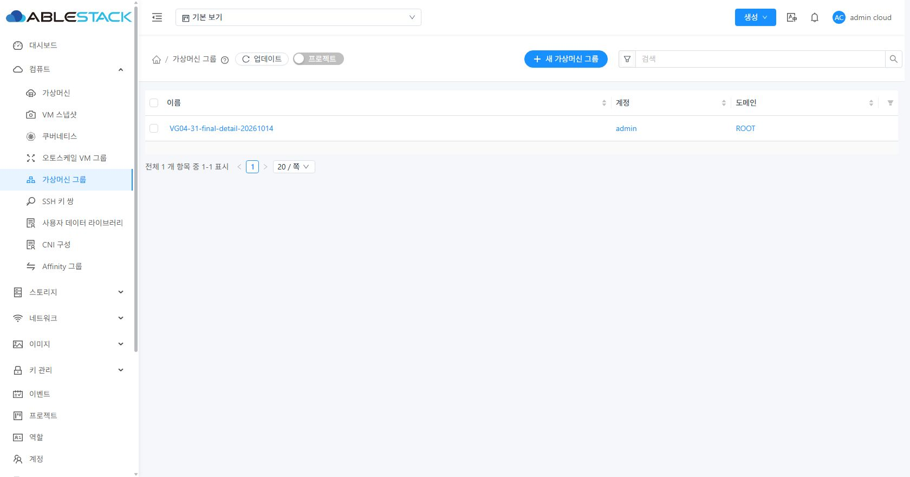
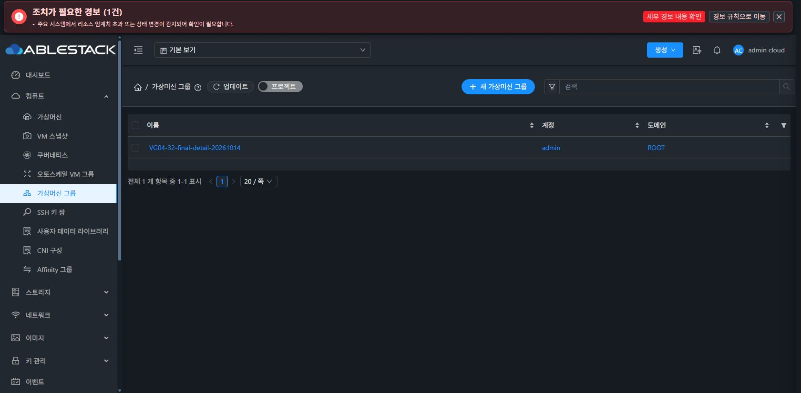

# VG-04 실제 UI 근거

최종 소스: `361b123637517e1bc83a6d79430d5bdd03806a4b`, 2026-10-14 KST. 정상 조회/갱신/빈 결과의 리본·성공 시각은 제거했다. 31 라이트·32 다크의 아래 화면은 최종 배포본에서 전용 빈 그룹이 표시된 상태이며, 이후 그룹을 정리했다. 32 최상단의 기존 시스템 경보는 그룹 조회 상태와 별개다.





## 실제 흐름과 검증 경계

이름/keyword/소유/Zone 제거·페이지/페이지 정렬·URL/지연/오류 흐름은 이번 구현 단계에서 실검증했다. 정상 리본을 제거한 `13fb327`에서 31 반복 실패/성공 재시도와 32 프로젝트/늦은 검색/권한/정상 0/초기화를 확인했다. 마지막 상세 분기 보완 `361b123`에서 양쪽 정상 목록·코멘트 탭·API query 분리, 31 상세 실패 보호/재시도, 32 없어진 상세 처리를 다시 확인했다. API 조회/ACL 28개는 서버를 바꾸지 않고 확인한 실제 계약이다. malformed 응답 및 세션/늦은 실패는 단위 테스트 근거다.

| 사이트 | 실제 UI 행위 | 관찰된 결과 |
| --- | --- | --- |
| 31 | 이름 필터 검색 | Zone 필드 없음. 동일 한글 이름의 admin/전용 일반 사용자 2개, 서버에 name 전달 |
| 31 | keyword 검색→페이지 2→이름 오름차순→수동 갱신 | 페이지/keyword/sort URL 유지. 서버에 정렬/Zone/q 전달 없음 |
| 31 | Zone/unknown + owner/keyword URL 재진입 | 미지원 값 제거. 입력·account/domain과 실제 반환 소유 대조 |
| 31 | 갱신 XHR 보류→500→재시도 다시 500→성공 | 로딩은 기존 업데이트 버튼. 이전 행/성공 시각 동일, 선택 제거, 내부 상세 미표시. 성공 시 오류 문단 제거 |
| 32 | 프로젝트 선택→기본 보기 | 기존 대시보드 전환 후 목록 재진입. projectid 있음/없음 대조, 1→28개, 이전 선택/행 없음 |
| 32 | 01 검색 보류→02 검색 성공→01 응답 완료 | 늦은 응답 loadingFinished 후에도 02 두 행만 표시 |
| 32 | 동일 검색 갱신403/531→재시도 | 이전 행/시각 미표시·권한 안내. 성공 시 같은02 두 행 복구 |
| 32 | 존재하지 않는 keyword→clear 버튼 | 정상 검색 빈 행과 0-0, 리본 없음. 검색 제거 후 28개 |
| 31/32 최종 | 전용 상세→코멘트 탭→상단 갱신 | 코멘트 tab 선택 유지, listInstanceGroups에 tab 전송 없음 |
| 31 최종 | 코멘트 상세 XHR500→재시도 | 이전 InfoCard/코멘트 유지, 작업 메뉴 0, 안전한 안내와 재시도로 메뉴 복구 |
| 32 최종 | 조회하던 전용 그룹 삭제→상세 갱신/직접 URL 재진입 | “그룹을 더 이상 조회할 수 없습니다.”, 작업 메뉴 0, URL 유지·404 이동 없음 |
| 31/32 종료 | 전체 전용 그룹/프로젝트/계정 정리 후 목록 갱신 | 정상 소유 범위 빈 행. 정상 리본 0 |

## 최종 상세 API 파라미터 예

인증·전체 URL·응답 내부 상세는 보관하지 않는다. 실제 요청에서 인증 필드를 제외한 파라미터만 발췌했다. UI URL의 tab=comments는 아래 요청에 없다.

```json
{
  "site": "31",
  "command": "listInstanceGroups",
  "parameters": {
    "id": "5f18960b-dbc8-4860-aed9-88171ac9d1af",
    "listall": "true",
    "page": "1",
    "pagesize": "20"
  }
}
```

```json
{
  "site": "32",
  "command": "listInstanceGroups",
  "parameters": {
    "id": "1d382847-0916-461b-bb5b-f0f7d8758a86",
    "listall": "true",
    "page": "1",
    "pagesize": "20"
  }
}
```

## 상태 문구 발췌

정상 성공: 목록만 표시, `.vm-group-query-status` 0.

정상 검색 0: “검색 조건에 맞는 그룹이 없습니다.” 표준 테이블 행, 전체 0개/0-0.

갱신 실패: “그룹 갱신에 실패했습니다. 이전 결과를 표시합니다. 그룹 작업 전에 갱신해 주세요.” 마지막 성공 확인 시각과 재시도 버튼. 반복 실패에서 기존 시각이 동일했다.

권한 거부: “그룹 조회 권한이 없습니다. 이전 데이터와 선택을 제거했습니다.” 재시도 버튼, 이전 행과 시각 없음.

없어진 상세: “그룹을 더 이상 조회할 수 없습니다. 목록을 갱신해 확인해 주세요.” 이전 InfoCard/작업 없음.

오류 주입은 해당 테스트 탭의 그룹 XHR에만 적용했고 종료 시 Fetch 패턴/캐시 비활성을 복구했다. 직접적인 서버 장애 시험은 아니다. 32 중간 프로젝트 전환의 원인 미확정 promise 예외 1건을 별도로 관찰했다. 최종 보완 검증 구간에서 추가 exception 기록은 없지만 전체 콘솔 무오류를 인증하지 않는다.

[API·배포 보존·정리 요약](verification-summary.json) · [완료 보고서](../../VG-04-validation.ko.md)
