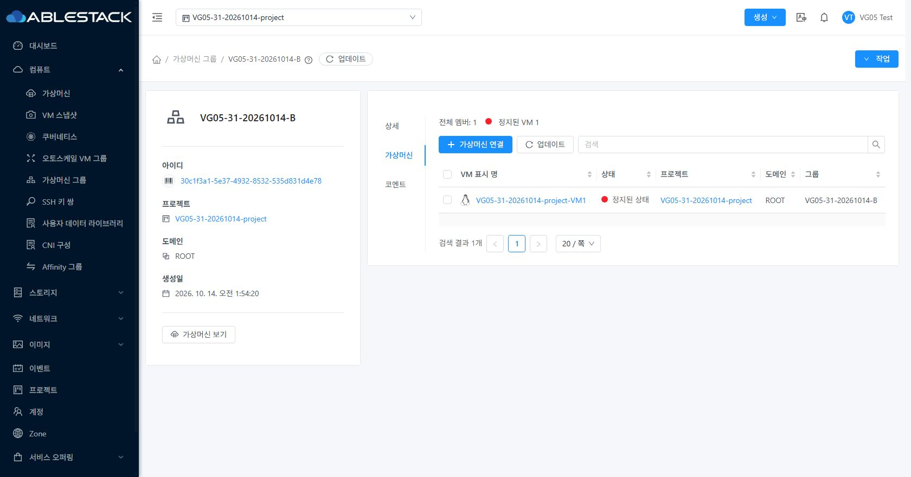
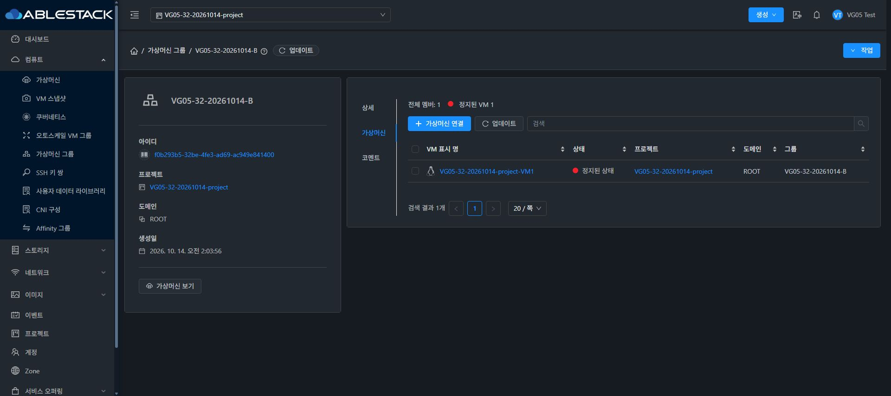
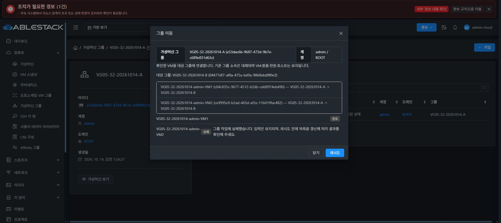

# VG-05 실제 UI 근거

2026-10-14. 작업: #1362 / Epic #1357 / Draft PR #1364. 아래 화면의 자원은 전용 검증 자원이며 검증 후 모두 정리했다. 인증 정보와 실제 기존 VM의 상세 이미지는 공개 자료에 포함하지 않았다.

[39개 기능 사례·안전한 요청 필드](ui-evidence.json). 기능 흐름은 c9e5d19fe1d에서 확인했으며 모바일 표 폭/후보 wrapper는1023eba39fe5, 고정20개 페이지 제어 보완의 최종 배포는32230b57c64다. 마지막 레이아웃10개 판정은 layout-evidence.json에 기록한다. 요청 기록은 표본이며 모든 네트워크 요청을 빠짐없이 수집했다고 표시하지 않는다.

## VM 표준 탭/컨텐츠

실제 VM과 그룹의 오른쪽 카드→탭 상대 좌표 x25/y47px가 같았다. 내부 body 기준24/46px. outer ResourceLayout/InfoCard는 기존 것을 사용하며 메뉴 폭은 각 탭 라벨에 따른다. 31 라이트와32 다크에서 프로젝트 이름·멤버수1·Stopped1·VM 링크를 확인했다.

## 실제 부분 실패와 재시도

32 관리자 VM 두 개를 A→B로 이동하면서 VM2 POST에만 제어된500을 주입했다. UI는 VM1 완료/VM2 실패를 표시했다. API/DB는 VM1 B, VM2 A였고 재시도는 VM2 POST1건만 보냈다. 이후둘다B, 최종해제 후둘다무소속이다. 내부 오류 상세는 노출하지 않았다.

## 역할·검색·포커스·배포

일반 사용자 및 프로젝트 멤버 연결/단건이동/해제, 관리자 일괄 작업, 제한역할의 조회/변경 차단, VM 역링크, Shift+F10·취소 행 포커스, 검색 전체/결과 수 구분, 코멘트 초안, URL검색/페이지크기/정렬/reload는 ui-evidence.json에 기록했다. HTTP500은 시험 주입이며 실제 서버의 자연 발생 오류로 표시하지 않는다. 삭제는 UI 확인폼/취소와 실제 API 삭제 후 보존/missing을 대조했다.

단계별 runtime-*.json은 수집 VM 속성/모든 볼륨 응답 불변·집계/멤버 API 일치·DB0/1 매핑을 판정한다. api-owner/role JSON은 소유 범위와 실제 역할 거부432를, cleanup/final-deployment-cleanup JSON은 전용 자원 정리와 활성 webapp/JAR/설정/PID/HTTP/FTCTL marker를 판정한다.

[완료 보고서](../../VG-05-validation.ko.md). 전체 Cloud/전체 CI·Running 멤버/고부하/원자적 CAS/전 역할/실다페이지를 인증한 결과가 아니다.
