# Mold 신입 개발자 교육 안내서
## ABLESTACK Mold 개발 환경과 Codex 활용 및 첫 기여 안내

---

### [문서 메타데이터]
- **문서 버전**: v1.0
- **기준 브랜치**: `europa-2026`
- **기준 커밋**: `9bdce62654`
- **소스 대조 일자**: 2026-10-06
- **Codex 공식 문서 확인일**: 2026-10-08
- **대상 독자**: ABLESTACK Mold 개발팀 신규 입사 소프트웨어 엔지니어
- **개발 기준 OS**: **macOS** (Apple Silicon M-Series / Intel)
- **문서 목적**: Mold 구조와 화면 메뉴·계정 권한을 이해하고 Mac 개발 환경을 준비한다. Codex에 작업을 요청하고 변경을 검토·검증한 뒤 PR·빌드·교육 환경 확인 결과를 설명할 수 있다.

---

이 안내서는 Mold 화면과 메뉴 이해, 개발 환경 준비, Mold 코드 이해, Codex를 이용한 구현과 검토, 첫 PR 제출 및 교육 환경 검증을 순서대로 다룹니다. 본문 1~10장은 공통 교육이며, 부록은 상세 참고 또는 업무에 따른 선택 실습입니다. 교육생은 작은 변경의 목적과 영향 범위를 정하고, 코드·화면·검사 결과를 근거로 완료 여부를 판단합니다. 서버와 실습 계정의 실제 값은 팀에서 공유한 교육 환경 정보를 확인하여 부록 A에 기록합니다.

각 장은 필요한 이유, 실행 방법, 정상 결과, 실패 시 확인할 곳의 순서로 읽고 직접 진행합니다. 장 끝의 학습 완료 기준으로 결과를 점검하고 실행 명령·화면·로그를 실습 기록에 남깁니다. 계정·권한이나 환경 정보가 부족한 항목은 미실행으로 표시하고 해당 문의 채널을 이용합니다. 로컬 설정과 코드 분석 등 진행 가능한 항목은 계속 학습합니다.

## 본 문서의 설정 안내 서식 규칙
본 가이드의 모든 환경설정 및 명령어 안내는 일관된 학습과 신속한 문제 해결을 위해 아래 4단계 표준 구조를 따릅니다:
1. **왜 필요한가 (Why)**: 해당 설정의 목적과 원리
2. **설정 방법 (How)**: 구체적인 명령어 및 설정 코드 (실행 위치 표기: `[개발 PC (Mac)]` 또는 `[교육 서버 (Linux)]`)
3. **정상 결과 (Verification)**: 정상 설정 시 터미널 출력 및 화면 상태
4. **실패 시 확인할 곳 (Troubleshooting)**: 흔히 발생하는 실수 및 점검 포인트. 코드의 역슬래시는 글꼴에 따라 원화 모양으로 보일 수 있습니다. 명령어는 코드 블록에서 복사하여 사용하고 원화 문자로 바꾸지 않습니다.

---

## 전체 목차

- [CHAPTER 1. Mold 이해하기 (What is Mold?)](#chapter-1-mold-이해하기-what-is-mold)
   - [1.1 Mold 서비스와 ABLESTACK 생태계 (오픈소스 브랜딩 배경)](#11-mold-서비스와-ablestack-생태계-오픈소스-브랜딩-배경)
   - [1.2 핵심 컴포넌트 역할](#12-핵심-컴포넌트-역할)
   - [1.3 VM 시작 요청의 처리 흐름](#13-vm-시작-요청의-처리-흐름)
   - [1.4 요청 처리 단계와 장애 확인 지점](#14-요청-처리-단계와-장애-확인-지점)
   - [1.5 챕터 1 학습 완료 기준 점검](#15-챕터-1-학습-완료-기준-점검)
- [CHAPTER 2 Mold 화면과 메뉴 이해](#chapter-2-mold-화면과-메뉴-이해)
   - [2.1 대시보드](#21-대시보드)
   - [2.2 컴퓨트](#22-컴퓨트)
   - [2.3 스토리지](#23-스토리지)
   - [2.4 네트워크](#24-네트워크)
   - [2.5 이미지](#25-이미지)
   - [2.6 키 관리](#26-키-관리)
   - [2.7 재해복구](#27-재해복구)
   - [2.8 데스크톱](#28-데스크톱)
   - [2.9 오토메이션](#29-오토메이션)
   - [2.10 이벤트](#210-이벤트)
   - [2.11 프로젝트](#211-프로젝트)
   - [2.12 역할](#212-역할)
   - [2.13 계정](#213-계정)
   - [2.14 도메인](#214-도메인)
   - [2.15 인프라스트럭쳐](#215-인프라스트럭쳐)
   - [2.16 서비스 오퍼링](#216-서비스-오퍼링)
   - [2.17 구성](#217-구성)
   - [2.18 확장](#218-확장)
   - [2.19 도구](#219-도구)
   - [2.20 할당](#220-할당)
   - [2.21 API 문서](#221-api-문서)
   - [2.22 학습 완료 확인](#222-학습-완료-확인)
- [CHAPTER 3. 필요한 기초 지식 (Prerequisites)](#chapter-3-필요한-기초-지식-prerequisites)
   - [3.1 클라우드 가상화·인프라 용어 사전](#31-클라우드-가상화인프라-용어-사전)
   - [3.2 Linux와 서버별 기본 명령](#32-linux와-서버별-기본-명령)
   - [3.3 Git 버전 관리 및 브랜치 협업 흐름](#33-git-버전-관리-및-브랜치-협업-흐름)
   - [3.4 Java와 Maven 멀티 모듈 구조](#34-java와-maven-멀티-모듈-구조)
   - [3.5 Vue.js & npm/Node.js 프론트엔드 기초](#35-vuejs--npmnodejs-프론트엔드-기초)
   - [3.6 HTTP Command API와 MySQL 상태 조회](#36-http-command-api와-mysql-상태-조회)
   - [3.7 챕터 3 학습 완료 기준 점검](#37-챕터-3-학습-완료-기준-점검)
- [CHAPTER 4. 교육 전 사전 준비 (Getting Ready)](#chapter-4-교육-전-사전-준비-getting-ready)
   - [4.1 사내 저장소(GitHub) 접근 권한 획득](#41-사내-저장소github-접근-권한-획득)
   - [4.2 사용할 IDE 확인](#42-사용할-ide-확인)
   - [4.3 교육 서버와 실습 계정 확인](#43-교육-서버와-실습-계정-확인)
   - [4.4 Codex 교육용 계정과 사용 환경 확인](#44-codex-교육용-계정과-사용-환경-확인)
   - [4.5 챕터 4 학습 완료 기준 점검](#45-챕터-4-학습-완료-기준-점검)
- [CHAPTER 5. 개발 환경 설정 (macOS 기준)](#chapter-5-개발-환경-설정-macos-기준)
   - [5.1 도구 버전과 교육 환경 기록](#51-도구-버전과-교육-환경-기록)
   - [5.2 macOS 기본 도구와 Homebrew](#52-macos-기본-도구와-homebrew)
   - [5.3 Node 버전 선택과 nvm 설정](#53-node-버전-선택과-nvm-설정)
   - [5.4 JDK와 Maven 경로 설정](#54-jdk와-maven-경로-설정)
   - [5.5 소스 코드 클론 및 저장소 디렉터리 구성](#55-소스-코드-클론-및-저장소-디렉터리-구성)
   - [5.6 IDE 설치와 프로젝트 설정](#56-ide-설치와-프로젝트-설정)
   - [5.7 Codex 설치와 Mold 프로젝트 설정](#57-codex-설치와-mold-프로젝트-설정)
   - [5.8 UI 설정 파일 구성 (`ui/.env.local`) 및 프록시 연결](#58-ui-설정-파일-구성-uienvlocal-및-프록시-연결)
   - [5.9 UI 의존성 설치와 개발 서버 실행](#59-ui-의존성-설치와-개발-서버-실행)
   - [5.10 로컬 Maven 빌드와 연구소 빌드서버 사용 원칙](#510-로컬-maven-빌드와-연구소-빌드서버-사용-원칙)
   - [5.11 챕터 5 학습 완료 기준 점검](#511-챕터-5-학습-완료-기준-점검)
- [CHAPTER 6. Mold 소스 코드 구조 분석 (Code Walkthrough)](#chapter-6-mold-소스-코드-구조-분석-code-walkthrough)
   - [6.1 전체 디렉터리 구조 및 모듈별 역할](#61-전체-디렉터리-구조-및-모듈별-역할)
   - [6.2 `ui/`: Vue 3 + Ant Design Vue 프론트엔드 구조](#62-ui-vue-3--ant-design-vue-프론트엔드-구조)
   - [6.3 `api/`: Mold API Command 클래스 구조](#63-api-mold-api-command-클래스-구조)
   - [6.4 `server/` & `engine/`: 비즈니스 로직 및 오케스트레이션 엔진](#64-server--engine-비즈니스-로직-및-오케스트레이션-엔진)
   - [6.5 `plugins/`: 하이퍼바이저 및 스토리지 연동 플러그인](#65-plugins-하이퍼바이저-및-스토리지-연동-플러그인)
   - [6.6 `agent/`: Mold Agent (KVM 호스트 상주 데몬)](#66-agent-mold-agent-kvm-호스트-상주-데몬)
   - [6.7 화면(UI)과 백엔드 코드 연결 매핑 실전 가이드](#67-화면ui과-백엔드-코드-연결-매핑-실전-가이드)
   - [6.8 챕터 6 학습 완료 기준 점검](#68-챕터-6-학습-완료-기준-점검)
- [CHAPTER 7. Codex를 이용한 Mold 개발](#chapter-7-codex를-이용한-mold-개발)
   - [7.1 기본 작업 흐름 익히기](#71-기본-작업-흐름-익히기)
   - [7.2 목표·맥락·확인 방법을 담아 요청하기](#72-목표맥락확인-방법을-담아-요청하기)
   - [7.3 실제 코드 근거로 Mold 구조 탐색하기](#73-실제-코드-근거로-mold-구조-탐색하기)
   - [7.4 작은 변경을 구현하도록 요청하기](#74-작은-변경을-구현하도록-요청하기)
   - [7.5 변경에 맞는 검사와 실제 결과 확인하기](#75-변경에-맞는-검사와-실제-결과-확인하기)
   - [7.6 변경 차이를 읽고 검토하기](#76-변경-차이를-읽고-검토하기)
   - [7.7 커밋과 PR 설명 작성하기](#77-커밋과-pr-설명-작성하기)
   - [7.8 중단한 작업 이어가기](#78-중단한-작업-이어가기)
   - [7.9 챕터 7 학습 완료 기준 점검](#79-챕터-7-학습-완료-기준-점검)
- [CHAPTER 8. Codex와 함께 하는 첫 개발 실습](#chapter-8-codex와-함께-하는-첫-개발-실습)
   - [8.1 코드 수정 전에 개인 브랜치 준비](#81-코드-수정-전에-개인-브랜치-준비)
   - [8.2 Codex로 사용 위치를 찾고 UI 문구 수정](#82-codex로-사용-위치를-찾고-ui-문구-수정)
   - [8.3 변경 검토와 커밋 PR CI 확인](#83-변경-검토와-커밋-pr-ci-확인)
   - [8.4 교육용 VM 시작 요청과 Job 추적 실습](#84-교육용-vm-시작-요청과-job-추적-실습)
   - [8.5 챕터 8 학습 완료 기준 점검](#85-챕터-8-학습-완료-기준-점검)
- [CHAPTER 9 빌드 배포와 검증](#chapter-9-빌드-배포와-검증)
   - [9.1 전체 작업 순서 한눈에 보기](#91-전체-작업-순서-한눈에-보기)
   - [9.2 연구소 빌드서버에서 RPM 생성](#92-연구소-빌드서버에서-rpm-생성)
   - [9.3 서버별로 필요한 RPM 나누기](#93-서버별로-필요한-rpm-나누기)
   - [9.4 RPM 전달과 서버 반영](#94-rpm-전달과-서버-반영)
   - [9.5 UI dist 파일을 운영 환경에 수동 반영](#95-ui-dist-파일을-운영-환경에-수동-반영)
   - [9.6 반영 후 서비스와 기능 확인](#96-반영-후-서비스와-기능-확인)
   - [9.7 실습 결과 기록](#97-실습-결과-기록)
- [CHAPTER 10. 문제 해결과 협업 (Troubleshooting & Collaboration)](#chapter-10-문제-해결과-협업-troubleshooting--collaboration)
   - [10.1 자주 발생하는 오류의 진단 순서](#101-자주-발생하는-오류의-진단-순서)
   - [10.2 주요 로그 파일 위치 및 분석 가이드](#102-주요-로그-파일-위치-및-분석-가이드)
   - [10.3 이슈 템플릿 작성법 및 버그 재현 리포트](#103-이슈-템플릿-작성법-및-버그-재현-리포트)
   - [10.4 Codex에 오류 증거를 전달하고 해결하기](#104-codex에-오류-증거를-전달하고-해결하기)
   - [10.5 챕터 10 학습 완료 기준 점검](#105-챕터-10-학습-완료-기준-점검)
- [공통 교육 완료 확인](#공통-교육-완료-확인)
- [부록 A 계정과 실습 환경](#부록-a-계정과-실습-환경)
   - [A.1 인증과 권한의 세 가지 단계](#a1-인증과-권한의-세-가지-단계)
   - [A.2 실습 환경과 자원 기록표](#a2-실습-환경과-자원-기록표)
- [부록 B 비동기 작업과 상태 진단](#부록-b-비동기-작업과-상태-진단)
   - [B.1 작업 수락과 실행 결과 구분](#b1-작업-수락과-실행-결과-구분)
   - [B.2 Job 결과와 VM 상태 비교](#b2-job-결과와-vm-상태-비교)
   - [B.3 실패와 상태 동기화 읽기](#b3-실패와-상태-동기화-읽기)
- [부록 C Mold 확장 기능 찾아보기](#부록-c-mold-확장-기능-찾아보기)
   - [C.1 FT와 DR](#c1-ft와-dr)
   - [C.2 n2k와 v2k 가져오기](#c2-n2k와-v2k-가져오기)
   - [C.3 Storage Service와 SharedFS](#c3-storage-service와-sharedfs)
   - [C.4 게스트 프로세스와 QGA](#c4-게스트-프로세스와-qga)
- [부록 D Codex의 다른 사용 방법](#부록-d-codex의-다른-사용-방법)
   - [D.1 터미널에서 Codex 사용하기](#d1-터미널에서-codex-사용하기)
   - [D.2 VS Code에서 Codex 사용하기](#d2-vs-code에서-codex-사용하기)
   - [D.3 Worktree로 작업 폴더 분리하기](#d3-worktree로-작업-폴더-분리하기)
   - [D.4 반복 작업을 Skill로 정리하기](#d4-반복-작업을-skill로-정리하기)
- [부록 E 빌드와 서버 반영 참고](#부록-e-빌드와-서버-반영-참고)
   - [E.1 빌드서버 준비와 도구 확인](#e1-빌드서버-준비와-도구-확인)
   - [E.2 RPM 조회와 설치 명령 참고](#e2-rpm-조회와-설치-명령-참고)
   - [E.3 SystemVM 템플릿 생성과 반영](#e3-systemvm-템플릿-생성과-반영)
- [부록 F GitHub Actions 빌드와 Release 안내](#부록-f-github-actions-빌드와-release-안내)
   - [F.1 workflow 선택과 소스 기준](#f1-workflow-선택과-소스-기준)
   - [F.2 GitHub Actions로 개발용 RPM 빌드하기](#f2-github-actions로-개발용-rpm-빌드하기)
   - [F.3 개발 Release 정리](#f3-개발-release-정리)

---

# CHAPTER 1. Mold 이해하기 (What is Mold?)

> ** 챕터 1 학습 목표**  
> 우리가 만드는 **Mold 서비스**의 정체성과 오픈소스 브랜딩 배경을 이해하고, 사용자가 웹 화면에서 버튼을 클릭했을 때 Mold 관리 서버, Mold Agent를 거쳐 실제 가상 머신(VM)까지 명령이 어떻게 전달되는지 전체 동작 흐름을 설명할 수 있다.

---

### 1.1 Mold 서비스와 ABLESTACK 생태계 (오픈소스 브랜딩 배경)

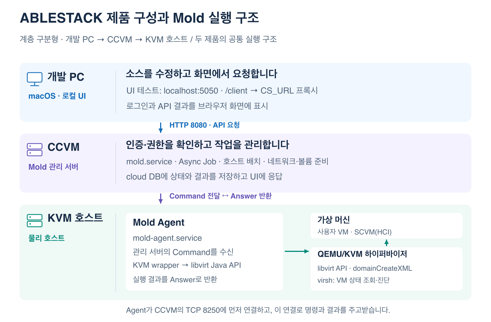

1. **ABLESTACK의 두 제품 구성: ABLESTACK-HCI와 ABLESTACK-VM**:
   - 에이블클라우드(AbleCloud)는 **ABLESTACK-HCI**와 **ABLESTACK-VM** 두 가지 제품을 제공합니다. 두 제품은 **Mold를 공통 관리 플랫폼**으로 사용하며, VM 디스크를 제공하는 스토리지 구성에서 차이가 있습니다.
   - **Mold (공통 관리 플랫폼)**: 가상 머신(VM), 가상 네트워크와 스토리지 등 인프라 자원을 중앙에서 관리합니다. CCVM의 Mold 관리 서버와 각 KVM 호스트의 Mold Agent가 요청과 실행 결과를 주고받습니다.
   - **ABLESTACK-HCI (하이퍼컨버지드 인프라)**: 컴퓨팅과 분산 스토리지를 함께 구성하는 제품입니다. 각 호스트의 KVM 위에 **SCVM(Storage Controller VM, 스토리지 컨트롤러 VM)**을 생성하고, SCVM들이 **Glue의 Ceph 클러스터**를 구성합니다. 사용자 VM의 디스크는 **Ceph RBD 블록 볼륨**으로 제공합니다.
   - **ABLESTACK-VM (공유 스토리지형 가상화)**: 공유 블록 스토리지에 **GFS 클러스터 파일시스템**을 구성하여 사용하는 일반 가상화 제품입니다. 같은 클러스터의 모든 KVM 호스트가 공유 파일시스템을 함께 마운트하고, 그 안의 **VM 디스크 파일**에 접근합니다.
   - **하이퍼바이저와 VM의 관계**: 각 물리 호스트의 **KVM 하이퍼바이저**가 VM 실행 기반입니다. 사용자 VM은 그 위에서 실행되고, HCI의 SCVM도 사용자 VM과 같은 가상 머신 계층에 배치됩니다. SCVM은 Ceph 스토리지 클러스터를 구성하는 역할을 맡습니다.

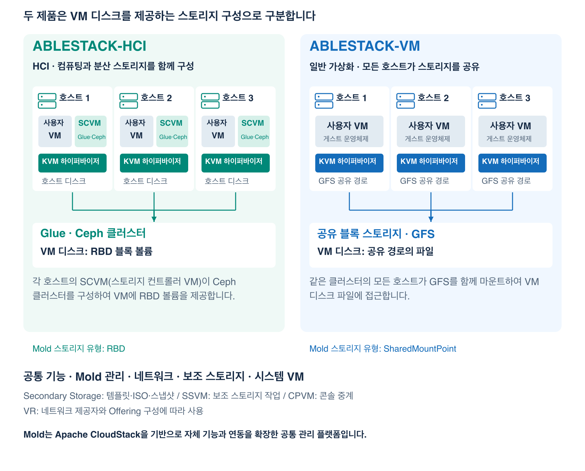

2. **CloudStack 기반 구조와 Mold 자체 확장**:
   - 신입 개발자가 가장 먼저 이해해야 할 핵심은 **"Mold는 Apache CloudStack을 기반으로 자체 기능과 연동을 확장한 제품"**이라는 점입니다.
   - 글로벌 오픈소스 IaaS 프로젝트인 **Apache CloudStack**을 우리 회사의 엔터프라이즈 솔루션으로 채택하여, Mold 웹 콘솔과 스토리지 연동, FT/DR, VM 가져오기 등의 기능을 확장하여 **독자적인 'Mold 서비스'라는 제품명으로 브랜딩 및 패키징**하여 개발하고 있습니다.
   - 따라서 소스 코드 내부의 Java 패키지명(`org.apache.cloudstack`)이나 일부 디렉터리 경로에는 오픈소스 명칭이 그대로 남아 있으나, 우리가 빌드하고 배포하는 시스템 서비스(`mold.service`, `mold-agent.service`), 웹 콘솔(Mold UI), 그리고 사내 업무 소통에서는 모두 **'Mold 서비스'**로 통칭합니다.

> [!NOTE]
> **[서비스 데몬명 및 로그 경로 안내]**  
> Mold 서비스의 systemd 서비스명은 관리 서버는 **`mold.service`** (또는 `mold`), 에이전트는 **`mold-agent.service`** (또는 `mold-agent`)로 등록되어 있습니다.  
> (※ 참고: 내부 로그 디렉터리 경로인 `/var/log/cloudstack/...` 및 Java 패키지 경로 `org.apache.cloudstack`에는 오픈소스 코어의 기반 경로가 유지되고 있으나, 서비스 제어 및 프로세스 관리 시에는 항상 **`mold.service`**, **`mold-agent.service`**를 사용합니다.)

서비스 상태를 확인하는 명령과 실행 위치는 3-2절을 참고합니다.

---

### 1.2 핵심 컴포넌트 역할

Mold 서비스는 분산 아키텍처로 구성되어 있으며, 세 가지 주요 계층이 유기적으로 통신합니다.

| 컴포넌트 | 실행 위치 | 사용 기술 | 핵심 역할 |
| :--- | :--- | :--- | :--- |
| **Mold Web UI** | 클라이언트 브라우저 (로컬 개발 PC) | Vue 3, Ant Design Vue, Axios, Node.js | 사용자 및 관리자를 위한 Mold 웹 콘솔. 백엔드 Query Command API를 비동기 호출하여 화면 렌더링. |
| **Mold 관리 서버 (Management Server)** | 중앙 컨트롤러 가상 머신 (**CCVM**) | Java 17, Spring Framework, MySQL | 전용 컨트롤러 VM(CCVM) 내에서 `mold.service`로 상주 구동. API 인증, 인프라 자원 DB(`cloud`) 관리, 가상 머신 스케줄링, 비동기 작업(Async Job) 관리, 물리 호스트의 Mold Agent로 명령 하달. |
| **Mold Agent (에이전트)** | 각 물리 하이퍼바이저 호스트 (**KVM Node**) | Java, Libvirt, QEMU/KVM, Linux Shell | 물리 하이퍼바이저 호스트(Bare-Metal)에서 `mold-agent.service`로 상주 구동. CCVM 관리 서버의 명령(`Command`)을 수신하여 Libvirt/QEMU를 통해 실제 VM 생성/시작/정지/삭제 및 스토리지 마운트 수행. |
| **System VMs (시스템 VM)** | 각 Zone 내부 가상 머신 | 경량 Linux Debian 템플릿 | • **SSVM (Secondary Storage VM)**: 템플릿, ISO, 볼륨 스냅샷 다운로드/업로드 처리<br>• **CPVM (Console Proxy VM)**: 웹 브라우저에서 VM 화면을 직접 보는 VNC 콘솔 중계<br>• **VR (Virtual Router)**: 사설 네트워크 DHCP, DNS, 라우팅, 방화벽, 포트포워딩 제공 |

---

### 1.3 VM 시작 요청의 처리 흐름

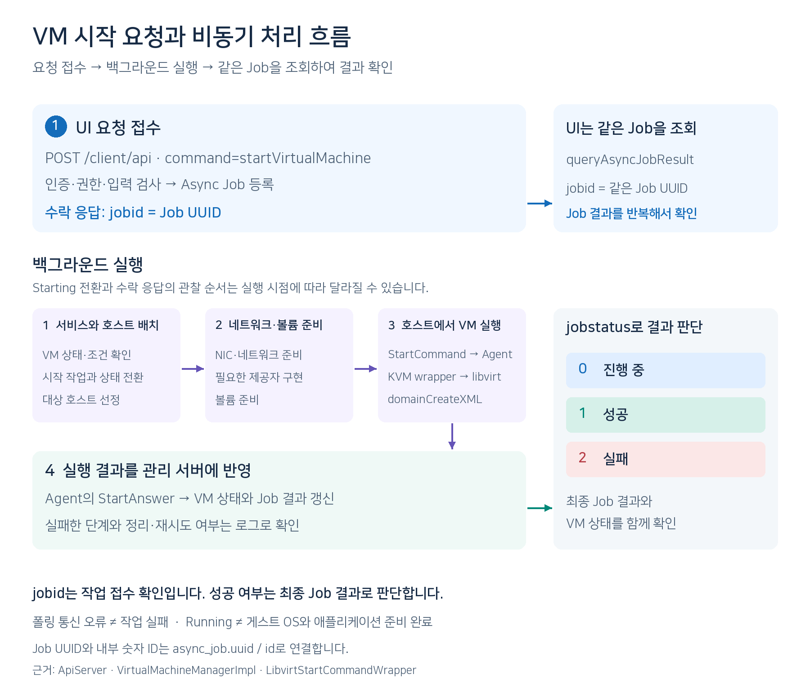

사용자가 시작 버튼을 누르면 API 계층이 요청을 검사하고 Async Job을 등록합니다. UI에는 Job UUID가 수락 응답으로 반환되고, 실제 VM 시작은 백그라운드 작업에서 진행됩니다. 응답 전후의 스레드 실행 시점은 달라질 수 있으므로 `Starting` 상태 변경이 수락 응답보다 먼저 발생한다고 가정하지 않습니다.

| 처리 구간 | 담당 코드 또는 컴포넌트 | 확인할 내용 |
| :--- | :--- | :--- |
| 요청 | UI API 래퍼 | `POST /client/api`, 본문에 `command=startVirtualMachine`과 VM UUID 전달 |
| 작업 등록과 수락 | `ApiServer`, 작업 프레임워크 | 파라미터와 권한 확인 후 Async Job 등록, `jobid` UUID 반환 |
| 서비스와 배치 | `UserVmManagerImpl`, `VirtualMachineManagerImpl` | VM 상태와 조건 검사, 시작 작업 예약과 상태 전환, 대상 호스트 선정 |
| 인프라 준비 | Network 및 Volume 계층 | NIC와 네트워크 준비, 필요한 네트워크 제공자 구현, 볼륨 준비 |
| 호스트 실행 | Agent, KVM wrapper | `StartCommand` 수신, 도메인 XML·디스크·NIC 구성 |
| 하이퍼바이저 호출 | libvirt Java API | `domainCreateXML` 호출, 결과를 `StartAnswer`로 반환 |
| 결과 반영 | 관리 서버와 작업 프레임워크 | 정상 완료 또는 실패 정리, VM 상태와 Job 결과 갱신 |
| 화면 확인 | UI Job 조회 | `queryAsyncJobResult`의 `jobstatus`와 결과를 확인하고 자원 재조회 |

`jobid` 반환은 작업 접수를 뜻합니다. 성공 여부는 Job 결과로 확인해야 합니다. API JSON 필드는 `jobid`, `jobstatus`이며, 로그의 내부 Job 번호와 외부 UUID를 연결하는 방법은 8-4와 부록 B에서 다룹니다.

Agent는 관리 서버의 기본 8250 포트에 연결합니다. 명령과 응답은 이 연결을 통해 오갑니다. 운영자가 사용하는 `virsh`와 Agent 내부의 libvirt API 호출은 구분합니다.

코드 확인 경로: `server/src/main/java/com/cloud/api/ApiServer.java`, `engine/orchestration/src/main/java/com/cloud/vm/VirtualMachineManagerImpl.java`, `plugins/hypervisors/kvm/src/main/java/com/cloud/hypervisor/kvm/resource/wrapper/LibvirtStartCommandWrapper.java`.

---

### 1.4 요청 처리 단계와 장애 확인 지점

UI는 공통 API 래퍼를 통해 Command API를 호출합니다. 현재 래퍼는 `get`, `list`, `query`, `find`로 시작하는 조회 명령을 주로 GET으로 보내고, `startVirtualMachine` 같은 변경 명령은 POST로 보냅니다. 브라우저 Network 탭에서 실제 메서드와 경로를 확인합니다.

API 처리에는 요청자의 신원 확인, 해당 API를 호출할 수 있는 역할 권한, 해당 VM에 대한 자원 접근 권한 검사가 연결됩니다. 서비스 계층도 VM 상태와 자원 조건을 검사합니다. 계정과 권한의 관계는 부록 A에서 설명합니다.

VM 시작 작업은 호스트 선정과 함께 NIC·네트워크 및 볼륨을 준비합니다. 네트워크 제공자가 Virtual Router인 경우에는 라우터 구현이나 배포가 연결될 수 있습니다. 모든 네트워크가 VR을 사용하지는 않습니다. 준비 단계에서 실패하면 Agent에 `StartCommand`가 전송되기 전에 작업이 종료될 수 있습니다.

KVM 호스트에서는 Agent가 명령을 받아 wrapper로 전달합니다. VM 시작의 대표 경로는 `LibvirtStartCommandWrapper`에서 `LibvirtComputingResource.startVM()`을 거쳐 libvirt API를 호출하고 `StartAnswer`를 반환하는 흐름입니다.

| 현상 | 먼저 비교할 지점 |
| :--- | :--- |
| 요청이 즉시 거절됨 | API 응답, 세션, 역할과 자원 권한, 파라미터 |
| Job이 수락된 후 시작 실패 | Job 결과, 관리 서버 로그, NIC·네트워크·볼륨 준비 |
| 호스트 실행 실패 | Agent 로그, libvirt 상태, 도메인과 디스크 정보 |
| VM은 Running인데 콘솔만 안 열림 | Console Proxy와 콘솔 접속 경로 |
| 템플릿 전송이 진행되지 않음 | Secondary Storage와 SSVM 경로 |
| 화면 결과와 실제 상태가 다름 | 자원 재조회, Agent 전원 보고, Job 조회 통신 상태 |

`Running`은 가상 머신의 실행 상태입니다. 게스트 OS의 부팅 완료와 애플리케이션 정상 응답은 별도로 확인합니다.

---

### 1.5 챕터 1 학습 완료 기준 점검
- [ ] Mold 서비스의 정체성과 오픈소스 브랜딩 배경을 동료에게 3줄 이내로 명확히 설명할 수 있는가?
- [ ] Mold 관리 서버와 Mold Agent의 역할 차이를 설명할 수 있는가?
- [ ] 브라우저에서 'VM 시작'을 눌렀을 때 Libvirt에 도달하기까지의 과정을 5단계로 요약할 수 있는가?

---

# CHAPTER 2 Mold 화면과 메뉴 이해

> **챕터 2 학습 목표**  
> 화면의 메뉴 순서에 따라 상위 메뉴와 하위 메뉴의 역할을 이해하고, VM·볼륨·네트워크·이미지의 관계를 설명할 수 있다.

이 장은 관리자 화면의 왼쪽 메뉴 표시 순서대로 설명합니다. 계정 역할·활성 기능·프로젝트에 따라 보이지 않는 메뉴가 있을 수 있습니다. 접속 주소와 계정 준비는 4-3절, 개발 실습은 8장을 참고합니다.

자원 목록은 여러 자원의 상태를, 상세 화면은 선택한 자원의 정보와 연결 관계를 보여 줍니다. 검색·필터는 목록의 조회 조건이며, 프로젝트 선택은 조회 범위를 정합니다. 같은 이름의 자원도 Zone·계정·프로젝트·UUID가 다를 수 있습니다. 작업 접수 메시지와 최종 성공은 구분합니다.

---

### 2.1 대시보드

VM·스토리지·네트워크 등 자원의 개수와 사용 현황, 용량을 요약해 보여 줍니다. 표시되는 정보는 계정 권한과 조회 범위에 따라 달라집니다.

---

### 2.2 컴퓨트

컴퓨트는 VM의 실행 상태와 배치·초기 설정을 관리합니다. 가상머신 상세는 VM 자체의 정보뿐 아니라 연결된 디스크와 네트워크도 보여 줍니다.

| 하위 메뉴 | 주요 기능 |
| --- | --- |
| 가상머신 | 생성·시작·정지·재시작·사양 변경, 이미지·호스트·연결 자원 정보 |
| VM 스냅샷 | VM 단위의 시점 저장과 되돌리기 |
| 쿠버네티스 | 클러스터 생성·시작·정지, 노드 수 변경과 업그레이드 |
| 오토스케일 VM 그룹 | 부하 조건에 따른 VM 수 조절, 확장·축소 정책과 일정 |
| 가상머신 그룹 | VM을 업무별 이름으로 묶는 분류 |
| SSH 키 쌍 | VM 로그인에 사용하는 공개키의 생성·등록·관리 |
| 사용자 데이터 라이브러리 | VM 초기 설정에 전달하는 데이터 관리 |
| CNI 구성 | 쿠버네티스 네트워크 구성 관리 |
| Affinity 그룹 | VM을 함께 또는 분리해 배치하는 조건 관리 |

VM 상세의 **상세**는 UUID·이미지·사양, **볼륨**은 디스크, **NIC**는 네트워크 연결, **메트릭**은 사용량, **이벤트**는 작업 기록입니다. 콘솔은 게스트 화면을 보여 줍니다. IP 구성·프로세스·장애보호·DR 보호 현황 탭은 환경과 기능에 따라 표시됩니다. Running은 VM 실행 상태이며 게스트 OS와 애플리케이션 준비 완료와는 구분합니다.

---

### 2.3 스토리지

볼륨은 VM의 디스크입니다. ROOT는 부팅 디스크, DATADISK는 추가 데이터 디스크를 나타냅니다. VM 상세의 볼륨 탭과 스토리지 목록은 같은 디스크를 서로 다른 관점에서 보여 줍니다.

| 하위 메뉴 | 주요 기능 |
| --- | --- |
| 볼륨 | 생성·업로드·VM 연결·분리·크기 변경, 유형·크기·연결 VM·상태 정보 |
| 스냅샷 | 볼륨의 시점별 저장본, 새 볼륨·템플릿 생성과 지원되는 복원 |
| 스냅샷 정책 | 주기적인 볼륨 스냅샷의 일정과 보관 수 관리 |
| 백업 | 백업 시스템에 보관된 VM 데이터와 복구 시점 관리·복원 |
| 백업 일정 | VM 백업의 실행 주기와 대상 관리 |
| 버킷 | 오브젝트 저장 공간과 저장된 내용 관리 |
| 공유 파일 시스템 | 여러 VM이 함께 사용하는 파일 저장 공간의 생성·상태·접속 정보 |

VM 스냅샷, 볼륨 스냅샷과 백업은 대상·보관 방식·복구 범위가 다릅니다. 공유 파일 시스템과 버킷도 저장 방식과 접근 방법이 다릅니다.

---

### 2.4 네트워크

VM의 연결망·IP·통신 규칙을 관리합니다. NIC는 VM과 네트워크의 연결 관계입니다.

| 하위 메뉴 | 주요 기능 |
| --- | --- |
| 가상머신용 네트워크 | VM 연결망의 생성·조회·설정 변경, CIDR·게이트웨이·연결 VM 정보 |
| VPC | 여러 네트워크를 묶는 가상 전용 영역과 하위 네트워크·라우터 관리 |
| 보안그룹 | 지원되는 네트워크에서 VM에 적용하는 인바운드·아웃바운드 허용 규칙 |
| VNF 기기 | 방화벽 등 네트워크 기능을 수행하는 가상 장비의 배포·실행 상태 관리 |
| Public IP 주소 | 외부 통신용 IP와 방화벽·포트포워딩·로드밸런싱·VPN 기능 |
| AS Numbers | BGP 라우팅에 사용하는 AS 번호의 할당·사용 상태 |
| 사이트간 사설네트워크(VPN) | 사이트 간 VPN 게이트웨이 관리 |
| 사이트 간 VPN 연결 | VPN 게이트웨이 사이의 연결과 상태 관리 |
| 네트워크 ACL | 네트워크에 적용하는 통신 규칙 목록 |
| VPN 사용자 | 원격 접속 VPN 사용자 계정 관리 |
| VPN 고객 게이트웨이 | 연결할 상대편 VPN 장비의 주소와 연결 정보 관리 |
| 게스트 VLAN | VM 네트워크에 사용하는 VLAN 범위 |
| IPv4 서브넷 | VM 네트워크에 사용하는 IPv4 서브넷 관리 |
| DNS 영역 | DNS 영역과 영역별 DNS 레코드 관리 |
| DNS 서버 | DNS 서비스를 제공하는 서버 정보 관리 |

방화벽은 통신 허용 범위, 포트포워딩은 외부와 VM 내부의 IP·포트 연결, 로드밸런싱은 요청을 받을 VM들을 정의합니다. 사설 게이트웨이·내부 LB 등은 관련 자원 상세에서 제공될 수 있습니다. 이 메뉴의 VPN은 Mold의 가상 네트워크 기능입니다.

---

### 2.5 이미지

이미지는 새 VM을 만들 때 사용하는 원본입니다. 템플릿은 OS가 준비된 디스크 이미지이고, ISO는 설치 CD와 같은 이미지입니다.

| 하위 메뉴 | 주요 기능 |
| --- | --- |
| 템플릿 | URL 등록·로컬 업로드, 이미지 정보·공유 범위·Zone별 준비 상태 관리 |
| ISO | 설치 이미지 등록·업로드·공유 범위 관리, VM에서 사용할 설치 매체 |
| 쿠버네티스 ISO | 쿠버네티스 지원 버전과 설치 이미지 관리 |

이미지의 하이퍼바이저·아키텍처·파일 형식·OS와 준비 상태는 사용할 VM 환경과 관련됩니다. **SystemVM·VR용 템플릿**의 생성·등록·글로벌 설정은 부록 E-3에서 별도로 다룹니다.

---

### 2.6 키 관리

볼륨 암호화에 사용하는 키와 키 관리 장비 연결을 관리합니다. 관리자 권한이나 HSM 기능이 제공된 환경에서 표시됩니다.

| 하위 메뉴 | 주요 기능 |
| --- | --- |
| KMS 키 | 볼륨 암호화 키와 연계 볼륨 정보 관리 |
| HSM 프로파일 | 키 관리 장비의 연결 정보와 프로파일 관리 |

---

### 2.7 재해복구

장애 시 다른 사이트에서 서비스를 복구하기 위한 보호 구성을 관리합니다. DR 기능이 활성화된 환경에서 제공합니다.

| 하위 메뉴 | 주요 기능 |
| --- | --- |
| DR 사이트 | 복구 대상 사이트의 연결 정보와 상태 관리 |
| DR 계획 | 보호할 VM·복구 구성·보호 상태·작업 이력 관리 |

---

### 2.8 데스크톱

가상 데스크톱 서비스를 관리합니다. 해당 기능이 구성된 환경에서 제공합니다.

| 하위 메뉴 | 주요 기능 |
| --- | --- |
| 클러스터 | 가상 데스크톱 서비스의 배포·실행 상태와 접속 정보 |
| 컨트롤러 템플릿 | 데스크톱 제어용 이미지의 버전과 준비 상태 관리 |
| 마스터 템플릿 | 데스크톱 배포 원본 이미지의 버전과 준비 상태 관리 |

---

### 2.9 오토메이션

자동화 컨트롤러와 자동화로 배포한 패키지를 관리합니다. 해당 기능이 구성된 환경에서 제공합니다.

| 하위 메뉴 | 주요 기능 |
| --- | --- |
| 오토메이션 컨트롤러 | 자동화 실행 기반의 배포·실행 상태 관리 |
| 컨트롤러 템플릿 | 컨트롤러 이미지의 버전과 준비 상태 관리 |
| 배포된 패키지 | 패키지의 배포 결과와 접근 정보 관리 |

---

### 2.10 이벤트

자원에 수행된 작업 기록을 보여 줍니다. 작업 시각·자원·종류·설명에 따라 기록을 조회하며, 지원되는 다운로드 기능을 제공합니다. 개별 자원의 이벤트 탭은 해당 자원의 기록을, 왼쪽 이벤트 메뉴는 계정 권한 범위의 기록을 모아 보여 줍니다.

---

### 2.11 프로젝트

여러 계정이 함께 자원을 사용하는 작업 공간입니다. 프로젝트의 참여 계정·프로젝트 역할·자원 한도를 관리합니다. 상단 프로젝트 선택에 따라 화면의 조회 범위가 달라집니다.

---

### 2.12 역할

사용할 수 있는 API와 권한 규칙을 관리합니다. 메뉴 조회 권한과 자원 생성·변경·삭제 권한은 다릅니다. 상세의 권한 규칙에서 허용할 API와 규칙을 확인합니다. 인증과 권한의 구분은 부록 A-1을 참고합니다.

---

### 2.13 계정

자원을 소유하는 단위입니다. 소속 사용자·활성 상태·자원 한도를 관리합니다. 계정의 사용자는 실제 로그인 주체이며, 사용자와 API 키 기능은 계정·사용자 상세나 프로필에서 제공합니다.

---

### 2.14 도메인

계정을 조직별 계층으로 나누고 관리 범위를 정합니다. 하위 계정·하위 도메인과 자원 한도를 관리합니다. 도메인 → 계정 → 사용자는 조직 범위·자원 소유·로그인 주체의 관계입니다.

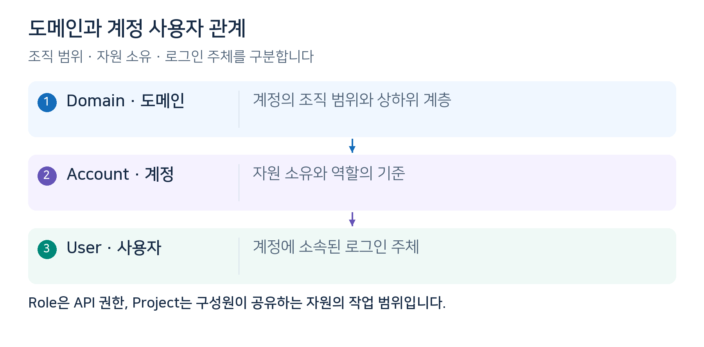

---

### 2.15 인프라스트럭쳐

VM을 실행할 물리·가상 기반을 관리하는 관리자 중심 메뉴입니다. Zone → Pod → 클러스터 → 호스트 순서로 배치 영역과 서버가 연결됩니다.

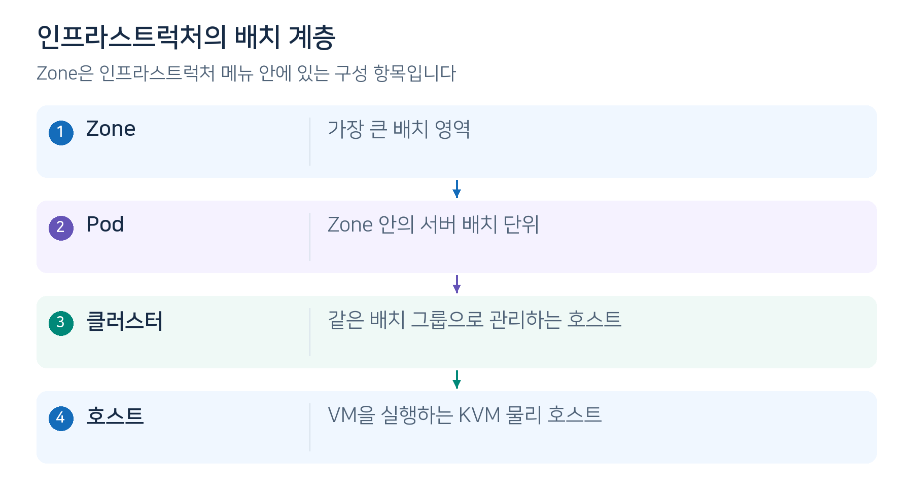

| 하위 메뉴 | 주요 기능 |
| --- | --- |
| 요약 | 전체 인프라의 상태와 수량 요약 |
| Zone | 배치 영역과 하위 구성의 상태 관리 |
| Pod | Zone 안의 서버 배치 단위와 연결 클러스터 관리 |
| 클러스터 | 호스트 묶음과 클러스터 상태 관리 |
| 호스트 | KVM 호스트의 연결 상태·자원·실행 VM 정보와 유지보수 기능 |
| 기본 스토리지 | VM 디스크가 사용하는 스토리지 풀의 용량·상태 관리 |
| 2차 스토리지 | 템플릿·ISO·스냅샷 등을 보관하는 저장소 관리 |
| 백업 저장소 | 백업 연동 저장소와 제공자 설정 관리 |
| Object 스토리지 | 버킷 등 오브젝트 저장 기능의 기반 저장소 관리 |
| 시스템 VM | SSVM·CPVM의 상태·배치·주소와 다운로드·콘솔 서비스 기반 |
| 가상 라우터 | VM 네트워크 서비스를 제공하는 가상 라우터의 상태와 배치 |
| 내부 LB | 내부 로드밸런싱을 제공하는 가상 장비의 상태와 배치 |
| 관리 서버 | Mold 관리 서버의 상태와 연결 정보 |
| CPU 소켓 | 호스트의 CPU 소켓 정보 |
| DB/Usage 서버 | DB 서버와 사용량 서버의 지표 |
| 경보 | 장애와 자원 부족 알림 |
| 경보 규칙 | 경보 발생 조건과 규칙 관리 |

물리 네트워크·네트워크 서비스 제공자·GPU 장치 등은 관련 자원 상세에서 제공될 수 있습니다. 서버 데몬 확인 절차는 9-6절을 참고합니다.

---

### 2.16 서비스 오퍼링

VM·볼륨·네트워크 등에 적용할 사양과 기능의 묶음을 관리합니다. CPU·메모리뿐 아니라 스토리지 조건이나 제공 기능도 포함합니다.

| 서비스 오퍼링의 하위 메뉴 | 무엇을 정하는가 |
| --- | --- |
| 컴퓨트 오퍼링 | VM의 CPU·메모리와 관련 실행 조건 |
| 시스템 오퍼링 | 시스템 VM·가상 라우터 등의 실행 사양 |
| 디스크 오퍼링 | 볼륨 크기·스토리지 조건·I/O 제한 등의 디스크 사양 |
| 백업 오퍼링 | VM이 사용할 백업 서비스와 정책 |
| 네트워크 오퍼링 | 네트워크 유형과 DHCP·NAT·방화벽 등 제공 기능 |
| VPC 오퍼링 | VPC에서 사용할 네트워크 서비스 구성 |

---

### 2.17 구성

서비스 전체 또는 환경별 동작을 정하는 설정을 관리합니다.

| 하위 메뉴 | 주요 기능 |
| --- | --- |
| 글로벌 설정 | 설정 이름·현재 값·기본값·설명과 적용 범위 관리 |
| LDAP 구성 | 외부 디렉터리의 사용자 인증 연동 정보 관리 |
| OAuth 구성 | 외부 로그인 제공자의 인증 연동 정보 관리 |
| 하이퍼바이저 기능 | 하이퍼바이저의 기능·제약 정보 관리 |
| 게스트 OS 카테고리들 | 이미지의 OS 분류 관리 |
| 게스트 OS | 이미지에 사용하는 OS 목록 관리 |
| 게스트 OS 매핑 | Mold OS 항목과 하이퍼바이저 OS 유형의 연결 관리 |
| GPU 카드 유형 | GPU 종류와 GPU 프로필 등의 사양 관리 |

글로벌 설정은 적용 범위와 재시작 필요 여부가 항목별로 다릅니다. SystemVM의 router.template.kvm 설정은 부록 E-3에서 다룹니다. GPU 프로필은 GPU 카드 등의 관련 상세에서 제공합니다.

---

### 2.18 확장

외부 연동 모듈의 등록과 활성화, 연결 자원과 사용자 정의 작업을 관리합니다. 상세의 자원·사용자 정의 작업·이벤트 탭에서 연동 정보를 확인합니다. 사용자 정의 작업은 연결된 자원의 상세 화면에도 표시될 수 있습니다.

---

### 2.19 도구

코멘트·사용량·자원 가져오기와 Webhook 관련 기능을 제공합니다.

| 하위 메뉴 | 주요 기능 |
| --- | --- |
| 코멘트 | 자원에 남긴 메모 조회·관리 |
| 사용량 | 기간·계정 등의 조건에 따른 사용량 기록 조회 |
| 인스턴스 가져오기-내보내기 | 기존 VM의 Mold 관리 등록 또는 관리 대상 제외 |
| 데이터 볼륨 가져오기 | 기존 볼륨의 관리 등록 또는 관리 대상 제외 |
| Webhooks | 이벤트의 외부 전달 설정과 전송 이력 관리 |
| Webhook deliveries | Webhook의 전송 결과와 전송 이력 조회 |

사용량 기록은 실시간 VM 메트릭과 구분합니다. 인스턴스·볼륨 가져오기는 기존 자원을 Mold 관리 대상으로 등록하는 기능입니다.

---

### 2.20 할당

사용량에 따른 비용·잔액·요금 기준과 알림을 관리합니다. 해당 기능이 활성화된 환경에서 제공합니다. 계정의 VM 개수 등 자원 한도와는 다른 개념입니다.

| 하위 메뉴 | 주요 기능 |
| --- | --- |
| 요약 | 계정별 사용량·비용·잔액·크레딧 정보 |
| 요금 | 사용량에 적용할 요금 기준 관리 |
| 이메일 템플릿 | 할당 관련 알림 이메일의 내용 관리 |

---

### 2.21 API 문서

API별 요청 인자·필수 항목·응답 필드를 설명합니다. 제공되는 API와 문서 내용은 서버 버전과 계정 권한에 따라 달라질 수 있습니다. 오류와 로그 분석은 10장에서 다룹니다.

---

### 2.22 학습 완료 확인

아래 항목으로 메뉴의 역할과 연결 관계를 이해했는지 점검합니다.

- [ ] VM·볼륨·네트워크·이미지를 각각 어떤 메뉴에서 관리하는지 설명할 수 있는가?
- [ ] 자원 목록과 상세 탭, 검색·필터·프로젝트 범위의 역할을 설명할 수 있는가?
- [ ] VM과 볼륨·NIC·템플릿의 관계를 설명할 수 있는가?
- [ ] 계정·도메인·역할·프로젝트의 차이를 설명할 수 있는가?
- [ ] 일반 자원 메뉴, 관리자 인프라 메뉴와 환경별 확장 기능을 구분할 수 있는가?

메뉴 확인일: 2026-10-12. 메뉴 이름과 주요 기능은 저장소의 한국어 UI 구성 기준입니다. 배포된 교육 서버의 버전·권한·활성 기능에 따라 화면은 달라질 수 있습니다.

---

# CHAPTER 3. 필요한 기초 지식 (Prerequisites)

> ** 챕터 3 학습 목표**  
> 관리 서버(CCVM)와 물리 호스트(KVM)의 인프라 역할 차이를 명확히 이해하고, 각 환경별 핵심 명령어(systemd, 로그, virsh, DB, Git, API)를 혼동 없이 실무에서 실행할 수 있다.

---

### 3.1 클라우드 가상화·인프라 용어 사전

| 용어 | 영문 명칭 | 설명 및 비유 |
| :--- | :--- | :--- |
| **CCVM** | Cloud Controller VM | Mold 관리 서버(`mold.service`), `mold-usage.service`, MySQL DB가 상주하여 실행되는 중앙 컨트롤러 가상 머신. |
| **SCVM** | Storage Controller VM | ABLESTACK Glue(오픈소스 Ceph 기반) 분산 스토리지를 관리 및 제어하는 스토리지 전용 컨트롤러 가상 머신. |
| **Host (호스트)** | Host | 가상 머신(CCVM, SCVM 및 일반 사용자 VM)들이 직접 구동되는 단일 물리 하이퍼바이저 서버 (KVM 및 Mold Agent 탑재). |
| **Zone (존)** | Zone | 데이터센터 하나에 해당하는 가장 큰 물리/논리 단위 (전원, 네트워크 격리). |
| **Pod (파드)** | Pod | Zone 내부의 랙(Rack) 단위. 동일한 L2 브로드캐스트 도메인을 공유하는 호스트 묶음. |
| **Cluster (클러스터)** | Cluster | 동일한 하이퍼바이저와 공유 스토리지를 공유하는 물리 서버(Host)들의 집합. |
| **Primary Storage** | 주 스토리지 | 실행 중인 VM의 가상 디스크(Root/Data Volume)가 실시간으로 읽고 쓰는 고성능 스토리지 (ABLESTACK Glue, NFS, 로컬 디스크 등). |
| **Secondary Storage** | 보조 스토리지 | OS 설치 템플릿(QCOW2), ISO 이미지, 백업 스냅샷을 영구 보관하는 대용량 스토리지. |
| **Service Offering** | 컴퓨팅 사양 | VM에 할당할 vCPU 개수, RAM 크기, CPU 속도 등의 템플릿 사양. |
| **Libvirt** | Libvirt | Linux에서 QEMU/KVM 하이퍼바이저를 일관된 C/Java API 및 `virsh` CLI로 제어하는 오픈소스 가상화 드라이버 계층 (물리 호스트의 Mold Agent가 이를 직접 제어). |

---

### 3.2 Linux와 서버별 기본 명령

> [!IMPORTANT]
> ** 필수 개념: 어디에서 실행하는 명령어인가? (CCVM vs 물리 호스트 분리)**  
> ABLESTACK Mold 서비스는 단일 서버 구조가 아닙니다.  
> 1. **관리 서버는 클러스터 내 전용 컨트롤러 가상 머신인 CCVM (Cloud Controller VM)** 내부에서 `mold.service` 데몬으로 구동됩니다.  
> 2. **에이전트는 실제 KVM 하이퍼바이저 물리 호스트 (Bare-Metal)** 내부에서 `mold-agent.service` 데몬으로 구동됩니다.  
> 
> 따라서 신입 개발자는 **내가 지금 실행하려는 작업이 관리 서버(CCVM) 작업인지, 아니면 가상 머신을 직접 띄우는 물리 호스트(KVM) 작업인지**를 명확히 구분하고 대상 서버에 SSH 접속해야 합니다.

#### 1) 실행 환경(인프라 노드) 구분 매트릭스

| 환경 구분 | 실행 위치 (호스트명 예시) | 접속 방법 (SSH / 로컬) | 구동 주요 서비스 / 프로세스 | 개발자 핵심 작업 |
| :--- | :--- | :--- | :--- | :--- |
| **개발 PC (Mac)** | 개발자 개인 PC (로컬 macOS) | 로컬 zsh 터미널 | Node.js (팀 확정 버전), VS Code, IntelliJ, Git | UI 로컬 개발 서버 (`npm start`), 소스 코드 편집, Git 형상 관리 |
| **관리 서버 (CCVM)** | 컨트롤러 가상 머신 (`ccvm`, 예: `10.10.x.10`) | `[Mac] ssh <SSH-사용자>@<CCVM-IP>` | `mold.service`, `mold-usage.service`, MySQL DB (`cloud`) | HTTP API 제공(8080), 비동기 작업(Job) 스케줄링, DB 쿼리, 에이전트 명령 하달 |
| **물리 호스트 (KVM)** | 물리 하이퍼바이저 서버 (`ablecube-1`, 예: `10.10.x.1~3`) | `[Mac] ssh <SSH-사용자>@<호스트IP>`<br>또는 `[CCVM]`에서 SSH 점프 | `mold-agent.service`, `libvirtd`, `qemu-kvm` 프로세스 | KVM 가상 머신 상태 진단(`virsh`), Libvirt 제어, Ceph/Glue 디스크 마운트 확인 |

---

#### 2) [관리 서버 (CCVM)] 전용 핵심 명령어 세트

관리 서버(CCVM)에 SSH 접속(`ssh <SSH-사용자>@<CCVM-IP>`)한 상태에서 수행하는 명령어입니다.

* **Mold 관리 서버 데몬 제어 (`systemctl`)**:
  ```bash
  # Mold 관리 서버 데몬 상태 점검 (Active: active (running) 확인)
  # 실행 위치 관리 서버 (CCVM)
  sudo systemctl status mold.service

  # 관리 서버 재시작 (본인 작업 범위의 교육 서버에서 대상과 진행 중 작업 확인 후)
  sudo systemctl restart mold.service

  # 관리 서버 시작 및 중지 (허용된 교육 실습 범위에서만)
  sudo systemctl start mold.service
  sudo systemctl stop mold.service

  # Mold Usage 서비스 상태 확인 (과금 및 리소스 사용량 집계 데몬)
  sudo systemctl status mold-usage.service
  ```

* **관리 서버 로그 읽기**:
  ```bash
  # 실행 위치 관리 서버 CCVM
  tail -f /var/log/cloudstack/management/management-server.log
  ```
  `tail -f`는 새 로그를 계속 표시하며 `Ctrl+C`로 종료합니다. 오류·Job·VM별 상세 검색은 10-2절을 참고합니다.

* **관리 서버 네트워크 리스닝 포트 확인**:
  ```bash
  # 8080(HTTP API 및 웹 UI), 8250(물리 호스트 에이전트와의 TCP 통신) 포트 활성 확인
  # 실행 위치 관리 서버 (CCVM)
  sudo ss -tlpn | grep -E "8080|8250"
  # 또는 netstat 사용 시
  sudo netstat -tlpn | grep -E "8080|8250"
  ```

DB 접속과 SELECT 조회는 3-6절에서 다룹니다.

---

#### 3) [물리 호스트 (KVM Hypervisor)] 전용 핵심 명령어 세트

실제 하이퍼바이저 물리 서버(`ablecube-1`, `ablecube-2` 등)에 SSH 접속한 상태에서 수행하는 명령어입니다.

* **Mold Agent 및 Libvirt 데몬 제어 (`systemctl`)**:
  ```bash
  # Mold Agent 데몬 상태 점검 (Active: active (running) 확인)
  # 실행 위치 물리 호스트 (KVM)
  sudo systemctl status mold-agent.service

  # Mold Agent 데몬 재시작 / 시작 / 중지 (본인 작업 범위의 교육 호스트에서 진행 중 작업 확인 후)
  sudo systemctl restart mold-agent.service
  sudo systemctl start mold-agent.service
  sudo systemctl stop mold-agent.service

  # 가상화 핵심 드라이버(Libvirt) 서비스 상태 확인
  sudo systemctl status libvirtd.service
  ```

* **에이전트 실시간 로그 모니터링**:
  ```bash
  # Mold Agent 실시간 로그 추적 (CCVM 관리 서버로부터 수신한 Command 실행 및 Answer 반환 내역)
  # 실행 위치 물리 호스트 (KVM)
  tail -f /var/log/cloudstack/agent/agent.log

  ```

* **하이퍼바이저 가상 머신(QEMU/KVM 도메인) 직접 점검 (`virsh`)**:
  ```bash
  # 해당 물리 호스트에서 실행 중인 전체 KVM 가상 머신 도메인 목록 확인
  # 실행 위치 물리 호스트 (KVM)
  sudo virsh list --all

  # 특정 가상 머신(예: i-2-5-VM)의 상세 vCPU, 메모리, 상태 확인
  sudo virsh dominfo i-2-5-VM

  # 호스트에서 실행 중인 QEMU 프로세스 확인
  ps aux | grep qemu-kvm
  ```

* **스토리지 마운트 및 Libvirt 풀 상태 확인**:
  ```bash
  # /mnt 아래에 마운트된 파일 기반 스토리지 경로 점검
  # 실행 위치 물리 호스트 (KVM)
  df -h | grep /mnt/

  # Libvirt 스토리지 풀 활성화 목록 확인
  sudo virsh pool-list
  ```

  `df`는 마운트된 파일 시스템을 조회합니다. Ceph RBD 볼륨 상태까지 이 명령으로 확인했다고 판단하지 않고, 저장소 유형과 VM의 디스크 연결 정보를 함께 확인합니다. KVM 시작 경로는 transient 도메인을 생성하므로 정지한 Mold VM이 `virsh list --all`에 계속 표시된다고 가정하지 않습니다.

---

#### 4) [네트워크 점검] 호스트 간 포트 및 통신 연결성 확인

컴포넌트 간 통신 단절(네트워크/방화벽 문제) 발생 시 원인을 빠르게 진단하는 명령어입니다.

```bash
# 1. 개발 Mac에서 CCVM의 HTTP API 포트(8080) 연결 확인
# 실행 위치 개발 PC (Mac)
nc -zv <CCVM-IP> 8080

# 2. 물리 호스트에서 CCVM으로의 에이전트 통신 포트(8250) 연결 확인 (필수)
# 실행 위치 물리 호스트 (KVM)
nc -zv <CCVM-IP> 8250

# 3. CCVM에서 물리 호스트로의 SSH(22) 연결 확인
# 실행 위치 관리 서버 (CCVM)
nc -zv <물리호스트-IP> 22
```

---

### 3.3 Git 버전 관리 및 브랜치 협업 흐름

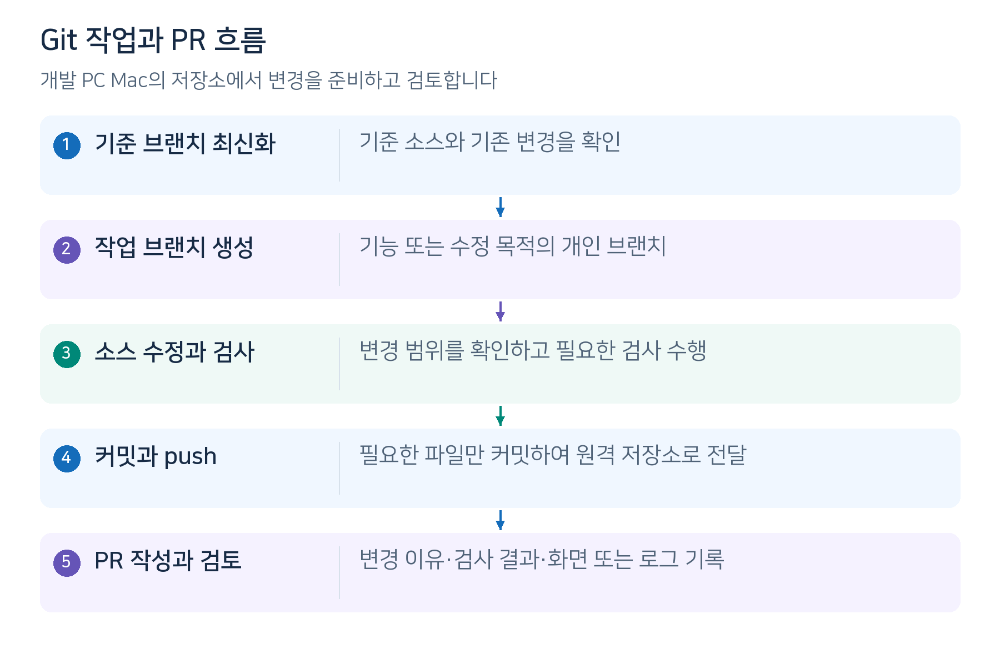

Mold 저장소(`ablestack-mold`)는 여러 개발자가 동시에 협업하는 대규모 프로젝트입니다. 모든 Git 작업은 **[개발 PC (Mac)]**의 로컬 작업 영역에서 수행합니다.

1. **브랜치 명명 규칙**:
   - 기능 개발: `feat/<기능명>` 또는 `feat/issue-<이슈번호>` (예: `feat/vm-disk-resize`)
   - 버그 수정: `fix/<버그요약>` (예: `fix/ui-login-error`)
2. **커밋 메시지 규칙 (Conventional Commits)**:
   ```text
   <타입>(<영역>): <제목>
   
   [본문: 변경 이유 및 해결 내용 상세 설명]
   
   [이슈 링크 또는 참조]
   ```
   * **예시**:
     * `feat(ui): 인스턴스 상세 정보 탭에 IP 변경 버튼 추가`
     * `fix(kvm): SharedMountPoint 하위 경로 볼륨 조회 지원`
     * `docs: 신입 개발자 온보딩 가이드 추가`
3. **표준 Git 작업 명령어**:
   ```bash
   # 기준 브랜치 최신화 및 새 작업 브랜치 생성
   # 실행 위치 개발 PC (Mac)
   git checkout europa-2026
   git pull origin europa-2026
   git checkout -b feat/vm-disk-resize

   # 수정 파일 확인, 필요한 파일만 스테이징 및 커밋
   git diff
   git add ui/public/locales/ko_KR.json
   git commit -m "feat(ui): 인스턴스 상세 정보 탭에 IP 변경 버튼 추가"

   # 원격 저장소로 브랜치 푸시
   git push origin feat/vm-disk-resize
   ```

---

### 3.4 Java와 Maven 멀티 모듈 구조

루트 `pom.xml`의 `cs.jdk.version=11`은 소스와 바이트코드 컴파일 기준입니다. 실제 CI 빌드에는 JDK 17이 사용되고, 현재 Rocky 패키징 스펙은 Java 17 런타임을 요구합니다. 이 세 가지 기준을 구분해야 합니다. 컴파일 타깃이 11이라는 이유만으로 모든 모듈과 테스트가 JDK 11에서 동작한다고 보장할 수는 없습니다.

교육용 Mac은 JDK 17을 기본으로 준비하고 `java -version`, `mvn -v`, IDE의 Project SDK와 Maven 실행 JDK를 함께 확인합니다. 버전과 경로가 다르면 터미널에서 분석한 결과와 IDE의 결과가 달라질 수 있습니다.

Maven은 루트 `pom.xml`과 각 모듈의 `pom.xml`을 읽어 의존성과 빌드 구성을 관리합니다. `api`, `core`, `server`, `engine`, `plugins`는 서로 필요한 클래스와 모듈을 참조합니다. IDE에서 루트 POM을 Maven 프로젝트로 가져온 뒤 클래스 정의와 호출 관계를 탐색합니다.

일반 개발자는 로컬 PC에서 소스를 수정하고 Maven 빌드와 테스트를 확인한 뒤, 원격 저장소에 변경을 올립니다. 연구소의 Rocky Linux 9 빌드서버가 소스를 받아 최종 RPM을 생성합니다. 로컬 예시는 5-10절, 빌드서버 실습은 9-2절을 참고합니다. GitHub Actions 자동화 빌드는 부록 F에서 별도로 설명합니다.

근거: `pom.xml`, `.github/workflows/ci.yml`, `packaging/centos8/cloud.spec`, `developer/build-release-policy.ko.md`.

---

### 3.5 Vue.js & npm/Node.js 프론트엔드 기초

Mold의 `ui/` 프로젝트는 **Vue.js (Vue 3) + Ant Design Vue** 기반입니다.

* **단일 파일 컴포넌트(SFC, `.vue`)**:
  * `<template>`: HTML 마크업 및 Ant Design 컴포넌트 (`<a-button>`, `<a-table>` 등)
  * `<script>`: 자바스크립트 비즈니스 로직, 반응형 상태(`ref`, `reactive`), API 호출
  * `<style>`: Less / CSS 스타일 시트
* **Axios & API 통신**:
  * `src/api/index.js`에 공통 API 호출 유틸리티(`callAPI`, `getAPI`, `postAPI`)가 정의되어 있어, 백엔드 명령을 호출할 때 함수 하나로 편리하게 처리합니다.
* **다국어(i18n)**:
  * `ui/public/locales/ko_KR.json`, `en.json`에 키-값 형태로 다국어 텍스트가 분리되어 있습니다. UI 템플릿에서는 `$t('label.virtual.machine')` 형태로 렌더링됩니다.

---

### 3.6 HTTP Command API와 MySQL 상태 조회

Mold API는 `command` 파라미터로 작업을 지정하는 Query Command 방식입니다. 대표 경로는 `/client/api`이며 개발 UI도 `/client` 경로를 원격 관리 서버로 프록시합니다. HTTP 메서드와 파라미터 위치는 공통 래퍼와 실제 Network 요청에서 확인합니다.

`listVirtualMachines` 같은 조회는 GET을 사용하고, VM 시작은 현재 UI 래퍼에서 POST를 사용합니다. 조회 예제도 인증이 필요합니다. 로그인한 교육 계정의 Network 요청에서 파라미터와 응답을 먼저 확인하고, 별도 API 실습에서는 본인 교육 계정에 허용된 세션 또는 API 인증 방식을 사용합니다. 인증 없이 실행한 curl이 성공할 것이라고 가정하지 않습니다.

| 대상 | 확인 목적 |
| :--- | :--- |
| `vm_instance` | VM 내부 ID, 이름, 상태와 현재 호스트 |
| `volumes` | 볼륨 정보와 스토리지 풀 연결 |
| `async_job` | Job UUID, 내부 ID, 명령과 처리 결과 |
| `host` | KVM 호스트 연결 상태와 주소 |

DB 내부 숫자 ID와 외부 API UUID를 구분합니다. 아래 명령은 CCVM에서 접속한 뒤 MySQL 프롬프트에서 실행합니다.

* **MySQL `cloud` 데이터베이스 직접 조회**:
```bash
# CCVM 내 MySQL cloud DB 접속
# 실행 위치 관리 서버 (CCVM)
mysql -u <교육용-조회-사용자> -p cloud

```

아래 SELECT는 MySQL 프롬프트에서 실행합니다. 교육용 읽기 권한 계정을 사용합니다.

```sql
-- 가상 머신 목록 및 현재 상태(State) 조회
SELECT id, name, state, host_id, created FROM vm_instance ORDER BY id DESC LIMIT 5;

-- 비동기 작업 상태: job_status 0=진행중, 1=성공, 2=실패
SELECT id, uuid, user_id, job_cmd, job_status, job_result_code FROM async_job ORDER BY id DESC LIMIT 5;

-- 연결된 KVM 물리 호스트 상태 확인 (status: Up/Down)
SELECT id, name, status, type, private_ip_address FROM host WHERE type='Routing';
```

DB 조회는 진단 자료를 수집하는 절차입니다. 상태를 고치기 위해 직접 UPDATE하거나 진행 중 Job을 삭제하지 않습니다. API 결과, DB, 관리 서버와 Agent 로그를 같은 시각의 자료로 비교합니다.

---

### 3.7 챕터 3 학습 완료 기준 점검
- [ ] CCVM(관리 서버 VM)과 물리 호스트(KVM)의 역할 차이를 설명하고, `mold.service`와 `mold-agent.service`가 각각 어디서 구동되는지 설명할 수 있는가?
- [ ] CCVM에서 `tail -f`로 관리 서버 로그를 읽고, 상세 오류·Job 검색 방법을 10-2절에서 찾을 수 있는가?
- [ ] 물리 호스트에서 `sudo virsh list --all` 명령어로 실제 구동 중인 KVM 가상 머신 도메인을 확인할 수 있는가?
- [ ] Zone, Pod, Cluster, Host의 계층 구조를 큰 단위부터 순서대로 나열할 수 있는가?
- [ ] Primary Storage와 Secondary Storage의 역할 차이를 설명할 수 있는가?

---

# CHAPTER 4. 교육 전 사전 준비 (Getting Ready)

> ** 챕터 4 학습 목표**  
> 저장소 접근 권한을 획득하고, 개발용 IDE와 개인별 실습 계정을 준비한 뒤 교육용 Mold 관리 서버에 접속한다.

---

### 4.1 사내 저장소(GitHub) 접근 권한 획득

#### 1) 왜 필요한가
소스 코드 다운로드와 PR 제출을 위해 팀에서 지정한 저장소의 접근 권한을 확인합니다. 사내 Organization 저장소라면 초대와 SSO 절차를 진행하고, 직접 브랜치 푸시 권한이나 팀에서 정한 fork 방식도 확인합니다.

#### 2) 설정 방법
1. 저장소 접근 권한이 없다면 저장소 관리자에게 본인의 GitHub 아이디를 전달하여 권한을 요청합니다.
2. 이메일 또는 GitHub 알림으로 도착한 사내 Organization 초대 링크를 수락합니다.
3. 터미널 `[개발 PC (Mac)]`에서 저장소 접근 가능 여부를 확인합니다:
   ```bash
   # 저장소 원격 접근 권한 및 브랜치 확인
   # 실행 위치 개발 PC (Mac)
   git ls-remote https://github.com/jschoiRR/ablestack-mold.git
   ```

#### 3) 정상 결과
브라우저에서 `https://github.com/jschoiRR/ablestack-mold` (또는 지정된 사내 원격 저장소) 접속 시 소스 코드와 커밋 히스토리가 정상 표시됩니다.

#### 4) 실패 시 확인할 곳
- `404 Not Found`가 발생할 경우: 사내 Organization 초대 메일 수락이 완료되었는지 확인합니다.
- SSO(Single Sign-On) 인증이 요구되는 경우: GitHub 설정의 Organization 접근 권한에서 SSO 인증을 클릭합니다.

---

### 4.2 사용할 IDE 확인

UI 개발은 VS Code, Java 코드 탐색과 디버깅은 IntelliJ IDEA를 기준으로 합니다. 회사에서 사용할 제품과 라이선스, 기존 설치 여부를 확인합니다. 실제 설치와 플러그인 설정은 Homebrew 준비 후 5-6절에서 진행합니다.

---

### 4.3 교육 서버와 실습 계정 확인

#### 1) 왜 필요한가
실습 중 다른 개발자의 리소스와 충돌하지 않도록, 본인 전용의 도메인(Domain)이나 계정(Account), 테스트 VM 자원을 부여받고 관리 서버 접속 정보를 확인합니다.

#### 2) 설정 방법
교육 시작 전에 아래 기본 정보를 확인합니다. 비밀번호·토큰·개인키는 표에 적지 않습니다.

| 확인 항목 | 확인하여 기록할 값 |
| --- | --- |
| 웹 콘솔과 API | CCVM 주소·포트·웹 콘솔 URL·API URL |
| SSH 접속 | CCVM과 KVM 호스트의 주소·사용자·접속 방식 |
| Mold 계정 | 본인의 User·Account·Domain·Role·Project |
| 실습 범위 | 허용된 VM·서버 작업과 공용 자원 사용 일정 |

로그인은 호출자의 신원을 확인하는 것이고, Role은 사용할 API, 자원 권한은 접근할 VM의 범위를 결정합니다. 세 항목을 구분하며 자세한 설명과 자원 기록표는 부록 A를 참고합니다.

1. 팀에서 공유한 실습 환경 정보에서 본인에게 할당된 서버와 계정을 확인합니다. 정보가 없거나 접근 권한이 없으면 환경 담당자에게 요청합니다:
   - **웹 콘솔 주소**: `http://<CCVM-IP>:8080/client/` (실제 교육 서버 주소로 바꿈)
   - **웹 콘솔 계정**: 본인에게 발급된 교육 계정, Domain 및 Role 확인
   - **서버 SSH 접속**: `ssh <SSH-사용자>@<CCVM-IP>` (팀이 발급한 접속 방식 사용)
2. 터미널에서 웹 콘솔 포트 연결 및 SSH 접속을 확인합니다:
   ```bash
   # 1. Mold 웹 콘솔 및 API 서비스 포트(8080) 연결 테스트
   # 실행 위치 개발 PC (Mac)
   curl -I http://<CCVM-IP>:8080/client/

   # 2. 관리 서버(CCVM) SSH 접속 테스트
   ssh <SSH-사용자>@<CCVM-IP>
   ```
3. 브라우저로 접속하여 로그인을 시도합니다.

#### 3) 정상 결과
* SSH 접속 후 `hostname`으로 대상 교육 서버를 확인합니다. 로그인 사용자는 교육 환경에 따라 다릅니다.
* 브라우저 로그인 성공 후 대시보드가 열리며 존(Zone), 인스턴스(VM), 스토리지 등의 현황 카드가 정상 표시됩니다.

#### 4) 실패 시 확인할 곳
- 화면에 아무것도 뜨지 않거나 404가 뜰 경우: 교육 환경 정보에 기록된 URL의 호스트·포트·`/client/` 경로와 프록시 사용 여부를 확인합니다.
- 'Invalid username or password' 오류: Caps Lock 활성화 여부 및 대소문자를 확인합니다.

---

### 4.4 Codex 교육용 계정과 사용 환경 확인

#### 1) 왜 필요한가

Codex는 선택한 프로젝트의 파일을 읽고, 허용된 범위에서 수정과 명령 실행을 수행합니다. 교육 전에 사용할 계정과 작업 폴더, 권한 범위를 맞춰야 같은 실습을 재현할 수 있습니다. 이 안내서는 **교육에 사용하는 macOS 데스크톱 앱**을 기준으로 합니다. 설치된 배포본에 따라 Codex 앱으로 표시되거나 ChatGPT 데스크톱 앱 안에서 Codex를 선택할 수 있으므로, 설치한 앱의 실제 이름·버전을 직접 확인하고 기록합니다.

#### 2) 설정 방법

아래 항목을 직접 확인하여 부록 A의 교육 환경 기록표에 기입합니다. 계정이나 접근 정보가 없다면 해당 관리자에게 요청합니다. 회사가 사용하는 요금제나 계정 제공 방식은 이 문서에서 가정하지 않습니다.

| 확인 항목 | 교육 전에 기록할 값 |
| --- | --- |
| 로그인 계정 | 회사가 교육용으로 승인한 계정과 필요한 조직·워크스페이스 |
| 사용 가능 여부 | 해당 계정의 Codex 이용 가능 여부와 조직의 기능 제한 |
| 설치 경로 | 공식 배포본 또는 회사가 지정한 앱 배포 경로 |
| 교육 대상 | 클론한 Mold 폴더, 기준 브랜치, 실습용 작업 범위 |
| 문의 담당자 | 계정·로그인 및 개발 환경 문의 채널 |

일반적인 계정 사용 경로는 앱에서 **ChatGPT 계정으로 로그인**하는 것입니다. API 키 방식도 제공되지만, 계정 로그인으로 교육을 진행할 때 API 키 발급은 필수 준비 사항이 아닙니다. 비밀번호·토큰·API 키를 교재나 프롬프트에 적지 않습니다. 설치와 로그인 흐름은 [OpenAI 공식 시작 안내](https://learn.chatgpt.com/docs/quickstart)를 확인합니다.

#### 3) 정상 결과

교육용 계정의 이용 권한과 앱 배포 경로를 확인한 상태입니다. 앱이 설치돼 있다면 로그인과 새 작업 시작도 확인합니다. 교육 대상 폴더와 기준 브랜치를 설명할 수 있으며, 소스 편집과 외부 서비스 접근에 어떤 권한이 적용되는지 확인한 상태입니다. 모델 이름이나 사용 한도는 계정과 시점에 따라 달라지므로 교육 당일 화면을 기준으로 기록합니다.

앱을 아직 설치하지 않은 교육생은 5-7절에서 회사가 지정한 설치 경로와 로그인까지 확인한 뒤 첫 작업을 시작합니다.

#### 4) 실패 시 확인할 곳

로그인은 되지만 Codex를 사용할 수 없다면 로그인 계정·조직 선택·이용 권한을 담당자에게 확인합니다. 로그인 창이 반복되면 앱 버전과 발생 시각, 인증 오류 문구를 기록합니다. 인증서·프록시 관련 오류는 회사 네트워크 담당자와 확인하며, 다른 사람의 계정이나 인증 파일을 복사해 해결하지 않습니다.

---

### 4.5 챕터 4 학습 완료 기준 점검
- [ ] 교육용 Codex 계정과 앱 배포 경로, 문의 담당자를 확인하였는가?
- [ ] SSH 명령어로 교육용 Mold 관리 서버(CCVM)에 정상 접속할 수 있는가?
- [ ] 브라우저에서 교육용 Mold 관리 서버 웹 콘솔에 정상 로그인하여 VM 목록을 열람할 수 있는가?

---

# CHAPTER 5. 개발 환경 설정 (macOS 기준)

> ** 챕터 5 학습 목표**  
> 신입 개발자의 Mac 환경에 툴체인(팀 확정 Node, JDK 17, Git)을 구축하고, 교육에서 확정한 로컬 Mold UI 환경을 기동하여 원격 Mold 관리 서버와 실시간으로 연동할 수 있다.

---

### 5.1 도구 버전과 교육 환경 기록

저장소의 설치 문서와 CI에는 서로 다른 버전이 있습니다. 이 표는 소스에서 확인한 기준이며, Mac에서의 실행 검증 결과는 교육 환경 기록표에 별도로 남깁니다. Node 16.20.2를 포함한 macOS 후보 버전의 호환성을 검증 없이 확정하지 않습니다.

| 도구 | 소스에서 확인한 기준 | 교육용 Mac에서 기록할 내용 |
| :--- | :--- | :--- |
| macOS와 CPU | macOS 중심 교육 | `sw_vers`, `uname -m`, 사용 중인 셸 |
| Node와 npm | UI CI는 Node 14.21.3 | 팀 확정 버전, 설치 경로, npm 버전, UI 기동·lint·unit 결과 |
| JDK | 컴파일 타깃 11, CI 및 Rocky 런타임 17 | JDK 17 경로, IDE SDK와 Maven JDK 일치 여부 |
| Maven | 빌드 참고 기준 3.9.10 | `mvn -v` 출력과 사용할 검증 프로파일 |
| Python | `.python-version`은 3.10 | 테스트 도구가 필요할 때 환경과 의존성을 확인 |
| Homebrew와 IDE | 설치 시 공식 지원 환경 확인 | 실제 설치 버전과 경로 |

Apple Silicon에서 Node 14를 그대로 설치하는 과정은 CPU 아키텍처에 따른 제약이 있습니다. 공식 nvm 문서의 macOS 안내를 확인하고, CI와 같은 검증은 Actions에서 수행합니다. 팀의 교육 환경 정보에서 로컬 버전을 확인하고, 본인 Mac에서 `npm ci`, UI 기동, 수정 없는 lint와 unit test를 실행한 결과를 기록합니다.

검증 기록 항목: Mac 모델과 CPU / macOS 버전 / Node·npm·JDK·Maven / 소스 SHA / 실행 명령 / 결과 / 확인자 / 확인일. 부록 A의 환경표에 최종 값을 기입합니다.

참고: `.github/workflows/ui.yml`, `.java-version`, `.python-version`, `pom.xml`, [nvm macOS 안내](https://github.com/nvm-sh/nvm#macos-troubleshooting).

---

### 5.2 macOS 기본 도구와 Homebrew

먼저 macOS 버전과 CPU 종류를 확인합니다. Apple Silicon은 `arm64`, Intel은 `x86_64`로 표시됩니다. Rosetta 셸을 사용하는 경우 설치 경로와 아키텍처도 함께 확인합니다.

```bash
# 실행 위치 개발 PC Mac
sw_vers
uname -m
xcode-select -p
git --version
```

Homebrew가 없다면 [공식 설치 안내](https://docs.brew.sh/Installation)의 지원 환경과 설치 절차를 확인합니다. 설치 프로그램이 출력하는 Next steps를 따라 셸에 경로를 등록합니다. 기본 경로는 Apple Silicon에서 `/opt/homebrew`, Intel 환경에서 일반적으로 `/usr/local`이며 실제 설치 경로를 우선합니다.

```bash
# 실행 위치 개발 PC Mac
/bin/bash -c "$(curl -fsSL https://raw.githubusercontent.com/Homebrew/install/HEAD/install.sh)"
brew --version
brew --prefix
```

새 터미널에서도 `brew --version`이 출력되어야 합니다. Command Line Tools가 필요하고 설치되어 있지 않다면 `xcode-select --install`을 실행합니다. PATH 설정을 반복 추가하기 전에 `.zprofile`과 `.zshrc`의 기존 설정을 확인합니다.

---

### 5.3 Node 버전 선택과 nvm 설정

Node는 프로젝트별로 버전을 선택할 수 있도록 nvm으로 관리합니다. nvm 공식 설치 방식을 사용하고, 이미 설치된 nvm은 중복 설치하지 않습니다. 아래 스크립트 버전은 소스 대조일의 공식 안내를 기준으로 합니다.

```bash
# 실행 위치 개발 PC Mac
curl -o- https://raw.githubusercontent.com/nvm-sh/nvm/v0.40.8/install.sh | bash
source ~/.zshrc
command -v nvm
```

정상 결과는 `nvm`입니다. 출력되지 않으면 설치 프로그램이 어느 셸 프로필을 수정했는지 확인합니다. nvm은 셸 함수이므로 실행 파일만 찾는 `which`보다 `command -v nvm`을 사용합니다.

팀에서 공유한 교육용 Node 버전을 확인하여 부록 A와 아래 변수에 기입합니다. 기준이 없으면 개발 환경 문의 채널에서 확인합니다. 꺾쇠 안의 값은 실제 버전으로 바꿉니다. 현재 UI CI는 Node 14.21.3이며, Mac 로컬 버전이 다르면 그 차이를 기록합니다.

```bash
# 실행 위치 개발 PC Mac
MOLD_NODE_VERSION="<팀에서 확정한 교육용 Node 버전>"
nvm install "$MOLD_NODE_VERSION"
nvm use "$MOLD_NODE_VERSION"
node -v
npm -v
node -p 'process.arch'
command -v node
```

전역 기본 Node 버전을 바꾸기보다 프로젝트 작업 시 확정 버전을 선택합니다. 설치 실패나 OpenSSL 오류가 발생하면 버전·아키텍처·패키지 오류를 기록하고 10-1 절차로 확인합니다.

참고: [nvm 공식 설치와 사용](https://github.com/nvm-sh/nvm).

---

### 5.4 JDK와 Maven 경로 설정

JDK 17을 설치하고 터미널과 IDE가 같은 JDK를 사용하도록 설정합니다. 설치 경로는 `brew --prefix`로 계산하므로 Apple Silicon과 Intel의 경로 차이를 직접 하드코딩할 필요가 없습니다.

```bash
# 실행 위치 개발 PC Mac
brew install openjdk@17
sudo ln -sfn "$(brew --prefix openjdk@17)/libexec/openjdk.jdk" \
  /Library/Java/JavaVirtualMachines/openjdk-17.jdk
```

아래 두 줄을 기존 설정과 중복되지 않게 `.zshrc`에 등록합니다.

```bash
export JAVA_HOME=$(/usr/libexec/java_home -v 17)
export PATH="$JAVA_HOME/bin:$PATH"
```

팀의 개발 환경 기준에서 사용할 Maven 버전을 확인합니다. 저장소의 빌드 참고 기준은 3.9.10입니다. Homebrew 배포본을 사용하도록 정한 환경에서는 아래 명령으로 설치합니다. 설치되는 버전은 실행 시점에 따라 달라질 수 있습니다.

```bash
# 실행 위치 개발 PC Mac
brew install maven
```

팀이 Maven 3.9.10처럼 특정 버전을 지정했다면 [Apache Maven 공식 배포본](https://maven.apache.org/download.cgi)의 이전 버전 안내에서 해당 binary archive를 받아 체크섬을 확인하고 압축을 풉니다. 사용자 도구 폴더에 `apache-maven-3.9.10`을 두었다면 `.zshrc`의 PATH에 해당 `bin` 경로를 등록합니다.

```bash
# 압축을 푼 실제 경로로 바꾸어 .zshrc에 등록
export PATH="$HOME/tools/apache-maven-3.9.10/bin:$PATH"
```

새 터미널에서 `command -v mvn`과 `mvn -v`가 표시하는 Maven 버전 및 Java home을 기록합니다. 터미널의 JDK와 IntelliJ의 프로젝트 SDK·Maven 실행 JDK를 맞춥니다. 설치 과정은 [Maven 공식 설치 안내](https://maven.apache.org/install.html)를 참고합니다.

```bash
# 실행 위치 개발 PC Mac
java -version
/usr/libexec/java_home -V
command -v java
command -v mvn
mvn -v
```

IntelliJ에서는 루트 `pom.xml`을 가져오고 Project SDK와 Maven importer·runner의 JDK를 확인합니다. Java 11 컴파일 타깃과 JDK 17 실행 설정의 관계는 3-4을 참고합니다.

참고: [Homebrew OpenJDK 17 안내](https://formulae.brew.sh/formula/openjdk@17).

---

### 5.5 소스 코드 클론 및 저장소 디렉터리 구성

#### 1) 왜 필요한가
작업용 로컬 PC에 기준 브랜치(`europa-2026`) 소스 코드를 온전하게 다운로드합니다.

#### 2) 설정 방법
```bash
# 1. 작업 디렉터리 생성 및 이동
# 실행 위치 개발 PC (Mac)
mkdir -p ~/WORK
cd ~/WORK

# 2. 기준 브랜치 지정 클론 (사내 저장소 URL 입력)
git clone -b europa-2026 https://github.com/jschoiRR/ablestack-mold.git mold-europa2
cd mold-europa2

# 3. Git 사용자 정보 설정 (사내 메일 기준)
git config user.name "홍길동"
git config user.email "gdhong@ablecloud.com"
```

#### 3) 정상 결과
```bash
# 실행 위치 개발 PC (Mac)
git status
On branch europa-2026
Your branch is up to date with 'origin/europa-2026'.
nothing to commit, working tree clean
```

#### 4) 실패 시 확인할 곳
- `fatal: Remote branch europa-2026 not found`: 브랜치 철자가 맞는지 확인하거나, `git branch -a`로 원격 브랜치 목록을 조회합니다.

---

### 5.6 IDE 설치와 프로젝트 설정

5-2절의 Homebrew 설치와 5-5절의 소스 클론을 마친 뒤 진행합니다.

#### IDE 설치와 확장
* **프론트엔드 (UI 개발 추천: VS Code)**:
  - 아래 `brew` 명령은 5-2의 Homebrew 설치와 PATH 확인을 먼저 완료한 뒤 실행합니다.
  - Homebrew를 통한 설치:
    ```bash
    # 실행 위치 개발 PC (Mac)
    brew install --cask visual-studio-code
    ```
  - 필수 확장(Extensions) 설치:
    - `Vue - Official` (구 Volar): Vue 3 문법 강조 및 자동완성
    - `Prettier - Code formatter`: 코드 포맷팅
    - `ESLint`: 자바스크립트 린트 검사
* **백엔드 (코드 탐색 및 디버깅 추천: IntelliJ IDEA)**:
  - Homebrew를 통한 설치:
    ```bash
    # 실행 위치 개발 PC (Mac)
    brew install --cask intellij-idea-ce
    ```
  - 플러그인: Lombok, Checkstyle, Vue.js 플러그인 확인

#### Mold 프로젝트 설정

1. **VS Code로 프로젝트 열기**:
   ```bash
   # 실행 위치 개발 PC (Mac)
   cd ~/WORK/mold-europa2
   code .
   ```
2. **권장 설정 적용 (`.vscode/settings.json`)**:
   저장소의 `ui/package.json`은 Vue와 Standard ESLint 규칙을 사용합니다. 초기에는 저장 시 일괄 포맷을 끄고 lint 결과를 기준으로 수정합니다. Prettier를 사용할 경우 팀 설정과 일치시키고 변경 범위를 확인합니다.
   ```json
   {
     "editor.formatOnSave": false,
     "eslint.validate": ["javascript", "vue"],
     "files.autoSave": "onFocusChange"
   }
   ```

#### 정상 결과
VS Code 및 IntelliJ에서 `.vue` 및 `.java` 파일을 열었을 때 구문 강조(Syntax Highlighting) 및 코드 정의 바로가기(`Cmd + Click`)가 정상 작동합니다.

#### 실패 시 확인할 곳
- VS Code에서 Vue 파일에 빨간 밑줄이 가득 뜰 경우: Vetur 확장이 설치되어 있다면 비활성화하고 `Vue - Official` 확장만 활성화되어 있는지 확인합니다.

---

### 5.7 Codex 설치와 Mold 프로젝트 설정

#### 1) 왜 필요한가

Codex가 올바른 저장소와 브랜치를 읽는지 먼저 확인해야 이후 코드 설명과 수정 결과를 검토할 수 있습니다. IDE에서 파일이 열린 상태와 Codex 작업에 연결된 폴더는 별도로 확인합니다. 첫 작업의 목표는 **설정과 소스 조회가 정상인지 확인하는 것**입니다.

#### 2) 설정 방법

**앱 설치와 프로젝트 연결**

[OpenAI 공식 시작 안내](https://learn.chatgpt.com/docs/quickstart)에서 macOS용 다운로드 경로를 확인하고, 회사가 지정한 배포 방식이 있으면 그 방식을 사용합니다. 승인된 ChatGPT 계정으로 로그인한 뒤 소프트웨어 개발용 Codex 화면에서 5-5절에서 클론한 `~/WORK/mold-europa2` 폴더를 엽니다. 홈 폴더 전체를 프로젝트로 지정하지 않습니다. CLI와 VS Code 확장은 선택 경로이며, 본 실습에서는 추가 설치하지 않습니다.

**모델과 권한 확인**

처음에는 계정에 제공되는 기본 모델·추론 설정으로 저장소 구조를 확인합니다. 여러 모듈의 원인 분석처럼 검토가 깊어지는 작업에서는 사용 가능한 선택지 중 더 충분히 추론하는 설정을 검토합니다. 간단한 파일 찾기에 항상 최고 설정을 사용할 필요는 없으며, 어떤 설정에서도 코드 근거와 검증 결과를 확인합니다. 특정 모델명·가격을 교육의 고정 조건으로 두지 않습니다. 설정 위치는 배포본의 [개발자 설정 안내](https://learn.chatgpt.com/docs/developer-settings)를 참고합니다.

파일 권한은 읽거나 수정할 수 있는 범위이고, 명령 권한은 로컬 명령 실행에 적용되는 범위입니다. 첫 조회에는 읽기 중심 권한을 사용하고, 코드 수정 실습에서는 작업 폴더에 필요한 권한을 확인합니다. 승인 요청이 나타나면 명령·대상 경로·네트워크 사용 목적을 읽습니다. 설치 문제를 해결하려고 전면 접근 권한을 기본값으로 선택하지 않습니다. 연결 앱·브라우저 등의 권한은 로컬 명령 권한과 별도로 관리됩니다. [공식 권한 안내](https://learn.chatgpt.com/docs/permissions)

**저장소 지침 확인과 교육용 예시**

현재 루트 `AGENTS.md`에는 보안 검토 시 `SECURITY.md`와 연결된 위협 모델을 확인하라는 지침이 있습니다. 회사의 Codex 개발 규칙이 이미 모두 정의되어 있다고 가정하지 않습니다. Codex는 전역·프로젝트·하위 경로의 지침을 함께 적용할 수 있으므로, 작업에 적용되는 지침 파일의 경로와 핵심 내용을 먼저 확인합니다. [AGENTS.md 공식 안내](https://learn.chatgpt.com/docs/agent-configuration/agents-md)

아래는 향후 `AGENTS.md`에 추가할 수 있는 **Mold 교육용 지침 예시**입니다. 지금은 첫 프롬프트에 붙여 넣습니다. 실제 파일 반영은 별도 팀 리뷰로 진행하며, 기존 라이선스 주석과 보안 지침을 유지합니다. `AGENTS.md`의 문구가 앱의 파일·명령 권한을 자동으로 부여하지는 않습니다.

```text
Mold 교육용 작업 지침 예시
- 작업 전 현재 폴더와 브랜치, 기존 변경 파일을 확인한다.
- 기존 라이선스와 SECURITY.md 관련 지침을 유지한다.
- 코드 설명은 실제 파일과 심볼을 근거로 작성한다.
- 로컬 PC에서 Maven으로 변경을 검증하고 연구소 Rocky Linux 9 빌드서버에서 RPM을 생성한다.
- 자동화 빌드가 필요하면 안내서 부록 F의 GitHub Actions 절차를 확인한다.
- 요청된 파일과 범위만 수정하고 기존 사용자 변경을 보존한다.
- 수행한 검증과 미수행 항목을 구분하여 보고한다.
```

**읽기 전용 첫 작업 실행**

다음 프롬프트를 입력합니다. 무엇을 확인하고 어떤 결과를 원하는지 명확히 적는 방식은 [공식 프롬프트 안내](https://learn.chatgpt.com/docs/prompting)를 따릅니다.

```text
이 Mold 프로젝트의 교육용 개발 환경을 읽기 전용으로 확인해 줘.
파일 수정, 설치, 의존성 다운로드, 빌드, 서버 접속은 하지 마.
1. 현재 저장소 경로와 브랜치, HEAD SHA, 기존 변경 파일을 보고해 줘.
2. 적용되는 AGENTS.md 관련 파일 경로와 핵심 지침을 정리해 줘.
3. ui/package.json의 start, build, lint, test:unit을 읽고 의미를 설명해 줘.
4. Node, npm, Java, Maven의 버전과 실행 경로만 조회해 줘.
   없는 도구는 설치하지 말고 미확인 항목으로 남겨 줘.
5. 안내서 5-10절과 9장의 로컬 검증·빌드서버·Actions 역할을 읽고 확인 결과를 정리해 줘.
비밀 설정 파일이나 인증 정보는 읽거나 출력하지 마.
```

버전·경로 조회에는 다음과 같은 명령을 사용합니다. `git status`는 작업 전후를 비교합니다. 아래 명령은 패키지 설치나 빌드를 수행하지 않습니다.

```bash
# 실행 위치 개발 PC Mac의 Mold 저장소 루트
pwd
git branch --show-current
git rev-parse HEAD
git status --short
command -v node npm java mvn
node -v
npm -v
java -version
mvn -v
```

#### 3) 정상 결과

현재 폴더와 브랜치가 교육 환경 기록표와 일치하고, UI 스크립트 설명에 `ui/package.json`이 근거로 제시됩니다. Node·Java·Maven의 버전과 경로를 기존 터미널·IDE 설정과 비교할 수 있습니다. 조회 전후 변경 파일 목록이 같고 설치·빌드·서버 작업이 수행되지 않았다면 첫 설정 확인을 마칩니다. 기존 변경이 있는 저장소는 빈 목록을 요구하지 않고 그 변경이 보존되었는지 확인합니다.

#### 4) 실패 시 확인할 곳

경로가 다르면 올바른 Mold 폴더로 새 작업을 엽니다. 도구가 없다고 나오면 일반 터미널과 Codex 실행 환경의 PATH를 비교하고 5-3·5-4절의 설정을 확인합니다. 권한 오류는 막힌 경로와 명령을 확인한 후 필요한 범위만 조정합니다. 지침이 누락되었다면 파일 위치와 작업 폴더를 확인하고 새 작업에서 다시 읽도록 합니다. 설정 확인 결과만으로 UI 실행이나 전체 테스트까지 성공했다고 판단하지 않습니다.

공식 문서 확인일: 2026-10-08. 앱의 표시 이름과 메뉴는 배포본에 따라 달라질 수 있으므로 교육 당일 화면과 공식 안내를 함께 확인합니다.

---

### 5.8 UI 설정 파일 구성 (`ui/.env.local`) 및 프록시 연결

#### 1) 왜 필요한가
로컬 Mac에서 실행되는 Vue 개발 서버(`http://localhost:5050`)가 브라우저의 API 요청을 가로채어, 실제 **Mold 백엔드 관리 서버**(교육 서버: `http://<CCVM-IP>:8080`)로 전달(Proxy)할 수 있도록 주소를 지정해야 합니다.

#### 2) 설정 방법
1. `ui` 디렉터리로 이동합니다:
   ```bash
   # 실행 위치 개발 PC (Mac)
   cd ~/WORK/mold-europa2/ui
   ```
2. `.env.local` 파일을 생성하고 교육 서버 IP를 기입합니다:
   ```bash
   # 실행 위치 개발 PC (Mac)
   cat << 'EOF' > .env.local
   CS_URL=http://<CCVM-IP>:8080
   EOF
   ```
3. 설정 내용을 확인합니다:
   ```bash
   # 실행 위치 개발 PC (Mac)
   cat .env.local
   ```

#### 3) 정상 결과
터미널에 `CS_URL=http://<CCVM-IP>:8080` (또는 지정된 교육 서버 IP) 1줄이 정확히 출력됩니다.

#### 4) 실패 시 확인할 곳
- IP 뒤에 포트 `:8080`이 빠져 있거나 오타가 난 경우 API 호출 시 502 Bad Gateway 또는 404 Not Found가 발생합니다.

---

### 5.9 UI 의존성 설치와 개발 서버 실행

교육용 Node 버전을 선택한 상태에서 저장소의 lockfile을 유지하고 의존성을 설치합니다. 현재 UI CI는 `npm ci`를 사용합니다. 설치가 실패하면 lockfile을 삭제하여 새 의존성을 결정하지 말고 오류와 버전을 비교합니다.

```bash
# 실행 위치 개발 PC Mac
cd ~/WORK/mold-europa2/ui
node -v
npm -v
npm ci --no-audit --no-fund
npm start
```

실제 개발 서버 설정은 `ui/vue.config.js`의 `port: 5050`입니다. 브라우저에서 `http://localhost:5050`에 접속합니다. 원격 관리 서버 주소는 `.env.local`의 `CS_URL`이며, 관리 서버의 기본 8080과 로컬 UI의 5050을 구분합니다. 터미널에 출력된 실제 URL도 확인합니다.

로그인 후 VM 목록이 조회되면 UI와 교육 서버의 연결을 확인한 것입니다. 브라우저 Network 탭에서 `/client/api` 요청과 응답을 확인합니다. `.env.local` 변경 후에는 개발 서버를 정상 종료하고 다시 실행합니다.

OpenSSL·의존성 오류는 Node/npm 및 CPU 아키텍처, 오류 메시지와 lockfile 상태를 함께 기록합니다. 포트가 사용 중이면 `lsof -i :5050`으로 점유 프로세스를 확인하고 본인이 실행한 개발 서버를 종료하거나 팀에서 지정한 대체 포트를 사용합니다. 임의 프로세스를 `kill -9`로 종료하는 절차를 기본 해결책으로 사용하지 않습니다.

#### 명령어가 하는 일과 옵션

`npm`은 Node.js 프로젝트의 의존성과 실행 스크립트를 관리하는 도구다. `npm run 이름`은 `ui/package.json`의 `scripts`에서 해당 이름을 찾아 실행한다. UI 명령은 저장소 루트가 아닌 `ui/`에서 실행한다. 이 안내서에서 UI 빌드는 `npm run build`로 표기하며, `npm build`로 줄여 입력하지 않는다.

| 명령 | 목적과 실행 결과 |
| --- | --- |
| `node -v`와 `npm -v` | 현재 터미널에서 사용하는 버전을 출력한다. 교육 기록표 및 Actions 버전과 비교한다 |
| `npm ci --no-audit --no-fund` | lockfile에 정해진 의존성을 설치한다. 기존 `node_modules`는 다시 설치되며 lockfile은 갱신하지 않는다 |
| `npm start` | 수정하지 않는 lint 검사 후 개발 서버를 실행한다. 기본 주소는 `http://localhost:5050`이며 종료할 때는 `Ctrl+C`를 누른다 |
| `npm run build` | 배포할 정적 UI 파일을 `ui/dist/`에 생성하고 종료한다. 개발 서버나 RPM 설치를 실행하는 명령은 아니다 |
| `npm run lint -- --no-fix` | 소스를 자동 수정하지 않고 코드 규칙 위반을 검사한다. `--` 뒤의 옵션은 lint 도구에 전달된다 |
| `npm run test:unit -- --runInBand` | UI 단위 테스트를 순차 실행한다. 테스트 결과와 종료 상태를 확인한다 |

`npm ci`의 `--no-audit`는 설치와 함께 수행하는 취약점 보고 요청을 끄고, `--no-fund`는 후원 안내 출력을 끈다. 두 옵션은 의존성 오류를 무시하는 옵션이 아니다. `package.json`과 lockfile이 맞지 않으면 설치가 실패하므로 lockfile을 삭제해 진행하지 말고 변경 이력과 도구 버전을 확인한다.

#### 로컬 UI 빌드 확인

`npm run build`가 오류 없이 끝나면 `ui/dist/`에 배포용 정적 파일이 생성됩니다. 개발 서버를 계속 실행하는 명령과 구분합니다. 실제 서버에 반영할 파일의 생성·확인·업로드는 9-5절에서 함께 진행합니다.

```bash
# 실행 위치 개발 PC Mac의 ui 디렉터리
npm run build
ls -lh dist
```

명령 의미: [npm run 공식 문서](https://docs.npmjs.com/cli/v6/commands/npm-run-script/)와 [npm ci 공식 문서](https://docs.npmjs.com/cli/v11/commands/npm-ci/).

---

### 5.10 로컬 Maven 빌드와 연구소 빌드서버 사용 원칙

개발자의 기본 흐름은 로컬 PC에서 수정 내용을 확인한 뒤, 연구소에 준비된 Rocky Linux 9 가상머신에서 최종 RPM을 만드는 것입니다. 로컬 Maven 빌드는 가능하며 컴파일·단위 테스트·JAR 패키징에 사용합니다. 서버에 설치할 RPM은 빌드서버의 소스와 도구 환경을 기준으로 생성합니다.

1. **로컬 PC**: Codex와 IDE로 소스를 수정하고 Maven 빌드·필요한 테스트 및 UI 검사를 수행합니다.
2. **원격 저장소**: 검토할 변경을 커밋·푸시하고 빌드할 브랜치와 전체 SHA를 기록합니다.
3. **연구소 빌드서버**: 같은 브랜치에서 `git pull`로 소스를 갱신하고 SHA를 대조한 뒤 RPM을 생성합니다. 구체적인 절차는 9-2절을 따릅니다.
4. **교육 서버**: 생성된 RPM을 역할에 맞게 전달하고 설치·기능 검증 결과를 기록합니다.

GitHub Actions의 빌드·Release 절차는 부록 F에 따로 정리되어 있습니다. 로컬 UI의 `dist` 수동 반영은 9-5절을 따르며, 수동 반영한 UI는 다음 RPM 설치 때 교체될 수 있습니다.

#### 로컬 Maven 컴파일과 단위 테스트

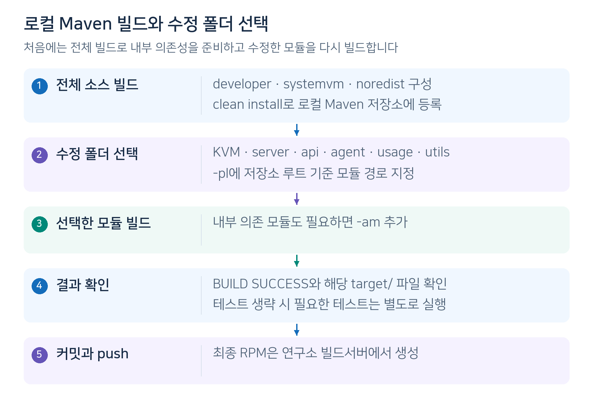

개발 PC Mac에서는 전체 소스를 한 번 빌드한 뒤, 수정한 폴더만 선택하여 다시 빌드합니다. 5-4절의 JDK 17·Maven 설정을 마치고 루트 pom.xml이 있는 Mold 저장소 폴더에서 아래 명령을 실행합니다. 예시의 소스 경로는 PC에 내려받은 위치에 맞게 바꿉니다.

```bash
cd ~/WORK/mold-europa2
java -version
mvn -v
```

**처음에는 전체 소스를 빌드**

처음 소스를 받았거나 브랜치를 변경한 뒤에는 아래 명령으로 전체 소스를 빌드합니다. 폴더별 빌드에 필요한 내부 라이브러리도 로컬 Maven 저장소에 준비됩니다.

```bash
mvn -P developer -P systemvm -Dnoredist clean install
```

-P developer는 개발용 모듈을 포함하고, -P systemvm은 SystemVM 모듈을 포함합니다. -Dnoredist는 연구소에서 사용하는 빌드 구성을 선택하는 속성으로, 이 저장소에서는 VMware 관련 모듈도 활성화합니다. 두 프로파일은 -P developer,systemvm으로 한 번에 적을 수도 있습니다.

clean은 이전 빌드 출력을 정리하고, install은 소스를 컴파일하고 패키지를 만든 뒤 ~/.m2/repository에 등록합니다. 운영 서버에 설치하는 명령은 아닙니다. 이 명령에는 테스트 실행을 생략하는 옵션이 없으므로, 빌드에 연결된 테스트도 실행합니다.

**전체 빌드에서 테스트 실행을 생략하는 경우**

패키지 생성만 확인하려는 경우에는 같은 명령에 -DskipTests를 추가합니다. 테스트 코드는 컴파일하지만 단위 테스트 실행은 생략합니다. 필요한 테스트와 기능 확인은 별도로 진행합니다.

```bash
mvn -P developer -P systemvm -DskipTests -Dnoredist clean install
```

**KVM 소스를 수정했을 때**

plugins/hypervisors/kvm 아래 Java 소스를 수정했다면 해당 폴더만 선택해 빌드합니다. 아래 명령은 전체 빌드가 성공한 뒤 사용하는 기본 예시입니다.

```bash
mvn -P developer -DskipTests -Dnoredist -pl plugins/hypervisors/kvm clean install
```

-pl 뒤의 경로는 저장소 루트를 기준으로 빌드할 폴더를 지정합니다. 결과 JAR은 plugins/hypervisors/kvm/target/에서 확인합니다. KVM 호스트의 RPM이나 서비스가 자동으로 바뀌지는 않습니다.

이 저장소는 기본 빌드 단계가 install로 설정되어 있어, 평소 사용하는 아래 명령도 install까지 진행합니다. 안내서의 예시에서는 실행할 단계를 알아보기 쉽도록 clean install을 명시했습니다.

```bash
mvn -P developer -DskipTests -Dnoredist -pl plugins/hypervisors/kvm
```

내부 의존성을 찾지 못하거나 KVM 코드와 공통 모듈을 함께 수정했다면, -am을 추가해 필요한 저장소 내 의존 모듈도 같이 빌드합니다.

```bash
mvn -P developer -DskipTests -Dnoredist -pl plugins/hypervisors/kvm -am clean install
```

**다른 폴더의 Java 소스를 수정했을 때**

아래에서 수정한 소스가 들어 있는 폴더의 명령 하나를 선택합니다. 모두 저장소 루트에서 실행하며, 결과 JAR은 각 폴더의 target/에 생성됩니다. 선택한 모듈만 빌드하는 명령이므로, 처음에는 앞의 전체 빌드를 완료합니다.

**관리 서버 로직인 server 폴더**

VM·네트워크·스토리지 등 관리 서버의 처리 로직을 수정한 경우입니다. 결과는 server/target/에서 확인합니다.

```bash
mvn -P developer -DskipTests -Dnoredist -pl server clean install
```

**API 정의와 명령인 api 폴더**

API 명령·응답 등 api 아래 코드를 수정한 경우입니다. 결과는 api/target/에서 확인합니다.

```bash
mvn -P developer -DskipTests -Dnoredist -pl api clean install
```

**호스트 Agent인 agent 폴더**

agent 아래 공통 Agent 코드를 수정한 경우입니다. KVM 전용 코드는 앞의 plugins/hypervisors/kvm 명령을 사용합니다. 결과는 agent/target/에서 확인합니다.

```bash
mvn -P developer -DskipTests -Dnoredist -pl agent clean install
```

**사용량 집계인 usage 폴더**

usage 아래 사용량 집계 코드를 수정한 경우입니다. 결과는 usage/target/에서 확인합니다.

```bash
mvn -P developer -DskipTests -Dnoredist -pl usage clean install
```

**공통 유틸리티인 utils 폴더**

utils 아래 공통 Java 유틸리티를 수정한 경우입니다. 결과는 utils/target/에서 확인합니다.

```bash
mvn -P developer -DskipTests -Dnoredist -pl utils clean install
```

두 폴더를 함께 수정했다면 -pl server,api처럼 쉼표로 경로를 나열합니다. -am은 선택한 모듈에 필요한 의존 모듈을 함께 빌드하며, 그 모듈을 사용하는 다른 모든 모듈까지 빌드하지는 않습니다. API·공통 코드가 바뀌어 영향 범위가 넓다면 전체 빌드로 확인합니다.

플러그인·engine·framework 등 다른 폴더도 해당 pom.xml이 있는 Maven 모듈 경로를 -pl에 지정할 수 있습니다. ui 폴더는 Maven 명령 대신 9-5절의 npm 빌드 절차를 사용합니다.

**SystemVM 관련 파일을 수정했을 때**

SystemVM용 Java 구성요소나 스크립트의 패키징을 확인하려면 systemvm 프로파일을 포함하고 필요한 의존 모듈도 같이 빌드합니다.

```bash
mvn -P developer -P systemvm -DskipTests -Dnoredist -pl systemvm -am clean install
```

이 저장소의 결과는 systemvm/target/agent.zip과 systemvm/dist/의 agent.zip·cloud-scripts.tgz입니다. 이 Maven 빌드는 KVM용 SystemVM 템플릿 이미지 자체를 만들지 않습니다. 템플릿 생성·업로드·글로벌 설정은 부록 E의 SystemVM 절차를 따릅니다.

**빌드 결과 확인과 다음 단계**

빌드가 끝나면 터미널의 BUILD SUCCESS와 빌드한 모듈의 성공 여부를 확인하고, 해당 target/ 폴더에서 이번에 생성된 파일을 확인합니다. 명령에 -DskipTests가 있으면 테스트 통과를 뜻하지 않습니다. 빌드에 실패하면 처음 실패한 모듈과 오류 메시지를 확인하여 원인을 수정한 뒤 같은 명령을 다시 실행합니다.

단위 테스트가 필요한 변경은 수정한 모듈의 테스트도 실행합니다. 공통 유틸리티의 기본 실습은 다음과 같습니다. utils/target/surefire-reports/에서 StringUtilsTest가 실제로 실행되었는지와 실패 건수를 확인합니다.

```bash
mvn -P developer -Dnoredist -pl utils -Dtest=StringUtilsTest test
```

로컬 결과는 컴파일·패키징 확인용입니다. 로컬 Maven 빌드만으로 RPM이 생성되거나 운영 환경에 반영되지는 않습니다. 확인한 소스를 커밋·푸시한 뒤, 9-2절의 연구소 빌드서버에서 같은 소스를 받아 최종 RPM을 생성합니다.

근거: 저장소 루트와 각 모듈의 pom.xml. 빌드 단계와 모듈 선택은 [Maven 빌드 단계](https://maven.apache.org/guides/introduction/introduction-to-the-lifecycle.html)와 [Maven 모듈 빌드 안내](https://maven.apache.org/guides/mini/guide-multiple-modules.html)를 참고합니다.

---

### 5.11 챕터 5 학습 완료 기준 점검
- [ ] Codex에서 올바른 Mold 폴더와 브랜치, 적용 지침을 확인하였는가?
- [ ] 읽기 전용 첫 요청으로 UI 스크립트와 도구 경로를 확인하고 기존 변경을 보존하였는가?
- [ ] Node·npm이 교육 환경 기록표와 일치하고 JDK·Maven·IDE 경로를 확인하였는가?
- [ ] 로컬 Maven 컴파일과 단위 테스트를 수행하고 실제 실행 결과를 구분해 기록하였는가?
- [ ] `cd ui && npm start`를 실행하여 브라우저에서 `http://localhost:5050`으로 Mold 대시보드에 정상 접속할 수 있는가?
- [ ] 로컬 Maven 빌드와 연구소 빌드서버의 RPM 생성 역할을 구분하고 커밋·푸시·소스 갱신 순서를 설명할 수 있는가?

---

# CHAPTER 6. Mold 소스 코드 구조 분석 (Code Walkthrough)

> ** 챕터 6 학습 목표**  
> 저장소 내 수십 개의 디렉터리 중 주요 모듈의 역할을 파악하고, 웹 화면의 특정 UI 컴포넌트에서부터 백엔드 API Cmd 클래스 및 비즈니스 로직 파일까지 역추적할 수 있다.

---

### 6.1 전체 디렉터리 구조 및 모듈별 역할

아래는 Git에 포함된 최상위 폴더 32개 전체입니다. 하위 폴더는 주요 경로만 펼쳤습니다. 폴더명은 현재 저장소 기준이며, 루트 pom.xml은 Java 모듈 전체 빌드의 시작점입니다.

```text
mold/
├── .github/          # 소스 검사와 UI·RPM 빌드, 릴리즈 배포를 자동으로 실행하는 설정
├── .local-dev/       # 기능 수정에 앞서 작성한 설계 문서와 동작 검증 결과를 보관하는 폴더
├── agent/            # 관리 서버의 명령을 받아 KVM 호스트의 VM·네트워크를 제어하는 데몬
├── api/              # API 명령 클래스와 요청 파라미터, 응답 데이터 형식을 정의하는 코드
├── build/            # 빌드 과정에서 버전·경로 등의 설정값을 치환하는 속성 파일을 보관
├── client/           # 관리 서버 실행에 필요한 설정과 웹 애플리케이션 배포 구성을 관리
├── cloud-cli/        # 터미널에서 클라우드 API를 호출하고 응답을 확인하는 파이썬 명령 도구
├── core/             # 여러 모듈이 공유하는 데이터 모델과 호스트에 전달할 제어 명령을 정의
├── debian/           # Debian 계열 리눅스에 설치할 패키지의 구성과 생성 절차를 관리
├── deps/             # noredist 빌드에 필요한 외부 라이브러리의 설치 스크립트와 안내
├── developer/        # 기능별 개발 설계·검증 기록과 빌드 정책, 개발용 DB 데이터를 보관
├── docs/             # 개발·운영 절차와 제품 구조 설명, 신입 교육 안내서를 모아 둔 폴더
├── engine/           # VM 배치·실행을 조율하고 DB 스키마와 스토리지 처리 기능을 구현
├── extensions/       # 외부 가상화 플랫폼이나 네트워크 기능을 연결하는 확장 스크립트 보관
├── framework/        # DB 접근·비동기 작업·설정·이벤트 등 여러 모듈의 공통 기반을 구현
├── output/           # 운영 안내서와 처리 흐름 설명을 PDF 등 결과물 형태로 저장하는 폴더
├── packaging/        # RPM 설치 패키지의 파일 구성과 빌드·설치 스크립트를 관리하는 폴더
├── plugins/          # 하이퍼바이저·스토리지·네트워크 종류별 연동 기능을 구현한 플러그인
│   ├── hypervisors/kvm/  # KVM 호스트에서 VM 실행과 장치·네트워크 제어를 처리하는 코드
│   └── storage/volume/   # 주 스토리지에서 VM 디스크 볼륨의 생성·복사·연결을 처리하는 코드
├── python/           # 서버 설치와 초기 설정, 운영 작업을 돕는 파이썬 명령 도구와 라이브러리
├── quickcloud/       # QuickCloud 실행에 사용하는 서버 구성과 설정을 담은 파일
├── release/          # 제품 버전 정보를 정의하고 릴리즈 시 적용할 관리 기준을 보관하는 폴더
├── scripts/          # VM·네트워크·스토리지 작업을 호스트와 시스템 VM에서 수행할 스크립트
├── server/           # API 요청에 따라 VM과 인프라 자원을 관리하는 서버의 업무 로직 구현
├── services/         # VM 콘솔 접속을 중계하고 템플릿·ISO 등 보조 스토리지 작업을 처리
├── setup/            # 설치 후 초기 설정과 DB 생성·업그레이드에 사용할 파일과 도구를 보관
├── systemvm/         # 시스템 VM 안에서 실행할 에이전트와 운영체제 설정·보정 스크립트 보관
├── test/             # 여러 기능이 함께 정상 동작하는지 검증하는 통합 테스트와 실행 도구
├── tools/            # SystemVM 이미지 제작, API 문서 생성과 개발·검증 보조 도구
├── ui/               # Vue 3 기반 웹 콘솔의 화면·메뉴·번역과 백엔드 API 호출을 구현
├── usage/            # VM·디스크·네트워크 등의 사용 기록을 모아 자원 사용량을 집계하는 서비스
├── utils/            # 문자열·파일·네트워크 처리 등 여러 자바 모듈에서 함께 쓰는 공통 도구
└── vmware-base/      # VMware API 연결과 자원 제어에 사용하는 공통 코드와 기능 구현
```

Git에 포함되지 않은 .git·.history·.vscode 같은 로컬 관리 폴더와 target·tmp 같은 생성 폴더는 위 목록에서 제외했습니다. 모든 폴더가 Maven 모듈인 것은 아니며, Java 모듈은 해당 pom.xml을 확인합니다.

---

### 6.2 `ui/`: Vue 3 + Ant Design Vue 프론트엔드 구조

프론트엔드는 신입 개발자가 가장 빈번하게 수정하고 기여하게 되는 영역입니다.

```text
ui/
├── src/
│   ├── api/index.js       # 공통 API 호출 래퍼 (callAPI / getAPI / postAPI)
│   ├── components/        # 재사용 가능한 UI 공통 컴포넌트
│   ├── router/           # 라우터 구성
│   ├── config/
│   │   └── section/       # 메뉴별 뷰 정의 (compute.js, storage.js, network.js 등)
│   ├── views/             # 실제 각 화면 페이지 컴포넌트
│   │   └── compute/       # 인스턴스(VM) 목록 및 상세 뷰 (DeployVM.vue 등)
│   └── locales/           # i18n 초기화와 언어 로딩
├── public/
│   └── locales/
│       └── ko_KR.json     # 한국어 번역 키-값 사전 (자주 수정됨)
├── .env.local             # 로컬 개발용 백엔드 프록시 설정 (CS_URL)
└── package.json           # UI 의존성 및 실행 스크립트
```

---

### 6.3 `api/`: Mold API Command 클래스 구조

클라이언트가 백엔드를 호출할 때 가장 먼저 맞이하는 진입점입니다.
- **위치**: `api/src/main/java/org/apache/cloudstack/api/`
- **구조 특징**:
  - API 이름을 `@APICommand`에서 검색해 Command 클래스를 찾습니다. 같은 이름에 일반 사용자용·관리자용 클래스가 함께 있을 수 있습니다. 예를 들어 `StartVMCmdByAdmin`은 `StartVMCmd`를 상속합니다.
  - `@APICommand` 어노테이션으로 API 이름과 응답 클래스, 요구 권한을 선언합니다.
  - `@Parameter` 어노테이션으로 요청 파라미터를 Command 필드에 매핑합니다. POST 요청 본문과 GET Query String을 모두 실제 요청에 맞춰 확인합니다.
- **대표 클래스 예시**:
  - `command=startVirtualMachine`  `command/user/vm/StartVMCmd.java`
  - `command=stopVirtualMachine`   `command/user/vm/StopVMCmd.java`
  - `command=listVirtualMachines`  `command/user/vm/ListVMsCmd.java`

---

### 6.4 `server/` & `engine/`: 비즈니스 로직 및 오케스트레이션 엔진

* **`server/`**:
  * API Cmd 객체의 `execute()` 메서드가 호출되면, 실제 비즈니스 로직을 처리하는 Manager/Service 클래스로 위임합니다.
  * 예: `com.cloud.vm.UserVmManagerImpl.java`
    * VM의 현재 상태 검사
    * 사용자 테넌트 권한 및 리소스 쿼터 재검증
    * API 계층에 등록된 비동기 작업에서 서비스 로직 수행
* **`engine/`**:
  * 복잡한 클라우드 자원 오케스트레이션을 담당합니다.
  * `engine/orchestration/`: VM 배포 시 어떤 호스트가 가장 적합한지 결정하는 `DeploymentPlanningManager` 등 위치

---

### 6.5 `plugins/`: 하이퍼바이저 및 스토리지 연동 플러그인

Mold만의 차별화된 가상화 제어 코드가 위치합니다.
* **`plugins/hypervisors/kvm/`**:
  * `LibvirtComputingResource.java`: KVM 호스트의 Agent에서 사용하는 리소스 구현체입니다. 시작 명령은 wrapper를 통해 libvirt API를 호출합니다. `virsh`는 개발자가 상태를 비교하는 진단 도구로 구분합니다.
* **`plugins/storage/volume/`**:
  * `plugins/storage/volume/ablestack/`에서 ABLESTACK 주 스토리지 연동을 찾습니다. `AblestackPrimaryDataStoreLifeCycleImpl`은 `rbd`와 `gluefs`를 각각 RBD와 SharedMountPoint 유형으로 구분합니다. SharedMountPoint의 파일 경로 처리도 KVM 스토리지 계층에서 함께 확인합니다.

---

### 6.6 `agent/`: Mold Agent (KVM 호스트 상주 데몬)

* 물리 하이퍼바이저 서버(Compute Node)에 데몬으로 설치되어 백그라운드에서 동작하는 **Mold Agent**입니다.
* 포트 `8250`을 통해 Mold 관리 서버와 지속적인 TCP 연결(Keep-alive)을 유지하며, 관리 서버가 보낸 Java Command 객체를 수신/역직렬화하여 실행한 뒤 `Answer` 객체를 반환합니다.

---

### 6.7 화면(UI)과 백엔드 코드 연결 매핑 실전 가이드

특정 화면을 수정하라는 업무가 주어졌을 때, 코드를 찾는 **3단계 역추적 기법**입니다:

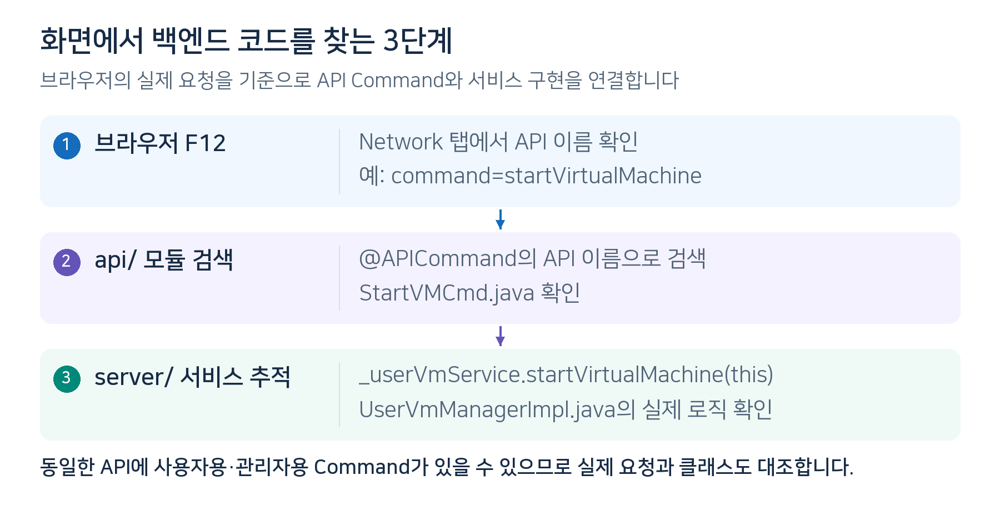

---

### 6.8 챕터 6 학습 완료 기준 점검
- [ ] UI·API·서비스의 실제 파일과 메서드를 직접 열어 호출 관계를 확인하였는가?
- [ ] 브라우저에서 '인스턴스 중지'를 눌렀을 때 호출되는 API 이름을 Network 탭에서 찾을 수 있는가?
- [ ] 해당 API 이름을 통해 매핑되는 `api/` 디렉터리의 Java 클래스 파일을 찾을 수 있는가?

---

# CHAPTER 7. Codex를 이용한 Mold 개발

이 장의 목표는 Codex와 함께 Mold 코드를 읽고 작은 변경을 수행한 뒤, 변경 이유와 검증 결과를 스스로 설명하는 것입니다. 5-7절의 Codex 설정과 6장의 코드 구조 학습을 마친 상태에서 시작합니다. 다음 8장에서는 이 방법을 번역 수정, VM 요청 추적, 첫 PR 제출에 적용합니다.

Codex의 설명, 파일 수정, 검사 실행은 서로 다른 결과입니다. 코드가 바뀌었다고 기능이 확인된 것은 아니며, 예상 결과를 설명했다고 검사가 실행된 것도 아닙니다. 교육생은 실제 변경 차이와 실행 기록, 화면을 근거로 완료 여부를 판단합니다.

### 7.1 기본 작업 흐름 익히기

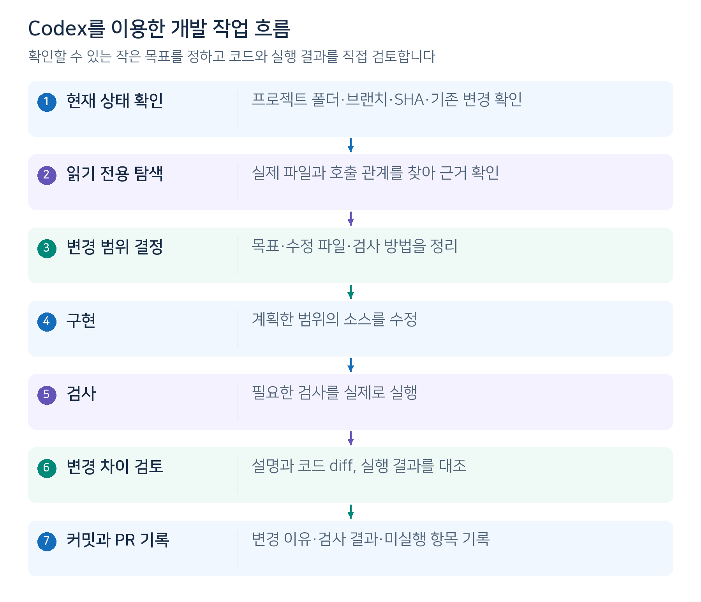

Codex가 자신의 Mac에 클론한 Mold 저장소를 열고 있는지 확인합니다. 브랜치와 SHA, 기존 변경을 기록하고 8-1절에 따라 개인 브랜치를 준비합니다. 저장소 지침과 실행 권한 설정은 5-7절을 따릅니다.

Codex가 찾은 코드와 변경 계획을 읽고 목표가 맞으면 수정하도록 요청합니다. 구현 뒤에는 실제 검사를 실행하고, 설명과 변경 차이가 일치하는지 검토합니다. 서버 반영은 9장의 절차를 따릅니다.

### 7.2 목표·맥락·확인 방법을 담아 요청하기

작업 요청에는 다음 세 가지가 필요합니다.

- **목표:** 사용자에게 어떤 문구나 동작이 달라져야 하는가?
- **맥락:** 어느 브랜치와 실행 환경에서 어떤 파일·현상을 다루는가?
- **확인 방법:** 어떤 검사와 화면 결과를 보면 완료라고 판단할 수 있는가?

“Mold UI를 개선해 줘”만으로는 대상과 완료 기준이 정해지지 않습니다. 번역 수정이라면 파일과 키, 원하는 문구와 표시 위치를 적습니다. 오류 진단이라면 실제 실행한 명령과 필요한 오류 발췌를 전달합니다. 관련 파일을 모르면 추정한 경로를 단정하지 않고 실제 코드를 찾아 달라고 요청합니다.

**프롬프트: 작업 요청의 기본 틀**

```text
목표: [바꾸려는 문구 또는 동작]
맥락: [브랜치, 실행 위치, 관련 파일과 현재 현상]
범위: [수정할 대상과 유지할 기존 동작]
확인: [검사와 실제 화면에서 확인할 결과]
먼저 코드를 읽고 변경 계획을 설명해 줘.
완료 후 변경 파일, 실제 검사 결과, 미확인 항목을 보고해 줘.
```

대괄호 부분은 실제 값으로 바꿉니다. Codex가 이해한 목표와 범위를 읽고, 다른 동작까지 바꾸려 한다면 구현 전에 요청을 구체화합니다. 데이터 취급 기준은 5-7절과 부록 A를 참고합니다.

### 7.3 실제 코드 근거로 Mold 구조 탐색하기

6장의 설명을 실제 파일과 메서드에 연결합니다. 탐색 단계에서는 파일 수정과 서버 조작을 요청하지 않고, API명과 추적할 구간을 지정합니다.

**프롬프트: VM 시작 요청의 코드 경로 탐색**

```text
파일을 수정하거나 VM을 조작하지 말고,
startVirtualMachine의 실제 코드 경로를 찾아 줘.
UI 호출 → API Command → 서비스와 오케스트레이션 →
KVM StartCommand 처리와 응답을 연결해 설명해 줘.
각 단계의 파일과 메서드를 근거로 적고,
코드로 확인한 사실과 실행 환경에서 확인할 내용을 구분해 줘.
```

교육생은 답변에 나온 파일을 직접 엽니다. `ui/src/config/section/compute.js`, `api/`의 `StartVMCmd`, `server/`와 `engine/`의 구현, KVM의 `LibvirtStartCommandWrapper`가 어떻게 연결되는지 확인합니다. 같은 API명에 관리자용 클래스가 있으면 상속 관계와 응답 범위를 비교합니다.

Mold 코드의 CloudStack 경로와 실제 서비스명은 구분합니다. 실행 위치·서비스명은 1장과 3장을 기준으로 확인합니다. 실제 VM의 Job 결과와 로그 연결은 8-4절과 부록 B에서 확인합니다.

완료 기준은 교육생이 UI 요청으로부터 API Command와 서비스 호출, KVM 처리 지점을 직접 찾아 보여 주는 것입니다. Codex가 경로를 찾지 못했다면 미확인으로 남기고, 존재하지 않는 호출 관계를 설명에 만들어 넣지 않습니다.

### 7.4 작은 변경을 구현하도록 요청하기

첫 구현은 한국어 번역 값 하나를 바꾸는 정도로 범위를 좁힙니다. `ui/public/locales/ko_KR.json`의 `label.instances` 값은 현재 `가상머신`이며, `ui/src/config/section/compute.js`에서 화면 제목에 사용합니다. 이 키는 다른 메뉴와 탭에서도 사용하므로 먼저 참조 위치와 영향을 조사합니다.

**프롬프트: 한국어 번역 값 하나 수정**

```text
개인 실습 브랜치에서 UI 번역 값 하나를 수정해 줘.
대상은 ui/public/locales/ko_KR.json의 label.instances이고,
실습 문구는 "가상 머신"이야.
사용 위치와 번역 로딩 방식을 먼저 조사한 뒤,
키 이름과 다른 번역 값을 유지하며 대상 값만 바꿔 줘.
변경 내용과 실제 검사를 보고하고 화면 미확인은 따로 적어 줘.
```

변경 계획에는 대상 파일과 값, 영향받는 화면, 검사가 들어갑니다. 구현 후 다른 언어 수정이나 의존성 변경 등이 섞이지 않았는지 확인합니다.

8-2절에서 번역 JSON의 응답과 실제 화면 표시를 비교합니다. 키가 번역 사전에 존재하는 것과 화면에서 사용되는 것은 별개입니다. 실제 제품에 반영할 문구는 PR에서 검토합니다. 임시 실습 문구가 남았다면 제출 전에 정리합니다.

### 7.5 변경에 맞는 검사와 실제 결과 확인하기

검사는 바꾼 내용의 문제를 찾을 수 있어야 합니다. 번역 변경은 JSON 문법과 키 유지, 언어 파일 로딩, 실제 표시를 확인합니다. lint와 필요한 단위 테스트는 UI 규칙과 관련 동작을 검사합니다. 작은 문구 수정을 위해 형식적인 테스트 파일을 추가하는 것을 목표로 삼지 않습니다.

UI 명령의 실행 위치와 의미는 5-9절을 참고합니다. `npm run lint -- --no-fix`와 `npm run test:unit -- --runInBand`의 실제 결과를 확인합니다. JSON 문법 확인만으로 화면 표시가 검증되지는 않습니다. 브라우저 확인은 8-2절에 따라 한국어 선택, 새로고침, Network의 번역 JSON 응답과 화면 비교로 진행합니다.

**프롬프트: 실행 증거를 포함한 검사 보고**

```text
이번 번역 변경에 필요한 검사를 실제로 수행해 줘.
검사마다 실행 위치, 명령, 결과를 보고하고,
JSON 문법, lint, 단위 테스트, 브라우저 확인을 구분해 줘.
실행하지 못한 검사는 이유와 다음 확인 방법을 적어 줘.
예상 결과나 예제 출력을 실제 실행 결과로 보고하지 마.
```

검사 결과는 **통과**, **실패**, **미실행·미확인**으로 구분합니다. 통과에는 실행 결과나 화면 증거를, 실패에는 핵심 오류를, 미확인에는 다음 조치를 남깁니다. Codex가 브라우저를 확인할 수 없다면 교육생이 직접 확인한 결과를 전달합니다.

로컬 UI 검사, PR의 CI, 백엔드 패키징도 구분합니다. 백엔드 전체 RPM은 연구소 빌드서버에서 생성합니다. GitHub Actions 자동화 빌드는 부록 F에서 따로 다룹니다. CI 결과는 8-3절, 산출물과 교육 서버 검증은 9장에서 기록합니다.

### 7.6 변경 차이를 읽고 검토하기

Codex가 완료했다고 답하면 실제 변경 차이를 읽습니다. `git diff`는 수정 전후의 내용을 보여 주므로 요청한 목표를 만족하는지, 예상한 범위만 바뀌었는지 확인할 수 있습니다.

```bash
# 실행 위치 개발 PC Mac의 저장소 루트
git status --short
git diff --stat
git diff -- ui/public/locales/ko_KR.json
```

새 파일은 기본 `git diff`에 나오지 않을 수 있으므로 상태 목록도 봅니다. 스테이징한 변경은 `git diff --cached`로 확인합니다. 예상 밖의 변경은 원인을 조사합니다.

Codex의 `/review`로도 검토할 수 있습니다. 입력창에 `/review`를 입력하고, 커밋 전 변경은 `Review uncommitted changes`를 선택합니다. 브랜치 전체를 비교할 때는 `Review against a base branch`를 선택하고 실제 PR의 기준 브랜치를 지정합니다. 이 기능은 코드를 수정하지 않고 검토 사항을 보고합니다.

**프롬프트: 리뷰 범위 지정**

```text
이번 번역 변경의 사용 위치와 영향 범위를 검토해 줘.
요청하지 않은 변경과 누락된 검증이 있는지 확인하고,
발견한 사항은 실제 코드 근거와 함께 설명해 줘.
문제가 없다면 검토 범위와 남은 미확인 항목을 적어 줘.
```

리뷰 지적은 실제 변경과 대조합니다. 리뷰 결과를 받았다고 PR 댓글 게시, 승인 또는 병합이 완료된 것은 아닙니다. 추가 수정이 있다면 영향을 받는 검사를 다시 실행하고, 교육생이 변경 이유를 설명할 수 있는지 확인합니다.

### 7.7 커밋과 PR 설명 작성하기

변경과 검사를 확인한 뒤 팀의 커밋 규칙에 맞춰 기록합니다. 파일을 지정해 스테이징하고 커밋에 들어갈 차이를 다시 봅니다. 다른 작업의 수정이나 개인 환경 파일이 섞이지 않았는지 확인합니다. 실제 Git 명령과 PR 생성은 8-3절을 따릅니다.

**프롬프트: 변경과 검사 기록으로 PR 초안 작성**

```text
실제 변경 차이와 검사 결과로 커밋 메시지와 PR 초안을 써 줘.
변경 목적, 수정 대상, 사용자에게 달라지는 점,
실제 수행한 검사와 미확인 항목을 간결하게 포함해 줘.
아직 실행하지 않은 CI나 화면 검사를 통과했다고 쓰지 마.
초안 작성까지만 수행해 줘.
```

초안을 검토한 뒤 커밋·push·PR 생성으로 이어갑니다. Codex에게 맡길 때는 대상과 수행할 작업을 지정합니다. 초안 작성과 원격 반영은 구분합니다.

PR 생성 후에는 Actions의 실제 결과를 확인하고 로컬 검사와 별도로 기록합니다. 검사 뒤 코드를 바꿨다면 이전 결과가 현재 변경에도 적용되는지 확인합니다. PR의 최신 SHA와 검증한 SHA가 연결되어야 동료가 같은 변경을 검토할 수 있습니다.

### 7.8 중단한 작업 이어가기

실행 오류의 진단과 수정은 10-4절에서 다룹니다. 이 절은 채팅·모델 변경이나 작업 중단 뒤 현재 상태를 확인하고 이어가는 방법입니다.

새 채팅을 시작하거나 모델을 바꿔 작업을 이어갈 때는 목표, 브랜치와 SHA, 변경 파일, 실제 검사 결과와 남은 작업을 전달합니다. 이전 기록을 현재 저장소 상태와 대조하고, 완료한 수정과 일부만 반영된 수정을 구분합니다. 기존 수정과 새 파일을 보존한 상태에서 남은 작업을 진행합니다.

**모델 변경 또는 크레딧 부족으로 중단된 경우**

크레딧 부족이나 사용량 제한 안내가 나오면 [사용량 화면](https://chatgpt.com/codex/settings/usage)에서 남은 한도와 갱신 시점을 확인합니다. 재개 가능 여부는 요금제와 계정·워크스페이스 설정에 따라 달라지며, 모델 변경만으로 소진된 한도가 복구되는 것은 아닙니다. 앱에서 사용 가능한 모델과 이용 조건을 확인한 뒤 재개합니다. 자세한 조건은 [공식 사용량 안내](https://learn.chatgpt.com/docs/pricing)를 참고합니다.

재개할 때는 마지막 답변만 보고 완료를 판단하지 않습니다. 실행 중이던 검사가 끝났는지 확인하고, 실제 출력이 없는 검사는 미확인으로 기록합니다. 다음 예시의 대괄호를 실제 정보로 바꿔 요청합니다. 같은 채팅에서 이어가더라도 현재 파일과 검사 결과를 다시 확인합니다.

**프롬프트: 중단 또는 모델 변경 후 작업 재개**

```text
중단 사유: [크레딧 부족 / 사용량 제한 / 모델 변경]
목표: [이번 변경의 목적]
현재 상태: [브랜치, SHA, 변경 파일]
완료한 확인: [실제 검사와 결과]
남은 문제: [실제 오류 또는 미확인 항목]
다음 작업: [진단, 수정 또는 재검증]
현재 브랜치와 SHA, git status, 변경 차이와 새 파일부터 확인해 줘.
기존 수정을 보존하고 완료한 작업과 일부만 반영된 작업을 구분해 줘.
실행 중이던 검사의 종료 여부와 실제 결과도 확인해 줘.
검사를 통과·실패·미실행·결과 미확인으로 나눠 정리해 줘.
기록과 실제 상태가 다르면 설명하고 남은 작업부터 이어서 진행해 줘.
수정이 끝나면 영향을 받는 검사를 실행하고 변경 내용과 결과를 알려 줘.
```

작업을 재개한 뒤 오류가 남아 있으면 10-4절의 진단 절차를 따릅니다. VM Job 결과를 못 받은 경우에는 8-4절과 부록 B에서 재조회 방법을 확인합니다.

### 7.9 챕터 7 학습 완료 기준 점검

- [ ] 목표·맥락·확인 방법을 담아 요청을 작성할 수 있는가?
- [ ] 수정 전에 브랜치, 기존 변경과 적용할 지침을 확인하는가?
- [ ] Codex가 찾은 파일과 메서드 근거를 직접 열어 볼 수 있는가?
- [ ] 작은 변경의 범위와 여러 화면에 미치는 영향을 설명하는가?
- [ ] 실제 통과·실패·미확인 결과를 구분해 기록하는가?
- [ ] 변경 차이를 읽고 리뷰 지적을 실제 코드와 대조하는가?
- [ ] PR 초안의 내용과 검사 결과가 사실인지 확인하는가?
- [ ] 중단한 작업의 현재 상태와 다음 조치를 전달할 수 있는가?

목표, SHA, 변경 파일, 주요 프롬프트, 실제 검사와 화면 근거, 미확인 항목을 기록합니다. 이 기록으로 변경을 설명하고 작업을 이어갈 수 있으면 기본 과정을 완료한 것입니다.

공식 참고 문서: OpenAI [Codex 프롬프트 안내](https://learn.chatgpt.com/docs/prompting#prompting-codex), [AGENTS.md 안내](https://learn.chatgpt.com/docs/agent-configuration/agents-md), [시작 안내](https://learn.chatgpt.com/docs/quickstart), [코드 리뷰 안내](https://learn.chatgpt.com/docs/code-review). 팀의 실제 설정과 작업 기준은 5-7절을 사용합니다.

---

# CHAPTER 8. Codex와 함께 하는 첫 개발 실습

> **챕터 8 학습 목표**  
> 개인 브랜치에서 작은 UI 변경을 수행하고, 교육용 VM의 요청과 Job을 실제 증거로 추적한 뒤, 사람이 검토할 수 있는 커밋과 PR을 준비한다. Codex의 제안은 소스·화면·검사 결과와 대조한다.

---

### 8.1 코드 수정 전에 개인 브랜치 준비

5-7절의 Codex 설정과 5-9절의 UI 실행을 마친 상태에서 시작합니다. 이번 실습의 UI 문구 변경과 VM 요청 조회를 작업 범위로 정하고, 본인 식별자가 들어간 개인 브랜치 이름을 선택합니다. 아래 `gdhong`은 예시이므로 본인의 이름이나 사내 식별자로 바꿉니다. 먼저 Codex에 작업 위치와 현재 상태 확인을 요청합니다.

```text
이 저장소에서 첫 UI 실습을 하려고 해. 수정 전에 저장소 루트,
현재 브랜치, git status --short와 저장소 작업 지침을 확인해 줘.
기준은 europa-2026, 개인 브랜치는 feat/onboarding-ui-gdhong이야.
기존 수정·미추적 파일·커밋이 있으면 보존하고 현재 상태를 설명해 줘.
아직 파일 수정, 커밋, 푸시 또는 PR 생성은 하지 마.
```

개발자는 결과를 직접 확인합니다. 기존 작업이 있거나 현재 브랜치의 용도가 불명확하면 기존 폴더를 보존하고 저장소를 별도 작업 디렉터리에 클론하여 실습합니다. 변경을 버리거나 자동으로 stash하여 상태를 숨기지 않습니다. 아래 동기화는 작업 폴더가 깨끗하고 본인이 사용하는 저장소임을 확인한 뒤 한 줄씩 실행합니다.

```bash
# 실행 위치 개발 PC Mac 저장소 루트
cd ~/WORK/mold-europa2
git status --short
git branch --show-current
git fetch origin
git checkout europa-2026
git pull --ff-only origin europa-2026
git checkout -b feat/onboarding-ui-gdhong
git branch --show-current
```

`--ff-only`가 실패하면 브랜치 이력을 강제로 맞추지 말고 차이를 확인합니다. 이미 같은 이름의 개인 브랜치가 있으면 새 이름을 정하거나 해당 작업을 이어갈지 확인합니다. 정상 결과는 최신 기준에서 만든 개인 브랜치 이름과 예상하지 않은 수정이 없는 작업 상태입니다. 이 확인을 마친 뒤 UI 파일을 수정합니다.

---

### 8.2 Codex로 사용 위치를 찾고 UI 문구 수정

첫 과제는 VM 목록 메뉴에 쓰이는 한국어 라벨 `label.instances`를 개선하는 것입니다. 현재 값은 `가상머신`이며 `ui/src/config/section/compute.js`의 메뉴 제목에 연결됩니다. 다른 화면에서도 공유하므로 전체 사용 범위를 먼저 확인합니다. 이름이 비슷한 `label.virtual.machine`은 현재 `ui/src`에서 직접 참조가 발견되지 않았습니다. 번역 파일에 키가 있다는 사실과 화면 사용 여부를 구분합니다.

```text
label.virtual.machine과 label.instances를 ui/src와
ui/public/locales에서 찾아 사용 위치를 비교해 줘. 이번 수정 대상은
label.instances야. compute.js의 메뉴 연결과 다른 사용 화면까지
확인하고 공유 문구 변경의 영향을 설명해 줘. 이 단계에서는
사용 위치와 영향만 분석하고 파일을 바꾸지 마.
```

개발자는 `compute.js`의 `title` 설정과 VM 목록 메뉴를 비교하고 다른 사용 위치도 확인합니다. 이 실습에서는 `가상머신`을 `가상 머신`으로 바꿉니다. 공유 화면에도 적용되는 예시이므로 사용 위치를 기록하고 변경 전후를 확인합니다. 실제 제품에 반영할 문구는 PR에서 팀의 검토를 받습니다.

```text
이번 실습에서 label.instances의 새 문구는 가상 머신이야.
ui/public/locales/ko_KR.json에서 이 키의 값만 변경해 줘.
키 이름과 다른 언어·파일·포맷은 유지해 줘. 변경 diff를 보여 주고,
ui 디렉터리에서 lint --no-fix와 단위 테스트를 실행해 실제 결과를
정리해 줘. 실행하지 못한 검사는 통과로 쓰지 마.
```

```bash
# 실행 위치 개발 PC Mac 저장소 루트
git grep -n -F 'label.instances' -- ui/src ui/public/locales/ko_KR.json
code ui/public/locales/ko_KR.json

# 실행 위치 개발 PC Mac ui 디렉터리
cd ui
npm run lint -- --no-fix
npm run test:unit -- --runInBand
git diff -- public/locales/ko_KR.json
```

`http://localhost:5050`에서 한국어를 선택하고 VM 목록 메뉴를 확인합니다. `public/locales` JSON은 런타임에 fetch하며 이미 읽은 언어는 메모리에 유지됩니다. Vue 컴포넌트의 HMR처럼 즉시 반영된다고 가정하지 말고 페이지를 새로고침합니다. Network 탭의 `locales/ko_KR.json` 응답 값과 VM 목록 메뉴의 문구를 비교하고, 공유 키를 쓰는 다른 화면도 확인합니다.

변경 전후 스크린샷, 사용 위치, 검사 명령과 결과를 남깁니다. 실습 표시용 접미사인 `Mold 온보딩 실습`을 제품 문구로 병합하지 않습니다. 임시 표시로 연습했다면 본인이 만든 변경만 제품 문구로 정리하거나 제거하고, 다시 diff와 화면을 확인합니다.

근거: `ui/src/locales/index.js`, `ui/public/locales/ko_KR.json`, `ui/src/config/section/compute.js`.

---

### 8.3 변경 검토와 커밋 PR CI 확인

코드 수정과 화면 검증을 마친 뒤 Codex에 제출 전 검토를 요청합니다. PR 문안을 작성하는 작업과 원격 브랜치 푸시·PR 게시를 구분합니다. 구현 요청만으로 병합이나 운영 배포까지 지시한 것으로 취급하지 않습니다.

```text
개인 브랜치의 변경을 기준 europa-2026과 비교해 검토해 줘.
의도하지 않은 수정과 임시 실습 문구가 없는지 확인하고, 실제 실행한
검사만 기재해 줘. 문제·변경 결과·화면 확인·테스트·미확인 사항을
담은 PR 제목과 본문 초안을 작성해 줘. 아직 푸시하거나 게시하지 마.
```

#### PR 제출 전 확인

- [ ] 로컬에서 `npm run lint -- --no-fix`와 필요한 unit test를 통과하여 린트 오류가 없는가?
- [ ] 커밋 메시지가 Conventional Commits 규칙(`feat:`, `fix:`)을 준수하고 있는가?
- [ ] 불필요한 임시 파일(`console.log`, `.DS_Store`, 임시 주석)이 포함되지 않았는가?
- [ ] PR 제목과 본문에 수정 목적과 테스트 결과가 명확히 기술되었는가?
- [ ] 로컬 `target/`·`ui/dist/`·RPM 등 생성 파일이 소스 변경과 함께 불필요하게 커밋되지 않았는가?

개발자는 `git diff`와 변경 전후 스크린샷을 확인합니다. 수정한 번역 키 외의 변경은 이유를 설명할 수 있어야 합니다. 다음 명령은 저장소 루트에서 실행하며, 커밋 메시지는 본인이 기록한 변경 목적과 사내 컨벤션에 맞춥니다.

```bash
# 실행 위치 개발 PC Mac 저장소 루트
cd ~/WORK/mold-europa2
git status --short
git diff --check
git diff -- ui/public/locales/ko_KR.json
git add ui/public/locales/ko_KR.json
git diff --cached
git commit -m "fix(ui): 가상머신 목록 표시 문구 개선"
git push -u origin feat/onboarding-ui-gdhong
```

검토를 마치고 제출하기로 한 실습 변경에 대해 푸시합니다. GitHub에서 Base를 `europa-2026`, Compare를 본인 브랜치로 선택하고 검토한 본문과 스크린샷을 첨부해 PR을 생성합니다. Codex에 게시를 맡길 때에는 다음처럼 대상과 범위를 직접 지시합니다. 저장소 접근이나 게시 도구가 준비되지 않았다면 사람이 GitHub에서 진행합니다.

```text
변경과 PR 초안을 검토했어. 이번 실습 브랜치
feat/onboarding-ui-gdhong을 origin에 푸시하고 europa-2026을
Base로 검토한 내용의 Draft PR을 만들어 줘. 병합·배포는 하지 마.
```

PR에서 `.github/workflows/ui.yml`의 UI Build 실행과 해당 커밋을 확인합니다. 이 workflow는 의존성 설치, UI 빌드, lint, 단위 테스트를 실행합니다. 필요한 검증이 모두 끝난 뒤 통과 여부를 판단하며 대기·건너뜀·실행되지 않음을 성공으로 기록하지 않습니다. 검증 실행이 보이지 않으면 Actions 탭, PR의 Checks, 실행 조건과 대상 커밋을 직접 확인합니다. 접근 권한이 없으면 저장소 관리자에게 문의하고 미확인으로 기록합니다.

lint가 실패하면 `npm run lint -- --no-fix`로 확인하고, 단위 테스트가 실패하면 테스트 이름·실패 원인·재현 조건을 기록합니다. 수정 후 검사를 다시 수행하고 새 커밋의 CI를 확인합니다. 초록색 CI는 검토와 기능 확인을 대신하지 않습니다. 백엔드 RPM 생성은 9-2절의 연구소 빌드서버 절차를 사용하며, UI 로컬 실행·빌드는 5-9절을 따릅니다. 패키징과 교육 서버 확인은 9장으로 이어지고, 요청된 수동 UI 반영은 9-5절의 별도 절차입니다.

---

### 8.4 교육용 VM 시작 요청과 Job 추적 실습

UI 수정과 PR 기록을 마친 뒤, 별도의 Mold 동작 실습으로 진행합니다. 본인에게 할당된 실습 자원에서 Stopped 상태의 VM 하나를 선택합니다. 시작 작업이 허용된 VM인지 부록 A의 실습 범위와 대조합니다. 시작 전에 VM UUID, 내부 인스턴스명, 소속 계정과 호스트 정보를 기록합니다. 실행 호스트는 시작 과정에서 달라질 수 있으므로 실제 대상도 확인합니다. 다른 사용자의 VM으로 대체하거나 반복 클릭하지 않습니다. Codex에는 먼저 코드 읽기만 요청합니다.

```text
startVirtualMachine의 UI 요청부터 StartVMCmd.execute의 다음 호출,
UserVmManagerImpl, 오케스트레이션과 KVM StartCommand 처리를
소스로 추적해 줘. 확인한 파일·메서드와 아직 확인하지 않은 연결을
구분해 줘. 이 단계는 코드 분석만 하며 VM 제어 명령은 실행하지 마.
```

개발자가 브라우저 Network 탭을 열고 지정 VM의 시작 버튼을 한 번 누릅니다. `POST /client/api` 본문의 `command=startVirtualMachine`, VM UUID, 응답 `jobid`를 기록합니다. 후속 `queryAsyncJobResult`의 `jobstatus`와 결과 또는 오류를 확인합니다. 다음 예시는 필드 구조만 보여 주며 실제 실행 결과가 아닙니다.

```json
{
  "startvirtualmachineresponse": {
    "jobid": "<수락된 Job UUID>"
  }
}
```

`jobstatus` 0은 진행 중, 1은 성공, 2는 실패입니다. HTTP 응답 수신이나 Job 수락만으로 VM 시작 성공을 판단하지 않습니다. 폴링 통신이 끊겼다면 결과 불명일 수 있으므로 VM 상태를 재조회합니다. 화면의 Job UUID와 관리 로그의 내부 숫자 Job ID도 구분합니다. 교육용 읽기 DB 계정으로 다음 조회를 수행합니다.

```sql
SELECT id, uuid, job_cmd, job_status, job_result_code
FROM async_job
WHERE uuid = '<Network에서 기록한 Job UUID>';
```

```bash
# 실행 위치 관리 서버 CCVM
grep -F 'job-<내부 ID>' /var/log/cloudstack/management/management-server.log

# 실행 위치 해당 VM의 실제 대상 KVM 호스트
grep -F '<VM 내부 인스턴스명>' /var/log/cloudstack/agent/agent.log
sudo virsh dominfo '<VM 내부 인스턴스명>'
```

위 명령은 Mac에서 실행하는 명령이 아닙니다. 관리 서버 로그는 CCVM에서, Agent 로그와 `virsh` 조회는 VM의 KVM 호스트에서 확인합니다. 실제 로그 형식·레벨은 설정에 따라 다르므로 특정 INFO 문장이 반드시 출력된다고 가정하지 않습니다. 읽기 조회 권한이 없다면 팀에서 공유한 예제 로그로 구조를 확인하고 실제 서버 조회는 미실행으로 기록합니다. 실제 추적이 필요하면 환경 문의 채널에서 읽기 권한을 요청합니다.

```text
아래는 교육용 VM에서 직접 수집한 요청·Job 조회·로그 발췌야.
제공한 증거와 소스를 근거로 요청 수락, 실행 결과, VM 현재 상태를
구분해 줘. Job UUID와 내부 숫자 ID를 연결하고, 확인되지 않은 단계는
추가로 필요한 읽기 조회를 제안해 줘. 출력이나 성공 로그를 만들지 마.
<비밀번호·세션키 등 인증정보를 제외한 실제 결과 붙여넣기>
```

결과표에는 요청 시각, VM UUID, Job UUID, 내부 Job ID, 호스트, `jobstatus`, VM 재조회 상태와 로그 발췌를 기록합니다. 네트워크·볼륨 준비, `StartCommand`, libvirt 호출, `StartAnswer`, Job 결과 중 실제 확인된 단계를 표시합니다. 실패 또는 결과 불명 사례는 부록 B와 대조하며, Codex의 원인 설명도 실제 증거가 뒷받침하는지 확인합니다.

---

### 8.5 챕터 8 학습 완료 기준 점검

- [ ] 코드 수정 전에 개인 브랜치를 준비하고 기존 작업을 보존했는가?
- [ ] 번역 키의 실제 사용 위치를 찾고, 실습에서 정한 문구만 변경했는가?
- [ ] 새로고침 후 번역 JSON 응답과 화면을 비교하고 스크린샷을 남겼는가?
- [ ] 지정 교육용 VM의 Job UUID와 내부 Job ID를 연결하고 CCVM·KVM 증거를 구분했는가?
- [ ] Codex의 설명에서 실제 확인한 사실과 추정·미확인 사항을 구분했는가?
- [ ] diff·검사 결과를 직접 검토하고 올바른 Base의 PR과 최신 커밋 CI를 확인했는가?

실습 기록에 PR 주소, 변경 전후 화면, 검사 결과와 별도 VM 추적표를 첨부하고 8-5절의 항목을 직접 점검합니다. 자신이 바꾼 문구의 사용 위치와 Job 수락·성공의 차이를 코드와 증거로 설명할 수 있으면 실습을 마친 것입니다. PR 병합과 배포 여부는 팀의 검토 절차에 따라 결정합니다.

---

# CHAPTER 9 빌드 배포와 검증

이 장은 로컬에서 확인한 소스를 연구소 빌드서버에서 RPM으로 만들고, 교육 서버에 반영해 수정한 기능을 확인하는 실습이다. 빌드서버와 대상 서버는 이미 설정된 연구소 환경을 사용한다.

### 9.1 전체 작업 순서 한눈에 보기

**로컬 확인·푸시 → 빌드서버 소스 갱신 → RPM 생성 → 대상 서버 반영 → 기능 확인** 순서로 진행한다.

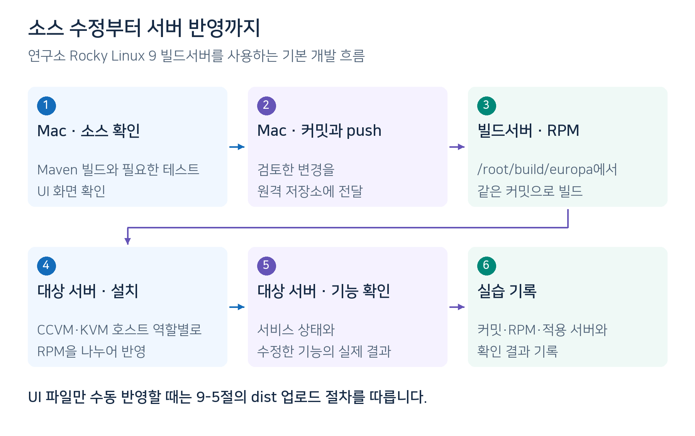

| 빌드서버 정보 | 사용할 값 |
| --- | --- |
| 접속 | `root@10.10.0.100` — Rocky Linux 9 VM |
| 소스 폴더 | `/root/build/europa` |
| RPM 생성 폴더 | `/root/build/europa/dist/rpmbuild/RPMS/` |
| 빌드 옵션 | 연구소 구성 `noredist` |

**UI 파일만 수동 반영할 때는 9-5절을 따른다.** 이 경우에는 RPM 생성·설치 단계를 대신해 `dist` 파일을 업로드한다. Java 서버 코드나 Agent 변경은 RPM으로 반영한다.

공용 빌드 폴더는 다른 사람이 사용 중인지 먼저 확인한다. DB 스키마 자동 업데이트는 9-4절, 시스템 VM 이미지 변경은 선택 실습인 부록 E-3을 참고한다. 자동화 빌드를 사용하는 경우에는 부록 F를 참고한다.

### 9.2 연구소 빌드서버에서 RPM 생성

로컬 변경의 빌드·테스트와 커밋·푸시를 마친 뒤 시작한다. 빌드서버는 원격 저장소의 소스를 받아 다시 빌드하므로 Mac의 `target/` 파일을 복사할 필요가 없다.

#### 1 빌드서버 접속

Mac 터미널에서 접속하고, 요청되면 담당자가 전달한 암호를 입력한다.

```bash
# 실행 위치 개발 PC Mac
ssh root@10.10.0.100
```

#### 2 소스 폴더 이동과 갱신

소스는 **`/root/build/europa`**에 받아 두고 사용한다. `pom.xml`과 `packaging/`이 있는 저장소 루트다.

```bash
# 실행 위치 연구소 빌드서버
cd /root/build/europa
git status --short
git branch --show-current
git pull --ff-only
git rev-parse HEAD
```

`git status`에 예상하지 않은 변경이 없고, 현재 브랜치가 빌드할 브랜치인지 확인한 뒤 `git pull`을 실행한다. `--ff-only`는 새 병합 커밋을 만들지 않고 원격 소스를 갱신한다. 마지막 커밋 SHA가 이번에 검토한 빌드 기준과 같아야 한다. 갱신이 실패하면 빌드를 진행하지 않는다.

#### 3 RPM 빌드

기존 RPM은 팀의 보관 폴더로 옮겨 이번 결과와 구분한다. 빌드 폴더에는 개인의 미커밋 소스를 두지 않는다.

```bash
# 실행 위치 연구소 빌드서버
cd /root/build/europa
./packaging/package.sh -d rocky9 -p noredist
```

`-d rocky9`는 Rocky Linux 9 대상, `-p noredist`는 연구소의 라이브러리 구성을 선택한다. 스크립트가 Maven·UI 빌드와 RPM 생성을 처리한다.

**성공 기준은 오류 없이 명령이 끝나고 `RPM Build Done`이 표시되는 것이다.** 실패하면 처음 발생한 오류와 로그를 확인한다. 빌드 성공 후에도 9-6절의 기능 확인은 필요하다.

#### 4 생성된 RPM 확인

```bash
# 실행 위치 연구소 빌드서버
find /root/build/europa/dist/rpmbuild/RPMS -type f -name '*.rpm' -ls
```

RPM은 **`/root/build/europa/dist/rpmbuild/RPMS/`** 아래에 생성된다. 위 명령은 하위 폴더의 파일 경로·수정 시각·크기를 보여 준다. 일반적인 x86_64 서버에서는 주요 RPM이 `x86_64/`에 있으며, `noarch/` 같은 다른 하위 폴더도 함께 검색된다.

이번 빌드에서 생성된 **management·agent·common·usage·ui** RPM을 확인한 뒤, 다음 그림에 따라 전달한다. 서버 도구가 없거나 빌드 준비 문제가 생기면 부록 E-1을 참고한다.

### 9.3 서버별로 필요한 RPM 나누기

제품명은 Mold지만 RPM 파일명에는 `cloudstack`이 사용된다. `*` 부분은 빌드 결과의 버전·릴리즈·아키텍처 값이다.

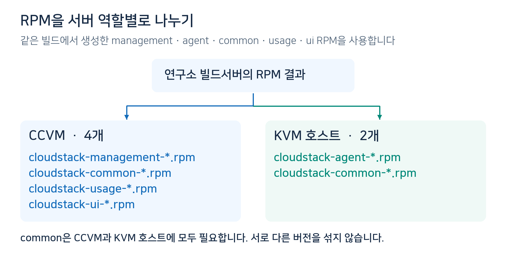

**CCVM은 management·common·usage·ui 4개, KVM 호스트는 agent·common 2개다.** `common`은 두 서버에 모두 필요하다.

같은 빌드에서 생성한 RPM을 사용하고 버전을 섞지 않는다. 아래 절차는 의존성이 준비된 연구소 서버에 반영하는 예시이며, 실제 적용 대상과 시간은 팀에서 공유한 서버 사용 일정과 본인의 작업 범위를 확인하여 기록한다. 공용 서버 반영은 팀의 운영 절차를 따른다.

### 9.4 RPM 전달과 서버 반영

DB 스키마 변경이 포함된 RPM은 적용 전에 DB 백업을 확보한다. 스키마가 바뀐 뒤 이전 RPM만 설치해도 DB가 원래 상태로 돌아가지 않으므로 복구 시에는 백업과 해당 버전의 복구 절차를 확인한다.

#### 1 서버별 파일 전달

SFTP 파일 전송 프로그램으로 대상 서버의 **`/var/tmp/mold-rpm/`** 폴더에 필요한 RPM을 업로드한다. 폴더가 없으면 만든다. **이번에 반영할 서버용 파일과 버전만** 이 폴더에 둔다.

CCVM에 4개, KVM 호스트에 2개가 있는지 파일 이름과 크기를 확인한다. 빌드서버에서 설치하지 않고, 파일을 전달받은 대상 서버에서 다음 명령을 실행한다.

#### 2 CCVM에 4개 RPM 반영

```bash
# 실행 위치 CCVM
cd /var/tmp/mold-rpm
ls -lh ./*.rpm
sudo rpm -Uvh --replacepkgs ./*.rpm
```

#### 3 KVM 호스트에 2개 RPM 반영

```bash
# 실행 위치 반영 대상 KVM 호스트
cd /var/tmp/mold-rpm
ls -lh ./*.rpm
sudo rpm -Uvh --replacepkgs ./*.rpm
```

`ls -lh`로 목록을 먼저 확인한다. **CCVM에는 해당 4개만, KVM 호스트에는 해당 2개만 있어야 한다.** 다른 종류나 이전 버전의 RPM은 폴더 밖으로 옮긴 뒤 설치한다. `./*.rpm`은 이 폴더의 모든 RPM을 뜻한다.

`rpm -Uvh`는 설치·업그레이드를 수행하며 진행 상황을 표시한다. `--replacepkgs`는 같은 버전 번호로 다시 빌드한 패키지도 재설치한다. 두 명령은 **각각 해당 서버에서** 실행한다.

설치 중 서비스가 재시작될 수 있으므로 정한 적용 시간에 진행한다. **RPM 업데이트 후 Mold 서비스가 시작되면 코드·DB 버전과 업그레이드 이력을 확인하고 필요한 스키마 업데이트를 자동 수행한다.** 정상 기동과 수정 기능은 9-6절에서 확인하며, 일반적인 RPM 반영 과정에서 SQL을 직접 실행하는 단계는 없다. 의존성·충돌 오류가 나면 다음 단계로 넘어가지 말고 오류를 담당자에게 전달한다. 옵션별 설명과 다른 설치 방식은 부록 E-2에 모았다.

### 9.5 UI dist 파일을 운영 환경에 수동 반영

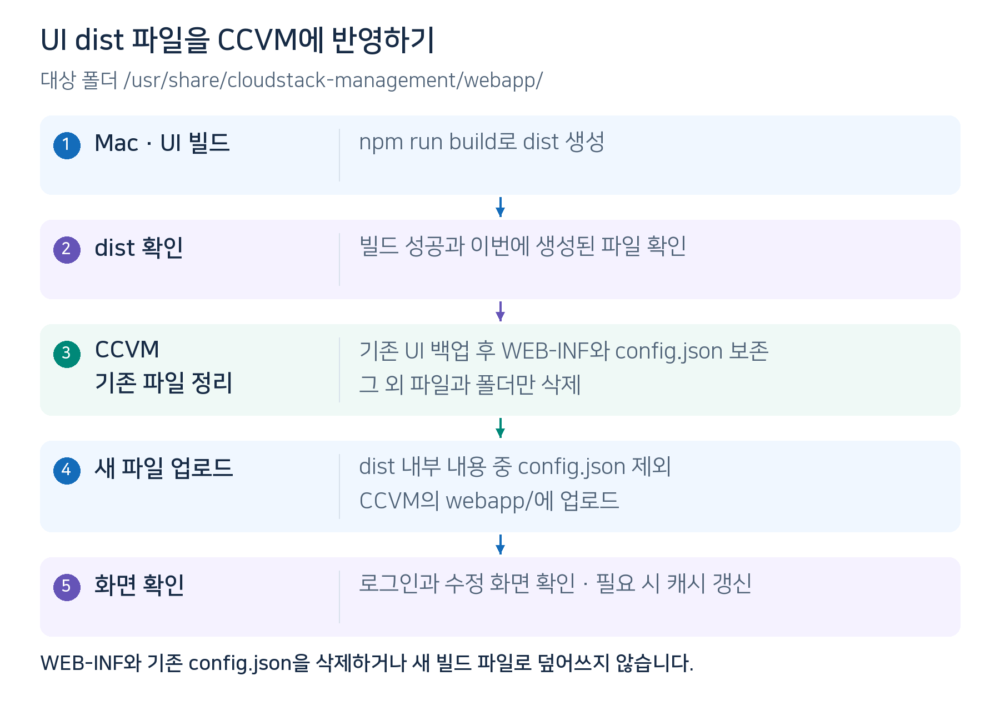

#### 1 Mac에서 UI 빌드

```bash
# 실행 위치 개발 PC Mac
cd ~/WORK/mold-europa2/ui
npm run build
ls -lh dist
```

검토한 커밋의 SHA를 기록하고 빌드한다. `npm run build`가 오류 없이 끝나고 `dist/`에 아래 파일들이 생성됐는지 확인한다. 실패한 빌드의 기존 `dist`는 사용하지 않는다. 의존성 설치는 5-9절을 따른다.

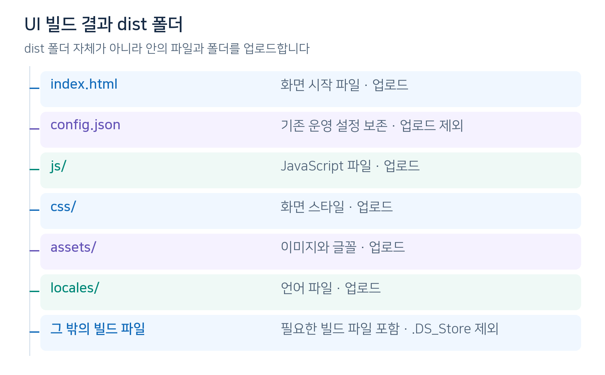

#### 2 CCVM의 기존 UI 파일 정리

SFTP에서 CCVM의 다음 폴더를 열고, 기존 내용을 별도 위치에 백업한다.

```text
/usr/share/cloudstack-management/webapp/
```

**WEB-INF 폴더와 기존 config.json만 남기고 나머지 파일과 폴더를 삭제한다.** `config.json`이 연결된 링크라면 그 링크도 보존한다.

#### 3 새 파일 업로드

Mac의 `dist/` 안에서 **config.json을 제외한 파일과 폴더**를 CCVM의 `webapp/`에 올린다. `.DS_Store`는 제외한다. **dist 폴더 자체가 아닌 내부 내용**을 올리고 `webapp/index.html`을 확인한다.

#### 4 화면 확인

운영 URL에서 로그인과 수정 화면을 확인한다. 이전 화면이 보이면 캐시를 비우거나 강력 새로고침한다. 문제가 해결되지 않으면 백업한 UI 파일로 되돌리되, `WEB-INF`와 기존 `config.json`은 보존한다.

### 9.6 반영 후 서비스와 기능 확인

#### 1 설치 버전과 서비스 상태 확인

RPM 반영 후에는 아래 서비스가 실행 중인지 확인한다. Usage의 서비스 이름은 `mold-usage.service`다.

| 실행 위치 | 확인할 서비스 | 역할 |
| --- | --- | --- |
| CCVM | `mold.service` | Mold 관리 서버와 API 처리 |
| CCVM | `mold-usage.service` | 리소스 사용량 집계 |
| KVM 호스트 | `mold-agent.service` | 관리 서버 명령 수신과 VM 작업 처리 |
| KVM 호스트 | `libvirtd.service` | 가상 머신 제어를 위한 libvirt 서비스 |

**CCVM에 RPM을 반영했을 때** 다음을 확인한다.

```bash
# 실행 위치 CCVM
rpm -q cloudstack-management cloudstack-common cloudstack-usage cloudstack-ui
sudo systemctl is-active mold.service mold-usage.service
```

**KVM 호스트에 RPM을 반영했을 때** 다음을 확인한다.

```bash
# 실행 위치 반영 대상 KVM 호스트
rpm -q cloudstack-agent cloudstack-common
sudo systemctl is-active mold-agent.service libvirtd.service
```

`rpm -q`는 설치된 버전·릴리즈를 보여 준다. 이번 RPM과 같은 값인지 확인한다. `is-active`는 명령에 적은 서비스 순서대로 상태를 출력하므로, 두 줄 모두 `active`인지 확인한다. 다른 결과가 나오면 10-2절에서 해당 서비스의 상세 상태와 로그를 확인한다. 재시작은 허용된 대상·시간과 진행 중 작업을 확인한 뒤 3-2절의 명령을 사용한다. UI 파일만 수동 반영했다면 RPM 버전 확인 대신 9-5절의 화면 확인을 수행한다.

#### 2 수정한 기능 확인

| 수정한 부분 | 확인할 내용 |
| --- | --- |
| UI 문구·화면 | 로그인, 수정한 문구·화면, 관련 버튼 동작 |
| 서버 API·업무 로직 | 변경한 요청의 응답과 최종 결과, 관리 서버 오류 |
| KVM Agent·가상화 기능 | 호스트 연결과 수정한 VM·볼륨·네트워크 동작 |

**이번 변경에 해당하는 항목을 확인한다.** 비동기 요청은 접수 응답뿐 아니라 최종 Job 결과와 실제 자원 상태까지 확인한다. 문제가 있으면 요청 시각·대상·오류를 기록하고 10장과 부록 B에서 로그 확인 방법을 찾는다.

### 9.7 실습 결과 기록

| 기록 항목 | 실제 값과 결과 |
| --- | --- |
| 빌드 소스 | 브랜치와 커밋 SHA: ____________________ |
| 빌드 결과 | 실행 일시와 RPM 파일명·보관 폴더: ____________________ |
| 적용 대상 | CCVM 또는 KVM 호스트·적용 일시·설치 버전: ____________________ |
| 확인 결과 | 수정 기능·통과 또는 실패·미실행 항목: ____________________ |
| 남은 문제 | 오류와 다음 확인 사항: ____________________ |

실행하지 않은 검사는 미실행으로 적는다. 이번 RPM과 필요한 로그는 팀 보관 폴더에 남기고, 교육 리소스는 약속한 상태로 정리한다.

Codex에는 위 기록을 전달해 “실제 기록으로 빌드·반영·검증 결과를 요약하고, 실패와 미실행 항목을 구분해 줘”라고 요청할 수 있다.

완료 기준은 **이번 RPM을 서버 역할에 맞게 반영하고, 수정한 기능의 실제 결과를 기록한 것**이다.

---

# CHAPTER 10. 문제 해결과 협업 (Troubleshooting & Collaboration)

> ** 챕터 10 학습 목표**  
> 개발 과정에서 발생하는 흔한 에러(포트 충돌, CORS, 권한 오류)를 스스로 해결하고, 문제 발생 시 유용한 정보를 체계적으로 수집하여 이슈 및 리뷰를 요청할 수 있다.

---

### 10.1 자주 발생하는 오류의 진단 순서

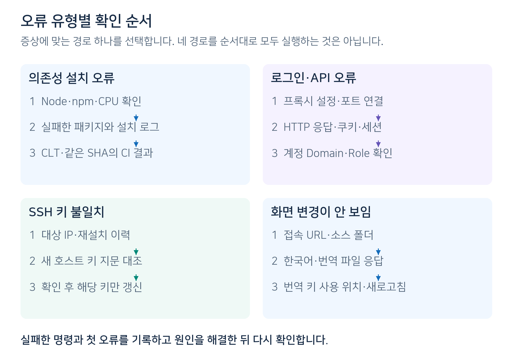

#### 의존성 설치 또는 node gyp 오류

실행 위치는 Mac의 `ui` 디렉터리입니다. Node·npm·CPU 아키텍처와 오류 메시지를 먼저 확인합니다. `package-lock.json`은 버전 관리되는 재현 기준이므로 삭제하지 않습니다. npm 옵션을 바꾸어 의존성을 새로 결정하는 작업은 일반적인 복구 절차로 안내하지 않습니다.

```bash
node -v
npm -v
node -p 'process.arch'
xcode-select -p
git status --short
npm ci --no-audit --no-fund
```

선택한 교육용 버전과 CI 버전을 비교하고, 실패한 패키지와 설치 로그를 기록합니다. CLT가 필요한데 없는 경우에만 설치합니다. 로컬 차이가 해결되지 않으면 같은 소스 SHA의 CI 결과와 비교합니다.

#### 로그인과 API 연결 오류

Mac에서 `.env.local`을 확인하고 개발 서버를 정상 재시작합니다. 로컬 접속은 5050, 원격 관리 서버 기본 포트는 8080입니다. 먼저 포트 연결을 확인하고 인증된 Network 응답으로 API 결과를 확인합니다.

```bash
cat .env.local
nc -zv <교육용 관리 서버 IP> 8080
```

포트 연결 성공은 로그인 성공과 다릅니다. HTTP 응답, 쿠키·세션, 계정 Domain과 Role을 확인합니다. 401·403·API 오류·프록시 오류를 같은 현상으로 처리하지 않습니다.

#### SSH 호스트 키 불일치

교육 환경 정보의 재설치 이력, 대상 IP와 호스트 키 지문을 대조합니다. 새 지문을 확인할 근거가 없으면 서버 관리자에게 문의합니다. 확인 후 해당 호스트의 기존 키만 갱신합니다. 키 불일치 원인을 확인하지 않고 무조건 기존 기록을 지우고 수락하는 절차를 사용하지 않습니다.

#### 번역 또는 화면 변경이 보이지 않음

현재 접속 URL과 실행 중인 소스 디렉터리를 확인합니다. 한국어 선택 상태와 `locales/ko_KR.json`의 응답을 확인하고 페이지를 새로고침합니다. 번역 키가 실제 화면에서 사용되는지도 검색합니다.

#### JVM 메모리 오류

CCVM의 로그 시각과 오류 앞뒤 내용을 기록하고 서비스 상태, 메모리 사용량과 진행 중 작업을 확인합니다. 재시작은 본인에게 허용된 교육 서버에서 영향과 진행 중 작업을 확인하고 필요한 로그를 보존한 뒤 수행합니다. 공용 서버는 팀의 작업 일정과 운영 절차를 따릅니다. 재시작만으로 원인이 해결되었다고 판단하지 않습니다.

```bash
# 실행 위치 관리 서버 CCVM 읽기 점검
sudo systemctl status mold.service --no-pager
sudo journalctl -u mold.service -n 100 --no-pager
free -h
```

---

### 10.2 주요 로그 파일 위치 및 분석 가이드

기본 Agent 파일 로그는 INFO 수준일 수 있습니다. 명령 상세 로그가 보이지 않으면 실제 로그 설정과 해당 시각의 로그 파일을 직접 확인합니다. 설정 파일의 읽기 권한이 없으면 환경 문의 채널을 이용합니다. 공유 서버의 로그 수준을 교육생이 임의로 바꾸지 않습니다.

| 시스템 | 로그 파일 절대 경로 | 주요 확인 내용 |
| :--- | :--- | :--- |
| **Mold 관리 서버 (CCVM - MS)** | `/var/log/cloudstack/management/management-server.log` | API 요청 수신, 비동기 Job 실행, 스케줄링 에러, DB 예외 |
| **Mold 관리 서버 (CCVM - Access)** | `/var/log/cloudstack/management/access.log` | HTTP 클라이언트 접속 IP, 응답 코드(200, 401, 500) |
| **Mold Agent (물리 호스트)** | `/var/log/cloudstack/agent/agent.log` | 하이퍼바이저 명령 수신, Libvirt 통신 결과, 스토리지 마운트 |
| **Libvirt 데몬 (물리 호스트)** | `journalctl -u libvirtd.service` 및 교육 호스트에 설정된 로그 경로 | libvirt 실행·통신 오류와 도메인 관련 진단. `/var/log/libvirt/libvirtd.log` 파일의 생성 여부는 호스트 로그 설정 확인 |
| **브라우저 (Mold Web UI)** | F12 개발자 도구  Console & Network 탭 | Javascript 런타임 오류, Axios HTTP 4xx/5xx 에러 본문 |

#### 서비스 상태와 최근 로그

서비스 오류가 있으면 다음 명령으로 상태와 최근 로그를 확인한다:

```bash
# 실행 위치 CCVM
sudo systemctl status mold.service --no-pager
sudo journalctl -u mold.service -n 100 --no-pager
```

Usage는 `mold-usage.service`로 바꾸고, KVM 호스트에서는 `mold-agent.service` 또는 `libvirtd.service`로 바꿔 상태와 로그를 조회한다. `-n 100`은 최근 100줄, `--no-pager`는 페이지 뷰어 없이 출력하는 옵션이다. 로그 경로는 위 표에서 확인하고, 확보한 증거는 10-3절의 이슈 기록에 남긴다.

#### Job과 VM 로그 검색

* **관리 서버 실시간 로그 분석 & 트러블슈팅**:
  ```bash
  # CCVM 관리 서버 로그 읽기
  # 실행 위치 관리 서버 (CCVM)
  tail -f /var/log/cloudstack/management/management-server.log
  # 오류 필터링
  tail -f /var/log/cloudstack/management/management-server.log | grep -E "ERROR|WARN|Exception"
  # 내부 Job 번호 검색
  grep "job-1025" /var/log/cloudstack/management/management-server.log
  # VM 이름 검색
  grep "i-2-5-VM" /var/log/cloudstack/management/management-server.log | tail -n 50
  ```

**KVM 호스트에서 조회**

```bash
# 실행 위치 해당 VM의 KVM 호스트
grep -F '<VM 내부 인스턴스명>' /var/log/cloudstack/agent/agent.log
tail -f /var/log/cloudstack/agent/agent.log | grep -E "ERROR|WARN|Exception"
```

로그의 Job UUID와 내부 번호는 8-4절에서 연결합니다. 예시의 `job-1025`와 VM 이름은 실제 값으로 바꿉니다.

---

### 10.3 이슈 템플릿 작성법 및 버그 재현 리포트

버그를 발견하거나 기능 이슈를 등록할 때는 **동료 개발자가 10분 안에 재현할 수 있도록 구체적인 정보를 제공**해야 합니다:

아래는 작성 항목을 보여 주는 예시입니다. 실제 오류 코드나 로그를 대신하지 않으며, 재현 결과를 확인한 뒤 자리표시자를 채웁니다.

```markdown
### 1. 현상 요약 (Summary)
인스턴스의 [보조 IP 추가] 실행 시 오류 발생

### 2. 재현 환경 (Environment)
- 브랜치: `europa-2026` (커밋: `9bdce62654`)
- 브라우저와 macOS: <실제 버전>
- 연동 서버: 교육용 1번 Mold 관리 서버 (`10.10.13.10:8080`)

### 3. 재현 단계 (Steps to Reproduce)
1. [컴퓨트] - [인스턴스] 메뉴로 이동
2. 지정된 실습용 실행 중(Running) VM 클릭
3. [NIC] 탭 클릭 후 [보조 IP 추가] 버튼 클릭

### 4. 실제 결과 (Actual Result)
<실제로 표시된 오류와 기대한 정상 결과를 각각 기록>

### 5. 첨부 로그 및 스크린샷 (Logs / Screenshots)
- Network 탭: <HTTP 상태, API 응답의 errorcode·errortext, 요청 시각>
- 대상 식별자: <VM UUID, 인스턴스명, Job UUID와 내부 ID(있을 경우)>
- `management-server.log`: <해당 시각의 실제 로그 발췌>
```

---

### 10.4 Codex에 오류 증거를 전달하고 해결하기

오류가 발생한 명령, 실행 위치, 현재 브랜치·SHA, 도구 버전과 오류 앞뒤 출력을 함께 전달합니다. 브라우저 오류라면 접속 URL과 API명, 재현 순서, 실제 응답을 추가합니다. 교육 기록을 공유할 때 계정 비밀번호·토큰·개인키는 포함하지 않습니다.

```text
Mold UI 검사 실패를 분석해 줘.
실행 위치: 개발 Mac의 ui 디렉터리
브랜치와 SHA: <실제 값>
실행한 명령: <실패한 명령>
도구 버전: <Node와 npm 버전>
오류 출력과 재현 순서: <실제 기록>
먼저 오류가 발생한 코드와 원인을 조사해 줘.
확인된 원인과 추정을 구분하고 가장 작은 수정안을 적용해 줘.
lockfile과 기존 사용자 변경을 보존하고 관련 검사를 다시 실행해 줘.
실행할 수 없는 검사는 이유와 사람이 확인할 방법을 남겨 줘.
```

권한이나 도구 부족으로 검사가 실행되지 않았다면 코드 오류와 구분합니다. 앞선 시도가 남긴 변경을 확인한 뒤 후속 요청을 전달하고, 수정 후에는 처음 실패한 명령과 해당 기능을 다시 확인합니다. Codex가 제시한 원인도 재현 결과와 코드 근거로 검토합니다.

CCVM이나 KVM에서 발생한 오류는 서버명, 서비스명, 요청 시각과 Job 식별자를 포함한 실제 기록으로 분석합니다. 코드 분석을 요청했다고 서버 접속이나 서비스 재시작까지 요청한 것은 아닙니다. 서버에서 수행할 조치는 9장의 적용 대상·실행 위치·검증 절차에 연결해 정합니다.

---

### 10.5 챕터 10 학습 완료 기준 점검
- [ ] 실제 오류·실행 위치·버전을 전달하고 Codex의 수정 후 재검증 결과를 확인할 수 있는가?
- [ ] 주요 5대 오류 발생 시 대처 방법을 숙지하였는가?
- [ ] Mold 관리 서버와 Mold Agent의 로그 파일 경로를 찾아 접근할 수 있는가?
- [ ] 문제 상황 발생 시 위의 표준 양식에 맞추어 이슈를 작성할 수 있는가?

---

---

# 공통 교육 완료 확인

본문 1~10장의 학습 완료 기준을 직접 점검하고 아래 기록을 작성합니다. 별도 체크리스트를 사용한다면 `onboarding-checklist.md`에도 결과를 표시합니다. 실행 결과와 근거가 있는 항목만 완료로 표시하고, 실패·미실행·미확인 항목에는 이유와 다음 확인 방법을 적습니다. 교육용 Node 버전, 실습 계정과 서버 정보는 본인이 확인한 실제 값으로 기입합니다.

- 학습자 이름: ____________________
- Codex 주요 작업 요청 / 검토 기록: ____________________
- 실습 소스 SHA / PR URL: ____________________
- 연구소 빌드서버 기록 / RPM 파일: ____________________
- 검증 결과와 미실행 항목: ____________________
- 리소스 및 빌드 산출물 정리 확인: ____________________
- 다음 담당 기능 / 추가 교육: ____________________
- 본인 점검일: ____________________

시스템 VM 템플릿 반영, Mold 확장 기능, Codex 선택 도구와 GitHub Actions는 해당 업무가 있을 때 별도로 진행합니다. 선택 실습을 수행하지 않았다는 이유로 공통 교육을 미완료로 표시하지 않습니다. 수행했다면 별도 체크리스트의 해당 항목에 결과를 남깁니다.

---

# 부록 A 계정과 실습 환경

이 부록은 권한의 상세 설명과 실습 기록 양식이다. 기본 접속·계정 정보는 4-3절에서 먼저 확인하고, 아래 자원 기록은 각 실습을 진행하며 보완한다.

### A.1 인증과 권한의 세 가지 단계

Mold에 로그인했다고 모든 VM을 조작할 수 있는 것은 아닙니다. 요청은 아래 세 가지를 확인합니다. 같은 API가 관리자 계정에서는 성공하고 교육 계정에서는 실패하면, 계정의 역할과 대상 자원의 소유 범위를 먼저 비교합니다.

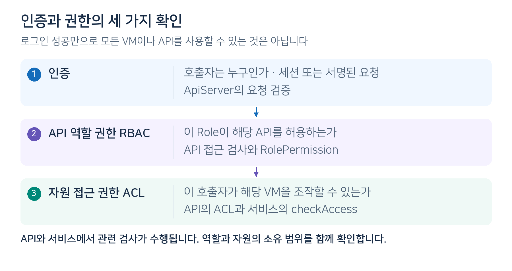

User는 로그인 주체이며 Account에 속합니다. Account는 자원 소유와 역할의 기준이고 Domain은 계정의 계층적 범위입니다. Project는 구성원이 공유하는 자원의 작업 범위입니다. Role은 호출 가능한 API를 결정합니다. 화면의 Project 선택이 바뀌면 요청의 자원 범위도 확인해야 합니다.

`StartVMCmd`의 VM ID는 `@ACL(OperateEntry)`로 표시되며 서비스에서도 VM 접근 권한을 확인합니다. 새 API를 개발할 때는 기존 명령의 권한 선언과 서비스 검사를 함께 읽습니다. 실습 환경에 서로 다른 Role의 계정 두 개가 제공되어 있다면 조회 결과와 메뉴 노출을 비교하고, 실패 응답의 API명·대상 UUID·계정 범위를 기록합니다. 계정이 하나뿐이면 해당 계정의 범위를 기록하고 계정 간 비교는 미실행으로 표시합니다.

근거: [StartVMCmd의 ACL](https://github.com/jschoiRR/ablestack-mold/blob/9bdce626542155f4f66969cb7b4b1fb01542b28d/api/src/main/java/org/apache/cloudstack/api/command/user/vm/StartVMCmd.java#L59), [API 접근 검사](https://github.com/jschoiRR/ablestack-mold/blob/9bdce626542155f4f66969cb7b4b1fb01542b28d/server/src/main/java/com/cloud/api/ApiServer.java#L1549), [VM 접근 검사](https://github.com/jschoiRR/ablestack-mold/blob/9bdce626542155f4f66969cb7b4b1fb01542b28d/server/src/main/java/com/cloud/vm/UserVmManagerImpl.java#L6615).

### A.2 실습 환경과 자원 기록표

4-3절에서 확인한 기본 접속 정보를 옮겨 적고, 도구 설정과 VM·빌드 실습에서 확인한 값을 순서대로 보완합니다. 비밀번호·Secret Key·개인키는 문서에 기록하지 않고 팀이 정한 전달 경로를 사용합니다.

| 항목 | 직접 확인하여 기록할 값 |
| --- | --- |
| 학습자와 일정 | 본인 이름, 실습 기간, 저장소·개발 환경 문의 채널 |
| 소스 기준 | 저장소 URL, 기준 브랜치·커밋, 변경 브랜치 |
| 접속 경로 | CCVM 주소, API URL, SSH 사용자·접속 방식 |
| 연구소 빌드서버 | Rocky Linux 9 VM `10.10.0.100`·SSH 계정 `root`·OS 세부 버전·도구 버전 |
| 빌드 소스와 옵션 | 소스 폴더 `/root/build/europa`·대상 브랜치·커밋 SHA·패키징 옵션 |
| RPM 생성과 보관 | 생성 폴더 `/root/build/europa/dist/rpmbuild/RPMS/`·이번 RPM 파일명·전달 및 보관 경로 |
| 개발 도구와 Codex | macOS·CPU·Node·npm·JDK·Maven·IDE·Codex 앱·로그인 조직과 권한 범위 |
| 계정 범위 | User, Account, Domain, Role, Project 이름과 UUID |
| 배치 환경 | Zone, Pod, Cluster, KVM Host 이름과 UUID |
| 실습 VM | 이름, UUID, 인스턴스명, 현재 상태, 배치 호스트 |
| 연결 자원 | NIC·Network, Network Offering, 볼륨·스토리지 풀 |
| VM 사양 | 템플릿, Service Offering, Disk Offering |
| 실습 범위 | 허용 작업, 공용 자원 사용 규칙, 종료 후 정리 방법 |

완료 기준은 본인 계정으로 지정 VM을 찾고, UI의 UUID와 관리 서버·호스트의 인스턴스명을 연결해 설명할 수 있는 것입니다.

# 부록 B 비동기 작업과 상태 진단

8-4절에서 수집한 요청·Job·로그를 바탕으로 실패나 결과 불명, 상태 불일치가 있을 때 참고한다.

### B.1 작업 수락과 실행 결과 구분

`startVirtualMachine`은 비동기 API입니다. 수락 응답의 `jobid`는 UUID이며, 관리 서버 로그의 `job-<숫자>`는 내부 DB ID입니다. 두 값을 같은 문자열로 검색하면 일부 로그를 놓칠 수 있습니다. `async_job.id`와 `async_job.uuid`로 대응 관계를 확인합니다.

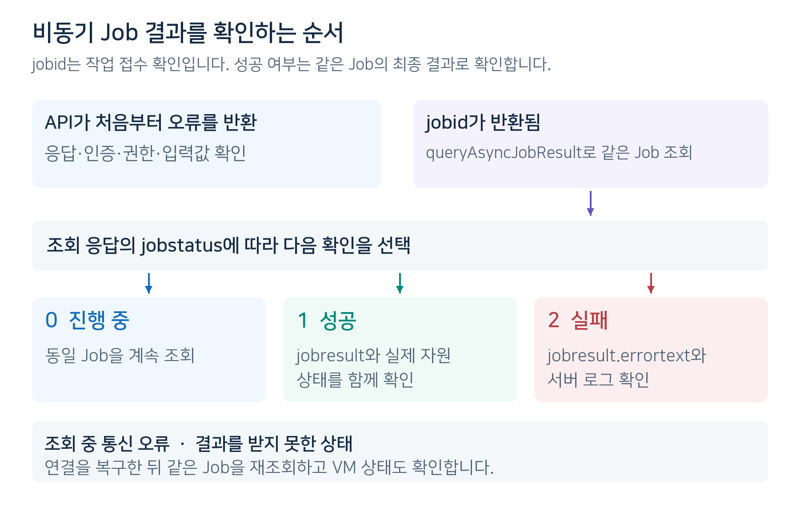

폴링의 통신 실패는 작업 실패를 뜻하지 않습니다. 원래 명령을 바로 다시 보내기 전에 같은 Job의 결과와 VM 상태를 확인합니다. UI 추적기의 `unknown`도 결과를 확인하지 못한 상태입니다.

근거: [UUID 응답](https://github.com/jschoiRR/ablestack-mold/blob/9bdce626542155f4f66969cb7b4b1fb01542b28d/server/src/main/java/com/cloud/api/ApiServer.java#L792), [UI 결과 구분](https://github.com/jschoiRR/ablestack-mold/blob/9bdce626542155f4f66969cb7b4b1fb01542b28d/ui/src/utils/plugins.js#L69), [폴링 오류 처리](https://github.com/jschoiRR/ablestack-mold/blob/9bdce626542155f4f66969cb7b4b1fb01542b28d/ui/src/utils/jobTracker.js#L42).

### B.2 Job 결과와 VM 상태 비교

8-4절의 기본 추적을 반복하지 않고, 이미 확보한 Job UUID·내부 ID·VM UUID·호스트·요청 시각을 사용합니다. 같은 Job을 재조회한 뒤 아래 SELECT로 VM의 DB 상태와 배치 호스트를 확인합니다.

```sql
SELECT id, uuid, instance_name, state, host_id
FROM vm_instance
WHERE uuid = '<VM-UUID>';
```

```bash
# 실행 위치 실제 대상 KVM 호스트
sudo virsh dominfo '<인스턴스명>'
```

Job 결과·DB 상태·도메인 상태를 같은 시각의 자료로 비교합니다. 읽기 권한이 없거나 도메인 조회가 실패했다면 그 이유를 미확인으로 기록합니다. 정지한 Mold VM이 호스트에 도메인으로 남아 있다고 가정하지 않습니다. 결과가 다르면 B-3절의 상태 동기화와 10-2절의 관리 서버·Agent 로그를 함께 확인합니다.

### B.3 실패와 상태 동기화 읽기

VM 상태는 정상적으로 `Stopped → Starting → Running`으로 진행하며 시작 실패 시 `Starting → Stopped`로 돌아가는 전이가 있습니다. 호스트 선택, 네트워크·볼륨 준비, Agent 연결, libvirt 실행 중 어느 단계에서 실패했는지 확인해야 합니다. 실패 뒤 자원 정리나 재시도가 이어질 수 있습니다.

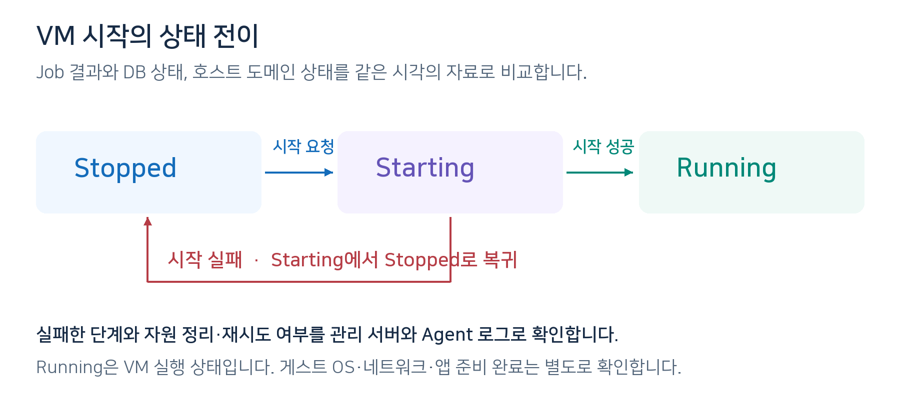

관리 서버는 Agent가 보고한 전원 상태도 반영합니다. 작업·HA 처리와 상태 보고가 겹치면 동기화를 미룰 수 있으므로 UI·DB·도메인 상태가 한 순간에 같다고 가정하지 않습니다. `Running`은 VM 실행 상태이며 게스트 OS 부팅·네트워크·애플리케이션 준비 완료는 별도로 확인합니다.

근거: [VM 상태 전이](https://github.com/jschoiRR/ablestack-mold/blob/9bdce626542155f4f66969cb7b4b1fb01542b28d/api/src/main/java/com/cloud/vm/VirtualMachine.java#L103), [전원 보고 처리](https://github.com/jschoiRR/ablestack-mold/blob/9bdce626542155f4f66969cb7b4b1fb01542b28d/engine/orchestration/src/main/java/com/cloud/vm/VirtualMachineManagerImpl.java#L5490).

# 부록 C Mold 확장 기능 찾아보기

이 부록은 담당 기능을 맡았을 때 진행하는 선택 학습입니다. 담당 기능의 설계와 구현을 찾는 안내입니다. 설계 문서의 목표, 현재 코드, 배포된 서버의 기능 설정·패키지·검증 결과를 함께 확인합니다. 기능명만으로 모든 환경에서 같은 동작이 제공된다고 판단하지 않습니다.

### C.1 FT와 DR

FT·DR 업무는 보호 상태, 복제, 전환·복귀, 현재 활성 사이트를 읽는 데서 시작합니다. `plugins/integrations/ftctl-service`의 `FtctlServiceImpl`과 `plugins/integrations/disaster-recovery`를 찾아 UI/API와 Agent 경계를 연결합니다. 먼저 [DR 흐름 설계](https://github.com/jschoiRR/ablestack-mold/blob/9bdce626542155f4f66969cb7b4b1fb01542b28d/docs/ftctl/514-cross-hypervisor-dr-ui-backend-flow-diagrams-20260701.md)를 읽고, 실제 지원 방향과 작업 조건은 해당 설계 문서, 현재 코드와 교육 환경 설정을 대조하여 확인합니다. 확인되지 않은 기능은 미확인으로 기록합니다.

### C.2 n2k와 v2k 가져오기

n2k는 Nutanix, v2k는 VMware에서 KVM으로 가져오는 작업 경로를 찾는 키워드입니다. 변환 도구 진행 상태와 Mold VM 등록 완료를 구분합니다. [가져오기 통합 설계](https://github.com/jschoiRR/ablestack-mold/blob/9bdce626542155f4f66969cb7b4b1fb01542b28d/developer/design/ablestack-v2k-n2k-cloud-import-integration.ko.md)에서 시작해 `ImportUnmanagedInstanceForAblestackN2KCmd`, `ImportUnmanagedInstanceForAblestackV2KCmd`, `ImportVmTasksManagerImpl`을 검색합니다. 소스와 대상 스토리지 지원 범위는 실제 어댑터와 환경에서 확인합니다.

### C.3 Storage Service와 SharedFS

공유 파일 시스템과 저장소 서비스는 서비스 VM, 볼륨, 프로토콜 상태를 함께 봅니다. [Storage Service 설계](https://github.com/jschoiRR/ablestack-mold/blob/9bdce626542155f4f66969cb7b4b1fb01542b28d/docs/design/storage-service-systemvm-design.md)와 `server/`의 `SharedFSServiceImpl`, `StorageServiceManagerImpl`, `plugins/storage/sharedfs/storagevm`이 출발점입니다. Glue·주 스토리지 풀, 서비스 VM, 사용자에게 노출한 공유 경로를 각각 구분합니다.

### C.4 게스트 프로세스와 QGA

게스트 내부 프로세스 관측은 VM 시작·정지와 별도의 경로입니다. QGA 통신과 게스트 도구·기능 설정·현재 상태를 함께 확인합니다. [프로세스 준비 상태 설계](https://github.com/jschoiRR/ablestack-mold/blob/9bdce626542155f4f66969cb7b4b1fb01542b28d/docs/design/vm-process-capability/README.ko.md), `VmProcessCapabilityServiceImpl`, `LibvirtGetVmProcessCapabilitiesCommandWrapper`에서 관리 서버→Agent→게스트 경계를 찾습니다. 준비 상태가 확인되었다고 모든 변경 작업이 허용되는 것은 아니며 실제 API·대상별 권한과 지원 조건을 다시 확인합니다.

완료 기준은 맡은 기능의 UI 진입점, API, 서비스 구현, Agent 경계, 설계 문서를 각각 하나 이상 찾고 파일·메서드 근거를 붙여 호출 흐름을 실습 기록에 정리하는 것입니다.

---

# 부록 D Codex의 다른 사용 방법

데스크톱 실습 후 필요할 때 선택하는 활용 방법입니다. 공통 교육의 추가 설치 조건은 아닙니다. 작업 폴더·실행 환경·변경 내용을 확인합니다.

### D.1 터미널에서 Codex 사용하기

CLI는 터미널에서 파일 탐색·수정과 명령 실행을 요청하는 방법입니다. [공식 CLI 안내](https://learn.chatgpt.com/docs/cli)에 따라 macOS에 설치한 뒤 프로젝트 폴더에서 실행하고 로그인합니다.

```bash
# 실행 위치 개발 PC Mac
cd ~/WORK/mold-europa2
codex
```

명령을 찾지 못하면 CLI 설치 여부와 PATH를 확인합니다. 데스크톱 앱과 CLI 설치는 별도로 확인하며, 첫 요청에는 현재 브랜치와 기존 변경 확인을 포함합니다.

### D.2 VS Code에서 Codex 사용하기

[공식 IDE 안내](https://learn.chatgpt.com/docs/ide)에 따라 OpenAI Codex 확장을 설치하고 Mold 폴더를 엽니다. 사이드바에서 로그인한 뒤 관련 파일·선택 코드와 필요한 경로를 전달합니다. 앱과 IDE가 같은 프로젝트를 가리키는지 확인합니다.

### D.3 Worktree로 작업 폴더 분리하기

Worktree는 같은 Git 저장소의 별도 작업 폴더입니다. 기능을 병렬로 개발하거나 현재 작업을 유지한 채 다른 변경을 검토할 때 사용합니다. 기준 브랜치와 새 작업 폴더의 의존성·ui/.env.local·개발 서버 실행 위치를 확인합니다. 포트 충돌은 팀에서 정한 방식으로 해결합니다.

완료 후 변경 차이와 검사 결과를 검토하고 브랜치·PR로 정리합니다. 교육에서는 개인 브랜치를 먼저 익히고 필요할 때 Worktree를 도입합니다. [공식 Worktree 안내](https://learn.chatgpt.com/docs/environments/git-worktrees)

### D.4 반복 작업을 Skill로 정리하기

번역 검토, UI 검사 실패 분석, PR 설명 작성처럼 반복하는 작업은 성공한 예시를 바탕으로 Skill로 정리합니다. SKILL.md에 사용 조건과 절차를 적고 필요한 자료를 함께 둡니다. 공통 프로젝트 규칙은 AGENTS.md에, 반복 작업의 방법은 Skill에 정리합니다.

먼저 완료한 작업의 입력·검사 명령·좋은 결과 예시를 모아 절차를 검증합니다. 팀에서 제공한 Skill은 이름과 적용 범위를 확인한 뒤 사용합니다. [공식 Skill 활용 안내](https://learn.chatgpt.com/use-cases/reusable-codex-skills)

공식 문서 확인일: 2026-10-08.

---

# 부록 E 빌드와 서버 반영 참고

준비된 연구소 서버에서 기본 실습을 할 때는 9장을 따른다. 이 부록은 새 빌드서버 준비, 설치 오류 확인, 시스템 VM 템플릿 생성·반영 작업이 있을 때 찾아본다.

### E.1 빌드서버 준비와 도구 확인

새 서버는 환경 담당자가 Rocky Linux 9 VM, 저장소 접근, 도구와 라이브러리를 준비한다. 연구소의 기존 서버는 `10.10.0.100`, 소스 폴더는 `/root/build/europa`, 빌드 구성은 `noredist`다.

| 준비 항목 | 확인할 내용 |
| --- | --- |
| VM과 작업 폴더 | Rocky Linux 9·CPU 아키텍처·공용 작업 일정·소스 폴더의 쓰기 권한과 여유 공간 |
| Java와 Maven | 빌드용 JDK 17·팀의 Maven 버전·JAVA_HOME과 PATH·RPM spec의 Java 11 개발 패키지 의존성 |
| Node와 npm | 팀의 UI 빌드 버전과 PATH. 현재 CI 참고값은 Node 14.21.3 |
| RPM과 네이티브 도구 | rpm-build·컴파일러·개발 헤더·Python 도구 등 RPM spec의 의존성 |
| 제품 라이브러리 | `noredist` 빌드에 필요한 라이브러리와 저장소·의존성 다운로드 접근 |

```bash
# 실행 위치 연구소 빌드서버
cat /etc/rocky-release
uname -m
java -version
mvn -v
node -v
npm -v
rpmbuild --version
```

위 명령은 도구와 버전을 확인한다. 이미 설정된 서버에서 빌드할 때마다 실행할 필요는 없다. 도구가 없거나 팀 기준과 다를 때 환경 담당자와 확인한다.

현재 패키징 스크립트는 network-runtime RPM도 생성하며, Agent RPM은 이 런타임에 의존한다. 9-3절의 KVM 반영 파일 2개는 의존성이 준비된 호스트 기준이다. 의존성 오류가 발생하면 런타임 설치 상태를 함께 확인한다.

소스 RPM이 별도로 필요하면 `packaging/package.sh`의 `-S` 옵션을 사용한다. 출력은 `/root/build/europa/dist/rpmbuild/SRPMS/`다. 일반 실습에서 설치할 파일은 `RPMS/` 아래의 바이너리 RPM이다.

근거: `packaging/package.sh`, `packaging/centos8/cloud.spec`, `packaging/network-runtime/build.sh`.

### E.2 RPM 조회와 설치 명령 참고

9-4절은 이미 의존성이 준비된 서버에 RPM을 반영하는 예시다. 패키지 정보나 설치 오류를 더 확인해야 할 때 아래 명령을 사용한다.

```bash
# 실행 위치 RPM 파일이 있는 대상 Linux 서버
MOLD_RPM='/var/tmp/mold-rpm/실제-패키지.rpm'
rpm -qpi "$MOLD_RPM"
rpm -qpl "$MOLD_RPM"
rpm -qpR "$MOLD_RPM"
```

`-p`는 RPM 파일을 대상으로 삼는다. `-i`는 정보, `-l`은 포함 파일, `-R`은 의존성을 보여 준다. 설치된 버전 조회는 9-6절의 `rpm -q`를 사용한다.

| 명령 | 사용할 때 |
| --- | --- |
| `rpm -ivh 파일.rpm` | 새 패키지를 설치할 때 |
| `rpm -Uvh 파일.rpm` | 새 설치 또는 더 높은 버전으로 업그레이드할 때 |
| `rpm -Uvh --replacepkgs 파일.rpm` | 같은 버전 번호로 다시 빌드한 RPM까지 재설치할 때 |
| `dnf install ./파일.rpm` | 저장소를 통해 필요한 의존성을 함께 계산해 설치할 때 |
| `dnf reinstall ./파일.rpm` | 이미 설치된 같은 버전을 DNF로 다시 설치할 때 |

위 명령은 상황별 대안이며 순서대로 모두 실행하는 절차가 아니다. RPM은 필요한 의존성을 자동 다운로드하지 않는다. 오류를 `--nodeps`나 `--force`로 우회하지 말고, 필요한 패키지와 충돌 원인을 확인한다.

명령 의미: [RPM 공식 안내](https://rpm.org/docs/4.20.x/man/rpm.8), [Red Hat의 DNF 설치 안내](https://docs.redhat.com/en/documentation/red_hat_enterprise_linux/9/html/managing_software_with_the_dnf_tool/assembly_installing-rhel-9-content_managing-software-with-the-dnf-tool).

### E.3 SystemVM 템플릿 생성과 반영

이 절은 시스템 VM 이미지 내부를 수정하거나 새 템플릿을 반영할 때 진행하는 선택 실습이다. 일반적인 UI·서버 코드 변경의 RPM 반영만 수행한다면 이 절의 작업은 필요하지 않다.

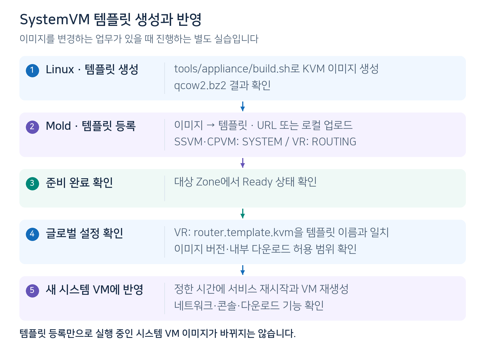

#### 1 시스템 VM 템플릿 생성

Packer·KVM/QEMU·sharutils와 이미지 검증용 NBD가 준비된 Linux x86_64 서버에서 실행한다. 빌드서버가 VM이면 중첩 가상화가 가능해야 한다. 아래 경로는 연구소 빌드서버 기준이다.

```bash
# 실행 위치 SystemVM 이미지 빌드 도구가 준비된 Linux 서버
cd /root/build/europa/tools/appliance
sudo bash ./build.sh systemvmtemplate 4.23.0.0 x86_64
ls -lh dist/*-kvm-*.qcow2.bz2
```

`build.sh`는 저장소의 `systemvm/debian` 변경을 넣어 KVM용 이미지를 만든다. `4.23.0.0`은 빌드 버전 예시이며 적용할 Mold 버전에 맞춘다. `BUILD SUCCESSFUL`과 생성 파일을 확인한다. 일반 RPM 빌드와는 별도 작업이다.

생성 위치는 `/root/build/europa/tools/appliance/dist/`이며, 파일 이름은 `systemvmtemplate-4.23.0.0-x86_64-kvm-날짜.qcow2.bz2` 형태다.

#### 2 시스템 VM 템플릿 업로드

관리자 계정으로 Mold의 **이미지 → 템플릿**에서 등록한다. 새 버전을 구분할 수 있도록 기존 템플릿과 다른 이름을 사용한다.

- URL 방식: 생성 파일을 다운로드 가능한 HTTP 서버에 올리고 **URL로 템플릿 등록**에서 파일의 전체 URL을 입력한다. SSVM이 해당 URL에 접근할 수 있어야 한다.
- 로컬 방식: 파일을 Mac으로 내려받고 **로컬에서 템플릿 업로드**로 선택한다. 이 방식은 SSVM의 HTTPS 업로드 환경이 구성돼 있어야 한다.

| 템플릿 등록 항목 | 사용할 값 |
| --- | --- |
| Zone | 반영할 연구소 Zone |
| 하이퍼바이저와 아키텍처 | KVM / x86_64에 해당하는 amd64 |
| 파일 형식과 OS | QCOW2 / Debian GNU/Linux 12 (64-bit) |
| 템플릿 형식과 이름 | SSVM·CPVM용은 SYSTEM, 예시 이름 `SystemVM-Europa-001`. VR 전용은 ROUTING, 예시 이름 `VR-Europa-001` |

등록 후 해당 Zone에서 다운로드 완료와 **준비 완료(Ready)** 상태를 확인한다. 동일한 빌드 이미지를 역할별 이름과 형식으로 각각 등록할 수 있다.

#### 3 글로벌 설정 확인과 반영

**글로벌 설정**에서 아래 값을 검색한다. Zone에 개별 설정값이 있으면 그 값도 확인한다.

| 설정 이름 | 확인하거나 변경할 값 |
| --- | --- |
| `router.template.kvm` | VR용으로 등록한 템플릿의 **이름(Name)**. 위 예시에서는 `VR-Europa-001` |
| `minreq.sysvmtemplate.version` | VR이 보고해야 하는 기준 버전. 새 이미지의 버전과 맞는지 확인하며, 단순히 템플릿 이름만 바꾸는 경우에는 변경하지 않는다. |
| `secstorage.allowed.internal.sites` | 내부 HTTP 서버에서 다운로드할 때 해당 서버 IP가 허용된 CIDR 범위에 포함되는지 확인한다. 이미 허용돼 있으면 변경하지 않는다. |

`router.template.kvm`에는 파일 이름이나 URL, 표시 설명을 넣지 않는다. 등록 화면의 **템플릿 이름과 정확히 일치**시킨다. SSVM·CPVM용 SYSTEM 템플릿은 VR 전용 이름 설정과 구분한다.

설정 저장 후 정한 적용 시간에 CCVM의 Mold 서비스를 재시작하고 9-6절의 상태와 `router.template.kvm`에 저장한 새 이름을 다시 확인한다. **등록만으로 실행 중인 VM의 이미지가 바뀌지는 않는다.** 교육 환경에서 VR은 대상 네트워크 재시작의 `Cleanup` 옵션으로 재생성하고, SSVM·CPVM은 대상 시스템 VM을 재생성해 반영한다. 네트워크·콘솔·다운로드 기능이 잠시 중단될 수 있으므로 사용 중인 작업을 먼저 확인한다.

새 VM의 템플릿 이름·버전과 네트워크 연결, 콘솔 연결, 템플릿 다운로드를 확인한다. URL 등록과 VR 이름 설정은 [Apache CloudStack 템플릿 등록 안내](https://docs.cloudstack.apache.org/en/latest/adminguide/templates.html#uploading-templates-from-a-remote-http-server)와 [시스템 VM 템플릿 변경 안내](https://docs.cloudstack.apache.org/en/latest/adminguide/systemvm.html#changing-the-default-system-vm-template)를 참고한다.

---

# 부록 F GitHub Actions 빌드와 Release 안내

이 부록은 GitHub Actions 빌드가 필요한 경우에 진행하는 선택 실습이다. GitHub Actions는 저장소의 yml 파일에 정의된 자동화 빌드 경로다. 일반 개발자의 연구소 빌드서버 절차는 9-2절을 따르고, 이 절은 Actions로 빌드·Release 게시를 수행할 때 별도로 사용한다. PR 검사와 자동화 빌드를 확인하는 방법도 함께 이해한다.

### F.1 workflow 선택과 소스 기준

- UI 검증: `.github/workflows/ui.yml`
- 제품 브랜치 개발 패키징: `.github/workflows/dev-release.yml`
- 실습 브랜치 또는 SHA 지정 패키징: `.github/workflows/branch-dev-release.yml`
- 정식 릴리즈 검증과 게시: `.github/workflows/build.yml` 및 `release.yml`

Actions 운영 기준은 `developer/build-release-policy.ko.md`와 실제 workflow를 참고한다. 정식 릴리즈는 필요한 전체 검증 결과와 최종 패키징·게시 결과를 함께 확인한다. 교육용 빌드서버에서 RPM이 생성되었다는 이유만으로 정식 릴리즈가 완료된 것은 아니다.


PR에 올린 최신 커밋과 빌드할 커밋이 같아야 한다. Mac의 저장소 루트에서 `git status`로 미커밋 변경을 확인하고 `git rev-parse HEAD`로 전체 커밋 SHA를 기록한다. 아직 커밋하지 않은 로컬 수정은 Actions 빌드에 포함되지 않는다. 브랜치에 추가 커밋을 올렸다면 이전 빌드가 최신 변경을 포함하는지도 다시 확인한다.

현재 `.github/workflows/dev-release.yml`의 `base_branch` 선택지는 `ablestack-europa`, `ablestack-diplo`이며 이 입력을 소스 checkout에도 사용한다. 이 workflow에 `europa-2026`이나 개인 실습 브랜치를 그대로 선택할 수 있다고 가정하면 안 된다.

개인 브랜치나 특정 커밋을 패키징할 때에는 `.github/workflows/branch-dev-release.yml`의 입력을 확인한다.

| 입력 | 의미 | 교육 실습에서 확인할 내용 |
| --- | --- | --- |
| `source_ref` | 실제 빌드할 브랜치 태그 커밋 SHA | PR에서 검토한 전체 SHA를 지정하고 checkout 결과와 대조한다 |
| `base_branch` | 제품 계열과 브랜딩 메타데이터 | Mold Europa 교육이면 `ablestack-europa`를 선택하고 workflow의 선택 항목과 대조한다 |
| `release_label` | 개발 Release를 구분하는 이름 | 실습 목적과 작성자를 알아볼 수 있는 이름을 정한다 |
| `draft` | 초안 Release 생성 여부 | 초안이면 파일 접근에 필요한 저장소 권한을 확인한다 |

`source_ref`가 교육 브랜치의 커밋이어도 `base_branch`는 제품 기준 이름일 수 있다. 두 입력을 같은 값으로 채우는 규칙은 없다. Actions 실행 화면에서는 workflow 실행 기준 ref와 workflow 내부의 `source_ref`를 구분하고, 결과의 실제 소스 SHA를 확인한다. SHA를 지정해도 그 커밋이 원격 저장소에 있어 checkout 가능해야 한다.

PR 검증은 대상 브랜치와 합쳐진 임시 병합 상태에서 실행될 수도 있다. 이때 검증 작업의 SHA와 개인 브랜치의 SHA가 다르다는 이유만으로 오류라고 단정하지 않는다. 무엇을 검사한 실행인지, 패키지는 어떤 소스로 만들었는지 기록한다. 검증 후 코드가 다시 바뀌었다면 이전의 녹색 체크를 최신 변경의 증거로 재사용하지 않는다.

UI만 패키징하는 `.github/workflows/ui-rpm.yml`도 있다. 자동 push 조건은 `feature/**`와 지정된 UI 경로이며, `feat/**` 브랜치를 push했다고 이 패키징이 자동 실행되는 것은 아니다. 수동 실행의 `ref`와 `run_checks`도 확인한다. 이 workflow는 RPM을 artifact로 올리므로 공식 배포에 필요한 Release asset 게시 여부는 별도의 Release 절차와 대조한다.

### F.2 GitHub Actions로 개발용 RPM 빌드하기

GitHub Actions로 RPM을 만드는 실습에서는 개인 브랜치나 특정 SHA를 지정할 수 있는 **ABLESTACK Branch Development Release**를 사용한다. 파일은 `.github/workflows/branch-dev-release.yml`이다. 제품 브랜치 자체의 최신 패키지를 만들 때는 **ABLESTACK Development Release**의 `dev-release.yml`을 사용한다. 이 절에서는 교육생이 검토한 커밋을 지정하는 방법을 설명한다.

**1 빌드할 커밋 준비**

5-10절의 로컬 컴파일·테스트와 필요한 PR 검증 결과를 확인한다. 변경을 커밋하고 원격 브랜치에 push한 뒤 전체 SHA를 기록한다. 로컬 파일에만 남아 있는 수정은 Actions에 전달되지 않는다. 실행할 저장소와 교육용 제품 기준을 workflow 파일 및 팀의 빌드 정책과 대조한다.

**2 Actions에서 workflow 선택**

GitHub 저장소의 **Actions** 탭에서 **ABLESTACK Branch Development Release**를 선택하고 **Run workflow**를 연다. workflow 실행 브랜치에는 팀이 지정한 workflow 정의가 있는 브랜치를 선택한다. 이 선택은 아래 `source_ref`에 지정할 빌드 소스와 별개다. 버튼이 없다면 저장소 쓰기 권한과 기본 브랜치의 `workflow_dispatch` 등록 여부를 확인한다.

**3 입력값 지정**

아래는 Mold Europa 교육용 예시다. `source_ref`는 1단계에서 기록한 원격 커밋의 전체 SHA로 바꾼다. workflow의 기본 `source_ref`가 자신의 실습 브랜치라고 가정하지 않는다. `release_label`에는 교육생이나 작업을 구분할 이름을 넣는다.

```text
source_ref: <원격에 올라간 실습 커밋의 전체 SHA>
base_branch: ablestack-europa
release_label: mold-training-<교육생 이름>
release_stage: alpha
prerelease_number: 1
draft: true
```

현재 이 workflow의 나머지 기본값은 `pack=noredist`, `simulator=default`, `node_version=14.21.3`, `build_srpm=false`, `release_seq=1`이다. 제품별 지정값이 있으면 그 값을 사용한다. `build_srpm=true`는 소스 RPM도 함께 만드는 선택이며, 첫 실습에서는 기본값을 사용한다. 정식 릴리즈 버전과 단계는 교육생이 임의로 지정하지 않는다.

**4 실행과 결과 확인**

입력값을 확인한 뒤 **Run workflow**를 누르고 새 실행을 연다. 현재 작업은 `metadata` → `build-systemvm-kvm` → `build-rpm` → `publish-release` 순서로 연결된다. RPM 작업은 `rocky97-rpm.yml`을 호출하여 Rocky 8.7 환경에서 패키징한다. 이 workflow는 KVM SystemVM 이미지도 함께 만들므로 RPM 작업 하나만 성공했다고 전체 완료로 판단하지 않는다.

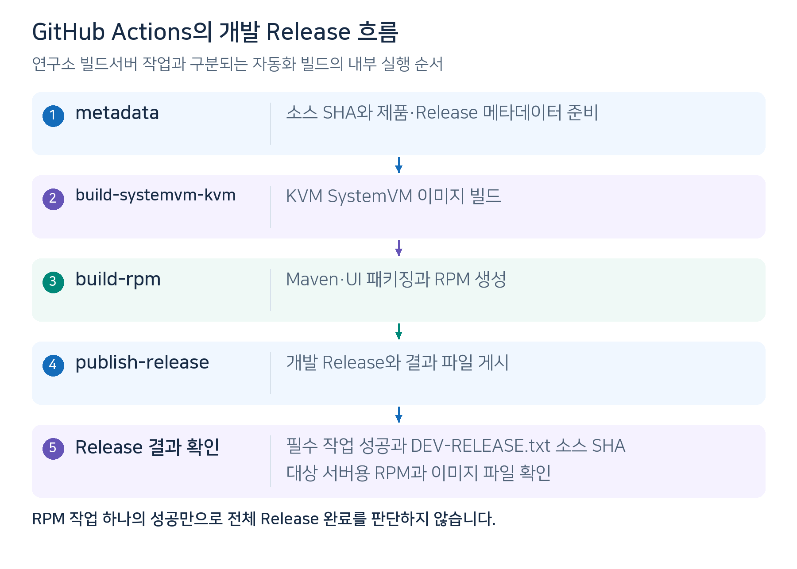

실패하면 처음 실패한 작업과 해당 단계의 오류를 읽는다. 소스 SHA, 작업 이름, 핵심 오류를 기록하고 원인을 해결한 뒤 다시 실행한다. RPM 패키징 내부 Maven 명령은 테스트를 생략하므로 패키징 성공은 기능 테스트 통과를 뜻하지 않는다.

**5 Release 파일과 소스 확인 후 내려받기**

모든 필수 작업이 성공하면 저장소의 **Releases**에서 해당 개발 Release를 연다. `draft=true`이면 권한이 있는 계정으로 로그인해 초안을 확인한다. `DEV-RELEASE.txt`의 **Source commit**이 1단계의 SHA와 일치하는지 먼저 확인한다.

| 기록 항목 | 확인 위치 |
| --- | --- |
| 실제 소스 전체 SHA | `DEV-RELEASE.txt`와 Actions의 checkout 및 결과 |
| workflow와 실행 번호 또는 URL | GitHub Actions 실행 페이지 |
| Release 이름 태그 파일명 | GitHub Release 페이지와 다운로드 파일 |
| 패키지 버전과 제품 표시 버전 | Release 메타데이터 및 RPM 정보 |
| SystemVM 이미지 이름과 버전 | 해당 Release의 이미지와 설명 파일 |

Release assets에는 `cloudstack-management-*.rpm`, `cloudstack-agent-*.rpm`, `cloudstack-ui-*.rpm` 등 실제 생성된 패키지와 KVM SystemVM 이미지, `DEV-RELEASE.txt`, `SHA256SUMS`가 포함된다. 파일명과 패키지 조합은 실제 Release를 기준으로 확인한다. RPM은 설치할 서버 역할에 맞게 선택하며, 파일 선택은 9-3절, 설치와 반영은 9-4절로 이어간다.

현재 branch 개발 Release는 같은 라벨의 이전 Release와 태그를 교체할 수 있다. 다른 교육생과 라벨을 공유하기 전에 확인하고, 이번 실행 URL·소스 SHA·파일명을 실습 기록에 남긴다. 검증 종료 후에는 이 절의 개발 Release 정리 안내를 따른다.

**RPM 빌드 내부 흐름 이해**

Actions의 Rocky 환경에서 `tools/build/rocky97-rpm-build.sh`가 `packaging/package.sh`를 실행하고, RPM spec의 Maven 패키징과 UI 빌드를 거쳐 RPM을 생성한다. 중간 출력은 `dist/rpmbuild/RPMS/`, 소스 RPM을 선택했으면 `dist/rpmbuild/SRPMS/`에 만들어진 뒤 Release에 모인다. 이 절의 경로는 Actions 작업 환경의 경로이다. 연구소 빌드서버에서 직접 실행하는 절차는 9-2절에 설명한다.

`mvn compile`이나 `mvn package` 자체가 RPM 파일을 만드는 것은 아니다. RPM 생성에는 spec과 RPM 패키징 도구를 사용하는 별도 과정이 필요하다. Actions 실습에서는 위 입력·결과 확인 절차를 사용하고, Linux 서버에 만들어진 RPM을 설치하는 명령은 9-4절에서 구분해 학습한다.

근거: `.github/workflows/branch-dev-release.yml`, `dev-release.yml`, `rocky97-rpm.yml`, `tools/build/rocky97-rpm-build.sh`, `packaging/centos8/cloud.spec`. 화면에서 실행하는 순서는 [GitHub workflow 수동 실행 안내](https://docs.github.com/en/actions/how-tos/manage-workflow-runs/manually-run-a-workflow)를 참고한다.

### F.3 개발 Release 정리

개발용 Release는 테스트 완료 후 Release, tag, asset을 정리하는 것이 공식 정책이다. 이번 실행 URL, 소스 SHA, 검증 결과를 실습 기록에 먼저 보존한다. 현재 `.github/workflows/dev-release-cleanup.yml`은 선택한 제품 기준의 `dev-제품기준-latest` 태그를 정리한다. `branch-dev-release.yml`이 만든 `dev-branch-실습이름-latest` 태그는 이 workflow의 처리 대상에 포함되지 않으므로, 해당 Release와 태그는 팀의 별도 정리 절차로 처리한다. 정식 Release의 보존 정책과 개발 Release 정리를 혼동하지 않는다.

---
