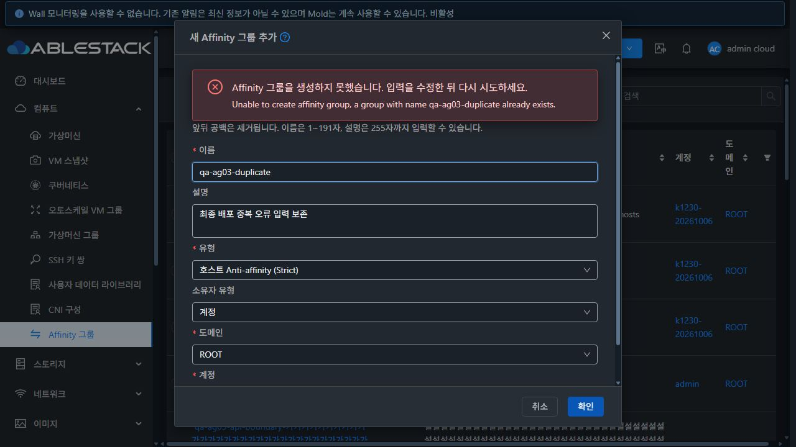

# AG-03 Affinity 그룹 생성·유형·검색 개선 검증 (#1416)

2026-10-19, 31번 클러스터. Epic #1413 / 누적 Draft PR #1420의 AG-03 범위에서 설계·구현·배포·검증·정리를 완료했다. Epic의 멤버 관리·최종 UI 표준화·실제 VM 배치 검증은 후속 이슈에 남긴다.

## 소스와 변경

- 기준 Europa: `d9f068bbbba048313b6d38539651d19444c4d7c7`. 작업 브랜치: `dhslove/epic-1413-affinity-ui`.
- 생성 기능 최초 검증 UI: `562f39597ba1a5657fa5b98fbe7014d761e2fbf6`. 최종 배포 UI: **`e695b7aa68b228fe44f90c4b39c4464808830c01`**.
- [설계](../../design/affinity-1416-create-search.ko.md): 동적 유형 조회, 입력 검증·실패 복구, 비동기 최종 완료, 소유자 전환 보호, 지원 검색·URL 계약.
- 최종 보완 커밋은 검색 폼·번역·회귀/설계만 변경했다. 최초 배포에서 검증한 생성 폼/소유자/작업 추적/검증 유틸리티 4개 파일은 Git blob이 동일하다. [소스 연속성](evidence/source-continuity.json), [Windows/WSL 최종 해시](evidence/source-manifest.json).
- UI만 변경했다. Java·DB 스키마·호스트 프로그램은 변경하지 않았다. 원래 FTCTL 작업 트리의 변경 파일 3개도 동일 해시로 보존했다. [FTCTL 해시](evidence/preserved-ftctl-hashes.json).

## API·DB 계약

| 항목 | 실제 확인과 UI 처리 |
| --- | --- |
| 이름 | 현재 DB는 utf8mb4 `varchar(191)`. Europa 업그레이드의 191자 안전 범위와 API의 기본 255 UTF-16 단위를 함께 검증. 앞뒤 공백만 제거하고 공백 이름은 차단 |
| 설명 | DB는 4096자이나 API `@Parameter.length` 기본값은 255 UTF-16 단위. 255자 입력까지 허용하고 256자는 UI에서 차단 |
| 중복 | 계정별 서버 검사/DB unique를 기준으로 판단. API 431을 폼에 표시하고 입력·유형·소유자·초점을 유지. 같은 폼에서 이름을 수정해 재시도 |
| 유형 | `listAffinityGroupTypes.affinityGroupType[].type`만 원문으로 전송. Strict/Non-Strict × affinity/anti-affinity 4개를 번역해 표시. 미등록 기본값 없음, 신규 유형은 원문 표시 |
| 소유자 | account+domainid 또는 projectid+domainid. 관리자 선택은 조회로 확인하기 전 준비되지 않은 상태이며, 전환 시 이전 선택을 즉시 해제. 늦은 응답을 버리고 임의 첫 소유자로 대체하지 않음 |
| 생성 완료 | `createaffinitygroupresponse.id/jobid`는 접수. `queryAsyncJobResult.jobstatus=1`에서만 알림·목록 갱신·닫기. 실패/조회 지연/결과 불명에서는 입력 유지, 생성 자동 재전송 없음 |
| 검색 | name/type/domainid/account/projectid와 공통 지원 인자만 전송. 계정 검색은 도메인 선행 선택. Zone 조건과 이전 Zone URL 제거. 프로젝트 검색은 전역 프로젝트 보기와 분리 |

[DB 스키마](evidence/db-schema.txt), [실제 유형](evidence/types-contract.json), [접수/최종 응답](evidence/create-contract.json), [문자 경계](evidence/boundary-contract.json), [경계 DB](evidence/boundary.db.txt).

실제 API에서 한글이 포함된 191자 이름과 255자 설명, 이모지 포함 136자/254 UTF-16 단위 이름의 무손실 저장을 확인했다. 256자 설명은 API에서도 431로 거절됐다. UI에서도 공백 이름·192자 이름·256자 설명의 POST가 발생하지 않았고, 유효 경계값은 최종 성공했다.

## 실제 UI 검증과 보완 과정

브라우저 검증 **53건 PASS**. [전체 검증 목록](evidence/ui-checks.json), [UI API 요청/응답](evidence/ui-network.json), [UI 생성](evidence/ui-created.json), [UI 삭제](evidence/ui-deleted.json).

| 검증 | 결과/증거 |
| --- | --- |
| D05 재현과 수정 | 기존 폼은 중복 431 뒤 닫혔다. 개선 후 입력·유형·계정과 이름 초점 유지, 같은 폼 수정 생성 성공. [수정 전](evidence/before-duplicate.txt), [최종 화면](evidence/final-duplicate-preserved.txt) |
| 유형 loading/error/0/retry | 실제 GET을 대기·실패시키고 제어된 0건 응답을 제공. 확인 버튼 차단·재조회 표시·잘못된 기본 선택 없음. 재조회에서 실제 4개 유형 복구. [로딩](evidence/types-loading.txt), [실패](evidence/types-error.txt), [0건](evidence/types-empty.txt) |
| 소유자 | 실제 빈 도메인에서 유효 이름·유형이 있어도 생성 차단. 계정/프로젝트 전환과 늦은 프로젝트 응답에서 최신 선택 유지. 관리자가 일반 계정과 프로젝트에 동일 이름을 각각 생성. [빈 도메인](evidence/owner-valid-form-empty-domain.txt), [지연 응답](evidence/owner-stale-response.txt) |
| 접수와 최종 완료 | GET을 대기시켜 접수 뒤 폼 유지 확인. 닫고 다시 열어 같은 이름·작업 ID 복원, 생성 POST는 1회. [접수](evidence/create-pending.txt), [재열기](evidence/create-reopened.txt) |
| 조회 실패 복구 | queryAsyncJobResult를 4회 실패시켜 결과 불명과 재조회 버튼 확인. 같은 job ID 조회로 최종 성공, 생성 POST 1회. [증거](evidence/job-query-unknown.txt) |
| 접수 ID 없음 | POST를 서버 전달 전에 차단. 결과 불명·재열기 후 재전송 차단 확인. 실제 그룹/작업은 API·DB 0건. [폼](evidence/post-unknown-reopened.txt), [API](evidence/unknown-post-api.json), [DB](evidence/unknown-post.db.txt) |
| D06 수정 | 기존 Zone 필터는 잘못된 UUID도 무시돼 동일 결과를 반환했다. 최종 폼에는 Zone이 없고 이전 URL에서도 제거되며 API로 전송하지 않음. [기존 UI](evidence/before-zone-filter.txt), [최종 URL](evidence/final-zone-normalized.txt) |
| 검색 도메인 범위 | ROOT 관리자의 listAccounts가 isrecursive=false에도 하위 도메인 계정을 반환함을 발견. UI 옵션을 도메인과 명시 대조하도록 보완해 하위 계정을 제외. [수정 전](evidence/search-domain-options-before-fix.txt), [최종](evidence/final-domain-options.txt) |
| 열린 폼의 URL 왕복 | 뒤로 가기에서 URL은 계정인데 폼은 이전 프로젝트인 현상을 재현·수정. 최종 배포에서 Back/Forward/새로고침과 계정·프로젝트 배타 선택 모두 일치. [수정 전](evidence/search-back-before-fix.txt), [Back](evidence/final-search-back.txt), [Forward](evidence/final-search-forward.txt), [새로고침](evidence/final-search-reload.txt) |
| 검색 오류/0건/복구 | 잘못된 도메인 431에서도 검색 경로 유지. 유효 검색으로 오류 해제, 정상 0건 API 200과 구별하고 재설정 시 모든 검색 조건 제거. [오류](evidence/final-search-invalid-domain.txt), [복구](evidence/final-search-recovered.txt), [0건](evidence/final-empty-search.txt), [초기화](evidence/final-reset.txt) |
| VM 대화상자 기준 | 공통 MoldDialog `md`, 실제 폭 720px·공통 테마·독립 본문 스크롤과 고정 하단 버튼. 최종 배포에서도 중복 수정→최종 생성→상세 삭제 재검증. [DOM 지표](evidence/final-dialog-metrics.json) |

관리자·일반 사용자 계정·일반 사용자의 프로젝트 보기 각각에서 **4개 유형, 총 12개 생성 경로**를 직접 실행해 모두 최종 jobstatus=1이었다. 추가 소유자/경계/복구/최종 배포 시험을 포함해 UI 생성 16건, API 준비 생성 3건이다. 관리자·일반 사용자·프로젝트 각각의 상세 삭제도 UI에서 최종 jobstatus=1을 확인했다.

API/DB 최종 대조에서 생성 작업 19개가 모두 job_status=1이고, 그룹 소유자는 admin(계정 2)·전용 사용자(191)·프로젝트 계정(192), 도메인 ROOT(1)와 일치했다. 그룹에 VM 매핑은 없었다. [행렬/소유자/작업](evidence/qualification-final.json), [DB](evidence/qualification-final.db.txt), [12개 경로 생성 후 스냅샷](evidence/qualification-before-ui-delete.json).

0건 유형/네트워크 장애는 제어된 XHR 시험이다. 서버에 실제 유형 설정을 제거하거나 서버 생성 작업을 실패시키지 않았다. 실제 jobstatus=2·세션 변경·동시 검증 경합은 단위 회귀에서도 확인했다.

## 자동 검증

- 최종 소스의 **11 suites / 186 tests PASS**. AG-01/02, 생성·백업 복구·VNF·오토스케일 공유 선택기, 공통 CNI 검색과 초점 회귀 포함. [Jest](evidence/unit.txt).
- 변경 JS/Vue 9개 파일 lint PASS. [lint](evidence/lint.txt).
- WSL ext4 `/home/ablecloud/work/dhslove/cloud-affinity-1413/ui`에서 `NODE_OPTIONS=--openssl-legacy-provider npm run build` production build PASS. [최종 빌드](evidence/build-final.txt).
- 기존 Browserslist/번들 크기 및 Jest의 컴포넌트 중복 등록·jsdom textarea 경고가 남는다. 브라우저 결과와 구분한다. 전체 커버리지 수집은 끄고 위 집중 suite를 실행했다.
- 전체 Cloud/Maven 빌드·GitHub Actions 전체 CI는 요청 범위에 없어 실행하지 않았다. 등록된 체크 없음은 CI 합격을 뜻하지 않는다.

## 배포와 보존

활성 경로 `/usr/share/cloudstack-management/webapp`를 백업하고 11개 정적 항목만 복사했다. config.json은 패키지에서 제외했다. webapp 루트 교체/삭제나 rsync --delete는 사용하지 않았다.

| 단계 | UI 소스 | index SHA256 | 결과 |
| --- | --- | --- | --- |
| 최초 배포 | 562f39597ba | dc65ffd5f4c85712527d414288bc1dad2a601c255286c4493e3345928dd169d8 | 파일 888개 해시 일치 |
| 최종 배포 | e695b7aa68b | b54e4f90405348a7c58eb0810d4f5835b865ec1aa4dc22ac88697b08f4ad0cae | 파일 888개 해시 일치 |

최종 패키지 SHA256: `b0e73cefa87fb7ad2e163e8d28498d06a24d842acaafc4e2dc7117ce161dac55`.

두 단계 모두 WEB-INF/web.xml, META-INF 존재 여부, config.json symlink와 내용 해시, JAR 9개, Mold PID **1765167**이 보존됐다. Mold active·/client/ HTTP 200이며 기존 FTCTL/AG-01/02 번들 표식도 유지됐다. 백업은 `/root/ag03-ui-deploy-20261019/webapp-backup`, `/root/ag03-ui-deploy-final-20261019/webapp-backup`이다. [최종 배포](evidence/deployment-final.json), [888개 manifest](evidence/deployment-final-static-manifest.json), [정리 후 health](evidence/final-health.json).

시험 그룹 **19개** 중 UI 3개·API 16개를 삭제했고, 전용 일반 계정/사용자·프로젝트/프로젝트 계정·빈 도메인도 정리했다. 그룹/매핑/활성 계정·프로젝트·도메인·사용자·VM·볼륨·NIC·네트워크 잔여는 모두 **0**이다. 감사 이벤트/비동기 작업 및 삭제 이력은 보존했다. [정리 API](evidence/cleanup-api.json), [DB 잔여](evidence/cleanup.db.txt).

기존 그룹 **4개 전체 API 응답**과 VM **119개 ID/이름/Affinity ID 투영**은 전후 동일하며 해시도 일치했다. UI 기본 보기는 프로젝트를 제외한 원래 3개 그룹으로 돌아왔다. [보존](evidence/preservation.json), [정리 후 UI](evidence/after-cleanup.txt).

## 경계와 다음 이슈

작업 레지스트리는 앱 메모리 범위이며 브라우저 전체 새로고침을 넘는 영속 복구는 제공하지 않는다. 작업 ID 없는 결과 불명은 목록/Cloud 작업 확인을 안내하고 해당 앱 세션의 재전송을 막는다. API에 없는 이름/설명 편집 기능은 추가하지 않았다.

다음은 **#1417 AG-04 / P2 멤버 관리**다. 그룹 중심 VM 수/탭, 적법한 Stopped VM의 추가·해제, 다른 기존 연결 보존, VM별 비동기 결과/부분 실패 재시도, 그룹 삭제 영향과 VM 보존을 설계·검증한다. 현재 시험 자원은 모두 정리했으므로 새 전용 VM/그룹을 준비한다.

이후 #1418에서 VM 기준 목록·상세·탭·탭 콘텐츠·대화상자 전체를 정돈하고, 소유 범위 이름/UUID 표현·목록 선택 작업·공통 최초 조회 실패 안내도 함께 검토한다. #1419에서 전체 역할·화면 크기·테마·키보드/접근성과 실제 호스트 배치를 통합 검증한다. 이번 보고서는 그 전체 행렬이나 Epic 전체 완료를 의미하지 않는다. PR #1420은 후속 변경을 누적하는 Draft이며 이번 요청으로 병합하지 않는다.

증거 텍스트는 LF 개행으로 정규화했고, 후행 공백은 \x20/\t 표기로 보존했다. JSON 문자열 안의 실제 입력값과 PNG·소스 파일은 이 정규화 대상에서 제외했다.
