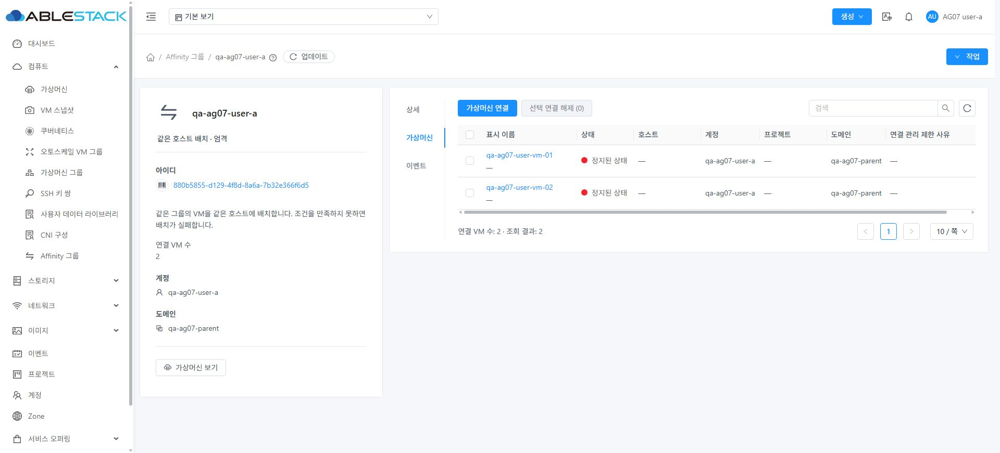

# AG-07 / #1421 검증 보고서

2026-10-19 KST, 31번 Mold 클러스터. Epic #1413의 누적 Draft PR #1420에 반영한다. 최신 Europa `8c5a92a4d9978229221613f4ff3e36e2df54daeb`를 포함한 기존 `dhslove/epic-1413-affinity-ui` 브랜치를 이어 사용했다. 서버 소스는 `a469372cc8273233392fb99722fe39d8e10f8f5e`, UI 소스는 `23b1613fd8067c95f0dc465e55296c4980986653`이며 이후 커밋은 테스트 보정·증거 문서다.

## 결과와 변경

**요청한 탭 배치 수정과 #1421의 설계·구현·변경 모듈 빌드·31번 배포·기능 검증·시험 자원 정리를 완료했다.** UI의 가상머신 탭은 제목·설명 없이 연결/해제 버튼으로 시작한다. 연결 수와 조회 결과 수는 표 아래 페이지 영역으로 이동했다. 대화상자의 변경 범위 설명과 권한·오류 안내는 유지한다.

서버는 계정/도메인 조회와 공유 그룹 조회에 별도로 페이지를 적용하고 count를 합산하던 경로를 변경했다. 기존 ACL·프로젝트·공유 상속 범위를 하나의 조건으로 결합하고, 전역 검색 조건 아래 DISTINCT 그룹 ID에 count·ID 오름차순·offset/limit을 한 번 적용한다. 선택된 페이지의 상세 VM 행은 모두 조회한다. 그룹별 다중 VM 연결이 count를 늘리거나 잘리지 않는다. UI에서 count를 응답 길이로 덮어쓰지 않는다. [설계](../../design/affinity-1413/AG-07.ko.md).

## 수정 전 재현과 수정 후 API 검증

전용 도메인에 계정 그룹 3개와 ExplicitDedication 공유 그룹 1개를 만들었다. 수정 전 도메인 관리자는 고유 그룹 4개인데 count=5였고, 크기 2인 세 번째 페이지가 빈 채로 표시됐다. 일반 사용자도 크기 1 요청에 2개 행을 반환했다. [원래 응답](evidence/reproduce-original.json), [원래 UI](evidence/before-domainadmin-count-five-four-rows.jpg).

이후 전용 그룹을 30개로 확장하고 수정 전의 **적법한 가시성 집합**을 역할별 oracle로 저장했다. 기존 프로젝트/비재귀 동작을 임의로 확대하지 않았다. 예를 들어 도메인 관리자 기본 범위는 고유 그룹 27개, `projectid=-1`은 기존 계약상 20개다.

| 검증 범위 | 결과 |
| --- | --- |
| root 전체·부모 도메인·특정 소유자·프로젝트, 도메인 관리자 기본·프로젝트 제외·비재귀, 일반 사용자·프로젝트·다른 소유자·자식 도메인·제한 역할·peer | 13개 범위의 고유 ID 집합과 전체 VM 매핑 보존 |
| 크기 1/2/10/20, 각 범위의 첫 페이지부터 마지막 이후 빈 페이지 | 52개 페이지 시나리오 통과. 각 요청의 count 일치·행 수 상한·중복/누락 없음·DB 숫자 ID 전역 정렬 |
| ID·이름·5개 유형·공유/페이지 키워드·없는 이름/키워드·이름과 유형 불일치 | 156개 필터 시나리오 통과. 공유 OR 조건이 검색 필터를 우회하지 않음 |
| 공유 그룹에 일반 VM 2대와 프로젝트 VM 1대, 각 VM에 다른 소유 그룹도 연결 | 공유 VM 3개, 전체 매핑 6개가 페이지 크기와 무관하게 보존 |
| 제한 역할 생성 거절, 일반 사용자의 peer 그룹 ID 조회 | 432 거절 및 peer 0개 |

합계 **208개 페이지/필터 시나리오 + 13개 전체 집합/매핑 대조**다. HTTP 호출 수를 의미하지 않는다. [수정 전 oracle](evidence/query-before.json), [수정 후 전체 결과](evidence/query-after.json), [실행 로그](evidence/query-after.txt), [DB 순서/매핑](evidence/before.db.txt), [검증 코드](evidence/probe.py).

부모 공유 그룹의 실제 상속과 peer 격리를 확인했다. 현재 공개 create API에는 `subdomainaccess` 입력이 없으므로 `false`인 부모 공유의 자식 제외는 집중 Java 테스트로 검증했으며 DB를 직접 수정해 시험하지 않았다.

## 실제 UI 검증

- 도메인 관리자: 전체 27개, 1페이지 20개와 2페이지 7개 및 다음 버튼 비활성화 확인. 공유 검색 1개, 불일치 검색 0개와 첫 페이지 초기화 확인. [2페이지](evidence/after-domainadmin-page-two.jpg), [공유 검색](evidence/after-shared-filter-one.jpg).
- 일반 사용자: 자신의 4개 정책 그룹과 공유 그룹 총 5개. VM 탭에서 연결 해제 후 재연결을 실행하고 완료 영수증과 DB jobstatus=1 두 건을 확인했다. 대상 그룹만 해제되고 다른 공유 연결은 유지됐다. 두 VM은 계속 Stopped였다. [해제 결과](evidence/normal-detach-success.jpg), [재연결 결과](evidence/normal-attach-success.jpg), [해제 API](evidence/ui-mapping-detached.json), [복원 API](evidence/ui-mapping-restored.json), [DB 작업 결과](evidence/cleanup-db.txt).
- 일반 사용자가 상단 프로젝트 선택기로 전용 프로젝트에 진입해 그룹 2개(프로젝트 1+공유 1), 프로젝트 VM 1개와 projectid가 포함된 이동 링크를 확인했다. [프로젝트 멤버](evidence/project-member-scope.jpg).
- 읽기 전용 역할: 자신의 그룹+공유 총 2개, 생성/삭제 작업 없음, 멤버 연결/해제 비활성화 확인. [제한 역할](evidence/readonly-members-disabled.jpg).
- 라이트/다크 각각 1440×900, 390×844, 390×480의 **6개 배치**에서 첫 콘텐츠가 작업 도구 모음이며 직접 제목/설명 요소는 0개다. 버튼은 32px 높이를 유지하고 좁은 화면에서는 검색/갱신 도구와 하단 페이지가 줄바꿈된다. 표는 자체 가로 스크롤 영역을 유지한다. 다크 모바일 연결창의 폭은 390px로 뷰포트와 일치했고 안내/선택/취소/다음 버튼이 유지됐다. [배치 측정](evidence/layout-matrix.json), [대화상자 DOM](evidence/dark-mobile-dialog.txt). 최초 화면 크기 변경 직후의 과도 상태는 합격 측정에서 제외하고 반응형 갱신 후 다시 측정했다. 라이트·기본 화면 크기로 복원했다.

UI 시험은 실제 브라우저에서 수행했다. DOM/스크린샷은 [ui-checks.json](evidence/ui-checks.json)에 기록했다. 테마/크기 변경은 이번 수정 영역의 배치 회귀이며 AG-06 전체 화면 42개를 새로 수행한 결과로 확대하지 않는다. VM 시작과 4개 정책의 물리 배치는 AG-06의 별도 증거다.

## 빌드와 품질 확인

| 항목 | 결과와 한계 |
| --- | --- |
| UI 집중 회귀 | 23 suites / 318 tests 통과. [로그](evidence/ui-unit.txt), [대상](evidence/unit-specs.txt) |
| 변경 Vue lint / UI production build | 통과. [lint](evidence/ui-lint.txt), [build](evidence/ui-build.txt) |
| server 변경 모듈 | WSL ext4에서 AffinityGroupQueryTest 11개 + 기존 QueryManagerImplTest 35개 = **46개 통과**. [모듈 결과](evidence/server-module-qualified-r2.txt) |
| 기본 server Checkstyle | **실패**. 기존의 관련 없는 테스트 7개 파일에서 wildcard import 15개 위반. [원래 실패](evidence/server-build.txt). 이 실패를 합격으로 표시하지 않음 |
| 변경 Java 2개 파일 Checkstyle | 같은 cloud-style.xml/Checkstyle 8.18을 사용한 별도 집중 실행에서 **위반 0개**. [설정](evidence/checkstyle-pom.xml), [결과](evidence/changed-checkstyle-final.txt) |
| 로컬 의존성 | 최신 upstream의 백업 명령 생성자와 오래된 설치 core JAR가 달라 `core` 모듈만 -DskipTests install하여 server 컴파일 의존성을 갱신. [core 결과](evidence/core-dependency-build.txt). core 자체 검증·배포를 의미하지 않음 |
| 최종 패키징 | 테스트한 소스/클래스에서 server만 재패키징 통과. [결과](evidence/server-package-final.txt), [출처/해시](evidence/build-source.json) |

전체 Cloud reactor 빌드, 전체 Maven 테스트 및 전체 Actions CI는 요청되지 않아 실행하지 않았다. 초기 집중 테스트의 Mockito 메타데이터/인자/varargs 설정 오류를 수정한 후 위 46개가 통과했다. 변경 Java의 Checkstyle은 별도 확인했고 모듈 패키징에는 `-Dcheckstyle.skip=true`를 사용했다.

## 31번 배포와 런타임 보존

활성 경로는 `/usr/share/cloudstack-management/webapp` 및 `/usr/share/cloudstack-management/lib/cloudstack-4.23.0.0-ABLESTACK.Mold.jar`다. 원본 백업은 `/root/ag07-deploy-20261019`에 보존했다. 원본 fat JAR의 manifest revision을 새 소스 전체의 배포 증거로 사용하지 않는다.

- UI 정적 파일 893개만 갱신했고 모든 파일 해시를 확인했다. WEB-INF/web.xml, META-INF의 기존 부재 상태, 설정 symlink와 내용 해시를 보존했다. webapp 전체 교체·삭제는 하지 않았다.
- 기존 fat JAR에 테스트한 **QueryManagerImpl.class 하나**를 반영하고 별도 출처 marker만 추가했다. 나머지 기존 엔트리 204,499개의 내용 해시가 동일하다. 기존 enum 보조 클래스는 그대로 유지했다. 원본과 새 클래스의 정규화된 javap 메서드 대조에서 변경 범위는 Affinity 검색과 공유 ID helper뿐이다. [메서드 대조](evidence/runtime-method-diff-final.json), [JAR 엔트리 대조](evidence/jar-patch-manifest.json).
- JAR SHA256: `9265dca2a9a810252a38d58d17ddcfbfd867f894db0064e9a5dd6bd1f74fb07f`. 새 클래스 SHA256: `b766f483a8dac0c305021cdbb60415bbf037adac560b46b049be2f62672ea9e4`.
- 관리 서비스 재시작은 17:34:22~17:34:56, PID 1765167→1934377. rollback은 없었으며 다른 JAR 8개를 보존했다. [UI 배포](evidence/deployment-ui.json), [서버 배포](evidence/deployment-jar.json).
- 정리 후 Mold active, `/client/` HTTP 200, 실행 클래스/출처 marker 및 정적 파일 893개 해시 재확인. SQL/링크 클래스 오류 0, 관측 구간의 FAILBACK_SYNC wait=900은 0. FT 흐름 자체를 시험한 결과는 아니다. [최종 상태](evidence/health-final.json).

로그 전체가 무오류인 환경은 아니다. 재시작 시 socket close·초기 관리 포트 연결 실패·commands.properties 누락과 기존 API key 만료 요청/SMTP 오류가 관측됐다. 정리 중 의도치 않게 남은 네트워크로 프로젝트 삭제가 한 번 거절된 오류도 포함된다. 별도로 17:46:53 Finalizer의 orphan transaction 메시지 1건이 있었으며 명령 문맥/스택이 없어 원인을 특정하지 못했다. 직전 50MB 로그에는 같은 메시지가 없었고, 이를 기존 결함 또는 AG-07 수정 완료로 단정하지 않는다. 필요 시 별도 진단 대상으로 남긴다. [오류 분류와 관측 한계](evidence/log-error-audit.json). Wall 비활성 알림도 기존 상태다. API 키 교체나 모니터링/메일 설정 변경은 하지 않았다. 백업/FT/호스트 패키지·DB 스키마는 배포하지 않았다.

## 정리와 기존 데이터 보존

30개 그룹, Stopped VM 3대, 네트워크 2개, 프로젝트 1개, 계정 6개, 역할 1개, 도메인 3개를 추적해 제거했다. 프로젝트 네트워크를 기본 범위로 조회하여 누락한 첫 정리에서 프로젝트 삭제가 거절됐고, 정확한 projectid로 조회·삭제한 후 재시도하여 완료했다. API의 삭제된 그룹 ID 조회가 431을 반환하는 점도 반영해 재진입을 안전하게 처리했다. [정리 동작](evidence/cleanup-actions.json), [최초 정리 진단](evidence/cleanup.txt), [완료 로그](evidence/cleanup-retry2.txt).

그룹·그룹/VM 매핑·그룹/도메인 매핑·VM·볼륨·NIC·네트워크·계정·도메인·프로젝트·역할·사용자 **12개 활성 잔여 카운터가 모두 0**이다. 삭제 이력은 DB에 남으며 물리 이력 전체 삭제를 의미하지 않는다. [SQL/결과](evidence/cleanup-db.txt).

기존 그룹 4개(일반 3+프로젝트 1)와 VM 119개의 ID·이름·Affinity 연결 투영 해시가 전후 `5120684f8c94fd68c44dac2e745a79857b4218fc53530daaa99a0c4f037f094a`로 일치한다. [보존 결과](evidence/cleanup-baseline.json). 기본 UI에는 일반 그룹 3개가 표시된다. [정리 후 화면](evidence/cleanup-original-list.jpg).

세 호스트의 실행 도메인 집합(35/31/34개)은 전후 동일했고, 전용 VM 도메인 3개는 모두 부재한다. [호스트 보존](evidence/hosts-after-preservation.json), [시험 도메인 부재](evidence/host-test-domains-absent.json). 원래 작업 트리의 FTCTL 수정 파일 3개도 해시가 동일하다. [보호 파일](evidence/protected-ft-files.json).

## Epic 상태와 다음 작업

#1421을 구현 범위 완료로 종료하고 PR #1420에 AG-07과 이 보고서를 추가한다. 하위 구현 이슈는 **7/7 완료**, 다음 미해결 하위 구현 이슈는 없다. Epic #1413과 누적 PR은 병합 전 Open으로 유지하며 PR은 Draft다. 다음 작업은 누적 PR의 코드 리뷰와 사용자 요청에 따른 병합·Epic 종료 판정이다. 등록 체크 없음은 CI 합격을 의미하지 않는다.

기존 서버의 CAS 없는 조회~쓰기 경합, 앱 재로드 후 영수증 보존 제한, 호스트 장애/실제 용량 고갈 및 전체 CI 미수행은 남은 한계다. 이번 count·페이지 수정으로 해결됐다고 표시하지 않는다. 별도 확장 이슈를 임의로 생성하거나 이번 요청에 포함되지 않은 PR 병합을 수행하지 않는다.
