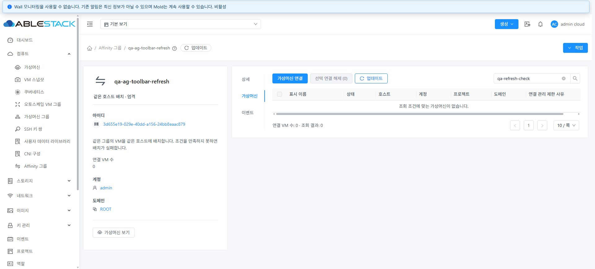

# Affinity 가상머신 탭 업데이트 버튼 표준 정정

2026-10-19 KST. Epic #1413 / 누적 PR #1420의 후속 UI 수정. 배포 소스 `993e994cf6a28c9f4cb71f6874868067aef4a6de`.

사용자 표준에 따라 가상머신 탭의 업데이트 버튼을 검색창 우측에서 액션 영역의 마지막으로 옮겼다. 아이콘만 보이던 버튼에 `label.refresh` 텍스트를 함께 표시한다. 기본 순서는 **가상머신 연결 → 선택 연결 해제 → 아이콘+업데이트**이며, VM별 작업 결과 버튼이 나타나면 그 뒤에 업데이트를 둔다. 검색창 우측에는 검색 버튼만 남는다. 탭 제목·설명을 추가하지 않았고 갱신 핸들러·권한·로딩 처리도 그대로 사용한다. AG-05/AG-07 설계 문서에 이 정정된 표준을 반영했다.

## 검증

- 변경 Vue lint, 기존 `AffinityGroupMembers.spec.js` **1 suite / 16 tests**, WSL ext4 UI production build 통과. 새 테스트를 추가하지 않았다. Jest는 집중 검증에 맞게 `--coverage=false`로 실행했으며 전체 소스 커버리지나 전체 Cloud CI 결과가 아니다. [lint](evidence/lint.txt), [테스트](evidence/unit.txt), [빌드](evidence/build.txt).
- 배포 전 DOM에서 직접 액션은 연결/해제 2개였고, 텍스트 없는 업데이트 버튼이 검색 컨텍스트 안에 있었다. 배포 후 직접 액션의 마지막이 `업데이트`이고 reload 아이콘이 있으며 검색 컨텍스트에는 업데이트 버튼이 없다. [수정 전](evidence/before-layout.json), [수정 후](evidence/layout.json).
- 실제 브라우저에서 새 업데이트 버튼을 클릭했다. 검색어 `qa-refresh-check`, 가상머신 활성 탭, 제목 없는 버튼 우선 배치가 유지됐다. 해당 그룹/소유 범위와 검색어를 포함한 `listVirtualMachines`, 해당 그룹의 `listAffinityGroups` 요청은 HTTP 200·API 오류 0으로 응답했다. 시험 그룹의 멤버는 0개다. 이 확인을 실제 다중 VM 연결/해제 재수행으로 확대하지 않는다. [네트워크 기록](evidence/refresh-network.json), [DOM](evidence/after-dom.txt).
- 기본 1920×871, 1440×900, 390×844에서 버튼 순서와 아이콘/텍스트를 측정했다. 1440px에서는 검색이 다음 줄의 우측에, 390px에서는 업데이트와 검색이 순서대로 줄바꿈되고 액션 버튼은 영역 밖으로 넘치지 않았다. 업데이트 버튼 높이는 모두 32px다. [배치 측정](evidence/layout.json). 화면 크기와 캐시 설정을 복원하고 시험 탭을 닫았다.

## 배포와 정리

18:16 KST에 31번의 활성 `/usr/share/cloudstack-management/webapp`에 정적 파일 893개만 반영했다. 모든 파일 해시가 빌드 결과와 일치한다. WEB-INF/web.xml, META-INF 상태, 설정 파일/링크와 JAR 9개를 보존했고 PID `1934377`도 동일하다. Mold active, `/client/` HTTP 200을 확인했다. 서버 재시작·JAR/호스트 패키지·DB 스키마 변경은 없다. 백업은 `/root/affinity-toolbar-20261019/webapp-backup`에 보존했다. [배포](evidence/deployment-after.json), [최종 상태](evidence/health-final.json).

UI 패키지 SHA256은 `57cf817d467e948a62b645d5c9588864d97be6f2f07fef4d19c671e661e80df6`, 활성 index SHA256은 `e6f2f5fd39b08a405420dd515deea2bb357c2dee96763fcbf32e04e46add0525`다.

전용 `qa-ag-toolbar-refresh` 그룹 1개를 만들어 사용한 뒤 삭제했다. VM 생성/변경은 없었다. API에서 전용 그룹 잔여 0, 기존 그룹 4개의 전체 응답 해시가 전후 동일하다. [정리](evidence/cleanup.json). 원래 작업 트리의 FTCTL 수정 파일 3개도 기존 해시와 일치한다. [보호 파일](evidence/protected-ft-files.json).

누적 PR #1420과 Epic #1413에 후속 결과를 반영한다. 기존 #1421의 완료 상태를 변경하지 않으며 PR 병합은 이번 작업 범위에 포함하지 않는다. 이 보고서는 이전 AG-05/AG-07 캡처에서 검색 우측에 있던 갱신 아이콘 배치를 대체하는 최신 기준이다.
