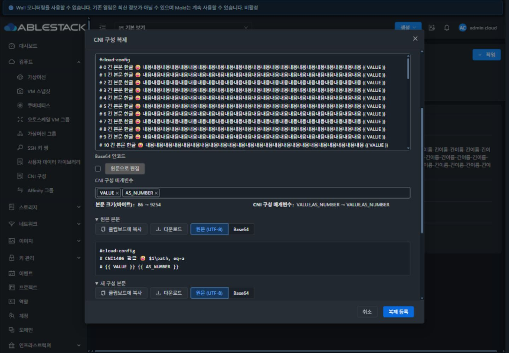
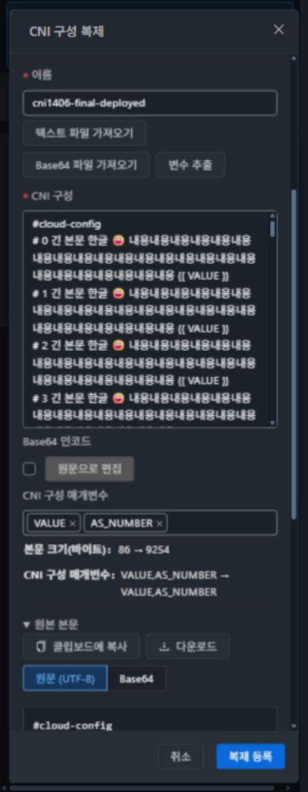

# #1406 CNI 복제와 원본 관계 — 31번 검증

2026-10-18. Epic #1395 / 누적 Draft PR #1409. [설계](../../design/cni-clone-1406.ko.md).

## 구현 결과

CNI 상세의 **CNI 구성 복제**에서 원본 본문·선언 변수·소유 범위를 읽고 새 이름/본문/변수로 새 CNI UUID를 등록한다. 일반 UserData 등록 API를 호출하지 않는다. 원본은 제출 직전에 다시 검증하며 계정·도메인/프로젝트 범위를 고정한다. 같은 바이트도 새 이름으로 복제할 수 있다.

등록 응답이 유실되면 제출 스냅샷을 유지하고 **등록 결과 확인**으로만 재조회한다. 관계 메모가 실패하면 확인된 대상 UUID를 유지하고 **관계 기록 재시도**로 누락된 메타데이터만 저장한다. 중복 이름, 원본 변경, 불완전 응답, 세션/소유/권한 변경과 늦은 응답을 처리한다. 권한 복구 시 같은 세션에서 보존한 작업을 명시적으로 재시도한다.

`MOLD_CNI_CLONE/1` 전용 Annotation 조각을 재조합하면 version/sourceid/targetid/owner/before/after를 얻는다. 255자 제한 안에서 UTF-8 계정명 전체를 보존하고 완전한 집합을 재조회한 뒤에만 성공으로 표시한다. 일반 UserData 관계와 구분한다. 코멘트에는 내부 Base64 대신 **CNI 복제 관계 기록**을 표시한다. 이 메타데이터는 편집 가능한 보조 정보이며 보안/감사 권한의 근거가 아니다. 전체 이력 조회·비교 탭은 #1407 범위다.

## 집중 검증과 실제 경로

- UI 집중 **7 suites / 199 tests PASS**: CNI 복제/부분 관계/응답 유실/중복 클릭/권한·세대 변경/스키마 손상, 기존 등록·파일·변수 도구·본문·일반 UserData 복제 회귀. [결과](test-results.txt).
- 전체 UI lint, 최종 변경 파일 lint, production build PASS. 변경은 UI만이며 Java/Maven/JAR/전체 Cloud 빌드/GitHub Actions를 실행하지 않았다. 번들 크기·Browserslist 알림과 전체 CI 결과를 구분한다.
- 실제 CNI 10건·일반 UserData 1건을 계정·프로젝트 소유자의 UI에서 복제하고 별도 API와 DB 조회로 UUID/`for_cks=1`/본문 Base64/변수/소유/관계 전체를 대조했다. 일반 UserData는 기존 `registerUserData`, `for_cks=0`, 일반 관계 prefix를 유지했다. API 60 checks·DB 11건 대조·UI 30 checks PASS. [복제별 증거](clone-proof.json), [DB 대조](db-proof.json), [API 체크](api-checks.json).
- 일반 동적 User 역할도 자기 자원 Annotation 저장이 실제 허용됐다. 소스의 선언 기본 권한만으로 관리자 전용이라고 가정하지 않는다. 네 API의 발견 권한과 객체 ACL을 사용한다. 다른 계정의 CNI 조회는 필터링되고 Annotation 추가는 거부됐다. 역할 변경 자체는 수행하지 않았으며 권한 상실/복구 상태 전이는 집중 테스트로 검증했다.
- UTF-8 BOM/CRLF/한글/이모지/달러/역슬래시 86바이트, 바이너리 4바이트, 수정 본문, 9,254바이트 긴 본문, 동일 바이트 새 이름을 포함한다. 원본 미리보기 복사·다운로드도 BOM/CRLF를 포함한 바이트가 일치했다.

### 장애 주입의 경계

1. `cni1406-lost-response`: 실제 등록 POST가 HTTP200으로 저장된 뒤 응답만 중단했다. 입력을 고정하고 결과 조회로 복구했으며 등록 POST는 1회였다.
2. `cni1406-relation-403`, `cni1406-final-confirmed`, 최종 배포본 `cni1406-final-deployed`: 첫 관계 조각은 실제 저장, 두 번째 추가 POST만 403으로 주입했다. 대상 UUID/경고를 유지하고 누락된 메모만 재시도해 완성했다. 실제 등록 POST는 각각 1회였다.
3. 초기 `cni1406-partial-relation`은 넓은 주입 패턴이 후속 읽기도 정지시켜 403과 읽기 타임아웃이 함께 발생했다. 주입을 해제하고 메타데이터만 재시도했다. 이 결과를 독립적인 403 시험으로 계산하지 않는다.
4. `cni1406-permission-retry`는 URL 패턴이 일치하지 않아 장애가 주입되지 않은 정상 대조 사례다. 실제 권한 실패 사례로 보고하지 않는다. 브라우저 주입은 전부 해제했다.

[인증정보를 제외한 실제 변경 요청](ui-network.json). 운영 API 응답·비밀번호·세션키·bootstrap·kubeconfig는 공개하지 않는다.

## 원본과 사용 중 클러스터 보존

기존 CNI 3개에는 현재 Kubernetes 참조가 없어 별도의 실제 **cni1406-source-cluster**를 생성해 시험했다. 프로젝트 CNI에 사용자 정의 Calico/변수를 적용한 컨트롤 1개·워커 1개이며 정상 생성 후 복제했다. 원본 CNI 5개의 이름·UUID·저장 바이트·변수·소유 범위가 그대로였다. ACL 시험에서 원본에 추가한 전용 시험 메모는 정리 시 함께 삭제했으며 Annotation 전체가 불변이었다고 주장하지 않는다.

클러스터 UUID `a59a7924-2126-4dad-a599-26b4c58838a0`, control VM `3c07f158-a171-4446-a62c-60849e196023`, worker `3b7e2231-97c4-42f9-9e0e-42feca144cee`. 복제 전후 CNI 참조·클러스터/VM UUID·Running 상태를 API로 대조했다. QGA를 통해 읽은 Kubernetes 노드 providerID/Ready, Calico 2/2 Ready·MTU1450·사용자 정의 annotation·probe 파일 SHA도 전후 일치했다. 게스트를 수동 수정하지 않았다. [게스트 전후 증거](source-guest-proof.json).

## VM 표준과 UI 검증

공통 MoldDialog lg, 세로 폼/필수값 표시, 작은 식별표, 공용 파일/변수 툴바와 코드 미리보기, 내부 스크롤·고정 푸터를 사용한다. 원본/소유 식별과 필요한 진행·오류 결과 외의 상시 설명/API 문구를 추가하지 않았다. 좁은 화면의 바이트/변수 비교는 한 열로 표시한다.

1440/1024/768/390px × 라이트/다크에서 긴 이름·UUID·본문을 확인했다. 오류/작성/관계 미완료/성공 32개 폭·테마·상태 조합을 포함해 67회 화면 측정, 43개 선택 스크린샷을 기록했다. 최종 빌드는 양 테마 작성/검증 오류와 다크 관계 미완료/성공의 24개 조합을 재검증했다. 라이트 결과 8개는 포커스/작성 비교표 보완 전 빌드이며 결과 영역의 구현은 같다. 화면 가로 넘침·모달 좌우/푸터 이탈·노출된 파일 입력이 없는 것을 검사하고 모바일/데스크톱 화면을 시각 검수했다. [UI 측정과 체크](ui-evidence.json).

필수값 오류 후 잠긴 입력이 풀리기 전에 포커스를 옮겨 버튼에 남는 결함을 실제 브라우저에서 발견했다. 잠금 해제 후 잘못된 입력으로 이동하도록 수정하고 최종 배포본에서 확인했다. 과대 본문은 한글 오류로 거부한다. 태그 Enter는 태그만 확정하고 중첩 변수 도구의 CtrlEnter는 상위 등록을 실행하지 않는다. 취소는 원본을 변경하지 않는다.

일반 UserData를 실제 복제해 기존 API/관계/코멘트 표시를 확인했다. VM 목록·상세 코멘트, CNI 목록·코멘트/본문 공통 화면도 읽기 회귀를 확인했다. VM 전체 동작을 재검증했다는 의미는 아니다.

## 배포·정리

최종 정적 자산 885개 해시 일치, 백업 `/root/cni-1406-ui-20261018-101102`, index SHA `988682de67ad5440c48b7d7f2ca96809654014950096ad0df14a6f01d61d460e`와 관리 서비스/WEB-INF/HTTP200 및 JAR/config/PID 보존을 [배포 기록](deployment-verification.txt)과 [최종 런타임](final-runtime.json)에 기록했다. 활성 경로 `/usr/share/cloudstack-management/webapp`에 정적 파일만 복사했으며 기존 서버 디렉터리와 설정은 보존했다. 사용 중 JAR은 #1405 배포 SHA `3b9bc6d9e6b766938e46ecde613ea00d073a08a435fc864c89e9827f560a36eb`, PID1589408 그대로다.

전용 클러스터 1개와 노드2/볼륨·라우터1·네트워크1·CNI15개/일반 UserData2개·Annotation·프로젝트1·계정2개·도메인1을 정상 API로 정리했다. 활성 잔여 13종 0, 세 호스트 시험 도메인 없음, 기존 CNI3/Kubernetes7 API 및 선택 DB36행 동일. DB SHA `2d61f159980ac4fa490f62c74e16ce6024ac1f8bb9210c2c6caaa366c74357f7`. [정리/기존 데이터 대조](cleanup-summary.json), [호스트](host-domain-cleanup.json).

## 다음 작업

**#1407 CNI 복제 이력·본문/변수 비교 UI**가 남았다. 이 관계 계약을 읽고 삭제된 원본·접근 불가·손상·순환·불완전 페이지를 처리하며 같은 VM 표준으로 검증한다. Epic #1395는 12/13 진행, PR #1409는 미병합 Draft를 유지한다. 별도 Kubernetes 삭제 복구 결함 #1410은 열어 둔다.
