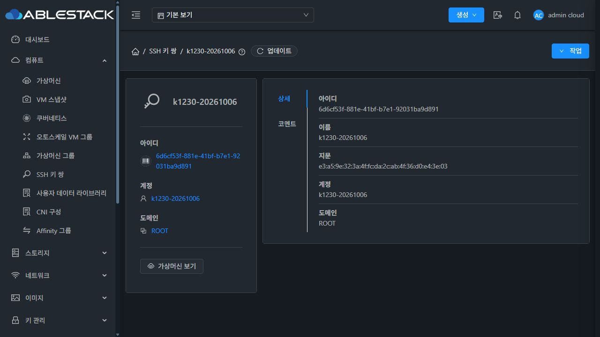
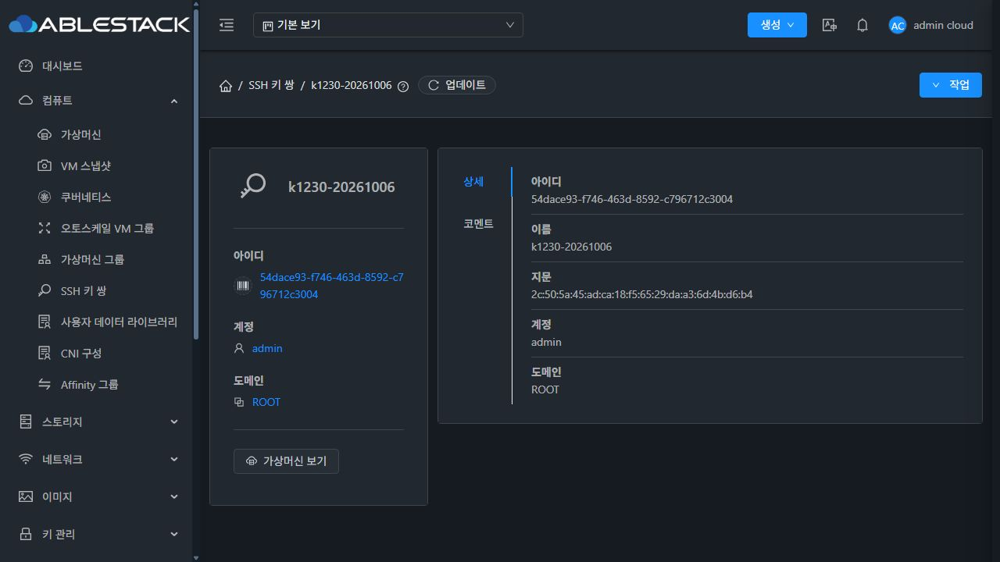

<!--
Licensed to the Apache Software Foundation (ASF) under one
or more contributor license agreements. See the NOTICE file
distributed with this work for additional information
regarding copyright ownership. The ASF licenses this file
to you under the Apache License, Version 2.0 (the
"License"); you may not use this file except in compliance
with the License. You may obtain a copy of the License at

  http://www.apache.org/licenses/LICENSE-2.0

Unless required by applicable law or agreed to in writing,
software distributed under the License is distributed on an
"AS IS" BASIS, WITHOUT WARRANTIES OR CONDITIONS OF ANY
KIND, either express or implied. See the License for the
specific language governing permissions and limitations
under the License.
-->

# Epic #1369 / #1370 구현·31번 배포·기능 검증

검증일: 2026-10-14 KST. 대상은 31번 Mold 관리 서버다. 호스트·가상머신·게스트의 SSH 설정은 변경하지 않았다.

## 구현과 소스 기준

- 최신 Europa 기준: `a5a811387476ac87a8774fc729cc68021104684a`.
- 구현 commit: `0da7809362978fff12b7d34b55fc39ab39f40396`.
- 작업 트리: WSL ext4의 `/home/ablecloud/work/dhslove/ablestack-cloud-ssh-1370`.
- `ListSSHKeyPairsCmd.getId()`를 추가하고 `ManagementServerImpl.listSSHKeyPairs()`의 기존 ACL 검색 조건에 내부 ID EQ 조건을 AND로 추가했다. DB schema·DAO·UI·API 파라미터는 변경하지 않았다.
- 부모 Epic의 #1371~#1377은 이번 구현 범위에 포함하지 않는다. UUID 상세 및 코멘트 링크의 현재 재현 증상은 API 수정으로 정상화됐지만 #1371의 UI 경로 통일·대상 불일치 차단은 후속 범위다.

## 변경 모듈 검증

WSL ext4에서 `api,server`만 선택했으며 전체 reactor를 빌드하는 `-am`이나 전체 Cloud/RPM 빌드를 실행하지 않았다.

```bash
mvn -B -ntp -pl api,server \
  -Dtest=ManagementServerImplSSHKeyPairTest,ManagementServerImplTest \
  -Dsurefire.failIfNoSpecifiedTests=false -Drat.skip=true install
mvn -B -ntp -pl api,server apache-rat:check
git diff --check
```

- 새 회귀 테스트: 수정 전 7개 중 4개 실패/오류 0, 수정 후 7개 통과.
- 기존 ManagementServerImplTest: 47개 통과. 합계 **54개, 실패·오류·skip 0**.
- API·Server 모듈 빌드 성공. API의 전체 단위 테스트를 실행했다는 의미는 아니다.
- 두 모듈 Apache RAT 성공, Unknown/Unapproved 0. 새 설계·검증 문서에는 ASF 라이선스 헤더를 포함했다.
- 새 테스트는 실제 SearchBuilder/SearchCriteria의 SQL 조건과 bind 값을 확인한다. DB 호출과 ACL helper는 mock으로 분리했고, 실제 ACL 계약은 아래 클러스터 API 검증으로 확인했다.

## 배포와 복구 근거

수정 전 최신 소스로 빌드한 두 클래스의 SHA-256이 서버의 기존 클래스와 정확히 일치했다. 기존 활성 JAR을 전체 백업하고 **변경한 두 클래스만** 교체한 뒤 Mold를 재시작했다.

| 클래스 | 배포 후 SHA-256 |
| --- | --- |
| `ListSSHKeyPairsCmd.class` | `61d469847b88de5b330b22dda8e5d9e07ccd7e3a63982b9fc58d19fcfe3cf323` |
| `ManagementServerImpl.class` | `d3946efd75eb179974f85790e6bed14d6d20e6be7e9601bd6bfd2d39addc5888` |

- 활성 JAR: `/usr/share/cloudstack-management/lib/cloudstack-4.23.0.0-ABLESTACK.Mold.jar`.
- 배포 후 JAR SHA-256: `149802c65b943bd67174a02f453fa380fd2bcb57a8f1ca21a185cb62ec483f56`.
- 백업: `/root/ssh-keypair-1370-20261014-214704/cloudstack.before.jar`.
- 배포 bundle SHA-256: `5ff8a038f7595ca04a49a1a1d1978639c7990784220efb04c027b418efdbe770`.
- Mold PID: `834619 → 911241`, 서비스 active, `/client/` HTTP 200.
- `WEB-INF` 보존, `index.html`·`config.json` 해시 불변. UI 정적 파일은 배포하지 않았다.
- 배포 시작 구간에 NoSuchMethodError/NoClassDefFoundError/VerifyError/ExceptionInInitializerError 없음. 실제 API·UI 동작도 아래와 같이 통과했다.
- 기존 manifest의 실행 버전은 `4.23.0.0-Mold.Europa-202609222315`다. 전체 패키지를 재빌드한 배포가 아니므로 manifest 버전 상승을 증거로 사용하지 않고 클래스 해시와 실행 결과로 확인했다.
- 복구 시 Mold를 중지하고 백업 JAR을 활성 경로에 복원한 뒤 시작한다. 배포 스크립트는 설치·기동 검증 실패 시 자동 복원을 포함한다. 실제 rollback은 필요하지 않았다.

## 실제 API 검증 — 32/32 통과

배포 전 정상 UUID 하나를 지정해도 기존 키 3개/count=3이 반환됐다. 배포 후 같은 UUID는 해당 키만/count=1을 반환했다.

| 검증 그룹 | 건수 | 결과 |
| --- | --- | --- |
| 기존 키 3개의 UUID 조회 | 3 | 각각 정확한 키/count=1 |
| 관리자 본인·다른 소유자 UUID | 2 | 요청한 키만 반환 |
| 일반 사용자 본인·다른 소유자 UUID | 3 | 본인 1개, 관리자 키는 빈 결과 |
| 미존재 UUID | 1 | HTTP 431 명시적 오류, 다른 키 없음 |
| ID와 이름·지문·키워드 교집합 | 7 | 일치 1개, 불일치 0개 |
| ID와 account/domain 범위 | 3 | 정확한 소유 범위만 반환 |
| 프로젝트·기본 범위·프로젝트 접근 권한 | 4 | 범위 일치, 비회원 HTTP 432 |
| ID 없는 이름·지문·키워드 및 동일 이름 조회 | 6 | 기존 검색·계정/프로젝트 범위 보존 |
| ID/기존 목록 pagination 및 total count | 3 | ID page2 rows=0/count=1, 기존 목록 페이지 중복 없음 |

테스트 키는 관리자 2개·일반 사용자 1개·프로젝트 1개, 총 4개다. 관리자·사용자·프로젝트에 같은 이름을 사용해 이름만으로 다른 키가 선택되지 않는지 확인했다. 일반 사용자는 별도 자식 도메인의 임시 계정으로 로그인했다.

## 실제 UI 검증

- 배포 전 URL UUID `54dace93-f746-463d-8592-c796712c3004`를 열면 상세는 다른 소유자의 UUID `6d6cf53f-881e-41bf-b7e1-92031ba9d891`를 표시했다.
- 배포 후 새로고침·재로그인한 같은 URL에서 요청한 UUID, admin 소유자, 지문이 모두 일치했다.
- 이름/account/domain 경로의 테스트 키 상세가 정확한 UUID를 표시했다.
- 테스트 키에 UI로 코멘트 1개를 추가하고, 목록 이름 링크가 UUID 경로로 바뀐 뒤에도 같은 키를 표시하는 것을 확인했다.
- 코멘트 아이콘의 `?tab=comments` 바로가기도 같은 UUID와 작성한 코멘트를 표시했다.
- 실제 렌더링 검증은 어두운 테마의 데스크톱이다. 이번 변경은 backend UUID 조건이며 새 UI 배치·밝은 테마·게스트 SSH 동작의 검증 완료를 주장하지 않는다.

배포 전:



배포 후:



## 정리와 보존

- 테스트 키 4개, 코멘트 1개, 프로젝트 1개, 일반 사용자 계정 1개, 도메인 1개를 정리했다.
- API: 기본 목록 3개, 기존 키의 UUID·이름·지문·account/domain이 baseline과 일치. 임시 계정·도메인·프로젝트 조회 결과 0개.
- DB: 테스트 키 0, 해당 UUID의 active 코멘트 0, active 테스트 계정·도메인·프로젝트 각각 0.
- 테스트 공개 키 생성에 사용한 임시 개인 키 파일은 생성 함수 종료 시 제거했다. 인증정보·세션·개인 키는 저장·공유하지 않았다.
- Windows/WSL의 기존 FTCTL 작업 트리는 보존하고 별도 작업 트리에서만 소스를 변경했다.

## 검증 한계와 증거

전체 Cloud/RPM 빌드와 전체 GitHub Actions CI는 실행하지 않았다. 사용자 작업 규칙에 따라 변경 모듈만 빌드하고 자동 전체 CI가 시작되지 않도록 커밋에 `[skip ci]`를 사용했다. PR 생성은 병합 완료를 의미하지 않는다.

상세 원본 증거는 로컬 `/home/ablecloud/work/ssh-keypair-1370-20261014/`의 `module-build-test.log`, `regression-before.log`, `module-rat.log`, `build-manifest.json`, `deployment.log`, `api-evidence.jsonl`, `api-verification.json`, `cleanup-verification.json`에 있다. UI 증거는 Windows `tmp/ssh-keypair-1370-20261014/`에 저장했다.
