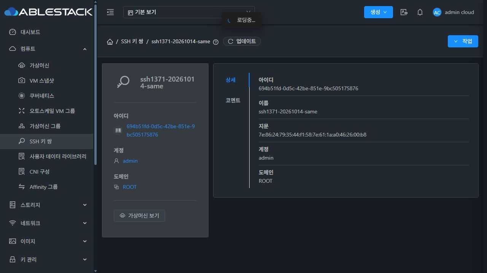
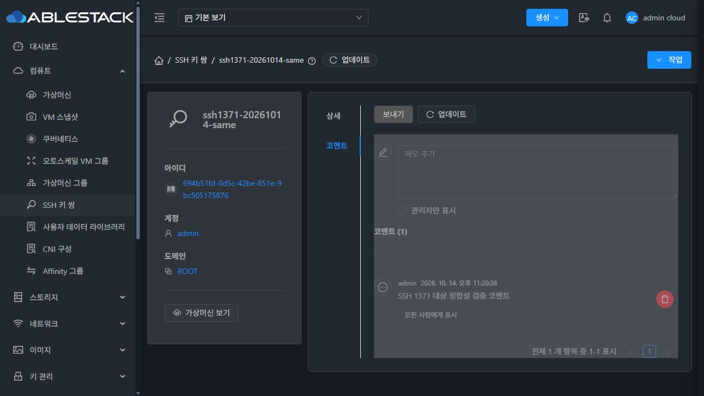
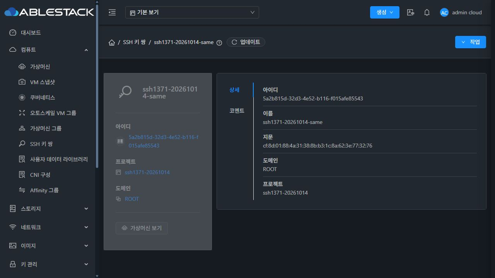
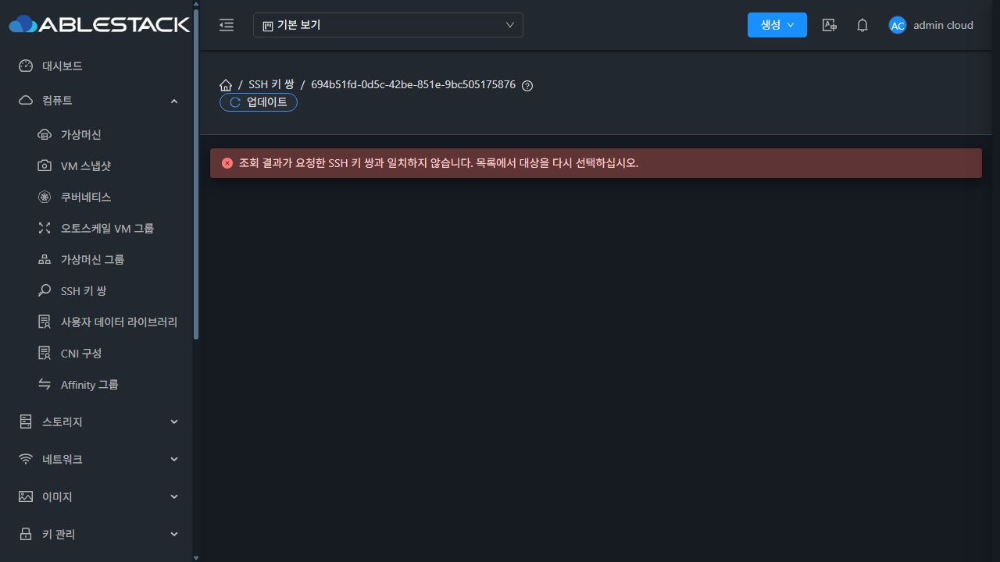
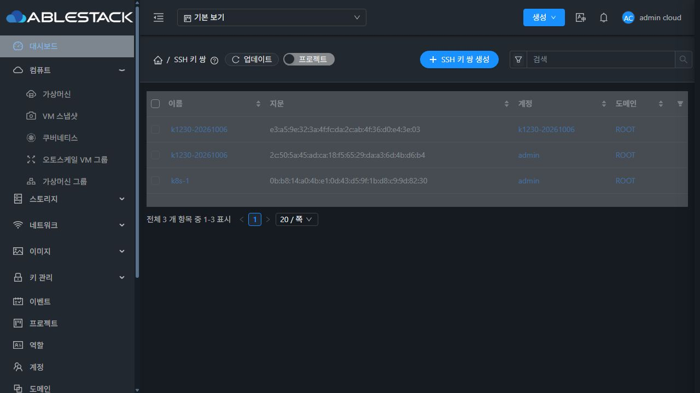

<!--
Licensed to the Apache Software Foundation (ASF) under one
or more contributor license agreements. See the NOTICE file
distributed with this work for additional information
regarding copyright ownership. The ASF licenses this file
to you under the Apache License, Version 2.0 (the
"License"); you may not use this file except in compliance
with the License. You may obtain a copy of the License at

  http://www.apache.org/licenses/LICENSE-2.0

Unless required by applicable law or agreed to in writing,
software distributed under the License is distributed on an
"AS IS" BASIS, WITHOUT WARRANTIES OR CONDITIONS OF ANY
KIND, either express or implied. See the License for the
specific language governing permissions and limitations
under the License.
-->

# SSH 키 쌍 #1371 구현·31번 배포 검증

Epic #1369 / 개선 이슈 #1371 / 기존 Epic PR #1378. 검증일은 2026-10-14 KST다. 이 보고서는 #1371 완료 범위를 기록하며 #1372~#1377은 남은 과제로 유지한다.

## 설계와 구현

목록의 이름·코멘트 링크를 UUID와 account/domain 또는 project/domain 범위로 통일했다. VM 상세 링크는 이름을 URL encode하고 VM 소유 범위를 전달한다. UUID 형태의 이름은 UI 내부 keypairname 표식으로 이름 조회와 구분한다.

상세 API는 page=1/pagesize=2로 조회하고 count=1/행 1개/요청 UUID 또는 이름/명시한 소유 범위가 모두 일치해야 상세와 작업을 허용한다. 없는 키·모호한 이름·다른 UUID·다른 소유자·서비스/권한 오류에서 resource를 비우고 작업을 차단한다. 이전 scope의 늦은 응답과 지연 폼 제출도 차단한다. 같은 대상 갱신은 올바른 상세를 유지하면서 작업을 잠시 막는다.

실제 브라우저에서 공통 switchProject가 projectid query를 제거하는 경로를 추가로 발견했다. SSH 상세에서는 명시적인 프로젝트 범위를 유지하고 전역 프로젝트 선택을 변경하지 않도록 보완했다. 다른 리소스의 기존 프로젝트 전환은 유지한다. 계정 키 삭제의 ignoreproject 내부 플래그는 전역 프로젝트의 잘못된 주입을 방지하고 API 전송 전 제거된다.

최종 UI 소스 commit: `d73dff5d4b5ce4df6cbde34170fb148d5099d07d`.
기준 upstream Europa: `a5a811387476ac87a8774fc729cc68021104684a`.
설계: [mold-ssh-keypair-1371-design.ko.md](../../design/mold-ssh-keypair-1371-design.ko.md).

## 테스트와 빌드

- 새 식별/링크/상태 테스트 54개와 공통 AutogenView·ResourceView·VM 그룹·계정/프로젝트/스냅샷/디스크 목록 회귀를 합쳐 **10개 suite / 253개 PASS**. 실패/skip 0.
- 최종 변경 파일 lint: `DONE No lint errors found!`. Locale JSON parse와 git diff --check 통과. 변경 소스·설계·검증 텍스트 15개는 분리한 검증 디렉터리에서 Apache RAT 0.15 check 목표만 실행해 15 Apache Licensed/Unknown 0으로 통과했다. 기존 RAT 제외 기준의 JSON·이미지는 별도 처리했다. 전체 Cloud 빌드나 UI Maven 모듈 빌드로 표현하지 않는다. [RAT 결과](changed-file-rat.log).
- WSL Rocky ext4 분리 작업 트리에서 Node 20.20.2와 `NODE_OPTIONS=--openssl-legacy-provider npm run build`로 프로덕션 UI 빌드 성공. 기존 Browserslist 및 번들 크기 경고는 남아 있다.
- 백엔드는 #1370에서 검증·배포한 JAR을 유지했다. 이번 작업에서 Java 변경·Maven 모듈 빌드·호스트/게스트 변경은 없다. 전체 Cloud/RPM/GitHub Actions CI는 실행하지 않았다.

원시 실행 로그: WSL `/home/ablecloud/work/ssh-keypair-1371-20261014/targeted-tests-project-final.log`, `lint-final.log`, `lint-project-final.log`, `ui-build-project-final.log`.

## 실제 API와 최종 UI 검증

실제 API에서 임시 6개·기존 3개의 UUID 및 소유 범위, 모호한 이름·잘못된 소유자·없는 UUID를 **12/12 PASS**로 확인했다. 실제 UI 삭제 후 계정 키 제거와 프로젝트 키 보존 **2/2 PASS**를 추가 확인했다. [API 결과](api-ui-target-verification.json), [삭제 대상 확인](delete-target-verification.json).

최종 배포본의 IAB UI 결과는 **29/29 PASS**다. [개별 결과와 경로](ui-results.json)에 각 항목을 기록했다.

| 항목 | 결과 |
| --- | --- |
| 01~05 목록 링크, 코멘트 있는 이름 진입, 코멘트 아이콘, 코멘트 탭 reload, 다른 계정/도메인의 같은 이름 | PASS |
| 06~09 UUID 직접 진입, 뒤로/앞으로, 기존 소유 범위 포함 이름 URL | PASS |
| 10~11 UUID 형태 이름, `/ 공백 ? + #` 이름 encoding | PASS |
| 12~14 소유 범위 없는 다중 이름, 없는 UUID, 잘못된 account/domain | 안내 표시, 상세/작업 제거 PASS |
| 15, 23 프로젝트 직접 링크 및 reload | 정확한 프로젝트 키, projectid query 유지, 전역 기본 보기 유지 PASS |
| 16~21 잘못된 UUID, 다중 UUID, HTTP 503, HTTP 403+API 531, 정상 복구 | 안내 표시, 상세/작업 제거, 재조회 복구 PASS |
| 갱신 진행 중 | 검증된 A 유지, 작업 숨김 PASS ([근거](ui-pending-check.json)) |
| 22 기존 실제 VM 상세의 SSH 링크 | VM 계정의 UUID `6d6cf53f-881e-41bf-b7e1-92031ba9d891` 및 지문 일치 PASS |
| 24~26 프로젝트 선택 중 계정 키 조회/실제 삭제 | POST는 name/account/domain만 전달, 같은 이름 프로젝트 키 보존, 삭제된 A는 미존재 처리 PASS |
| 27~28 실제 일반 사용자 로그인 | 자기 키 조회 PASS, 존재하는 다른 계정 키는 상세/작업 차단 PASS |
| 29 정리 후 기본 목록 | 기존 키 3개만 표시, 기존 지문 일치 PASS |

16~20의 오류 응답은 실제 브라우저의 listSSHKeyPairs XHR에만 일시적으로 주입했다. 백엔드 장애나 권한 설정을 실제로 변경한 결과로 표현하지 않는다. raw Fetch patterns를 비우고 미완료 정지 요청을 해제해 주입을 제거했으며, 정상 API 복구와 다른 VM 진입을 확인했다.

실제 삭제 POST는 [ui-delete-request.json](ui-delete-request.json)에 민감 정보 없이 저장했다. 같은 이름 프로젝트 키가 남아 있음을 API로 재확인했다. 기존 VM은 조회만 했으며 키 reset이나 VM 배포·게스트 SSH 시험은 이번 범위가 아니다.

## 배포 및 보존

최종 정적 파일 **849개 전부 SHA256 일치**. assets를 먼저 복사하고 index.html을 마지막에 교체했다. server-side 디렉터리는 삭제/교체하지 않았다. config.json은 배포하지 않았고 build의 source config 변환은 작업 트리에서 복원했다.

- 최초 배포 전 백업: `/root/ssh-keypair-1371-20261014-232118/static-before.tgz`.
- 최종 보완 배포 전 백업: `/root/ssh-keypair-1371-20261014-233659/static-before.tgz`.
- WEB-INF 보존, META-INF는 배포 전부터 없음.
- Mold active / PID `911241` 보존 / `/client/` HTTP 200.
- active bundle의 blockingLoadingState/fetchSyncProgress/extractJobId 및 신규 keypairname/오류 locale 확인.
- 관리 JAR SHA256 `149802c65b943bd67174a02f453fa380fd2bcb57a8f1ca21a185cb62ec483f56` 보존.
- config.json SHA256 `b7de5f6a1f7a3a17310ee7d34ca801bb316fc6f841039f865fbabf154cd59a13` 보존.
- 최종 index.html SHA256 `6fa9b27bd0f7e44ba752de10be2d592e7d7de6f1f76d04e3b730079d63e860ee`.

[배포 확인](deployment-verification.txt), [배포 artifact SHA256](static-artifact.sha256).

## 개체 정리와 완료 범위

임시 키 6개 중 A는 실제 UI 삭제로, 나머지 5개는 정확한 UUID·소유 범위를 확인한 뒤 API로 정리했다. 코멘트 1개는 UI로 삭제했고 프로젝트·계정·도메인 각 1개도 정리했다. API 및 DB에서 테스트 키/active 코멘트/active 계정·도메인·프로젝트 모두 0. 기존 기본 보기 키 3개의 UUID·이름·지문·account/domain이 동일하다.

[API 정리 결과](cleanup-verification.json), [DB와 최종 서비스 상태](db-cleanup-verification.txt).

기존 Epic PR #1378에 #1370과 #1371 구현을 누적한다. #1371은 사용자 요청에 따라 검증 근거를 기록하고 completed로 닫았다. PR은 미병합이며 Epic #1369 및 #1372~#1377은 OPEN으로 남긴다. 사용자 키 이름의 원문 표시(#1374), 관련 VM 조회(#1372), 대화상자/사용 VM 탭(#1375~#1377)의 완료로 간주하지 않는다.

## 화면 근거

