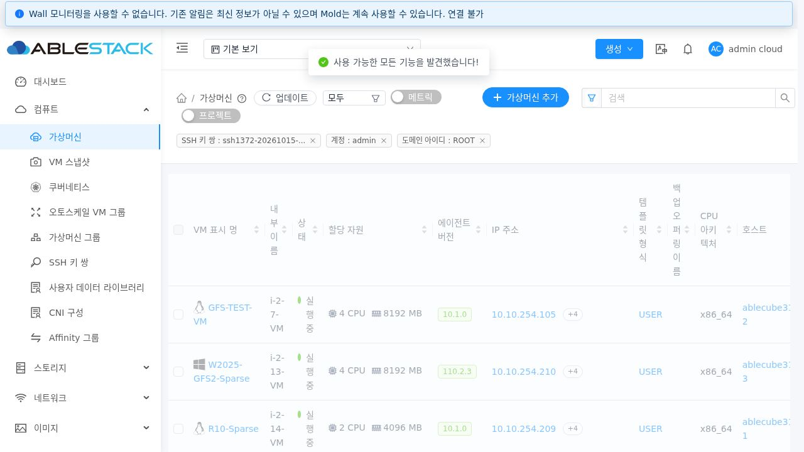
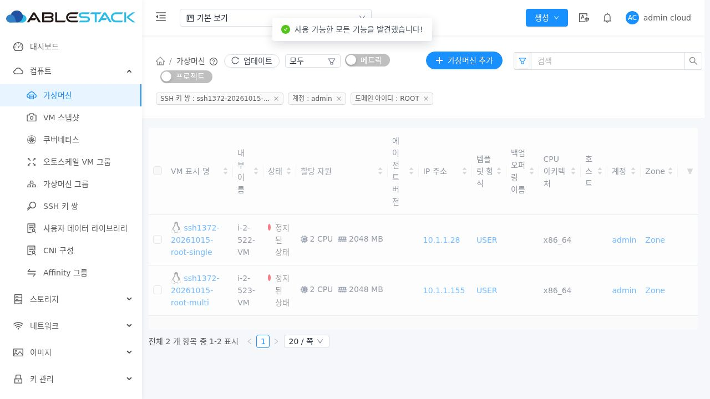
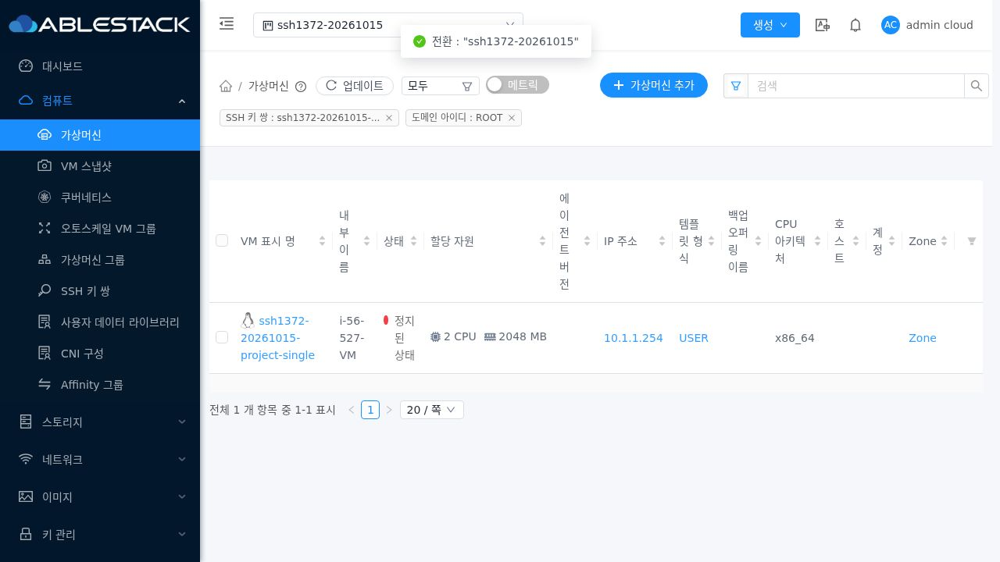
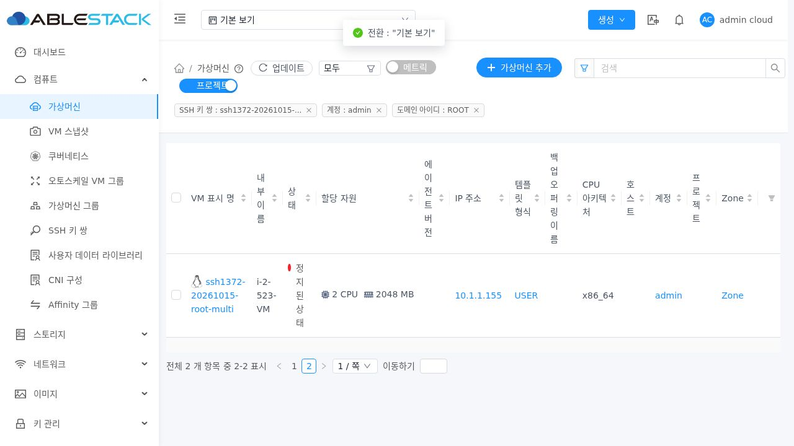
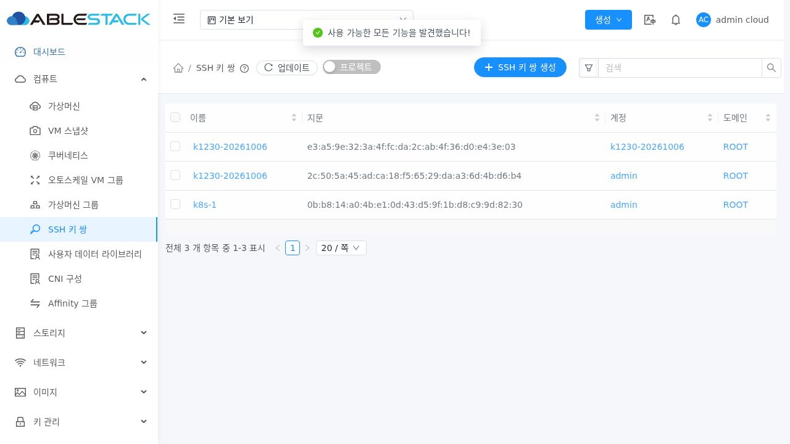

<!--
Licensed to the Apache Software Foundation (ASF) under one
or more contributor license agreements. See the NOTICE file
distributed with this work for additional information
regarding copyright ownership. The ASF licenses this file
to you under the Apache License, Version 2.0 (the
"License"); you may not use this file except in compliance
with the License. You may obtain a copy of the License at

  http://www.apache.org/licenses/LICENSE-2.0

Unless required by applicable law or agreed to in writing,
software distributed under the License is distributed on an
"AS IS" BASIS, WITHOUT WARRANTIES OR CONDITIONS OF ANY
KIND, either express or implied. See the License for the
specific language governing permissions and limitations
under the License.
-->

# SSH 키 실제 사용 VM 조회 검증 (#1372)

2026-10-15 / 테스트 클러스터 31 / Epic #1369 / 누적 PR #1378.
구현 및 배포 소스: `ce167ee7fe527dd0a6c25222ea55bb5bb3f67f49`.
upstream Europa 기준: `a5a811387476ac87a8774fc729cc68021104684a`.

## 결과와 설계

기존 조회는 다른 VM의 SSH.PublicKey 상세를 계정 조건만으로 연결해 무관한 VM을 포함했다. 검증용 A/B 키에서 API와 실제 UI 모두 89개를 반환했고, 키 없는 GFS-TEST-VM도 포함했다. 수정 후 A는 단일 A VM과 A/B 다중 키 VM만 2개, B는 A/B VM과 단일 B VM만 2개다. 미사용 키는 0개다.

같은 VM의 공개 키, 현재 등록된 키의 공개 키, account/domain 소유 범위를 함께 비교한다. LF 경계의 BINARY INSTR와 CRLF 정규화를 사용하며 이름/계정 ID는 바인딩한다. DISTINCT VM ID를 기존 ACL 검색의 AND/IN 조건에 결합해 id/ids·state·keyword·count·페이지 조건을 유지한다. 조회 실패에는 예외를 전달한다. SSH.KeyPairNames만 같은 VM이나 다른 VM의 키 상세로 연결하지 않는다.

UI 관련 VM 링크는 계정/도메인 또는 프로젝트 소유 범위를 유지한다. 명시적 계정 키 조회에서 전역 프로젝트 선택/전체 프로젝트 필터가 개입하지 않도록 일반 VM과 Metrics 요청에 공통 helper를 적용했다. 실제 프로젝트 키 경로는 전역 프로젝트 선택과 요청 projectid가 함께 일치함을 확인했다.

설계: [mold-ssh-keypair-1372-design.ko.md](../../design/mold-ssh-keypair-1372-design.ko.md).

## 빌드와 테스트

| 검증 | 결과 | 근거 |
| --- | --- | --- |
| 변경 Maven 모듈 engine/schema, server | BUILD SUCCESS | module-build.log |
| Java 대상/공통 회귀 | 47 통과, 실패/오류/skip 0 | module-tests-final.log |
| 변경 두 모듈 Apache RAT | SUCCESS, Unknown 0 | module-rat-final.log |
| UI 대상/공통 회귀 | 11 suite / 264 통과 | ui-tests.log |
| 변경 UI lint / 프로덕션 빌드 | 통과 | ui-lint.log, ui-build.log |
| 변경 소스/설계/검증 텍스트 Apache RAT | 26개 승인, Unknown/Unapproved 0 | changed-text-license-result.json |
| 실제 MySQL 조건 행렬 | 18/18 | sql-matrix-results.json |
| 배포 후 실제 API | 31/31 | api-verification.json |
| 실제 Cloud DB 연결 대조 | 5/5 | db-relationship.json |
| 키 재등록 수명주기 | 3/3 | lifecycle-verification.json |
| 실제 Chromium UI | 11 + 정리 후 2 = 13 통과 | ui-verification.json, ui-cleanup-verification.json |

WSL ext4 분리 작업 트리에서 변경 모듈과 UI만 빌드했다. 첫 RAT 실행에서 모듈 빌드가 생성한 비추적 systemvm metadata.ini/sha512sum.txt가 발견됐다. 생성 출력은 작업 근거 폴더로 보존 이동한 뒤 재검사해 통과했으며 POM 제외 규칙은 변경하지 않았다. MySQL 행렬은 연결별 TEMPORARY TABLE로 실행했고 실제 Cloud 테이블을 덮어쓰거나 수정하지 않았다.

SQL 행렬은 단일/다중 키 순서, 같은 이름의 다른 계정/도메인/프로젝트, 다른 상세·SSH 이름만 존재하는 VM, 제거된/비사용자 VM, 부분 문자열·대소문자, 중복 DISTINCT, 인젝션 문자열·따옴표/%/_, Unicode, CRLF, 기존 RSA의 후행 LF 및 빈/null 공개 키를 검증한다.

실제 API는 단일/다중 키, 키 없는 VM 제외, 미사용/없는 키, id/ids 교집합, state/keyword, 1개씩 1~3페이지의 count, 동일 공개 키·이름의 소유 범위, 기본/전체 프로젝트 조회, User/Domain Admin 권한, Metrics 및 기존 #1370 UUID 필터를 확인한다. 전체 프로젝트(-1)와 소유 범위 없는 검색은 기존 허용 범위의 계정 및 프로젝트 VM을 모두 포함하고, 명시적 소유 범위는 해당 VM만 포함한다.

B를 삭제한 뒤 같은 이름의 다른 공개 키로 재등록한 실제 테스트에서 B의 결과는 0개로 바뀌었고 A는 2개를 유지했다. 기존 테스트 VM의 저장된 SSH 공개 키·키 이름은 수정되지 않았음을 API로 확인했다.

## 실제 UI 근거

Windows 화면 도구의 데스크톱 접근 오류로 작업 지침의 WSL Chromium/Playwright를 사용했다. 실제 로그인 후 SSH 상세의 가상머신 보기, 새로고침, A/B/미사용/프로젝트 키, 전역 프로젝트 선택 및 전체 프로젝트, Metrics 전환, 페이지 1→2 이동, 다중 키 VM 상세 링크 표시, 일반 사용자 자기 키, 정리 후 기존 목록과 기존 키의 빈 연결 결과를 DOM·응답·JPEG로 검증했다. 오류 응답 주입이나 API 응답 mocking은 사용하지 않았다. 쿠키·세션·비밀번호·개인 키는 근거에 저장하지 않았다.

수정 전 89개:

수정 후 A의 실제 연결 VM 2개:

프로젝트 키의 연결 VM 1개:

전역 프로젝트 선택 중 계정 키의 VM 2개:

페이지당 1개, 총 2개 중 두 번째 VM:

## 배포

활성 관리 JAR의 기존 3개 클래스가 수정 전 빌드와 해시가 동일함을 먼저 확인했다. 백업 후 QueryManagerImpl / VMInstanceDetailsDao / VMInstanceDetailsDaoImpl만 교체하고 Mold를 재기동했다. 배포 후 3개 클래스와 빌드 산출물 SHA256이 일치한다. #1370의 ListSSHKeyPairsCmd/ManagementServerImpl 클래스는 유지했다.

- JAR 백업: `/root/ssh-keypair-1372-20261015-012006/cloudstack.before.jar`.
- UI 백업: `/root/ssh-keypair-1372-ui-20261015-012547/static-before.tgz`.
- 활성 JAR SHA256: `d3775c4c099563e84d24b1e1ac5799ee339cb3bf460bd55b20aa7e5cc46a5e06`.
- 최종 index.html SHA256: `f701b5d7746d6212f4556aac40503f503457486c88d0709cb4077ed182c1545d`.
- Mold 재기동 PID: 911241 → 941912. UI 배포에서는 PID 941912와 위 JAR을 보존했다.
- 정적 파일 849개 SHA256 일치, assets 먼저/index 마지막 교체. 활성 webapp의 WEB-INF/config.json 보존, 기존 FTCTL markers 3개 유지. META-INF는 원래 존재하지 않는다.
- 최종 Mold active, `/client/` HTTP 200. 최근 관리 로그에 SSH 조회의 linkage/SQL 오류 없음.

세부 근거: deployment-verification.txt, runtime-final.txt, class-hashes.sha256, static-artifact.sha256, static-manifest.json, backend-deployment.log.

## 정리와 기존 데이터 보존

실제 API로 만든 정지 VM 6개를 destroy/expunge하고 네트워크 3개, 현재 테스트 키 5개, 프로젝트 1개, 계정 2개, 도메인 1개를 UUID와 소유 범위로 확인한 뒤 정리했다. 키 재등록 때 이전 B 키도 삭제됐다. 개인 키 생성 파일은 임시 디렉터리에서 자동 삭제됐고 브라우저 컨텍스트는 종료했다.

API에서 테스트 VM 0개와 기존 기본 목록의 키 3개(UUID·이름·지문·소유 범위)를 확인했다. DB 활성 VM·볼륨·NIC·SSH 상세·네트워크·계정·도메인·프로젝트와 테스트 키는 모두 0개다. 삭제된 VM의 SSH 상세 10행은 Cloud의 제거 기록으로 남으며 활성 관계 조회에는 포함되지 않는다. 이를 활성 잔여 0과 구분한다.

기존 전체 namespace 키 5개의 UUID·소유 범위·공개 키 해시와 기존 VM SSH 상세 340행의 해시가 정리 전후 일치한다. 그 중 작업 시작 시 수집한 기존 활성 VM 12개의 SSH 상세도 수정하지 않았다. 기존 키/VM SSH 메타데이터를 보정하지 않았다. 근거: cleanup-api.json, cleanup-db.json, existing-keys-snapshot.json.

기존 기본 목록 키 3개는 현재 등록 material과 같은 소유 범위의 저장된 VM 공개 키가 일치하지 않아 새 조회 결과가 0개다. 일부 기존 VM에는 같은 이름이 저장돼 있어도 다른 계정 키의 공개 키가 남아 있다. 이름만 일치하는 관계를 실제 사용으로 표시하지 않는다. 이 결과는 게스트 authorized_keys나 실제 SSH 접속을 확인했다는 의미가 아니다.

## 범위와 제한

#1372의 조회 정합성과 기존 UI 이동 경로를 완료했다. #1377 사용 VM 탭, 삭제 정책/게스트 키 회수, 기존 VM 키 reset, 실제 게스트 SSH 접속은 후속 범위다. DB 스키마나 호스트 패키지를 변경하지 않았다. 전체 Cloud/RPM 빌드 및 GitHub Actions 전체 CI는 실행하지 않았다. PR #1378은 미병합으로 유지하며 Epic #1369 및 #1373~#1377은 계속 OPEN이다.
