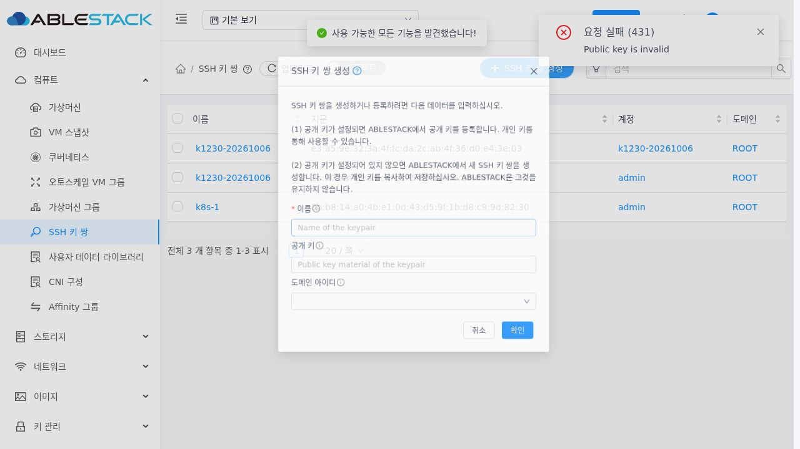
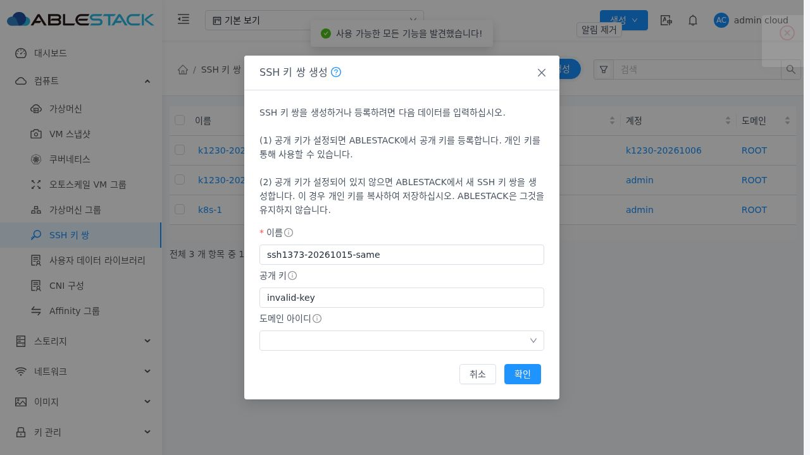
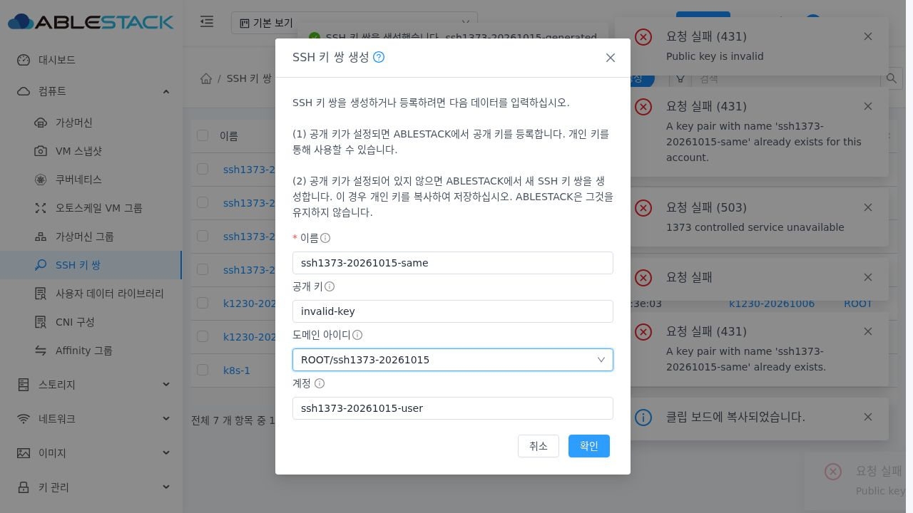
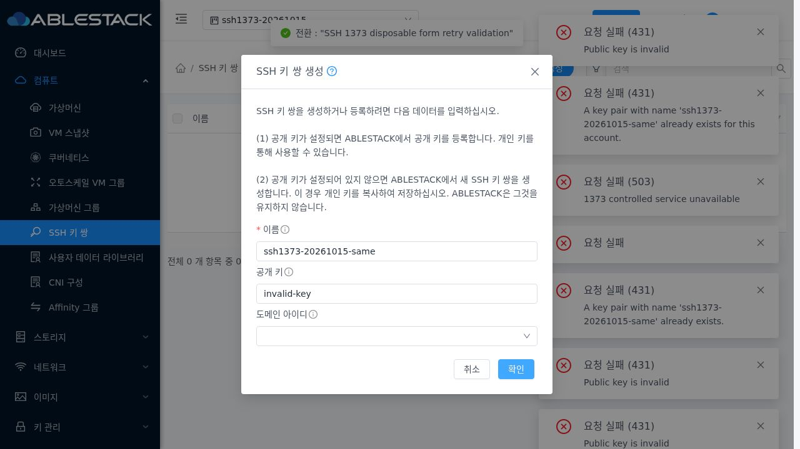
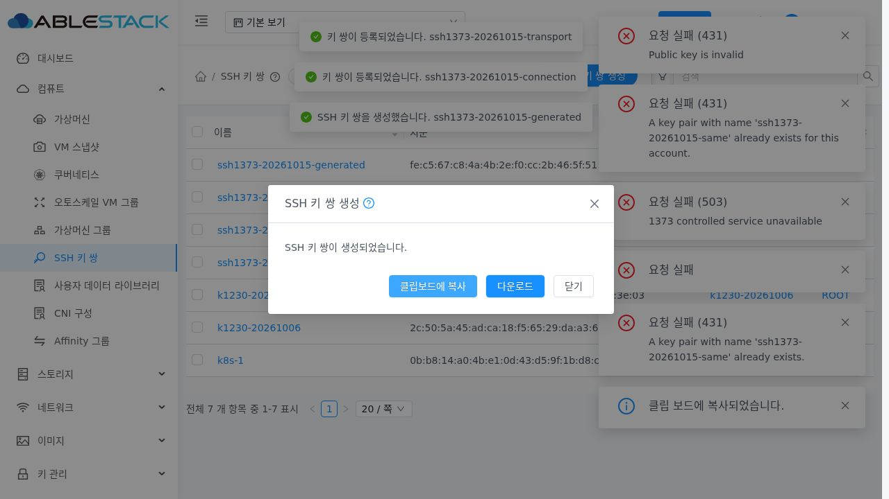
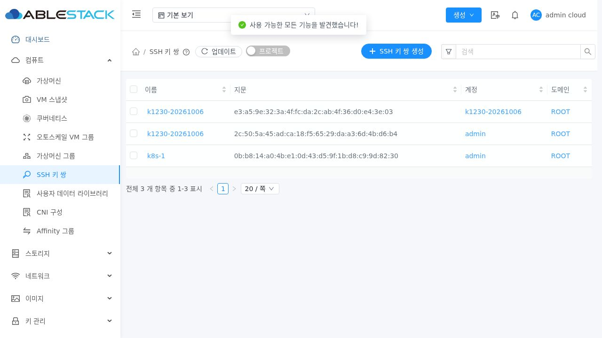

<!--
Licensed to the Apache Software Foundation (ASF) under one
or more contributor license agreements. See the NOTICE file
distributed with this work for additional information
regarding copyright ownership. The ASF licenses this file
to you under the Apache License, Version 2.0 (the
"License"); you may not use this file except in compliance
with the License. You may obtain a copy of the License at

  http://www.apache.org/licenses/LICENSE-2.0

Unless required by applicable law or agreed to in writing,
software distributed under the License is distributed on an
"AS IS" BASIS, WITHOUT WARRANTIES OR CONDITIONS OF ANY
KIND, either express or implied. See the License for the
specific language governing permissions and limitations
under the License.
-->

# SSH 공개 키 등록 실패 후 폼 보존 검증 (#1373)

2026-10-15 / 테스트 클러스터 31 / Epic #1369 / 누적 PR #1378.
구현·최종 UI 빌드 소스: `eb4a94d8dd4de928405a7670d209ae76af1e9b65`. 기준 upstream Europa: `a5a811387476ac87a8774fc729cc68021104684a`.

## 수정과 결과

실제 기존 UI에서 invalid-key 등록은 HTTP 431로 거부된 뒤 폼이 닫혔다. 다시 열면 이름/공개 키가 빈 값이었다. 등록 finally의 성공/실패 공통 닫기·갱신을 제거하고 성공에서만 성공 메시지·목록 갱신·닫기를 수행한다. 실패는 입력과 도메인/계정/프로젝트를 유지하고 loading을 해제해 수정·재시도를 허용한다.

loading을 폼 검증 시작 전에 설정해 비동기 검증 중의 중복 실행도 막는다. 이벤트 또는 @finish 값으로 제출할 수 있고, 검증 오류는 필드로 스크롤한다. 새 키 생성은 기존 개인 키 결과 화면을 유지하고 성공에서만 목록을 갱신한다. 결과 화면에 진입한 뒤 반복 제출을 막는다.

첫 실제 통신 중단 시험에서는 공통 request 처리기의 로그아웃 때문에 로그인 화면으로 이동하는 추가 원인을 확인했다. 두 생성/등록 POST에 기존 preserveOnFailure 옵션을 명시해 네트워크/서비스/권한 오류를 폼에서 처리한다. 현재 세션의 실제 401만 기존 인증 만료 처리를 유지한다. 공통 요청 정책과 다른 API는 변경하지 않는다.

[설계](../../design/mold-ssh-keypair-1373-design.ko.md). 생성/등록 모드 분리·권한 확장·대화상자 배치 표준은 #1375 등의 후속 범위다.

## 검증

| 검증 | 결과 | 근거 |
| --- | --- | --- |
| UI 단위/공통 회귀/요청 정책 | 14 suite / 307 통과, 실패/skip 0 | ui-tests-final.log |
| 신규 폼 테스트 | 15 통과 | 위 로그 및 CreateSSHKeyPair.spec.js |
| 변경 파일 lint | 통과 | ui-lint.log |
| 최종 생산 UI 빌드 | 성공 | ui-build-final.log |
| 소스/설계 Apache RAT | 3개 승인, Unknown/Unapproved 0 | source-license-final.log |
| 변경 소스/설계/검증 텍스트 RAT | 13개 승인, Unknown/Unapproved 0 | changed-text-license-result.json |
| 실제 브라우저 | 18 + 정리 후 2 = 20 통과 | ui-verification.json, ui-cleanup-verification.json |
| 실제 API와 생성 대상 대조 | 15/15 | api-verification.json |
| 정리 및 기존 데이터 보존 | 통과 | cleanup-verification.json |

WSL ext4 분리 작업 트리에서 Node 20으로 UI만 빌드했다. 최종 빌드 옵션은 --max-old-space-size=8192 및 --openssl-legacy-provider다. 대상 테스트는 coverage=false로 실행하며 전체 소스 coverage나 전체 CI 결과로 간주하지 않는다. 변경 Java 모듈/DB 스키마가 없어 Maven 빌드는 실행하지 않았다.

실제 Chromium/Playwright에서 로그인 → SSH 메뉴 → 생성 대화상자의 버튼/키보드 경로를 사용했다. 고정 1280×720, fullPage=false로 DOM·응답·JPEG를 대조했다. 실제 invalid/중복 이름 및 새 키 생성의 중복 실패를 확인했고 실패→수정→성공과 목록 갱신·성공 메시지·닫기를 검증했다. 자식 도메인/계정과 프로젝트에서도 입력/선택 범위를 유지했다.

HTTP 503·연결 중단·API 대기·현재 세션 401은 해당 브라우저의 SSH POST에만 제한적으로 주입했다. 주입은 해제했고 성공 재시도는 실제 API로 수행했다. 연결 중단은 서버 전송 전에 발생시켜 거짓 생성 성공으로 처리하지 않음을 확인했다. API를 대기시키고 Ctrl+Enter와 확인을 반복해 실제 POST는 1회임을 확인했다. 현재 세션 401에서는 정상적으로 로그인 화면으로 이동했다.

같은 이름/공개 키를 Root/다른 계정/프로젝트에 등록한 후 UUID·fingerprint·owner와 검색 범위를 API로 대조했다. 같은 계정의 다른 테스트 이름은 서로 다른 공개 키를 사용해 API의 공개 키 중복 제약과 구분했다.

새 키 생성의 개인 키 결과 화면은 유지됐다. 실제 복사 버튼을 누른 후 별도 임시 브라우저 페이지에서 Ctrl+V로 붙여넣어 내용을 확인했고, 다운로드 파일과 함께 응답 개인 키의 SHA256 및 바이트 수를 대조해 일치했다. navigator.clipboard API가 노출되지 않은 테스트 환경이므로 실제 키보드 붙여넣기를 사용했다. HTTP 테스트 환경의 브라우저에서 clipboard permission을 사용했으며 Windows OS 클립보드 검증으로 표현하지 않는다. 다운로드 임시 파일은 즉시 삭제하고 브라우저 컨텍스트를 종료했다. 개인 키·비밀번호·세션 원문은 파일/PR에 기록하지 않았다. 모바일·최초 저장 안내·새로고침 정책은 #1375 후속이다.

## 화면 근거

수정 전 오류 후 폼 닫기 및 빈 입력:

수정 후 invalid 등록 실패에서 입력/폼 보존:

자식 도메인/계정 선택 보존:

프로젝트 선택 상태에서 실패 후 폼 보존:

개인 키 결과 화면:

## 배포

UI 정적 파일 849개 SHA256 일치. assets 먼저/index.html 마지막 교체. WEB-INF/config.json과 활성 #1370/#1372 관리 JAR 및 Mold PID 941912를 보존했다. META-INF는 기존에 존재하지 않았다. 기존 FTCTL markers 3개 유지, Mold active 및 /client/ HTTP 200이다. jar SHA256은 작업 전후 d3775c4c099563e84d24b1e1ac5799ee339cb3bf460bd55b20aa7e5cc46a5e06로 동일하다.

- 최초 배포 전 UI 백업: /root/ssh-keypair-1373-ui-20261015-022225/static-before.tgz.
- 최종 통신 오류 보완 배포 전 백업: /root/ssh-keypair-1373-ui-20261015-023625/static-before.tgz.
- 근거: deployment-verification.txt, static-manifest.json, static-artifact.sha256, runtime-before.txt, runtime-final.txt.

## 정리와 범위

검증 키 6개·프로젝트 1개·계정 1개·도메인 1개를 UUID와 소유 범위로 확인한 뒤 API로 정리했다. 중간 시험에서 만든 키도 각 재검증 전에 정리했다. DB의 임시 키 및 활성 계정/도메인/프로젝트 잔여 0, 기존 전체 namespace 키 5개와 VM SSH 상세 350행 해시 보존. 기본 UI/API 목록의 기존 키 3개도 재확인했다. VM·볼륨·네트워크·호스트 작업은 하지 않았다.

#1373 완료 범위는 입력/범위 보존과 오류 복구 및 중복 제출 방지다. Epic #1369는 4/8 완료로 유지하며 #1374~#1377은 OPEN이다. 전체 Cloud/RPM 빌드 및 전체 GitHub Actions CI는 실행하지 않았고 PR #1378은 미병합이다.
