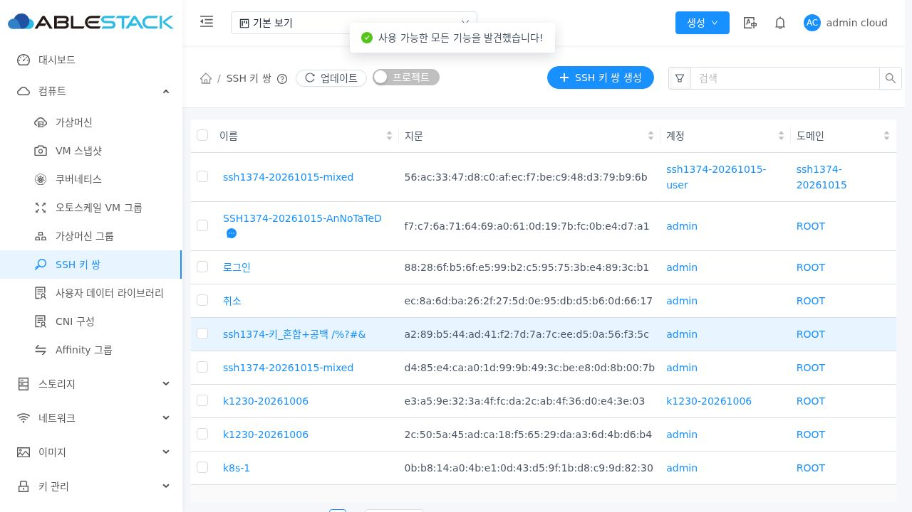
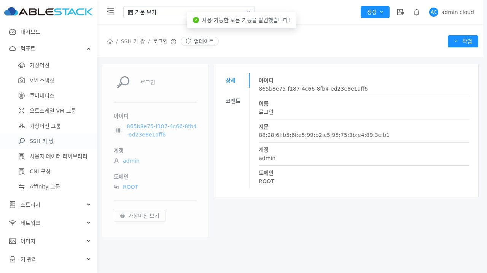
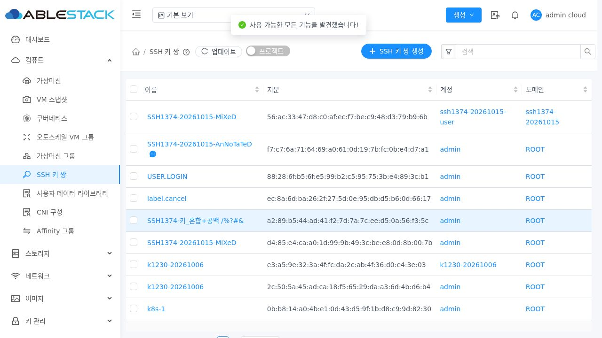
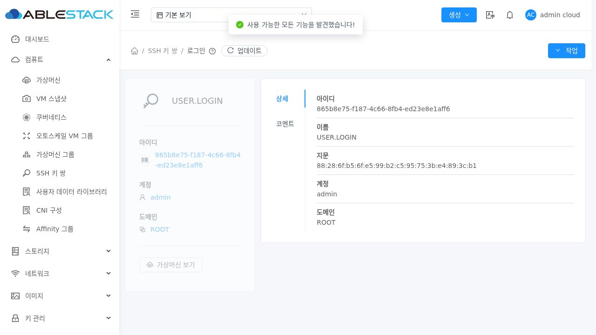
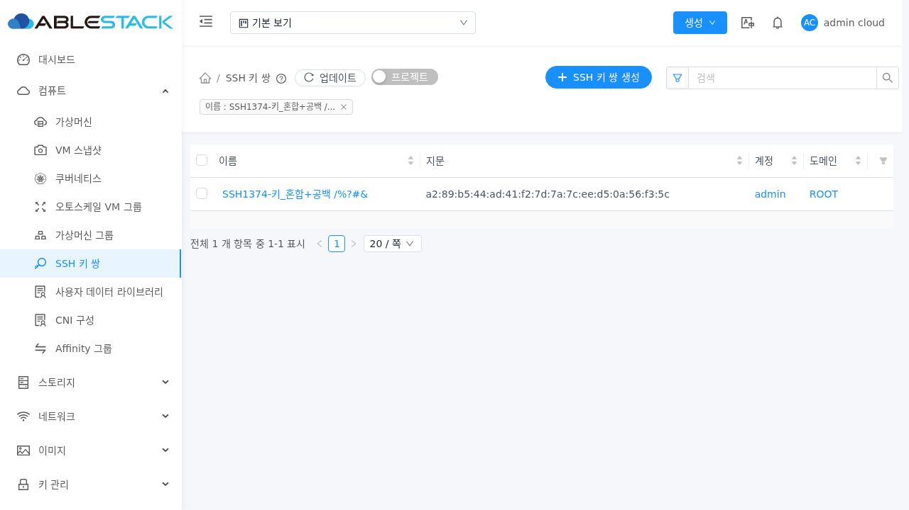
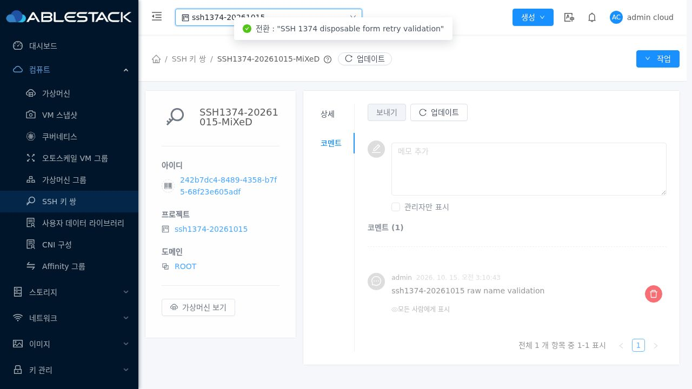
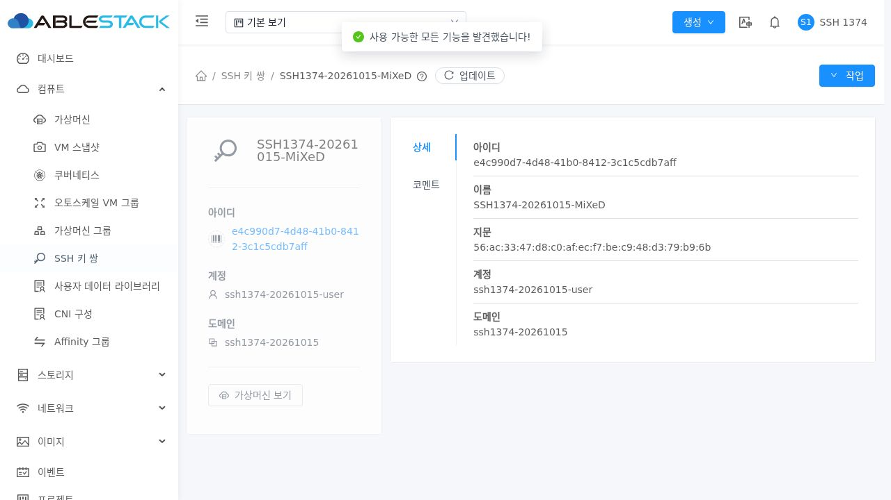
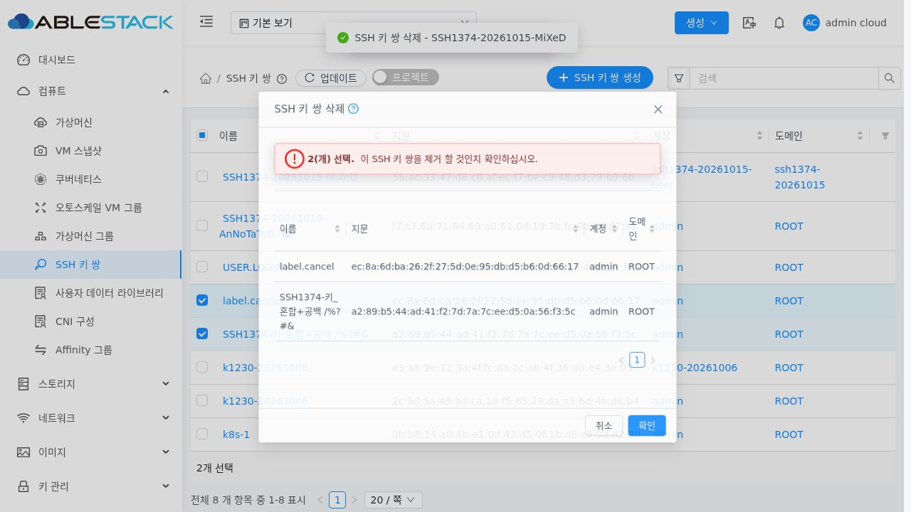
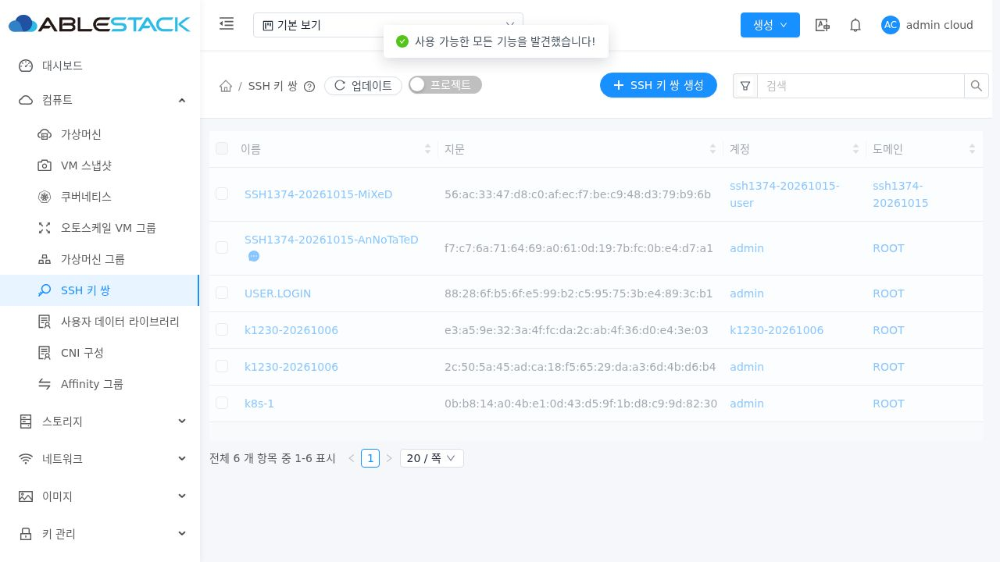
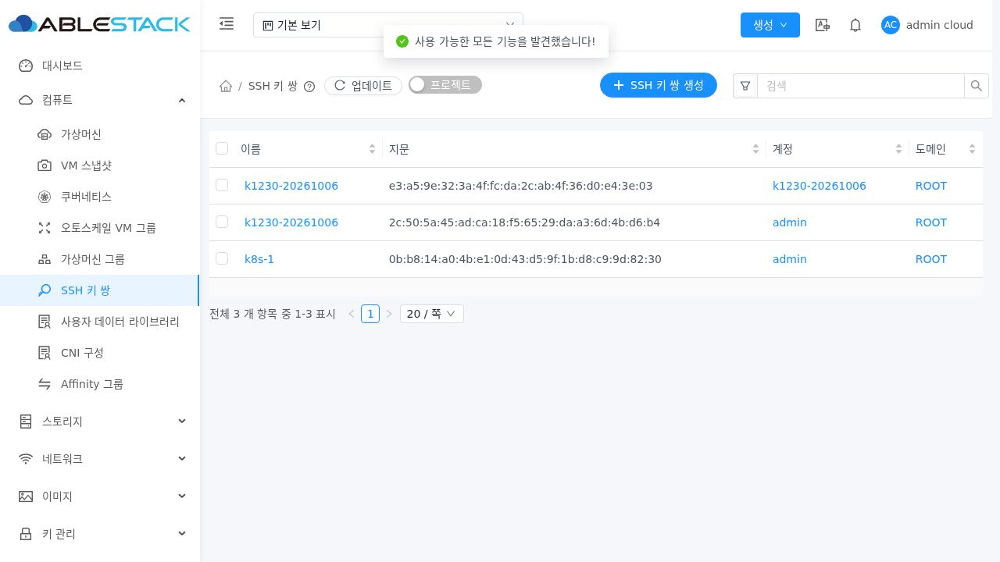

<!--
Licensed to the Apache Software Foundation (ASF) under one
or more contributor license agreements. See the NOTICE file
distributed with this work for additional information
regarding copyright ownership. The ASF licenses this file
to you under the Apache License, Version 2.0 (the
"License"); you may not use this file except in compliance
with the License. You may obtain a copy of the License at

  http://www.apache.org/licenses/LICENSE-2.0

Unless required by applicable law or agreed to in writing,
software distributed under the License is distributed on an
"AS IS" BASIS, WITHOUT WARRANTIES OR CONDITIONS OF ANY
KIND, either express or implied. See the License for the
specific language governing permissions and limitations
under the License.
-->

# SSH 키 이름 원문 표시 검증 (#1374)

2026-10-15 / 테스트 클러스터 31 / Epic #1369 / 누적 PR #1378.
구현·배포 UI 소스: `76e7c622b20d1a84c3fe491bc4288eece876b4ed`. 기준 upstream Europa: `a5a811387476ac87a8774fc729cc68021104684a`.

## 수정과 결과

기존 UI에서 코멘트 없는 이름 4개가 API 원문과 달랐다. `SSH1374-20261015-MiXeD`와 한글·기호 이름의 ASCII 부분이 소문자로 바뀌었고, `label.cancel`은 `취소`, `USER.LOGIN`은 `로그인`으로 표시됐다. 코멘트가 있는 이름은 원문으로 보이는 차이도 재현했다.

SSH 목록 이름을 `$t(text.toLowerCase())` 대신 Vue 텍스트 보간으로 표시해 원문을 보존한다. 코멘트 유무와 동일 이름의 다른 소유자에서도 일관되며, HTML 모양의 이름은 텍스트로 escape한다. 원본 데이터·링크 UUID/account/domain/project·검색·정렬·삭제 매핑은 그대로다.

`USER.LOGIN` 등 이벤트 키 이름은 상세 InfoCard 제목과 DetailsTab 이름 필드에서도 번역되는 추가 원인을 확인했다. SSH 제목과 SSH name 필드에서만 해당 이벤트 번역을 제외한다. 다른 리소스의 이벤트 이름/타입, 메뉴·컬럼·필드의 정적 번역은 기존 동작을 유지한다.

[설계](../../design/mold-ssh-keypair-1374-design.ko.md). 단건 삭제의 대상 요약 및 danger 표현은 #1376 범위로 유지한다. 이번 검증에서는 단건 상세 원문과 실제 삭제 요청, 기존 일괄 확인 표의 원문 이름과 실제 대상의 일치를 확인했다.

## 검증

| 검증 | 결과 | 근거 |
| --- | --- | --- |
| UI 단위/기존 SSH·VM·폼·요청 회귀 | 15 suite / 334 통과, 실패/skip 0 | ui-tests-final.log |
| 신규 이름/번역 경계 테스트 | 27 통과 | 위 로그와 두 이름 표시 spec |
| 변경 Vue/JS 5개 lint | 통과 | ui-lint.log |
| 생산 UI 빌드 | 성공 | ui-build.log |
| 변경 소스/설계 Apache RAT | 6개 승인, Unknown/Unapproved 0 | source-license.log |
| 변경 소스/설계/검증 텍스트 RAT | 16개 승인, Unknown/Unapproved 0 | changed-text-license-result.json |
| 실제 브라우저 표시/검색/정렬/소유 범위 | 22 통과 | ui-verification.json |
| 실제 단건·일괄 삭제 및 완료 확인 | 2 통과 | ui-delete-verification.json |
| 정리 후 기존 목록·관련 VM 회귀 | 2 통과 | ui-cleanup-verification.json |
| 실제 API 조회/대상 대조 | 19 + 삭제 후 5 = 24 통과 | api-verification.json, api-after-delete.json |
| 정리·기존 키/VM SSH 상세 보존 | 통과 | cleanup-verification.json |

WSL ext4 분리 작업 트리에서 Node 20으로 UI만 빌드했다. 빌드 옵션은 --max-old-space-size=8192 및 --openssl-legacy-provider다. 테스트는 coverage=false로 실행했으며 전체 소스 coverage/전체 CI를 뜻하지 않는다. 변경 Java 모듈이나 DB 스키마가 없어 Maven 빌드는 실행하지 않았다.

실제 Chromium/Playwright 로그인 → SSH 메뉴에서 Root Admin·일반 사용자·프로젝트 목록과 상세, 코멘트, UUID 링크와 이름 URL encoding, 혼합 이름/한글·기호/번역 키 이름의 검색, 원본 문자열 기준 오름차순·내림차순 정렬을 확인했다. 고정 1280×720, fullPage=false로 DOM·실제 응답·JPEG를 대조했으며 API 응답을 모의 주입하지 않았다. 고급 검색은 계정·도메인 옵션 로딩이 끝난 뒤 입력했다.

Root Admin 키 1개는 상세 작업 메뉴, 2개는 선택 후 행 우클릭의 일괄 삭제 메뉴에서 실제 삭제했다. 확인 표에 `SSH1374-키_혼합+공백 /%?#&`와 `label.cancel`이 원문으로 보였다. 실제 POST의 원문 name과 account/domainid 및 projectid 부재, HTTP 200을 검증했다. 같은 이름의 일반 사용자·프로젝트 키는 API와 UI에서 유지됐다.

일괄 삭제 응답 검증 이후 숨겨진 이전 모달과 현재 모달을 테스트 도구가 중복 선택해 완료 대기에서 strict-selector 오류가 발생했다. 삭제를 반복하지 않고 새 브라우저의 실제 목록과 API로 삭제된 키 3개의 부재 및 다른 소유자 키 보존을 재확인했다. 이는 ui-delete-verification.json에 구분해서 기록했다. 삭제된 UUID의 API 파라미터 검증은 431로 거부될 수 있으므로 삭제 후 부재는 정확한 이름·소유 범위 조회와 DB UUID 부재로 확인했다.

## 화면 근거

수정 전 코멘트 없는 이름 변형 및 이벤트 키 상세 번역:

수정 후 코멘트 유무·한글·기호·번역 키 원문과 상세:

프로젝트와 일반 사용자 범위:

일괄 삭제 확인 표 및 삭제 후 같은 이름의 다른 계정 키 보존:

## 배포

UI 정적 파일 849개의 SHA256이 실제 webapp과 일치한다. assets 먼저/index.html 마지막 교체. WEB-INF/config.json과 활성 #1370/#1372 관리 JAR, Mold PID 941912를 보존했고 META-INF는 기존에 없었다. 기존 FTCTL markers 3개를 유지했으며, 최종 정리 후에도 Mold active와 /client/ HTTP 200 및 정적 파일 해시 일치를 확인했다.

- 배포 전 백업: /root/ssh-keypair-1374-ui-20261015-032650/static-before.tgz.
- JAR SHA256: d3775c4c099563e84d24b1e1ac5799ee339cb3bf460bd55b20aa7e5cc46a5e06 (작업 전후 동일).
- config.json SHA256: b7de5f6a1f7a3a17310ee7d34ca801bb316fc6f841039f865fbabf154cd59a13 (동일).
- index.html SHA256: 49357b939b65f5a05e5a7c438f2a01b6461c3b2fbeecd0104747b7aa6f40da50.
- 정적 artifact SHA256: c8c147115d059f0ff649a1ff60e54bc7fb5211a76e4a2836d3dc39a412658f4b.
- 근거: deployment-verification.txt, static-manifest.json, static-artifact.sha256, runtime-before.txt, runtime-final.txt.

## 정리와 범위

검증 키 7개·코멘트 2개·프로젝트/계정/도메인 각 1개를 UUID·소유 범위로 확인한 뒤 정리했다. UI 삭제 3개 후 API로 나머지 4개를 정리했다. 임시 키·활성 코멘트·계정·도메인·프로젝트 잔여는 0이다. 기존 전체 namespace 키 5개와 VM SSH 상세 350행의 전체 해시 대조 결과가 동일하고 기본 UI/API 기존 키 3개를 재확인했다. VM·볼륨·네트워크·호스트 작업은 하지 않았다. 테스트 공개 키 생성용 개인 키는 임시 디렉터리와 함께 즉시 제거했으며 비밀번호·세션·개인 키 원문은 공개 근거에 기록하지 않았다.

#1374의 이름 원문 표시·일치 검증을 완료했다. Epic #1369는 5/8 완료로 OPEN을 유지하며 #1375~#1377은 후속 범위다. 전체 Cloud/RPM 빌드 및 전체 GitHub Actions CI는 실행하지 않았고 PR #1378은 미병합이다.
