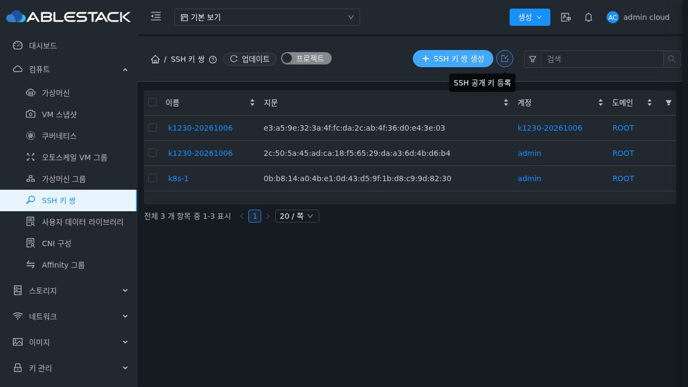
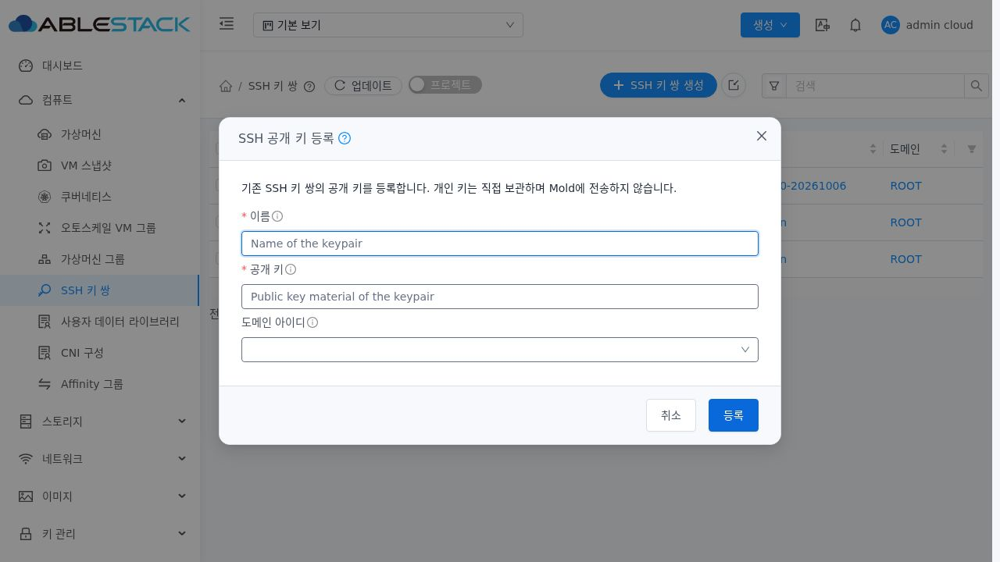
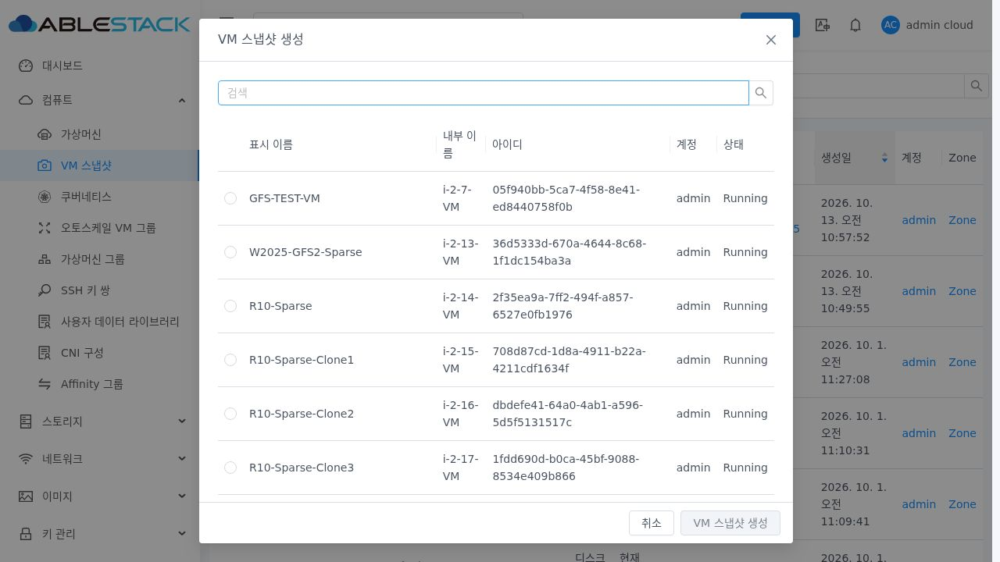
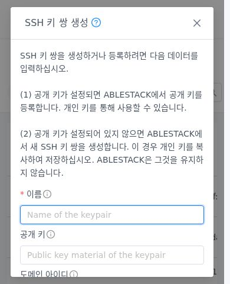
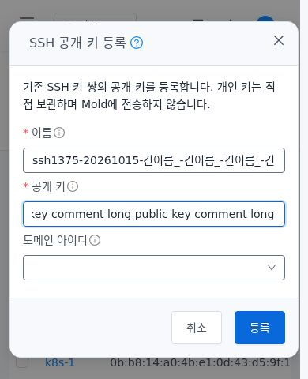
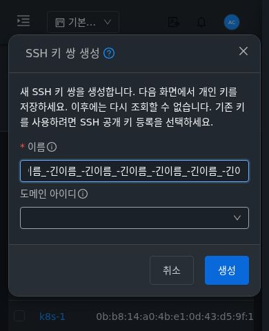
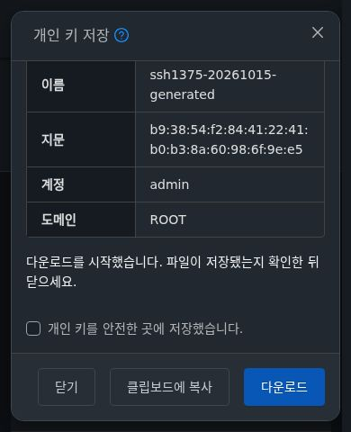
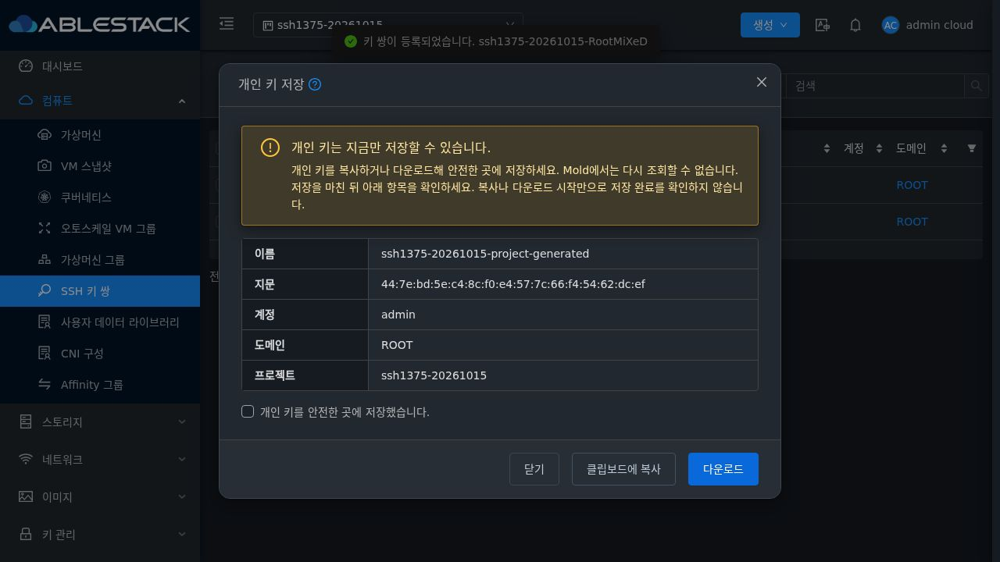
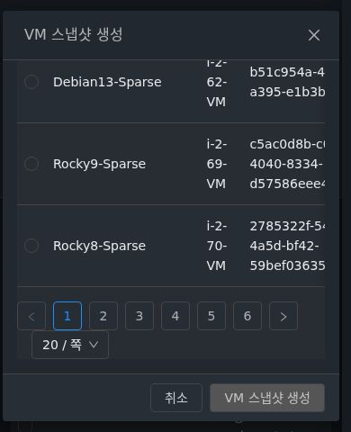
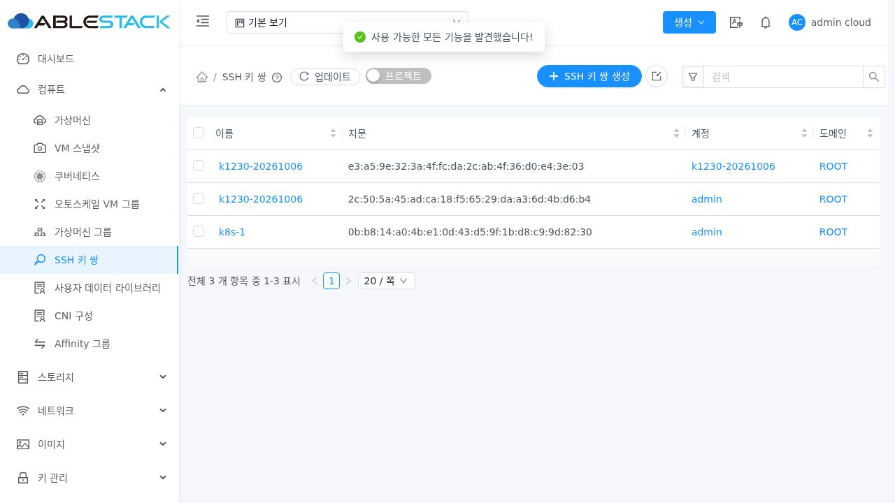

<!--
Licensed to the Apache Software Foundation (ASF) under one
or more contributor license agreements. See the NOTICE file
distributed with this work for additional information
regarding copyright ownership. The ASF licenses this file
to you under the Apache License, Version 2.0 (the
"License"); you may not use this file except in compliance
with the License. You may obtain a copy of the License at

  http://www.apache.org/licenses/LICENSE-2.0

Unless required by applicable law or agreed to in writing,
software distributed under the License is distributed on an
"AS IS" BASIS, WITHOUT WARRANTIES OR CONDITIONS OF ANY
KIND, either express or implied. See the License for the
specific language governing permissions and limitations
under the License.
-->

# SSH 생성·등록·개인 키 결과 대화상자 검증 (#1375)

2026-10-15 / 테스트 클러스터 31 / Epic #1369 / 누적 PR #1378.
최종 구현·배포 UI 소스: `afe5caf81e8ed4601822ea901a7d90dea5f05d5d`. 기준 upstream Europa: `a5a811387476ac87a8774fc729cc68021104684a`.

## 변경과 결과

기존 UI의 390×480 화면에서 Footer가 없고 취소/확인 작업 영역은 y=521로 화면 밖에 있었다. 기존 VM의 MoldDialog와 AutogenView selfManagedDialog를 재사용해 Header/Body/Footer를 분리했다. 공통 MoldDialog에 선택적 sm/md/lg/xl preset을 추가하고 SSH는 md=720을 사용한다. preset에서만 MOLD-DIALOG-1.0(#1213)의 viewport 상한, 14/10px 모서리, padding, 42px Footer 버튼과 테마 토큰을 적용한다. 사용자 요청에 따라 제목과 Header는 실제 VM 기준으로 통일했다. 데스크톱/모바일, 밝은/어두운 테마 모두 제목 16px·굵기 500·줄 높이 22px·색상·padding과 Header padding 16px 24px·높이 55px이 VM 스냅샷과 일치한다. 기존 22px/모바일 18px 큰 제목을 제거했다. 기존 760/custom width 및 다른 대화상자의 배치는 유지한다. #1214 전체 공통 전환 완료를 뜻하지 않는다.

생성·등록을 각 API 권한으로 노출한다. 목록의 생성은 기존 텍스트 primary 버튼을 유지하고 공개 키 등록은 아이콘만 남겼다. 마우스 오버 시 작업명 툴팁을 제공하고 aria-label로 키보드 접근 이름을 유지한다. 제목과 Footer는 생성/등록 모드에 일치하고, 등록의 공개 키가 비었다고 create로 전환하지 않는다. 설명→이름→공개 키(등록에만 해당)→도메인→계정 순서와 기존 input/select를 보존한다. AutogenView selfManagedDialog에 refresh-data만 연결해 성공 목록 갱신을 유지한다.

개인 키 결과에 이름·지문·account/domain/project 및 최초 저장/재조회 불가 안내를 표시한다. Footer는 닫기→복사→다운로드(단일 primary)다. 복사는 실제 성공 콜백으로 피드백하고 실패는 Body에 표시한다. 다운로드는 Blob URL로 시작 후 해제하며, 시작을 저장 완료로 표현하지 않는다. 복사/다운로드가 영구 저장을 뜻하지 않아 저장 확인을 자동 선택하지 않는다.

저장 확인 후에는 바로 닫고, 미확인 닫기/아이콘/Escape는 같은 모달의 계속 저장/저장 없이 닫기로 전환한다. 생성 키는 남는다는 의미를 안내한다. 입력의 normal/hover/focus/error/disabled 스타일은 preset에 한정해 기존 dark-mode 규칙보다 우선하고 테마 입력 표면/대비 토큰을 사용한다. 미저장 결과 또는 제출 중 새로고침/이탈에는 beforeunload 기본 확인을 사용한다. 개인 키는 본문/DOM 속성/저장소/로그에 표시하지 않고 메모리에서만 사용하며 닫기/해제 시 지운다. 공개 키 조회·생성 알고리즘·개인 키 재조회는 추가하지 않았다.

[설계](../../design/mold-ssh-keypair-1375-design.ko.md).

## 실제 검증에서 보완한 부분

첫 배포의 실제 측정에서 html의 stable scrollbar gutter로 프레임이 viewport 중앙보다 5px 왼쪽에 있었고 닫기 버튼 내부 56px이 외부 48px보다 8px 넓었다. preset wrapper/mask만 100vw로 맞추고 wrapper gutter/외부 스크롤 및 닫기 내부 크기를 보정했다. 최초 수치는 ui-initial-frame-offset.json에 보존했다.

Footer 이동 후 기존 Ctrl+Enter directive는 keydown에서 Footer로 포커스를 옮겨 form 밖의 keyup을 놓쳤다. 외부 submit 버튼을 form 속성으로 연결하고 Ctrl+Enter를 같은 제출 handler의 keydown 경로로 처리했다. 필수값 오류에서도 AFormItem fragment의 $el과 비활성 입력에 대한 이른 포커스 호출을 제거하고 loading 해제 후 nextTick에서 Input ref로 스크롤·포커스를 적용했다. API 오류 후에는 기존 포커스와 Body 스크롤을 복원한다.

## 검증 결과

| 검증 | 결과 | 근거 |
| --- | --- | --- |
| SSH·VM·공통 폼·요청 회귀 | 21 suite / 401 통과, 실패/skip 0 | ui-tests-final.log |
| 최종 preset/폼/렌더러 추가 확인 | 3 suite / 38 통과 | ui-tests-presets-final.log |
| 변경 Vue/JS lint | 통과 | ui-lint.log |
| 최종 생산 UI 빌드 | 성공 | ui-build.log |
| 소스/설계 RAT | 10개 승인, Unknown/Unapproved 0 | source-license.log |
| 변경 텍스트 RAT | 결과 JSON 참조 | changed-text-license-result.json |
| 최종 실제 UI | 44 + 공통/키보드/대비 8 + 입력 상태 2 + VM 제목/헤더·등록 아이콘/툴팁 12 + 정리 후 2 = 68 통과 | ui-verification.json 등 |
| 최종 실제 API | 대상 25 + 역할 metadata 4 + 금지 API 2 = 31 통과 | api-verification.json, role-api-*.json |
| 테스트 개체 정리·기존 상태 보존 | 통과 | cleanup-verification.json |

Node 20, WSL ext4 분리 작업 트리에서 UI만 빌드했다. 옵션은 --max-old-space-size=8192 및 --openssl-legacy-provider다. 테스트는 coverage=false이며 전체 소스 coverage/전체 CI 결과로 표현하지 않는다. Java/DB 스키마 변경이 없어 Maven 빌드를 하지 않았다.

Chromium/Playwright의 실제 로그인·SSH 메뉴·Footer/Enter/Ctrl+Enter 경로를 사용했다. 밝은/어두운 테마, 1280×720·390×844·390×480 및 200% 확대와 같은 CSS viewport 640×360/DPR 2 조건을 측정했다. 확대 조건은 CDP로 재현했으며 Windows 브라우저 도구 모음의 확대 조작 검증으로 표현하지 않는다. 긴 이름·공개 키/설명, Header/Footer 좌표·Body 스크롤·수평 넘침·중첩 없음, Tab 순환·Escape·초기/복귀 포커스와 mask 정책을 확인했다. 테마는 제품의 시스템 테마 변경 처리로 전환했다.

Root Admin·Domain Admin·일반 사용자·프로젝트·create-only/register-only를 검증했다. 제한 역할은 UI 진입/제출 API가 일치하고 반대 API는 실제 HTTP 432(Not available)로 거부됐다. Root/다른 계정/프로젝트의 같은 이름도 UUID·지문·범위로 대조했다.

invalid-key와 중복 이름은 실제 API로 거부됐고 값·포커스·스크롤을 유지한 뒤 수정·재시도했다. 해당 SSH POST의 503과 요청 대기만 테스트 브라우저에 제한적으로 주입하고 해제했다. 실제 성공 요청으로 후속 경로를 검증했고 중복 제출 중 POST는 1회였다. 요청 중 닫기/Escape를 막고 Footer·상태 문구를 유지했다. 기존 sticky 오류 알림은 실제 닫기 버튼으로 정리한 뒤 다음 메뉴를 열었다.

개인 키는 실제 복사 버튼→별도 임시 페이지 Ctrl+V 및 다운로드 파일을 응답과 SHA256/바이트 수로 대조했다. 임시 파일은 즉시 삭제하고 클립보드는 테스트 문구로 교체한 뒤 컨텍스트를 닫았다. 브라우저 clipboard permission을 사용했으며 Windows OS 클립보드 검증으로 표현하지 않는다. 개인 키·비밀번호·세션 원문은 근거에 기록하지 않았다. 미저장 새로고침의 실제 beforeunload 확인을 취소하고 결과 보존, Escape→계속 저장, 저장 없이 닫기 후 키 유지와 저장 확인 후 닫기/목록 갱신을 확인했다.

## 화면 근거

## 배포와 정리

정적 파일 849개의 SHA256이 실제 webapp과 일치한다. assets 먼저/index 마지막으로 배포하고 WEB-INF/config.json, 기존 #1370/#1372 관리 JAR, Mold PID 941912와 FTCTL markers 3개를 보존했다. META-INF는 기존에 없었다. Mold active, /client/ HTTP 200 및 정리 후 해시 일치를 확인했다. 최종 배포 전 백업은 `/root/ssh-keypair-1375-ui-20261015-102434/static-before.tgz`다. JAR SHA256은 d3775c4c099563e84d24b1e1ac5799ee339cb3bf460bd55b20aa7e5cc46a5e06로 동일하다. 실제 index/config/artifact 해시는 runtime/deployment/manifest 근거에 기록했다.

최종 테스트 키 11개·역할 2개·계정 4개·도메인/프로젝트 각 1개를 UUID·소유 범위로 확인해 정리했다. 사전 검증에서 만든 키도 각 재검증 전에 정리했다. 임시 키 및 활성 역할·계정·도메인·프로젝트 잔여 0, 기존 전체 namespace 키 5개와 VM SSH 상세 350행 해시 및 기본 UI/API 기존 키 3개를 보존했다. 역할은 soft-delete되므로 활성 조건으로 잔여를 판단했다. VM·볼륨·네트워크·호스트 작업은 하지 않았다.

#1375의 구현 범위 검증을 완료했다. Epic #1369는 6/8 완료 OPEN, #1376/#1377은 후속 범위다. 전체 Cloud/RPM 빌드 및 전체 GitHub Actions CI는 실행하지 않았고 PR #1378은 미병합이다.
