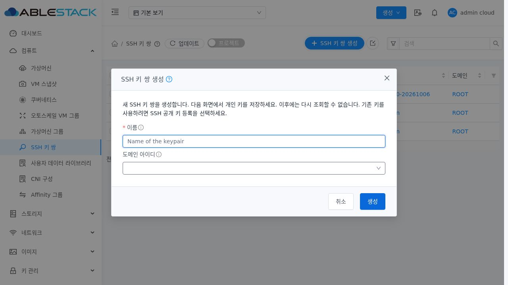
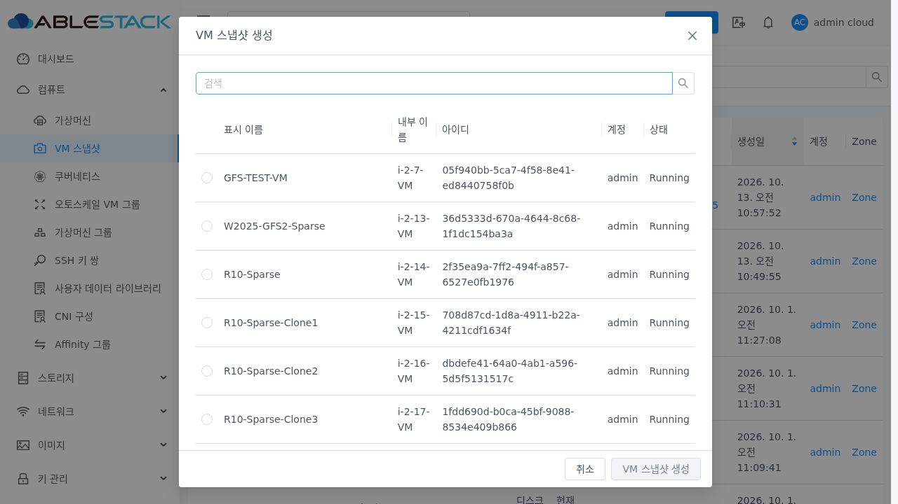
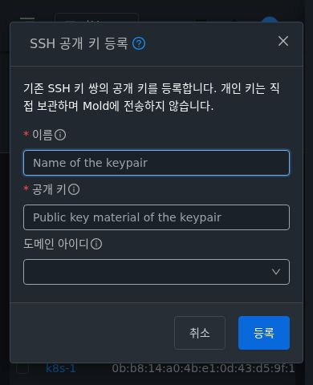
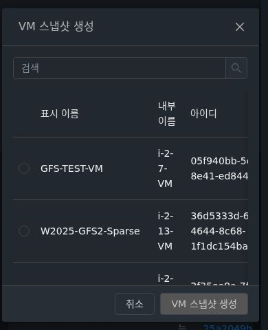

<!--
Licensed to the Apache Software Foundation (ASF) under one
or more contributor license agreements. See the NOTICE file
distributed with this work for additional information
regarding copyright ownership. The ASF licenses this file
to you under the Apache License, Version 2.0 (the
"License"); you may not use this file except in compliance
with the License. You may obtain a copy of the License at

  http://www.apache.org/licenses/LICENSE-2.0

Unless required by applicable law or agreed to in writing,
software distributed under the License is distributed on an
"AS IS" BASIS, WITHOUT WARRANTIES OR CONDITIONS OF ANY
KIND, either express or implied. See the License for the
specific language governing permissions and limitations
under the License.
-->

# SSH 대화상자 모서리 반경을 VM 공통 스타일로 통일 (#1375 후속)

2026-10-15 / 테스트 클러스터 31 / Epic #1369 / PR #1378.
배포 소스 `7ad8519301ed9b1dd0b4e69290b0ef857148de2a`. 수정 전 소스는 PR HEAD `42b2af3bafe7a1fba42de4f481be59d0578b1145`의 구현이다.

## 변경과 실제 비교

실제 UI의 SSH 생성/등록 대화상자는 네 모서리 반경이 14px이었고 VM 스냅샷 대화상자는 4px이었다. 밝은/어두운 테마와 1280×720/390×480에서 측정한 8개 조합 모두 불일치했다. 소스의 preset 전용 데스크톱 14px 및 모바일 10px 재정의를 제거해 기존 VM과 같은 공통 AntD 스타일을 사용한다. 현재 content 네 모서리는 4px, Header 위쪽은 4px/아래쪽은 0px, Footer 위쪽은 0px/아래쪽은 4px으로 일치한다.

이미 맞춘 제목 16px/굵기 500/줄 높이 22px/테마 색상, Header padding 16px 24px도 함께 비교했다. 목록의 SSH 키 쌍 생성 텍스트 버튼과 공개 키 등록 아이콘·마우스 오버 툴팁을 유지한다.

## 이번 검증

| 검증 | 결과 | 근거 |
| --- | --- | --- |
| 수정 전 실제 반경 관찰 | 8개 조합 모두 SSH 14px / VM 4px | before-radius.json |
| 배포 후 생성/등록 × 두 테마 × 두 화면 크기 | 8/8 일치: content/Header/Footer 반경·제목·Header 여백 | after-radius.json |
| 생성 텍스트·등록 아이콘·툴팁·버튼 순서 | 4/4 통과 | after-radius.json의 toolbarChecks |
| 생산 UI 빌드 | 성공 | ui-build.log |
| 변경 텍스트 RAT | 결과 JSON 참조 | changed-text-license-result.json |
| 배포·최종 활성 webapp | 849개 파일 해시 일치 / Mold active / HTTP 200 | deployment-verification.txt, runtime-final.txt |

검증은 31번 UI에 실제 로그인해 폼을 열고 취소하는 경로로 실행했다. 이번 후속 변경은 CSS 반경 재정의 제거와 문서 갱신이다. 기존 단위 401개/UI 68개/API 31개의 기능 검증은 [직전 #1375 보고서](../ssh-keypair-1375-20261015/validation.ko.md)의 해당 소스·시점 근거이며 이번에 전체 재실행한 결과로 표현하지 않는다. 전체 Cloud/Maven/RPM/Actions 빌드는 실행하지 않았다.

## 화면 근거

## 배포 상태

WSL ext4 분리 작업 트리에서 UI만 빌드해 assets 먼저/index 마지막으로 정적 파일을 배포했다. WEB-INF/config.json, 관리 JAR과 Mold PID 941912, 기존 FTCTL markers 3개를 보존했다. META-INF는 기존에 없었다. 배포 전후 /client/ HTTP 200, 정적 849개 SHA256 일치와 최종 활성 상태를 확인했다. 백업은 `/root/ssh-keypair-1375-radius-ui-20261015-104806/static-before.tgz`다. 정확한 index/config/JAR/artifact SHA256은 첨부 로그에 기록했다.

PR #1378에 누적하며 #1375는 CLOSED(completed)를 유지한다. Epic #1369는 6/8 완료 OPEN, #1376/#1377은 OPEN이다. PR은 미병합이다.
