<!--
Licensed to the Apache Software Foundation (ASF) under one
or more contributor license agreements. See the NOTICE file
distributed with this work for additional information
regarding copyright ownership. The ASF licenses this file
to you under the Apache License, Version 2.0 (the
"License"); you may not use this file except in compliance
with the License. You may obtain a copy of the License at

  http://www.apache.org/licenses/LICENSE-2.0

Unless required by applicable law or agreed to in writing,
software distributed under the License is distributed on an
"AS IS" BASIS, WITHOUT WARRANTIES OR CONDITIONS OF ANY
KIND, either express or implied. See the License for the
specific language governing permissions and limitations
under the License.
-->

# SSH 단건·일괄 삭제 설계·배포·기능 검증 (#1376)

2026-10-15 / 테스트 클러스터 31 / Epic #1369 / 누적 PR #1378.
배포 UI 소스 `462ac2a79f82a9fde55b548bcefb66e2fb7b549f`. 이전 누적 기준 `3c5c30ac325641b01f5854480281d0b6c7b40439`, 최신 upstream Europa `a5a811387476ac87a8774fc729cc68021104684a`의 후속이다.

## 문제와 변경

기존 단건 대화상자는 대상 이름·지문·소유 범위를 요약하지 않고 일반 확인을 제공했다. 기존 일괄 대상 표/선택 건수와 건별 결과의 의미를 유지하면서 단건과 같은 흐름으로 정리했다. 공통 MoldDialog/selfManagedDialog를 재사용하고 단건 md=720/일괄 lg=960, 제목 16px/500/22px 및 VM 공통 반경 4px을 따른다. Body만 스크롤하며 Header/Footer를 고정한다.

단건 요약과 일괄 표는 이름·UUID·지문·account/domain/project를 표시한다. 긴 값은 줄바꿈하고 일괄 표는 가로 스크롤과 10개 단위 페이지를 제공한다. 열 때 대상 필드를 복사·동결하고 이후 선택·목록·전역 프로젝트가 요청을 바꾸지 않게 했다. 삭제 직전 UUID·이름·지문·소유 범위를 다시 조회한다. 확인 실패/불일치에는 POST를 보내지 않으며 원래 UUID가 사라지면 같은 이름의 재등록 키에 삭제를 보내지 않는다. 실제 서버가 없는 UUID 조회에 431을 반환하는 계약도 반영했다.

Footer는 취소→삭제(danger primary)다. 초기 포커스는 취소이며 Ctrl+Enter로 제출하지 않는다. 처리 중에는 삭제 문구/접근 이름, 대상 표와 고정 Footer를 유지하고 중복·닫기·Escape·페이지 이탈을 제어한다. 결과는 같은 화면의 행에 남긴다. 닫을 때 목록을 갱신하고 처리한 일괄 선택을 해제하며, 삭제된 상세는 목록으로 돌아간다. 컨텍스트 메뉴 종료 후 목록 체크박스/상세 작업 버튼에 포커스를 복원한다.

## 결과와 복구 정책

상태는 삭제 전/대상 확인/삭제 중/삭제 완료/등록 없음/실패/결과 불명/차단이다. 실패 재시도는 실패 행만 대상으로 하며 이미 성공한 항목은 재삭제하지 않는다. 명확한 4xx 거부는 사유를 보존하고 통신·5xx·비정상 응답은 결과 불명으로 분류한다. UUID를 조회해 등록 없음/동일 등록 존재를 확인한 뒤 완료 또는 수동 재시도 가능한 상태로 바꾼다. 재조회 오류는 결과 불명을 유지하며 결과 확인은 GET만 보낸다. 사전 확인 차단도 재조회한 뒤 재시도할 수 있다. 세션 변경/해제 후에는 후속 POST를 중단한다.

삭제 API는 기존 이름+소유자 계약을 사용한다. 이번에는 UI의 동결·사전 대조·불명 결과 재조회로 대상을 보호하며 서버의 원자적 UUID 조건 삭제 API를 새로 추가한 것은 아니다.

## 실제 사용 VM과 권한

#1372의 공개 키 기반 listVirtualMachines에 정확한 keypair/account/domain 또는 project를 전달한다. 조회 전후 키 식별을 확인하고 ACL 범위의 수를 표시한다. 유효한 빈 결과, 조회 중, 실패, 권한 없음, 원래 등록 없음을 구분한다. 공통 helper를 분리해 #1377에서도 같은 계약을 사용할 수 있게 했다.

실제 VM 19대의 공개 키를 동일 소유 범위의 임시 키 등록에 사용해 UI/API 사용 수를 대조했다. 그 임시 등록을 삭제한 뒤에도 VM의 SSH 상세 해시는 보존됐다. 안내에는 Mold의 등록 삭제가 게스트에 설치된 키의 자동 회수가 아니라는 의미를 명시했다. 결과 화면의 수는 삭제 전 조회라고 표시한다. 게스트 SSH 접속/키 재설정은 실행하지 않았다.

## 검증 결과

| 검증 | 결과 | 근거 |
| --- | --- | --- |
| SSH/Autogen/VM/요청 회귀 | 23 suite / 443 통과 | ui-tests-final.log |
| 최종 삭제/식별/포커스 확인 | 3 suite / 47 통과 | ui-tests-focused-final.log |
| 변경 Vue/JS lint·생산 UI 빌드 | 통과 | ui-lint.log, ui-build.log |
| 소스/설계 RAT | 8개 승인, Unknown/Unapproved 0 | source-license.log |
| 전체 변경 텍스트 RAT | 결과 JSON 참조 | changed-text-license-result.json |
| 최종 실제 UI | 본 기능 39 + 공통 8 + 위험 확인 2 + 정리 후 2 = 51 통과 | ui-*.json |
| 최종 실제 API | 55 통과 | api-verification.json |
| 개체 정리·기존 상태 보존 | 통과 | cleanup-verification.json |

밝은/어두운 테마, 1280×720·390×844·390×480 및 640×360/DPR 2 확대 상당 조건을 검증했다. 확대는 CSS viewport/DPR 재현이며 Windows 도구 모음 확대 조작으로 표현하지 않는다. 긴 실제 등록 이름과 12개 선택의 단건/일괄 표, 결과 표에서 고정 Header/Footer·Body 스크롤·수평 넘침·제목/모서리를 측정했다.

Root Admin과 일반 User 역할의 VM 조회 없음/삭제 없음 조합을 실제 로그인해 검증했다. 동일 이름의 Root/다른 계정 및 프로젝트 대상과 API 소유 범위를 대조했다. 제한 역할은 실제 432(Not available) 응답도 확인했다.

실제 단건·소유자별 일괄·프로젝트 삭제, 사용 VM 안내 및 목록 복귀가 통과했다. 테스트 브라우저의 해당 요청에만 431/503/응답 유실·대기를 주입했다. 일괄 부분 실패 뒤 성공 행은 한 번만 삭제됐고 실패 행만 재시도됐다. 삭제 성공 응답 유실 뒤 같은 이름을 재등록해도 원래 UUID 조회로 판단하고 새 등록은 보존했다. 삭제 전 재등록·조회 실패에는 POST가 없었다. 불명 결과의 재조회가 실패하는 동안에는 결과 확인 GET만 허용했고 후속 재시도도 명시적 사용자 동작이었다. 처리 중 버튼·Body·Footer, 닫기/Escape/중복 방지를 확인했다.

기존 VM 스냅샷과 Autogen 그룹 추가 및 비어 있는 그룹 삭제 확인을 두 테마에서 열고 취소해 대표 공통 위험/비위험 회귀를 확인했다. 그룹의 기존 확인 스타일 전체를 변경하는 범위로 확대하지 않았다.

[설계](../../design/mold-ssh-keypair-1376-design.ko.md).

## 화면 근거

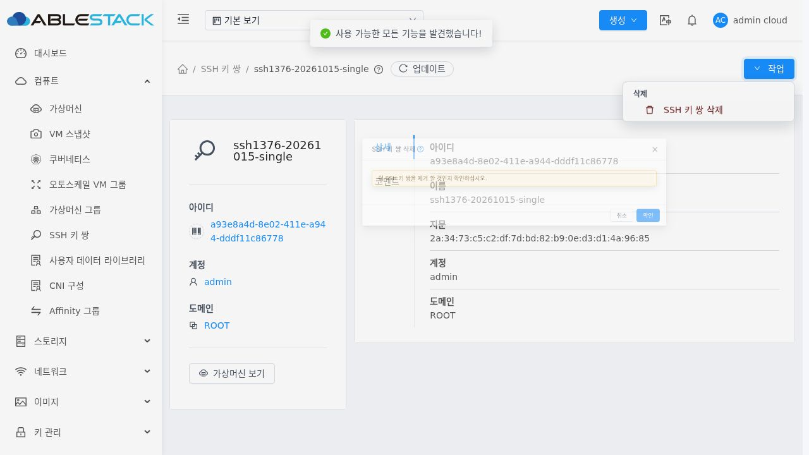

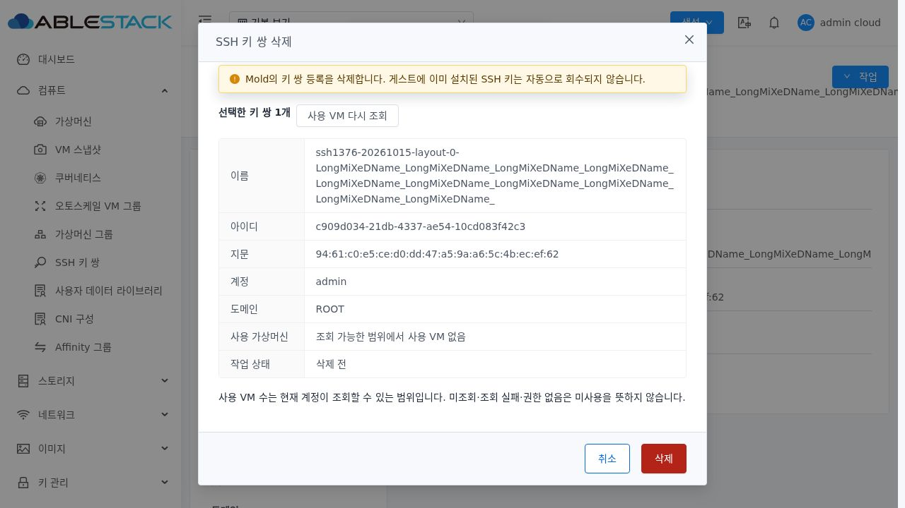

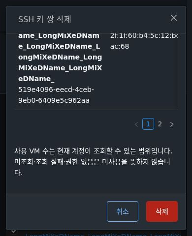

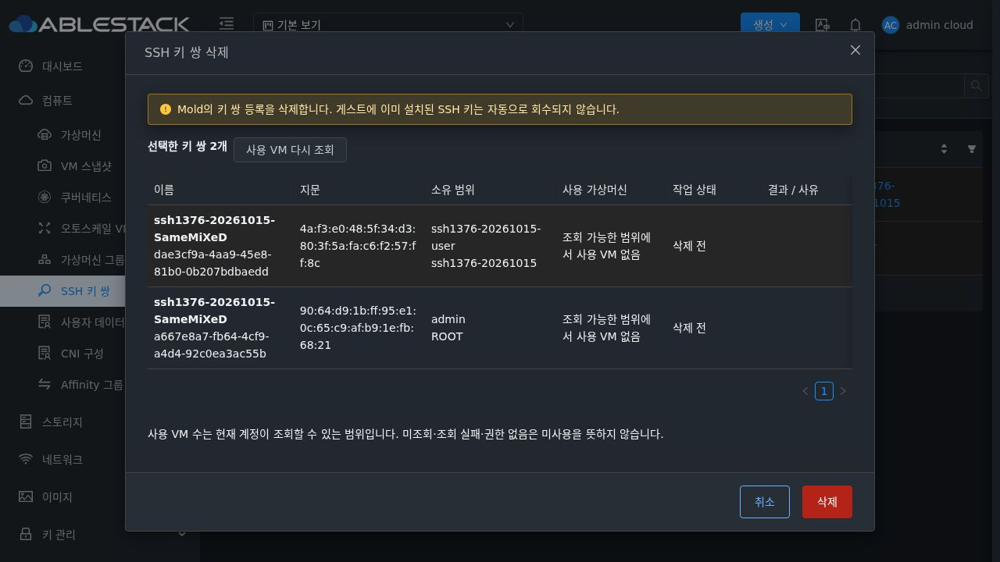

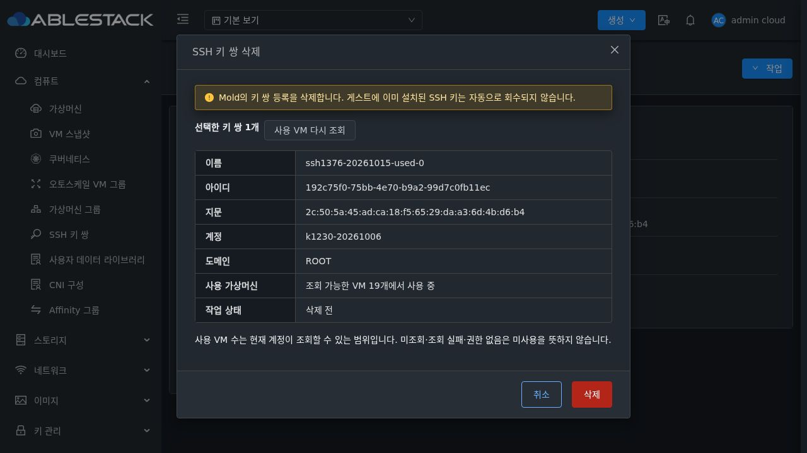

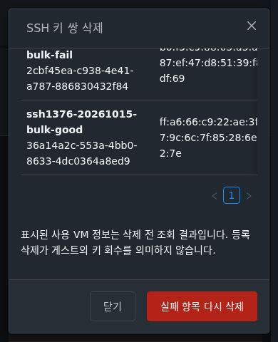

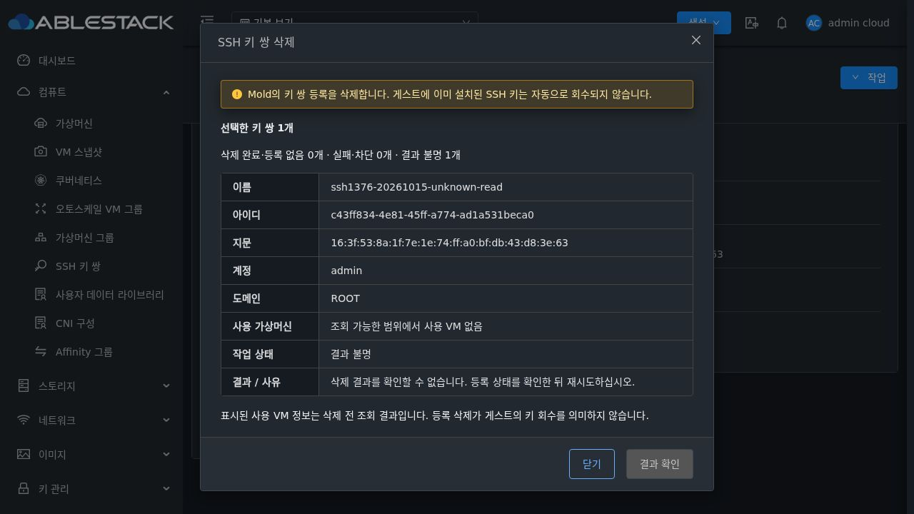

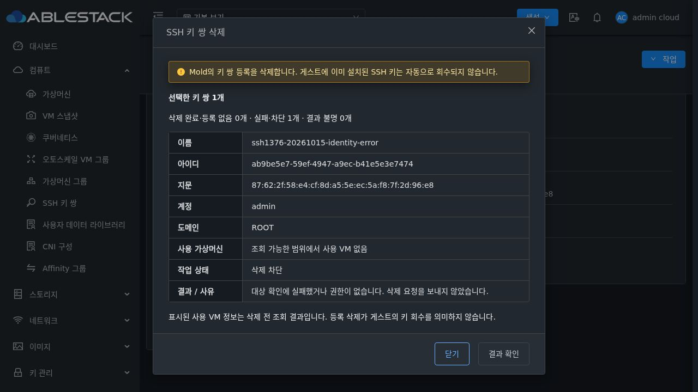

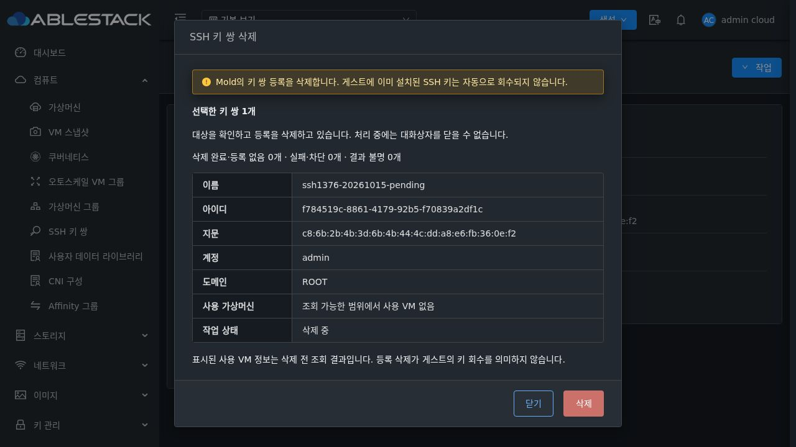

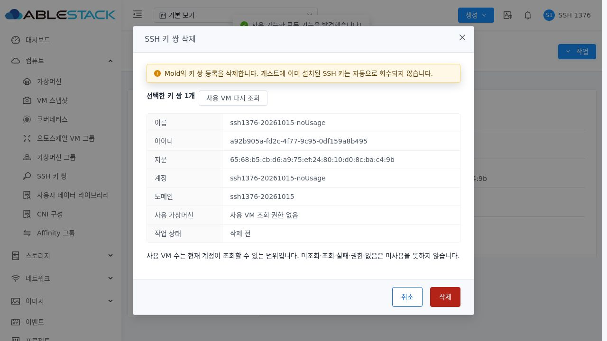

## 배포와 정리

WSL ext4 분리 작업 트리에서 UI만 빌드하고 정적 852개 파일을 assets 먼저/index 마지막으로 배포했다. SHA256 전수 일치, WEB-INF/config.json과 관리 JAR, Mold PID 941912 및 FTCTL markers 3개를 보존했다. META-INF는 기존에 없었다. 배포 전후 /client/ HTTP 200, Mold active와 정리 후 해시를 확인했다. 최종 백업은 `/root/ssh-keypair-1376-ui-20261015-114045/static-before.tgz`다. index/config/JAR/artifact의 정확한 해시는 첨부 로그에 기록했다.

최종 키 29개 및 사전 검증 키 31개를 UUID·이름·소유 범위로 확인해 정리했다. 역할 2개·계정 3개·도메인/프로젝트 각 1개·빈 VM 그룹 1개를 정리했고 활성 잔여는 0이다. 기존 전체 namespace 키 5개와 VM SSH 상세 350행 해시 및 기본 UI/API 키 3개를 보존했다. 사용 VM의 설정·볼륨·호스트 변경은 하지 않았다. 인증정보·세션·개인 키는 근거에 포함하지 않았다.

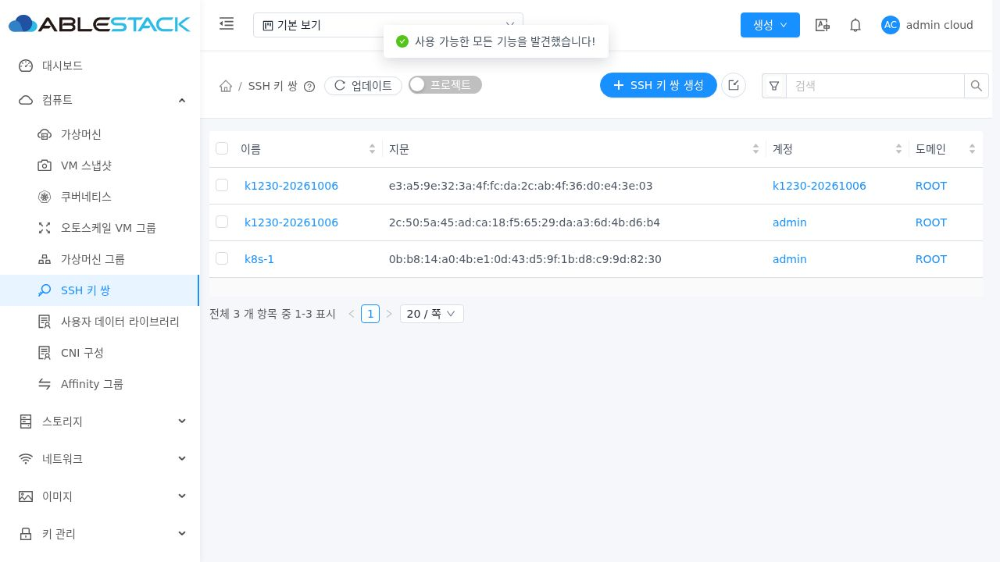

#1376 구현 범위 검증을 완료했다. Epic #1369는 7/8 완료 OPEN, #1377은 OPEN으로 유지한다. 전체 Cloud/Maven/RPM/Actions 빌드는 실행하지 않았고 PR #1378은 미병합이다.
