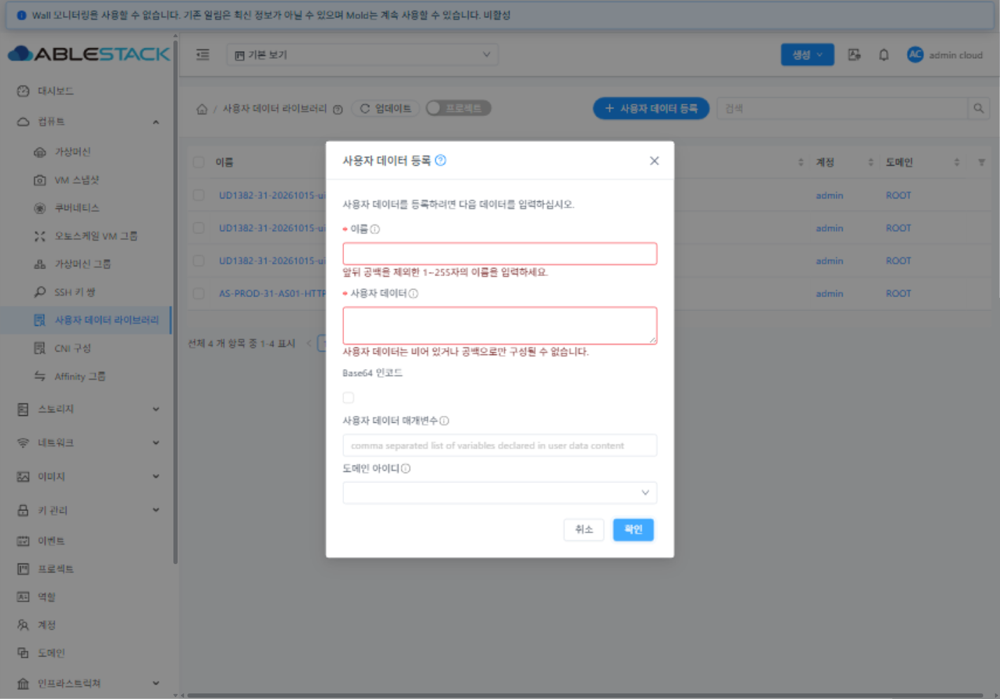
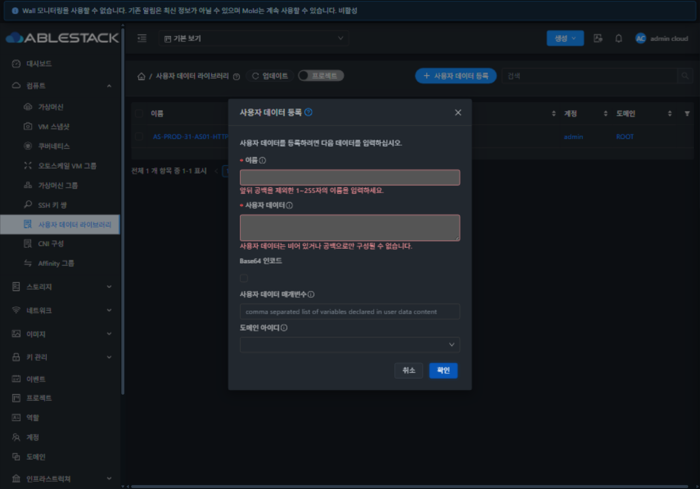
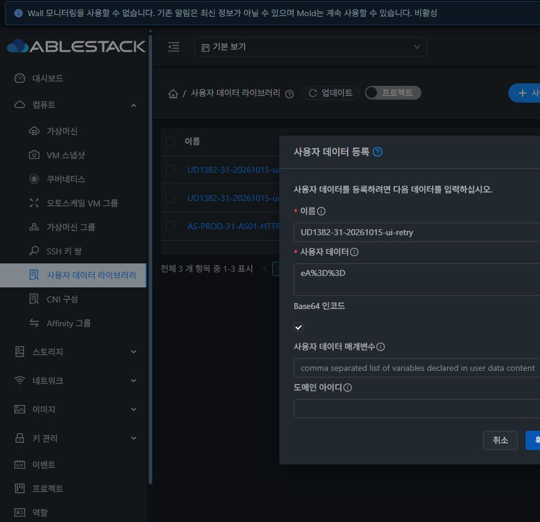
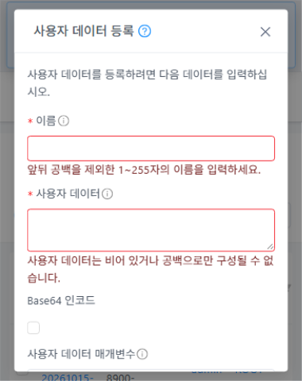

<!--
Licensed to the Apache Software Foundation (ASF) under one
or more contributor license agreements. See the NOTICE file
distributed with this work for additional information
regarding copyright ownership. The ASF licenses this file
to you under the Apache License, Version 2.0 (the
"License"); you may not use this file except in compliance
with the License. You may obtain a copy of the License at

  http://www.apache.org/licenses/LICENSE-2.0

Unless required by applicable law or agreed to in writing,
software distributed under the License is distributed on an
"AS IS" BASIS, WITHOUT WARRANTIES OR CONDITIONS OF ANY
KIND, either express or implied. See the License for the
specific language governing permissions and limitations
under the License.
-->

# UD-01 #1382 설계·구현·31번 배포 및 기능 검증

- 대상: [#1382](https://github.com/ablecloud-team/ablestack-cloud/issues/1382), 상위 [Epic #1381](https://github.com/ablecloud-team/ablestack-cloud/issues/1381).
- 누적 Draft PR: [#1393](https://github.com/ablecloud-team/ablestack-cloud/pull/1393), `dhslove/epic-1381-userdata-library` → `ablestack-europa`.
- 기준 upstream: `4bd1a2cff50c83089dc23ff1c83def631a343e3d`. UI 빌드 소스: `ecc7be4dd8ba370b698576d6a5cb3a9574ecafa7`, 최종 서버 보완 소스: `9ae42908711` (BOM 공백 정합성). 이후 문서·검증 스크립트 변경과 구분한다.
- [설계 및 계약](../../design/userdata-1382-design.ko.md).

## 변경 내용

이름의 Unicode 앞뒤 공백을 정리하고 빈 이름/본문, 잘못된 Base64/percent 표기, 잘못된 변수·중복 키·VR 예약어를 저장 전에 거절한다. 일반 텍스트는 UTF-8로 명시적으로 인코딩하며 Base64처럼 보이는 문자열을 자동 판별하지 않는다. Base64 바이너리는 UTF-8로 제한하지 않는다.

허용 표기를 디코딩 후 표준 Base64로 정규화해 최종 바이트 수와 중복을 검사한다. GET/POST 및 동적 구성 한도를 적용하고 UI에는 `listCapabilities.userdatamaxlength`로 현재 한도를 전달한다. DB 컬럼의 case-insensitive collation 후보를 정확한 Java 문자열로 다시 비교한다. 소유자별 DB 공유 잠금이 검사와 저장을 포함하므로 동시 등록도 같은 정책을 따른다. VM의 blank/null 해제 계약과 CNI 등록 전용 정책은 보존한다.

UI는 기존 Form·Tooltip·i18n·테마 스타일을 사용한다. 실패 후 필드/소유 범위를 유지하고 성공할 때만 갱신/닫기 이벤트를 발생시킨다. 검증 완료 전후 중복 제출을 막고 본문 console 출력을 제거했다.

## 빌드와 집중 테스트

| 범위 | 결과 |
| --- | --- |
| WSL ext4 변경 Maven 모듈 | API·엔진 스키마·사용자 데이터 엔진·서버 install 성공 |
| Java | RegisterUserDataCmdTest 3 + ManagementServerImplTest 44 + UserDataRegistrationTest 8 + UserDataManagerImplTest 8 + UserDataDaoImplTest 1 = **64건 통과** |
| UI 회귀 | **21건 통과**: UTF-8, Base64처럼 보이는 일반 텍스트, 바이너리, 표기 정규화, 잘못된 입력/변수, 크기/한글 경계, 실패 후 재시도, 중복 제출 |
| 변경 UI 파일 ESLint | 통과 |
| production UI 빌드·배포·실화면 | 성공. 정적 파일 **855개** 해시 일치, 일반/다크 및 역할별 UI 검증 통과 |

전체 Cloud 빌드 또는 GitHub Actions를 시작하지 않았다. 단위/집중 검사와 전체 CI를 구분한다. GitHub PR에 등록된 체크가 없는 상태를 전체 CI 통과로 표시하지 않는다.

## 31번 배포

서버는 `/usr/share/cloudstack-management/lib/cloudstack-4.23.0.0-ABLESTACK.Mold.jar`를 백업하고 검증한 모듈에서 가져온 **6개 클래스**만 교체했다. 그 외 모든 JAR 항목의 내용은 동일하다. 백업은 `/root/ud1382-20261015-185857`, 배포 후 JAR SHA256은 `707248c9688b08b35966f396d4503cd5937644cd0020d0480b2713edfee22c4b`다.

`WEB-INF` inode, `META-INF` 존재 상태 및 기존 `config.json` SHA256을 보존했다. `mold active`와 `/client/ HTTP 200`을 확인했다. [최초 서버 배포 증거](deployment-backend.json).

UI는 `/usr/share/cloudstack-management/webapp`의 정적 파일만 갱신했고 855개 파일의 SHA256을 대조했다. 환경 설정과 서버 디렉터리를 보존했고 UI 배포 전후 관리 PID `1103670`이 동일했다. UI 백업: `/root/ud1382-ui-20261015-190810`. [UI 배포 증거](deployment-ui.json).

마지막 BOM 공백 보완 후 등록 검증 클래스 1개만 추가 반영했다. 서버 모듈 install·등록 Java 8건과 API 75항목을 재확인했다. 최종 JAR SHA256은 `46814056203075c445b6122eeb968c7a11540a0b761eecfc345ac251fcd2dd7e`, 보완 직전 백업은 `/root/ud1382-20261015-192117`이다. 최종 관리 PID는 `1107180`이며 배포 이후 **6개 클래스와 정적 파일 855개** 전체 해시·서버 디렉터리·설정·서비스·HTTP를 다시 대조했다. [최종 서버 배포](deployment-backend-final.json), [최종 실행 상태](runtime-final.json).

## API 실환경 검증

[전체 API 75항목](api-results.json)이 통과했다. BOM 검증을 포함한 최종 행렬 72항목과 실제 GET 경계/정리 3항목을 함께 관리한다.

| 영역 | 확인 |
| --- | --- |
| 이름/본문 | ASCII/Unicode 공백 이름, 초과 길이, raw/인코딩 공백 본문·잘못된 형식이 431로 거절됨 |
| 정규화 | `eA==`/`eA`/percent/줄바꿈 표기가 같은 저장값으로 중복 차단됨. trim 이름의 재등록도 거절됨 |
| 정확한 바이트 | `EA==`/`eA==`는 다른 데이터로 저장하고 각각의 정확한 중복은 차단. URL-safe 바이너리, 비 UTF-8 0xa0, literal plus 및 한글/줄바꿈 원문 보존 |
| 변수 | trim 후 순서/대소문자 보존, 빈 항목·중복·형식·VR 메타데이터 예약어 거절 |
| 한도 | POST canonical 32768 바이트 통과, 32772 및 unpadded 우회 거절. 실제 GET 4096 바이트 통과/초과 거절. 한시적으로 64로 변경해 48 원문 바이트 통과/49 바이트 거절 후 원래 32768 복원 |
| 동시성 | 8개의 padded/unpadded 동시 요청 중 **1건 성공, 7건 431 중복 거절** |
| 소유 범위 | 일반 사용자·도메인 관리자·프로젝트에서 같은 이름/본문을 각자 등록 가능, 각 범위 내 중복·공백은 거절. 사용자/도메인 관리자의 ROOT 소유 데이터 조회가 차단됨 |
| 복원 | API 시험 자원 삭제 후 기존 라이브러리 **1건이 원래 응답과 정확히 동일**, 구성값 원복 |

## 실제 UI 검증

배포된 번들을 새로 로드해 실제 UI 동작과 API 저장 결과를 대조했다. [UI 상태 결과](ui-results.json), [UI 생성 개체의 API 바이트·소유 범위 결과](ui-api-results.json).

- 공백 이름/본문, 잘못된 percent/Base64, 한글 8193자(24579 원문 바이트 → 32772 Base64 바이트), 잘못된 변수 형식이 필드 오류로 표시되고 등록 요청을 보내지 않았다.
- 일반 모드에 `eA==`를 입력해 실제로 네 글자 그대로 저장됨을 확인했다. Base64 모드의 unpadded `eA`는 `eA==`로 저장된다.
- percent 표기로 같은 본문을 제출하면 431 중복 오류가 표시되고 이름·본문·Base64 선택 상태가 유지된다. 한글 본문으로 수정해 같은 폼에서 재시도하면 성공하고 목록이 갱신된다.
- 관리자·일반 사용자·도메인 관리자·프로젝트에서 실제 등록했다. 일반 사용자에게 소유자 변경 필드가 없고 도메인 관리자에게 도메인 선택이 노출되는 것을 확인했으며, 생성된 6개 라이브러리의 바이트·실제 소유자를 API로 대조했다.
- 일반/다크 × 1440×1000·1280×720·390×844·390×480에서 오류 상태와 computed style을 수집했다. 임시 viewport/cache 설정을 해제하고 원래 다크 모드로 복원했다.
- 예상한 431 외에 TypeError/ReferenceError/Unhandled/SyntaxError는 0건이었다. 브라우저 네트워크 버퍼는 일부가 순환 삭제되어 `networkPartial=true`로 기록했다. 전체 UI 저장 결과는 독립적인 API 재조회와 DOM/화면 증거로 검증했다.
- 최종 서버 재기동 후 실제 UI 재로그인과 BOM만 있는 이름/본문의 필드 거절도 재확인했다. 최종 검증 폼을 닫고 기존 라이브러리만 남은 상태로 종료했다.

기존 모달의 작은 높이에서 Footer가 본문 스크롤 아래에 놓이는 현상은 남아 있으며 #1383의 공통 모달 적용 범위다. 이번 필드 검증 통과를 MOLD-DIALOG-1.0 전체 적합성이나 정량 대비·200% 확대 검증 완료로 계산하지 않는다. 이 최종 검토는 #1392에서 수행한다.

## 정리 및 남은 Epic 범위

UI 생성 라이브러리 6개와 전용 계정 2개·프로젝트·도메인을 정리했다. 기존 라이브러리 1건의 전체 API 응답은 기준선과 정확히 일치하고 구성값은 32768로 복원됐다. DB에서도 활성 시험 라이브러리·계정·프로젝트·도메인이 모두 0건이다. [API 정리 결과](cleanup-summary.json), [DB 정리 결과](cleanup-db.tsv).

모달 쉘의 고정 Header/Footer와 전체 화면·탭 표준화는 #1383/#1389, 최종 표준 적합성 검토는 #1392에서 수행한다. 본 이슈의 입력 검증/오류 상태 개선이 Epic 전체 UI 표준 준수 완료를 의미하지 않는다. 이번 작업은 #1382의 구현·배포·검증이며, Epic과 나머지 하위 이슈는 계속 OPEN으로 유지한다.
