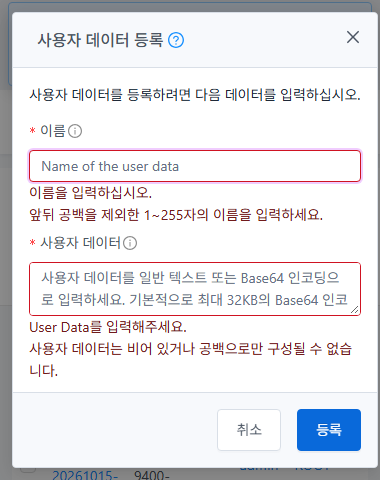
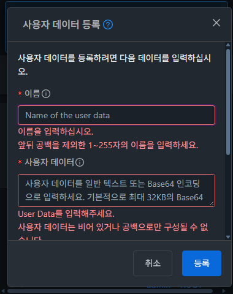
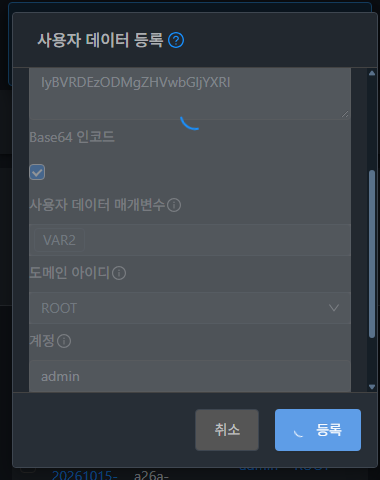
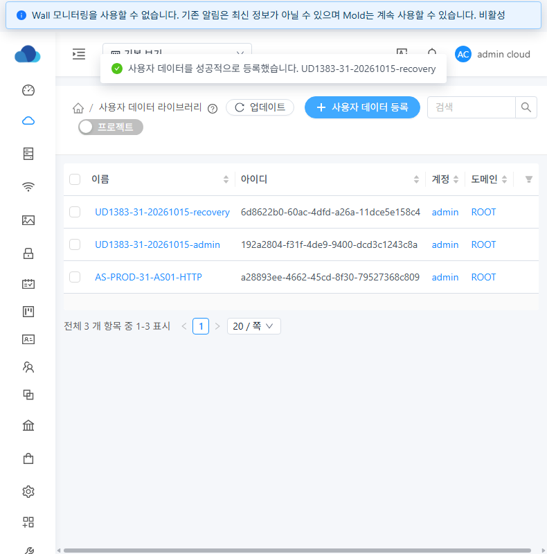

<!-- Licensed to the Apache Software Foundation (ASF) under one or more
contributor license agreements. See the NOTICE file distributed with this work
for additional information regarding copyright ownership. The ASF licenses this
file to you under the Apache License, Version 2.0 (the "License"); you may not use
this file except in compliance with the License. You may obtain a copy at
http://www.apache.org/licenses/LICENSE-2.0 . Unless required by applicable law or
agreed to in writing, software distributed under the License is distributed on
an "AS IS" BASIS, WITHOUT WARRANTIES OR CONDITIONS OF ANY KIND, either express
or implied. See the License for the specific language governing permissions
and limitations under the License. -->

# UD-02 #1383 등록 대화상자 구현·31번 배포·기능 검증

- 대상: [#1383](https://github.com/ablecloud-team/ablestack-cloud/issues/1383), [Epic #1381](https://github.com/ablecloud-team/ablestack-cloud/issues/1381).
- 누적 Epic Draft PR: [#1393](https://github.com/ablecloud-team/ablestack-cloud/pull/1393). 병합하지 않는다.
- 기준 upstream Europa: `4bd1a2cff50c83089dc23ff1c83def631a343e3d`.
- 최종 UI 빌드·배포 소스: `0542a6dee55ffc0df5cdf51517377c380162b3b4`. 이후 증거·문서·검증 스크립트 커밋과 구분한다.
- [설계와 동작 계약](../../design/userdata-1383-design.ko.md).

## 해결한 동작

사용자 데이터 등록을 공통 `MoldDialog size="md"`와 `selfManagedDialog` 경로로 전환했다.
VM/SSH 등록과 같은 제목·도움말·Header/Footer 패턴, 공통 반응형 크기와 테마 토큰을 사용한다.
기존 설명 → 이름 → 본문 → Base64 → 변수 → 도메인 → 계정 순서를 보존했다.
본문 내부 취소/확인 버튼과 사용하지 않는 결과·복사·다운로드 상태를 제거했다.

Footer의 취소 → 등록은 본문 스크롤과 독립적이다. 버튼·이름/계정 Enter·Ctrl+Enter는
같은 제출 함수와 잠금을 사용한다. textarea Enter는 줄바꿈, 태그 Enter는 변수 확정을 유지한다.
기본 Form 검증 실패에도 첫 오류 필드를 스크롤하고 포커스를 이동한다.

#1382의 입력 정규화·서버 검증을 유지하며 실패는 Body의 문자열 Alert로 표시한다.
오류·진행 영역을 폼 뒤에 배치하고 스크롤 앵커링을 억제하여 기존 필드를 밀지 않는다.
서버/통신 오류 후 소유 범위·값·변수·포커스·스크롤을 유지하며 다시 수정·제출할 수 있다.
성공할 때만 목록을 갱신한 뒤 닫는다. 취소/성공 후 재열기는 빈 값·Base64 해제·기본 소유 범위다.

검증/요청 중 필드와 취소를 잠그고 X/Escape를 차단한다. AutogenView는 자식의
`blocksNavigation`을 먼저 검사하여 route 변경이 요청 취소 토큰을 해제하지 않도록 했다.
브라우저 새로고침에는 beforeunload 경고를 요청한다. 해제된 폼의 늦은 응답은 UI를 변경하지 않는다.
공유 CNI 폼도 같은 쉘을 사용하며 전용 API와 기존 인코딩 계약을 유지한다.

## 빌드와 검증 결과

| 검증 범위 | 결과 |
| --- | --- |
| WSL rocky ext4 UI 테스트 | 등록 폼·기존 SSH 등록 **2개 suite / 56건 통과** |
| 변경 파일 ESLint / production UI 빌드 | 통과. Node 14.21.3 / npm 6.14.18 |
| 최종 실환경 UI 시나리오 | **42항목 통과** |
| 일반/다크 화면 크기 | 각각 1440×1000, 1280×720, 390×844, 390×480 |
| 활성 색상 정량 검사 | computed style **408개 샘플 통과**. 텍스트 최소 4.975:1, 도움말 아이콘/입력 경계 최소 3.076:1 |
| UI 생성 결과 | 초기 배포 1개·최종 배포 6개, 사용자 데이터 6개 + CNI 1개 총 **7개**의 원문·변수·소유 범위를 API로 정확히 대조 |
| 전용 자원 정리 | API/DB 활성 잔여 **0건**. 기존 사용자 데이터 1개와 CNI 3개 전체 API 응답 동일 |

[빌드 결과](build-results.json), [최종 UI 결과](ui-results.json), [원시 시도 기록](ui-attempts.json),
[요청 수·상태](network-results.json), [API 저장값/소유 범위](ui-api-results.json),
[색상 측정](contrast-results.json), [브라우저 오류 분류](browser-errors.json).

## 실제 UI 확인

- 필수값·잘못된 Base64·24577자 ASCII 및 8193자 한글 용량 초과는 필드 오류로 표시되고 등록 요청은 0건이었다.
- 실제 서버의 중복명 431, 삭제된 소유 계정 431 후 폼을 유지했다. 일반/다크의 안정된 기준선에서 소유자 입력 포커스와 Body 스크롤 **174 → 174px**를 대조했다.
- HTTP 503·ConnectionReset·지연 응답은 해당 브라우저의 등록 요청에만 제어 주입했다. 실제 서버 431 검증과 구분한다. 두 테마에서 값 보존과 재시도를 확인했다.
- 지연 중 취소/X/Escape·페이지 이탈·중복 제출을 차단했다. 지연 해제 후 성공 요청은 1건이고 생성·목록 갱신·닫기를 확인했다.
- 실제 브라우저에서 `beforeunload` 발생과 새로고침 취소(`javascriptDialogClosed.result=false`)를 확인했다. 인앱 브라우저가 경고를 취소 처리했고 요청/폼은 유지됐다. [이벤트 증거](beforeunload.json).
- 초기 이름 포커스, 첫 오류 포커스, 취소 후 트리거 복귀, Tab/Shift+Tab 순환과 `role=dialog`·`aria-modal=true`·제목 연결을 확인했다.
- 일반 사용자에게 소유자 변경 필드가 없고 도메인 관리자에게 도메인 선택이 표시된다. 프로젝트 등록 요청에는 선택한 프로젝트 ID가 포함되고 실제 저장 범위도 일치했다.
- 전용 조회 역할에서 목록 조회는 허용하고 등록 버튼/API는 차단했다. API 오류 코드는 432다. [권한 결과](permission-api.json).
- CNI 공유 폼에서 전용 제목·입력·API·인코딩으로 실제 등록했다. CNI 전체 기능 감사는 이 스모크 범위에 포함하지 않는다.
- 정상/선택/필드 오류/서버 오류/비활성/로딩/팝업/도움말을 이미지와 computed style로 기록했다. 비활성/로딩은 별도 가독성 기록이며 활성 텍스트 대비 통과 수에 섞지 않았다.
- 예상한 API/권한 오류와 별개로 TypeError/ReferenceError/SyntaxError/Unhandled 런타임 오류는 0건이었다.

42항목은 같은 시나리오의 마지막 확인 결과다. 초기 스크롤 비교에는 제출 전 22px 필드 설명 접힘과
locator의 포커스 이동이 섞여 재측정했고, 재열기 선택자는 빈 도메인 선택 span과 변수 태그를 구분하도록
수정했다. 원시 실패 시도도 보존했다. 최종 스크롤 비교는 안정된 폼에서 대상 재포커스 없이 실제 키를 보냈다.
초기 배포의 배치 관찰은 [별도 기록](initial-scroll-defect.json)에 한계와 함께 남겼다.

## 배포와 보존

`/usr/share/cloudstack-management/webapp`에 정적 파일만 반영했다. **855개 SHA256**이 일치한다.
최초 백업은 `/root/ud1383-ui-20261015-200917`, 최종 스크롤 보완 전 백업은
`/root/ud1383-ui-20261015-202113`이다. 서버 JAR과 #1382의 6개 변경 클래스는 그대로 보존했다.

- JAR SHA256: `46814056203075c445b6122eeb968c7a11540a0b761eecfc345ac251fcd2dd7e`.
- 기존 `config.json` SHA256: `b7de5f6a1f7a3a17310ee7d34ca801bb316fc6f841039f865fbabf154cd59a13`.
- WEB-INF inode `67111992`, META-INF 존재 상태, 관리 PID `1107180` 보존.
- `mold active`, `/client/ HTTP 200`. 필요한 기존 FTCTL 표식을 포함한 번들의 전체 파일 해시를 검증했다.

[배포 결과](deployment-ui.json), [전체 시험 후 최종 런타임 대조](runtime-final.json),
[API 정리](cleanup-summary.json), [DB 정리](cleanup-db.tsv).
새로고침 경고 시험도 서버 전송 전 요청을 실패 처리하고 기존 데이터 전체 동일성을 재확인했다.
임시 viewport·요청 가로채기·캐시 설정을 해제하고 원래 다크모드로 복원했다.

## Epic 진행과 검증 경계

UD-01 #1382와 UD-02 #1383까지 구현·배포·범위 내 검증을 완료했다. Epic 진행은 **2/11**이며
#1384~#1392와 Epic #1381은 OPEN으로 유지한다. 실제 VM/SSH 공통 Header의 기존 타이포·여백을 상속했다.
목록·상세·전체 탭, 표준 문서와 공통 구현의 차이, 200% 확대 등 전체 메뉴의 최종 표준 감사는 #1392의 범위다.

이번 작업은 UI 변경이다. Maven·전체 Cloud 빌드·수동 GitHub Actions·qemu 배포·PR 병합을 실행하지 않았다.
집중 테스트와 실환경 검증을 전체 CI 통과로 표시하지 않는다.
