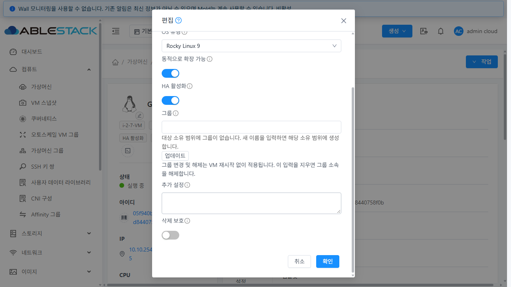
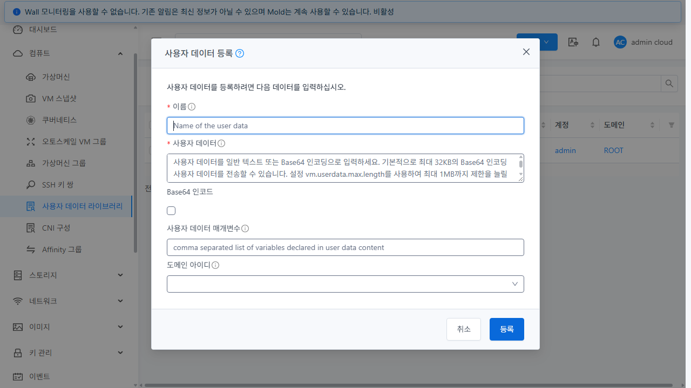
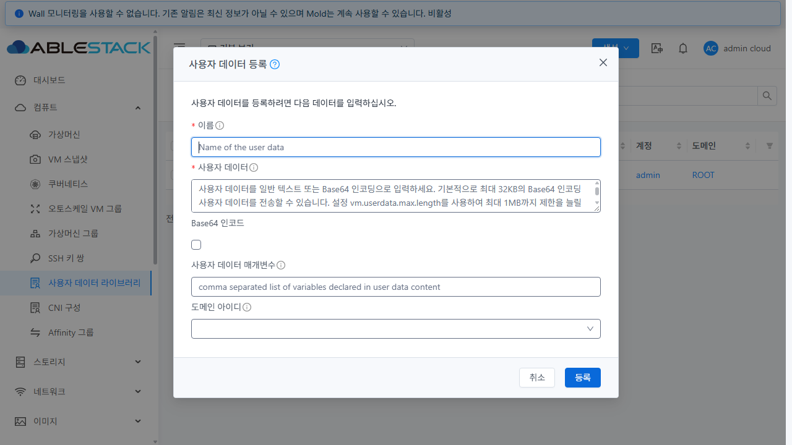
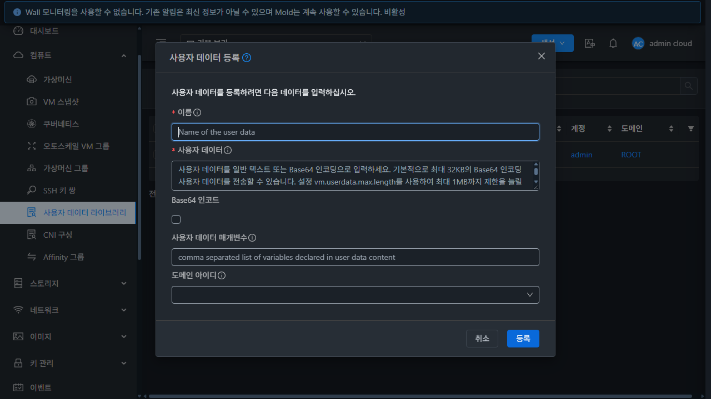
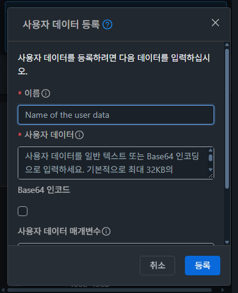

<!-- Licensed to the Apache Software Foundation (ASF) under one or more
contributor license agreements. See the NOTICE file distributed with this work
for additional information regarding copyright ownership. The ASF licenses this
file to you under the Apache License, Version 2.0 (the "License"); you may not use
this file except in compliance with the License. You may obtain a copy at
http://www.apache.org/licenses/LICENSE-2.0 . Unless required by applicable law or
agreed to in writing, software distributed under the License is distributed on
an "AS IS" BASIS, WITHOUT WARRANTIES OR CONDITIONS OF ANY KIND, either express
or implied. See the License for the specific language governing permissions
and limitations under the License. -->

# #1383 후속 보완: 등록 버튼의 VM 기본 크기 준수

2026-10-16, 31번 Mold. 사용자 요청에 따라 실제 VM 편집 대화상자와 사용자 데이터
등록 대화상자의 버튼을 비교하고, 크기 차이를 수정·배포·재검증했다.
UI 소스는 `1833582127c9af33dd258b259f1b4220f4c1267b`이며 Epic Draft PR #1393에 누적한다.

## 비교와 변경

VM `GFS-TEST-VM`의 작업 → 편집을 열어 측정하고 취소했다. VM 설정은 제출하지 않았다.
일반·다크 모드 모두 VM 취소/확인 버튼은 기본 `a-button` 크기를 사용했다.
등록 창은 `.mold-dialog-standard .ant-modal-footer > .ant-btn`의 높이·여백 재정의 때문에 컸다.

| 항목 | 실제 VM 기준 | 등록 창 변경 전 | 등록 창 변경 후 |
| --- | --- | --- | --- |
| 높이 | 32px | 42px | 32px |
| padding | 4px 15px | 0 18px | 4px 15px |
| 두 글자 버튼 폭 | 57.766px | 63.766px | 57.766px |
| 글자 / 줄 높이 | 14px / 22.001px | 동일 | 동일 |
| 모서리 반경 | 4px | 4px | 4px |

공통 preset에서 `height: 42px; padding: 0 18px`만 제거해 VM과 같은 기본 스타일을
상속한다. 등록 화면 전용 크기나 색상을 추가하지 않는다. Footer의 기존 정렬과 간격,
일반·다크 토큰, 폼과 제출 경로는 유지한다. 이 preset을 사용하는 CNI와 SSH 등록에도
같이 적용된다. 사용자 요청에 따른 현재 크기 계약은 이전 42px preset 설명보다 우선하며,
사용자 데이터와 SSH 설계 문서에도 이를 기록했다.

## 배포 후 검증

- VM 일반/다크 기준과 사용자 데이터 일반/다크 × 1280×720·390×480을 대조했다.
  CNI와 SSH 공개 키 등록은 일반/다크 1280×720에서 확인했다.
- 오류 상태를 포함한 [9개 화면의 18개 버튼](comparison.json)이 VM과 높이·폭·padding·
  글자·줄 높이·반경 모두 일치했다. 하단 영역은 75px에서 65px로 줄었다.
  390×480에서도 버튼은 화면 안에 있고 Body만 스크롤한다.
- 일반/다크에서 빈 등록을 실행해 필수값 오류, 첫 이름 필드 포커스, 버튼 잠금 해제,
  취소로 닫기와 빈 폼 재열기를 확인했다([동작 기록](behavior.json)).
- 공통 MoldDialog, RegisterUserData, CreateSSHKeyPair, DeleteSSHKeyPair 기존 단위 테스트
  **4 suites / 76개 통과**. WSL ext4 production UI 빌드 통과.
  빌드에는 asset/entrypoint 권장 크기 초과 경고 2개가 있다([검사 기록](checks.txt)).
- 테스트는 창 열기·취소와 빈 폼 검증으로 수행했으며 리소스 생성·삭제나 VM 설정 제출은 없다.
  임시 viewport와 캐시 비활성화를 해제하고 원래 다크모드로 복원했다.

이 보완의 실측 범위는 버튼 크기와 관련 대화상자 동작이다. 기존 #1383의 전체 API·권한·
등록 행렬을 재실행한 것으로 계산하지 않는다. SSH 삭제/개인 키 결과 화면의 실환경 전체
행렬도 재실행하지 않았다. 전체 Cloud 빌드·수동 Actions·PR 병합은 수행하지 않았다.
전체 메뉴 UI 표준 최종 통합 검토는 #1392에 유지한다.

## 배포 보존 확인

기존 UI-only 패키징/배포/런타임 검증 도구를 재사용했다. 소스와 일치하는 정적 파일
**855개 SHA256**, 서버 JAR와 UD-01 클래스 6개 해시를 검증했다.
`WEB-INF` inode·`config.json` 해시·관리 PID `1107180`이 보존됐고,
`mold active`, `/client/ HTTP 200`을 확인했다.

- 백업: `/root/ud1383-ui-20261016-011032`
- 스테이징: `/var/tmp/ud1383-buttons-1833582`
- [배포 결과](deployment.json) / [최종 런타임 검증](runtime-final.json)

## 비교 화면

VM 기준(하단으로 스크롤한 일반 모드):

사용자 데이터 변경 전:

사용자 데이터 변경 후 일반 / 다크:

작은 화면:

