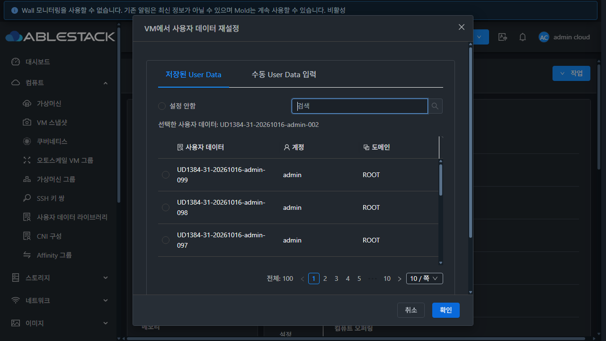
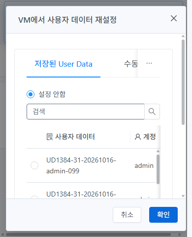
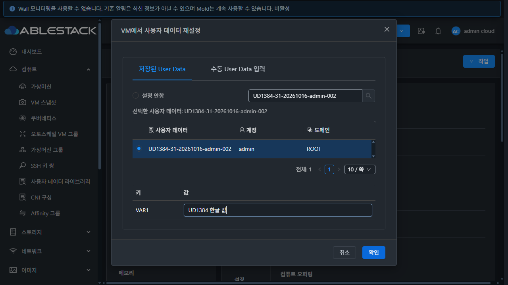

<!-- Licensed to the Apache Software Foundation (ASF) under one or more
contributor license agreements. See the NOTICE file distributed with this work
for additional information regarding copyright ownership. The ASF licenses this
file to you under the Apache License, Version 2.0 (the "License"); you may not use
this file except in compliance with the License. You may obtain a copy at
http://www.apache.org/licenses/LICENSE-2.0 . Unless required by applicable law or
agreed to in writing, software distributed under the License is distributed on
an "AS IS" BASIS, WITHOUT WARRANTIES OR CONDITIONS OF ANY KIND, either express
or implied. See the License for the specific language governing permissions
and limitations under the License. -->

# UD-03 #1384 구현·31번 배포·기능 검증

Epic #1381 / 누적 Draft PR #1393의 검색·서버 페이지·안전한 선택 계약을 구현했다.
첫 10건만 로컬 페이지로 나누던 선택기를 서버 count/page/pagesize/keyword에 연결하고,
없는 `handleSearchFilter` 호출과 초기 undefined userdata ID 접근을 제거했다.
2026-10-16(KST) 검증이며 [설계](../../design/userdata-1384-design.ko.md)에 계약과 후속 범위를 명시했다.

## 구현 결과

- 공통 `UserDataSelection`이 조회와 로딩·실패·재시도·세대별 응답 순서를 관리한다.
  계정+도메인 또는 프로젝트를 명시하고 서버 총 건수를 그대로 표시한다.
- 설정 안함은 고정 sentinel `0`이며 건수·서버 행·UUID 조회에 섞지 않는다.
  검색·페이지 변경은 선택 이름과 한글 변수값을 보존한다. 소유 범위/zone/권한 변경은
  검색·선택·변수값을 초기화한다. 삭제된 선택은 오류와 적용 차단으로 구분한다.
- VM 생성·VM 재설정·AutoScale 생성/프로필·VNF 생성이 같은 선택기와 제출 차단을 사용한다.
  부모의 중복 목록 조회와 늦은 상세 응답 경로를 제거했다. AutoScale 기존 preflight는 유지한다.
- VM/AutoScale 재설정은 공통 `MoldDialog`로 통합했다. 실제 VM 기본 버튼 높이 32px,
  padding 4px 15px를 상속한다. 기존 AntD·i18n·공통 테마 스타일을 재사용한다.
- 일반 사용자도 허용하는 executable/sharedexecutable 템플릿 조회를 재사용하고,
  정책 조회 실패 시 적용을 막고 재시도를 제공한다.
- 실환경에서 AntD 2 Alert의 미지원 action slot 때문에 재시도가 안 보이는 문제를 발견해
  description slot으로 수정했다. 실제 Alert/Button을 mount하는 회귀 검사도 추가했다.

## 소스·빌드·배포 구분

| 항목 | 결과 |
| --- | --- |
| 기준 upstream Europa | `4bd1a2cff50c83089dc23ff1c83def631a343e3d` |
| 초기 실환경 검증 UI | `8551fe8cf1c` — 조회/소유 범위/생성·재설정 확인, Alert slot 결함 발견 |
| 최종 배포 UI | `762c9de0fb07ab33bc857bdbb827769d75e2002d` — slot 수정 및 실제 컴포넌트 회귀 검사 |
| 단위 검사 | 4 suites / 128 tests PASS: 선택기, AutoScale 생성 preflight·편집, 등록 |
| 변경 파일 ESLint | PASS |
| WSL ext4 production UI build | PASS. asset/entrypoint 권장 크기 경고 2개, Browserslist 갱신 안내 |
| 최종 활성 정적 파일 | 855개 SHA256 일치 |
| 서버 보존 | JAR 및 6개 클래스·WEB-INF inode·config.json·관리 PID 일치 |
| 운영 확인 | `mold active`, `/client/` HTTP 200, PID 1107180 유지 |
| 최종 UI 백업 | `/root/ud1384-ui-20261016-020238` |

정적 자산만 반영했으며 [배포 기록](deployment-final.json)과 [최종 런타임](runtime-final.json)을 남겼다.
전체 Cloud 빌드·수동 GitHub Actions·qemu 빌드/배포·PR 병합은 실행하지 않았다.
이 결과는 집중 검사와 실환경 기능 검증이며 전체 CI 통과를 뜻하지 않는다.

## API ↔ 실제 UI 검증

전용 prefix `UD1384-31-20261016`으로 데이터 151개, 계정 4개·도메인 1개·프로젝트 1개·역할 1개,
정지 VM 2개를 사용했다. 테스트 전부터 있던 운영 라이브러리는 수정하지 않았다.

| 경우 | 실제 결과와 근거 |
| --- | --- |
| 관리자 100건 | 최종 UI에서 10개 서버 페이지의 고유 ID 100개가 API와 정확히 일치. [최종 전체 페이지](final-all-pages.json), [API](api-pages.json) |
| 페이지 크기 | 10→100→10 실제 UI 변경, API와 count/행 일치. [100건 화면](reset-pagesize-100.json) |
| 일반 사용자 11건 | 2페이지의 마지막 1건까지 접근. 마지막 항목 삭제 후 빈 다음 페이지가 1페이지·10건으로 복구. [경계 복구](role-user-empty-page-recovers.json) |
| 도메인 관리자 30건 | 3페이지·keyword 검색 정상. [페이지 3](role-domainadmin-page-3.json) |
| 빈 계정 0건 | 오류 없는 빈 목록, 고정 설정 안함 선택. [빈 목록](role-empty-0.json) |
| 프로젝트 11건 | 계정→프로젝트 변경으로 선택/변수 초기화, 전용 프로젝트의 2페이지 1건 표시. [소유자 초기화](owner-project-clears-selection.json), [프로젝트](project-page-2.json) |
| 목록 권한 없음 | API 432, UI 권한 오류와 생성 차단. [권한](role-denied-list.json) |
| 검색·늦은 응답 | keyword가 API와 일치. 이전 099 응답이 새 002 응답 뒤에 도착해도 새 결과 유지. [응답 순서](late-response-order.json) |
| 선택 보존 | 페이지 밖 선택 이름·한글 변수값 보존. 검색 Enter가 부모 제출을 실행하지 않음. [변수 보존](search-variable-preservation.json) |
| 오류·재시도 | 로딩·503 동안 기존 행/선택 보존과 적용 차단. 최종본에서 보이는 재시도 버튼을 실제 클릭해 복구. [오류](final-error-retry-visible.json), [복구](final-retry-recovers.json) |
| 삭제된 선택 | 선택한 admin-099 삭제 후 별도 오류·확인 비활성. 명시적 설정 안함으로 복구·변수 초기화, ID=0 조회 0건. [삭제](final-selected-target-deleted.json), [sentinel](none-api-proof.json) |
| 템플릿 정책 조회 실패 | 최종본에서 503 주입 시 적용 차단, 재시도 클릭으로 복구. [복구](final-template-retry-recovers.json) |
| AutoScale 재사용 | 실제 생성 wizard에서 page2·검색·003 선택·변수 보존·설정 안함 초기화 확인. [선택](autoscale-selected.json), [초기화](autoscale-none-clears.json) |

역할·소유자·AutoScale·지연 응답 시험과 최초 생성은 초기 UI 8551fe8에서 수행했다.
최종 762c9de에서는 전체 100건 페이지, 재시도, 삭제된 선택, 정책 오류, 8개 테마/viewport와
실제 VM 재설정을 재검증했다. 두 UI 간 동작 코드 차이는 Alert slot 수정이며 최종 테스트는
실제 AntD 렌더링까지 확인한다.

## 실제 생성·연결 결과

1. 실제 UI에서 `UD1384-31-20261016-vm`을 생성했다. Ubuntu 26 템플릿,
   2Core 2GB, 기존 UserData/ConfigDrive 지원 L2 네트워크에 `startvm=false`,
   admin-001과 `VAR1=UD1384 한글 값`을 보냈다. 비동기 작업은 jobstatus=1로 완료했다.
2. 별도 정지 VM `UD1384-31-20261016-reset`은 실제 UI 재설정으로 admin-001→002를 적용했다.
   최종 UI에서도 admin-002와 한글 변수값 재설정을 실행해 성공 알림·동기 API 응답·저장값을 확인했다.
3. [생성 요청](deploy-request.json), [생성 완료](deploy-job-result.json),
   [생성 VM](vm-connected-001.json), [재설정 VM](reset-connected-002.json),
   [DB 원문/라이브러리 해시](vm-db.tsv)가 ID·변수·정지 상태와 일치한다.
   API의 `userdatadetails`는 실제로 `{VAR1=UD1384 한글 값}` 문자열로 반환됐다.

정지 VM의 Cloud 저장·연결 정합성까지 확인했다. VM을 시작하거나 게스트 cloud-init 실행,
VR 전달 또는 ConfigDrive 매체의 실제 게스트 소비까지 검증한 결과로 계산하지 않는다.

## UI 표준·테마·런타임 범위

최종본의 일반/다크 × 1440×1000·1280×720·390×844·390×480 8개 화면과 computed style을 기록했다.
모든 Footer가 viewport 안에 있고 취소/확인 높이 32px·padding 4px 15px로 같다.
Header/Footer와 스크롤 가능한 Body를 공통 모달로 유지한다. 표 내부에는 기존 Table 스크롤도 있다.
오류·로딩·선택·비활성 상태는 별도 화면 증거로 보존했다. 이번에 전체 메뉴·대비 행렬·200% 확대
검사를 끝낸 것으로 표시하지 않는다. 전체 최종 적합성은 #1392에 남는다.

최종 실제 재설정의 새 커서 구간은 JavaScript 예외 0건이고 기록 누락이 없다
([runtime-reset-final.json](runtime-reset-final.json)). 긴 전체 최종 세션 수집은 버퍼가 잘려
`runtime-errors-final.json`에 truncated=true로 남겼으며, 이를 전체 예외 0건의 근거로 사용하지 않았다.
역할 전환과 VM wizard의 공통 메타데이터 경로에서는 listConfigurations 431·listResourceIcon 401·
로그아웃/이동 취소 5건의 처리되지 않은 Promise 예외가 관찰됐다
([분류](runtime-exception-classification.json), [명령](runtime-exception-commands.json)).
이는 선택기 검색 handler 결함과 구분하고 #1392 최종 연계 회귀의 미해결 점검 항목으로 전달한다.

## 정리와 남은 과제

테스트 자원을 API로 삭제하고 DB를 읽어 확인했다. 사용자 데이터·VM·볼륨·계정·프로젝트·도메인·역할의
활성 잔여는 모두 0건이다. 기존 라이브러리 1개의 전체 API 응답은 시작 시점과 정확히 일치한다.
151개 중 2개는 경계/삭제 시험에서 먼저 삭제했고 나머지는 최종 정리했다.
VM과 볼륨은 removed 표시된 Expunging/Destroy 이력으로 남으며 물리 이력 삭제를 주장하지 않는다.
정리 도구의 최초 잔여 집계는 최대 pagesize 초과로 실패했고, 500건 페이지 순회와 삭제된 프로젝트
재진입 처리를 보완한 후 재실행했다. [API 정리](cleanup-summary.json), [DB 정리](cleanup-db.tsv).
임시 viewport·요청 가로채기·캐시 설정을 해제하고 관리자/기존 다크 모드로 복원했다.

- 다음 **#1385**: 활성 모드의 userdata/userdataid 배타 전송, 현재 라이브러리/수동 본문/변수 복원,
  설정 안함의 유지·해제 의미, 템플릿 ALLOW/APPEND/DENY와 빠른 전환. 이번 sentinel 기반 위에 완성한다.
- 이어 **#1386**: 공급자 실패 시 VM 저장 정합성, VR/ConfigDrive 지원 조건 및 실제 전달·게스트 실행.
- 이후 #1387 일괄 삭제, #1388 사용 가상머신 전용 탭과 참조, #1389 목록/상세/본문 표준,
  #1390 저장본 조회, #1391 복제/버전, 마지막 #1392 전체 UI 통합 검토.

AutoScale 그룹 자체 생성/프로필 변경과 VNF 실제 생성은 이 클러스터에서 실행하지 않았다.
AutoScale 생성 선택기는 실제 UI로, 프로필/VNF의 공유 연결과 제출 차단은 소스·관련 단위 검사로
확인한 범위다. 해당 전체 수명 주기 실환경 검증은 최종 통합 검토에 남긴다.

[qualify.py](qualify.py)는 저장한 핵심 증거를 재확인하며 [정량 결과](qualification-summary.json)를 생성한다.
