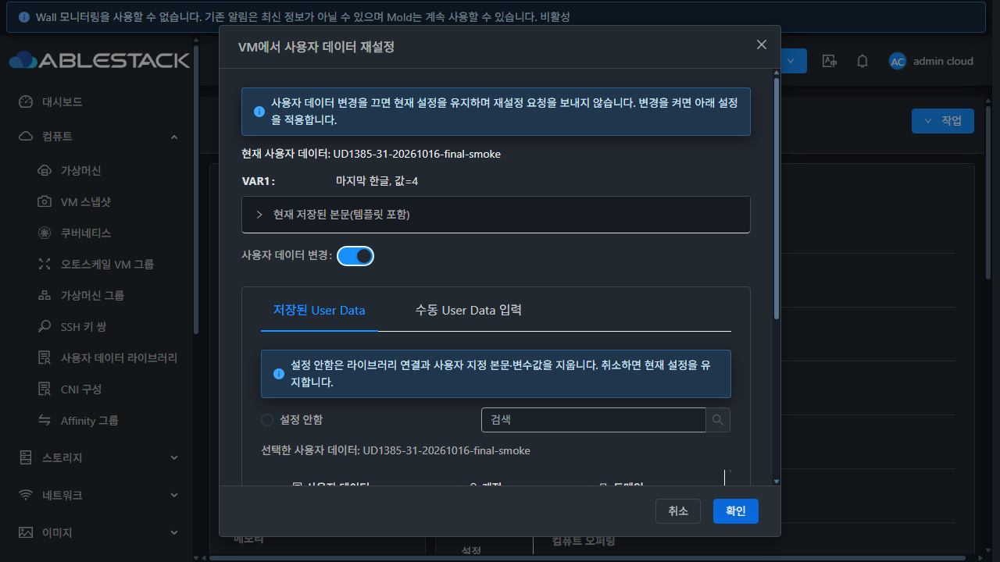
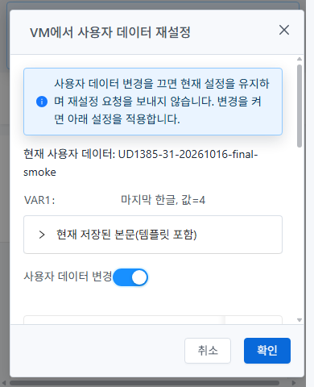
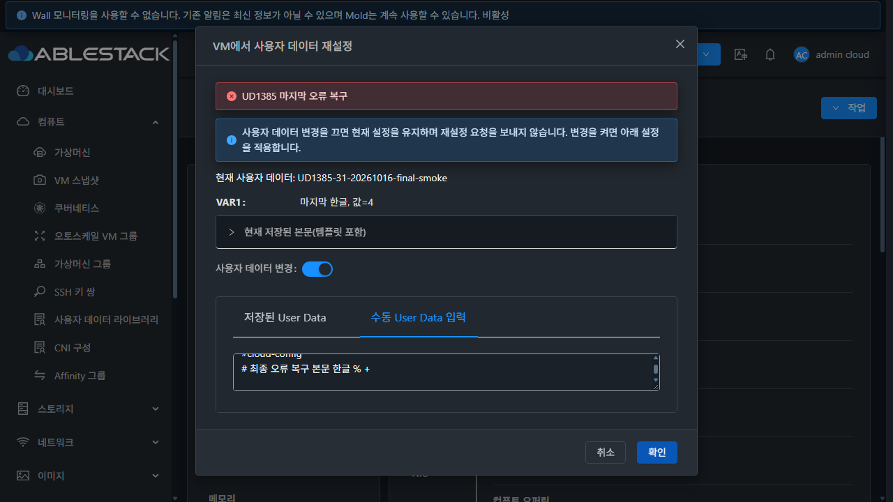

<!-- Licensed to the Apache Software Foundation (ASF) under one or more
contributor license agreements. See the NOTICE file distributed with this work
for additional information regarding copyright ownership. The ASF licenses this
file to you under the Apache License, Version 2.0 (the "License"); you may not use
this file except in compliance with the License. You may obtain a copy at
http://www.apache.org/licenses/LICENSE-2.0 . Unless required by applicable law or
agreed to in writing, software distributed under the License is distributed on
an "AS IS" BASIS, WITHOUT WARRANTIES OR CONDITIONS OF ANY KIND, either express
or implied. See the License for the specific language governing permissions
and limitations under the License. -->

# UD-04 #1385 설계·구현·31번 배포·기능 검증

2026-10-16 / Epic #1381 / 누적 Draft PR #1393.
VM 재설정에서 활성 모드만 전송하고, 현재 설정 유지와 설정 안함을 구별하며,
라이브러리·본문·한글 변수값을 현재 VM과 템플릿 정책에 맞춰 복원한다.
UD-04 범위 검증을 통과했다. 다음 구현 대상은 #1386이다.

## 구현과 설계

- [설계](../../design/userdata-1385-design.ko.md): 기본은 **사용자 데이터 변경 OFF**다.
  확인해도 reset API를 호출하지 않는다. 변경을 켰을 때만 활성 탭의 ID 또는 본문 하나를 보낸다.
- 설정 안함은 빈 `userdata=''`를 전송한다. 사용자 지정 연결·본문·변수를 지우며,
  템플릿 연결이 있으면 기본 데이터와 유효 템플릿 변수로 돌아간다. 임의 UUID나 번역 문구를 보내지 않는다.
- 실제 VM을 `listVirtualMachines(id, userdata=true)`로 다시 조회한다. 페이지 밖 현재 라이브러리와
  변수값을 복원하고, 탭별 초안은 보존하되 다른 라이브러리 선택 시 이전 변수는 전송하지 않는다.
  현재 본문은 읽기 전용으로 제공한다. 조회 실패 시 적용을 차단하고 재시도한다.
- ALLOWOVERRIDE는 유효한 템플릿 또는 사용자 지정 변수만, APPEND는 양쪽 변수의 합집합을,
  DENYOVERRIDE는 템플릿 변수만 보낸다. 특수 변수명도 안전하게 다루도록 null-prototype map을 사용한다.
- APPEND의 기존 저장값은 합성 본문이다. 현재 합성 결과는 그대로 보여주고 유지하며,
  변경할 때 새로 추가할 본문을 입력한다. 합성 본문을 다시 추가하여 템플릿을 중복시키지 않는다.
- 명시적 본문 조회에서 템플릿 전용 `userdatadetails`도 반환하도록 server의
  `UserVmJoinDaoImpl` 한 클래스를 보완했다. 일반 목록 조회·API/DB 스키마는 바꾸지 않았다.
- 실제 AutoScale 프로필 ID 조회, 템플릿 조회 공통 helper, 응답 세대/수명 검사와 기존 비동기 mutation을 재사용한다.
- 공통 MoldDialog·AntD·i18n·테마를 사용한다. 제출 중 중복 요청·닫기·취소를 차단하며,
  오류 후 입력을 보존한다. 오류는 Body 한 곳에 표시하여 전역 알림이 후속 작업을 가리지 않도록 했다.
  성공 알림의 누락 번역 키와 템플릿 기본값 표시도 수정했다.

## 소스·빌드 검증

Windows의 별도 `dhslove` worktree와 WSL rocky ext4 clone을 사용했다.
기준 upstream Europa는 `4bd1a2cff50c83089dc23ff1c83def631a343e3d`다.
기존 FT 작업 디렉터리는 수정하지 않았다.

| 검사 | 결과 |
| --- | --- |
| 최종 UI 단위 검사 | 5 suites / **152 tests PASS**, 20.737초 |
| 변경 UI 파일 ESLint | `--no-fix`, 오류 0 |
| 변경 server 모듈 테스트 | `UserVmJoinDaoImplTest` **13건**, 실패/오류/skip 0 |
| 변경 server 모듈 package | PASS |
| 최종 production UI build | PASS, asset/entrypoint 권장 크기 경고 2개와 Browserslist 안내 |
| 저장 증거 자동 대조 | [qualify.py](qualify.py), [qualification-summary.json](qualification-summary.json) PASS |

Maven은 `-pl server`만 실행했다. 전체 Cloud 빌드·수동 Actions·qemu 빌드·PR 병합은 수행하지 않았다.
최종 UI 검사 소스는 `8c7c83b609b31b6df0f162517c24468f911391a6`이다.
서버 변경은 첫 배포 이후 동일하여 UI 수정 때 Maven을 반복하지 않았다.
[build-results.json](build-results.json)에 명령·결과·로그 위치를 기록했다.

## 실환경 UI → 요청 → API/DB

31번 전용 정지 VM으로 확인했다. 원래 운영 라이브러리·VM 설정은 바꾸지 않았다.

| 경로 | 관찰 결과와 증거 |
| --- | --- |
| 현재값 유지 | `keep-requests.json`, `append-keep-requests.json`: reset 0건 |
| 라이브러리 → 수동 → 라이브러리 | 탭 초안 보존, 활성 본문 또는 ID만 전송. `mode-roundtrip-*`, `manual-requests.json`, `library-requests.json` |
| 페이지 밖 현재값·빠른 변경 | 15건의 현재 A/VAR1 복원, B의 NEW를 A에 보내지 않음. `off-page-current-restored.json`, `rapid-library-clears-old.json` |
| 설정 안함 | userdata 빈 문자열만 전송. 기본 VM은 API의 본문/ID/변수 모두 null. `none-requests.json`, `after-none.json` |
| 템플릿 ALLOW | 기본 T 복원, A 선택 시 VAR1만, 설정 안함 시 T만. `allow-*-requests.json`, `after-allow-*.json` |
| 템플릿 APPEND | 합성 본문 읽기 전용/추가 입력 분리. 템플릿·새 본문 각각 1회, 기본값 복귀. `append-*`, `after-append-*.json` |
| 템플릿 DENY | 사용자 지정 탭 미노출, 빈 userdata와 T만 제출. `deny-template-only.json`, `deny-requests.json` |
| 템플릿 전용 변수 응답 | 배포 전 T 누락 → 배포 후 `{T=템플릿 한글}`. `before-template-only.json`, `deployed-template-only.json` |
| 권한 | 기본 User/DomainAdmin은 reset 권한 432로 액션 숨김. 전용 임시 역할의 허용 후 자기 VM 변경 성공, 타인 VM 조회 차단/변경 531. 기본 역할은 수정하지 않음. `*-default-*`, `owner-api-*`, `role-fixtures.json` |
| 프로젝트 | projectid 포함 UI 제출, 한글 변수 API/DB 일치. `project-requests.json`, `after-project.json` |
| 현재값 조회 실패 | 제어된 503에서 확인 비활성, 조회 재시도 복원, reset 0건. `current-read-*` |
| 최종 제출 오류·지연 | Ctrl+Enter 반복 중 reset **1건**, 취소 비활성/Close 0. 503 오류는 Body만 표시, 전역 오류 알림 **0개**. 동일 입력의 실제 재시도 성공. `smoke-loading.json`, `smoke-error.json`, `smoke-error-requests.json` |
| 최종 실제 변경 | 수동 본문 → 라이브러리/VAR1 → 설정 안함. `smoke-*-requests.json`, `smoke-after-*.json`, `smoke-manual-db.tsv`, `smoke-library-db.tsv` |

첫 7개 VM의 API 본문 Base64 SHA256·library UUID·변수 문자열을 `verified-db.tsv`와 대조했다.
최종 전용 VM도 수동/라이브러리 각각의 API와 DB 본문 해시·변수값을 대조했다.
한글·쉼표·등호·퍼센트·더하기가 그대로 보존된다.
기록 누락/잘림이 없는 **23개 요청 구간**에서 JavaScript 예외 0건이며, reset의 ID/본문 동시 전송과 sentinel 0 전송도 0건이다.
이 수치는 해당 구간만을 의미한다. 전체 메뉴/모든 세션 예외 0건으로 확장하지 않는다.

성공 직후 AX에서 `VM에서 사용자 데이터 재설정 - 성공`을 확인했다.
후속 `smoke-success.txt/png` 저장은 2초 알림이 사라진 뒤여서 알림 문구를 포함하지 않는다.
해당 캡처는 창 닫힘을 보여주며, 실제 저장 성공은 API/DB로 확인했다.

## 최종 일반·다크와 VM 모달 표준

최종 배포 `8c7c83b`의 `qualified-{light,dark}-{1440x1000,1280x720,390x844,390x480}.json/png`
8개 화면을 저장했다. Footer가 viewport 안에 있고 모든 버튼은 VM 기준 **32px / padding 4px 15px**다.
기존 테마의 텍스트·입력·경계·버튼 computed style을 함께 기록했다.
390×480에서 Body scrollTop **0→668**, Header top **13**, Footer top **402**가 유지됐다.
메뉴 전체와 200% 확대의 최종 적합성 판정은 #1392에 남는다.

## 배포 이력과 현재 런타임

| 배포 소스 | 범위 / 증거 |
| --- | --- |
| `80c1f53bd8d5eb1ad192e3b092c9c1423a1b455d` | 서버 한 클래스 + UI. 정책/역할/프로젝트/기본 경로 검증. `deployment.json` |
| `ab56fd58317322b1ed57fead6f5084a5ae16e090` | 템플릿 기본값 표시·성공 번역. 이전 `final-*` 화면/요청. 전역 오류 중복을 발견하여 추가 수정 |
| **`8c7c83b609b31b6df0f162517c24468f911391a6`** | 최종 Body 오류 단일화. `smoke-*`, `qualified-*`, `deployment-ui-final.json`, `runtime-final.json` |

최종 정적 파일 **855개 SHA256**, JAR 내 기존 6개와 새 1개 **총 7개 클래스 SHA256**을 확인했다.
server JAR SHA256은 `b7d28d9b977c60e8bbe8107a0000f4f58246cfcdd8a4d7e2576f6a6c38d241b2`다.
변경 클래스 SHA256은 `174355b59882772bca5634797e6f9b4b3c456ca394dd42bddc0d3b6722f3a142`다.

활성 webapp의 WEB-INF inode와 config 해시를 보존했다. 서버 첫 배포에서만 mold를 재시작했고,
이후 UI 배포는 PID **1170852**를 보존했다. `mold active`, `/client/ HTTP 200`이다.
최종 백업은 `/root/ud1385-ui-20261016-032150`, 서버 원본 백업은 `/root/ud1385-20261016-025128`이다.
정적 자산만 덮어썼고 index.html은 마지막에 반영했다. WEB-INF 루트 삭제·전체 교체는 하지 않았다.

## 정리와 검증 한계

전체 시험 생성량은 사용자 데이터 **18개**, 정지 VM/볼륨 **8개**, 정책 템플릿 **3개**,
L2 네트워크 **3개**, 계정 **2개**, 프로젝트·내부 프로젝트 계정·도메인 각 **1개**, 전용 역할 **2개**다.
첫 17개/7개 VM을 정리한 뒤 최종 오류 수정 확인용 1개/1개 VM을 추가하고 다시 정리했다.
API/DB의 사용자 데이터·VM·볼륨·템플릿·네트워크·계정·프로젝트·내부 계정·도메인·역할
활성 잔여는 모두 **0건**이다. 제거된 VM 이력의 removed=1 행은 남아 있으며 활성 잔여로 세지 않는다.
기존 라이브러리 **AS-PROD-31-AS01-HTTP 1건**의 전체 API 응답은 시작 시점과 정확히 동일하다.
`cleanup-final.json`, `cleanup-db.tsv`, `cleanup-browser-final.json/png`로 확인한다.
원래 다크모드, 기본 viewport를 복원하고 임시 네트워크 가로채기·캐시 설정을 해제한 뒤 임시 탭을 닫았다.

- VM은 모두 Stopped로 생성했다. 정책 템플릿의 실제 부팅/이미지 소비·게스트 cloud-init 실행은 검증하지 않았다.
  Cloud 저장 성공을 VR/ConfigDrive 전달·게스트 실행 성공으로 표시하지 않는다. **#1386**에서 검증한다.
- legacy Java Map 문자열은 완전한 역변환 형식이 아니다. 선언 키 경계의 한글/쉼표/등호와 반복 키 차단을 검사했다.
  임의 외부 legacy 값의 모든 모호성을 해결한 구조화 API로 주장하지 않는다. 비 UTF-8 데이터는 편집을 차단한다.
- AutoScale 프로필 조회/응답 경합/비동기 결과는 집중 단위 검사에 포함했다. 실제 프로필 변경/그룹 수명 주기와
  VNF 실제 생성은 이번 실환경 완료에 포함하지 않고 **#1392**의 이전 미검증 항목을 유지한다.
- 재설정 창의 현재 본문 미리보기는 제공하지만 **#1390**의 전용 저장 데이터 API/UI 과제를 완료 처리하지 않는다.
- 전체 메뉴 목록·상세·탭/콘텐츠 매칭·모든 대화상자의 최종 UI 표준 준수는 **#1392**에서 별도 판정한다.

## 다음 진행 순서

1. **#1386 UD-05**: 미지원 네트워크·공급자 실패 시 저장/참조 일관성, 재시도와 실제 VR/ConfigDrive 전달·게스트 검증.
2. **#1387 UD-06**: 일괄 삭제 버튼 노출과 부분 실패 결과 처리.
3. **#1388 UD-07**: 라이브러리를 적용한 VM 목록 전용 탭, 템플릿/ISO 참조와 삭제 차단 이유.
4. **#1389 → #1390 → #1391 → #1392**: 목록·상세·본문 표준, 저장 데이터 조회, 복제/버전 정책, 전체 UI 최종 통합 검토.

UD-01~04 **4/11 완료**, 후속 **7개 OPEN**, Epic과 누적 PR은 계속 OPEN/Draft로 관리한다.
