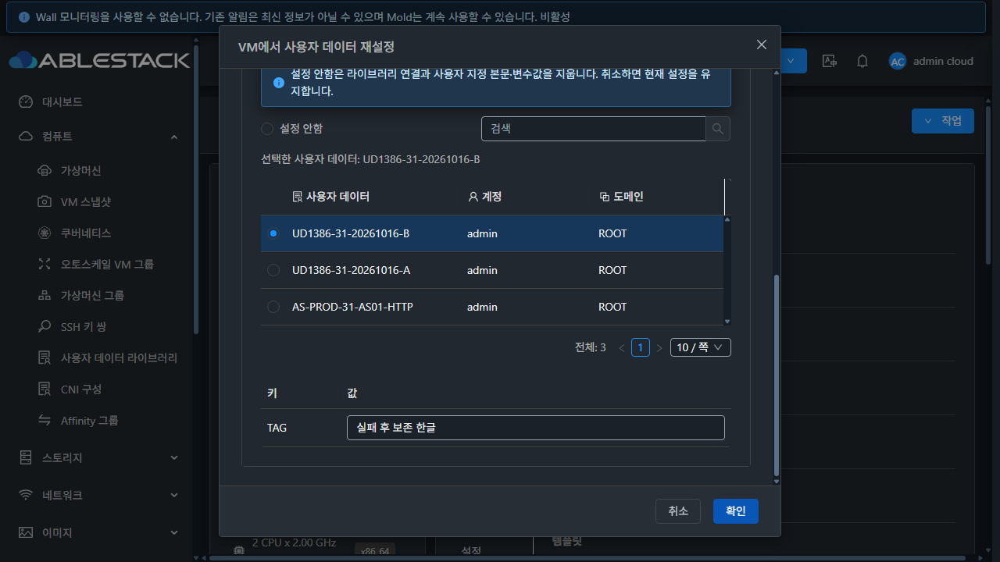
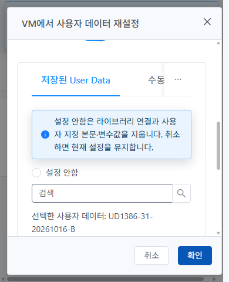

<!-- Licensed to the Apache Software Foundation (ASF) under one or more
contributor license agreements. See the NOTICE file distributed with this work
for additional information regarding copyright ownership. The ASF licenses this
file to you under the Apache License, Version 2.0 (the "License"); you may not use
this file except in compliance with the License. You may obtain a copy at
http://www.apache.org/licenses/LICENSE-2.0 . Unless required by applicable law or
agreed to in writing, software distributed under the License is distributed on
an "AS IS" BASIS, WITHOUT WARRANTIES OR CONDITIONS OF ANY KIND, either express
or implied. See the License for the specific language governing permissions
and limitations under the License. -->

# UD-05 #1386 실패 정합성·지원 조건·실제 전달 검증

2026-10-16 / Epic #1381 / 누적 Draft PR #1393.
`resetUserDataForVirtualMachine`의 공급자 수락 전 DB 저장과 다중 NIC 일부 성공 처리를 수정했다.
미지원/실패/지연 중 이전 Cloud 설정과 참조를 보존하고, 전부 수락한 결과만 저장한다.
실제 VR·ConfigDrive 전달과 전용 게스트의 파일 생성·명령 실행을 별도로 확인했다.

## 설계와 구현

[설계 문서](../../design/userdata-1386-design.ko.md).
기준 upstream Europa는 `4bd1a2cff50c83089dc23ff1c83def631a343e3d`이며 기존 Epic 브랜치를 계속 사용했다.
별도 Windows dhslove worktree와 WSL rocky ext4 clone에서 작업했고 기존 FT 작업을 변경하지 않았다.

- 기존 ACL/External/SharedFS 검사 후 VM lock을 잡아 최신 정지 상태를 검사한다.
  같은 VM의 재설정을 직렬화하고, 지원 NIC 전체를 적용 전에 검증한다.
  미지원 NIC는 제외한다. ConfigDrive는 실제 미디어 생성 경로와 같은 기본 NIC만 인정한다.
- 후보 본문/라이브러리/변수는 메모리의 profile로 보낸다. VR rule은 DB에서 로드한 기존 VM 세부 정보를
  유지하면서 후보 userdata 세 필드를 사용한다. 이전 DB 본문이 전달되는 회귀를 방지한다.
  후보 표식은 명시적 reset에서만 전달한다. 표식 없는 기존 updateVirtualMachine은 DB에서 새 본문을 읽어
  오래된 profile 값으로 덮어쓰지 않도록 한다. 기존 업데이트 경로의 본문 전달 회귀도 별도 검사했다.
- 모든 대상 NIC의 공급자가 수락하고 VM이 여전히 정지 상태인 경우 userdata 세 필드만 DB에 저장한다.
  하나의 성공으로 다른 NIC 실패를 가리지 않는다. 실패/지연 동안 조회되는 Cloud 값·사용 참조는 이전 값이다.
- false/예외/시간 초과·상태 변경·저장 실패 때 실패 NIC를 포함한 각 대상에 이전 값을 다시 전달한다.
  복원 실패가 다른 NIC의 복원을 중단하지 않는다. 복원 확인이 불가능한 경우 오류에 명시한다.
- UI는 현재 VM/NIC와 실제 네트워크를 다시 읽는다. 미지원 VM은 현재값 조회/유지는 허용하되 변경은 차단한다.
  네트워크 조회 실패는 적용을 차단하고 재시도한다. ConfigDrive의 다음 시작 시 생성과 게스트 소비를 구별한다.
- 실제 command-response의 공급자 오류 설명을 Body에 보존한다. 응답 유실은 **결과 미확인**으로 안내하고
  입력을 유지한다. 통신 오류를 서버 실패/롤백 확정으로 표시하지 않는다.
- 기존 MoldDialog·AntD alert·i18n·테마와 VM 32px 버튼을 재사용했다. 별도 모달/테마를 만들지 않았다.

새 DB 스키마/API는 추가하지 않았다. 기존 `updateVirtualMachine`의 다른 설정을 묶는 원자성과
VM 수명 주기 전체의 직렬화 프로토콜은 이번 명시적 reset API 변경의 범위가 아니다.
외부 공급자와 DB의 분산 트랜잭션/강제 프로세스 종료까지 원자적이라고 주장하지 않는다.

## 소스 검사와 배포

| 항목 | 결과 |
| --- | --- |
| 최종 UI 집중 검사 | **5 suites / 160 tests PASS** |
| 서버 집중 검사 | **46건 PASS**, 실패/오류/skip 0 |
| 서버 검사 구성 | 새 reset12·VR rule2, 기존 UserVmManager19·UserVmJoinDao13 |
| 변경 파일 ESLint | `--no-fix` 통과 |
| 변경 server 모듈 package | PASS |
| 최종 production UI build | PASS, asset/entrypoint 크기 경고 2개와 Browserslist 안내 |

서버는 WSL ext4에서 `mvn -pl server`만 검사/패키징했다. checkstyle/RAT는 해당 Maven 호출에서 건너뛰었고
별도 전체 CI 통과로 표시하지 않는다. 전체 Cloud 빌드·수동 Actions·qemu 빌드·PR 병합은 수행하지 않았다.
명령과 로그 위치는 [build-results.json](build-results.json)을 따른다.

초기 서버+UI 배포 소스는 `3b9dcd01b5fede2a761162dd24204a5b061154b4`다.
이 배포로 실제 실패/지연/잠금·게스트·권한을 확인했다.
검증 중 실제 오류가 일반530 문구로 축약되는 것을 발견하여 command-response 처리와 통신 결과 미확인 안내를 추가했다.
최종 UI 소스는 `11a14231351ed3963b8e1c1b6cae7993bf2325d0`이며 최종 오류·재시도·테마 검증은 이 배포를 사용했다.
최종 서버 소스는 `f89387ef67b3b07ca89b1ec7cf38e38c99930af7`이다. 최종 소스 검토에서 후보 전달을
공유하는 기존 업데이트 경로를 확인해 reset 전용 표식을 추가했다. 이 보완은 UI 코드를 바꾸지 않으며
변경 server 모듈만 다시 검사/패키징했다. 새 전용 VM에서 실제 UI reset B → 기존 updateVM 본문 A →
명시적 reset B의 API·VR 제공 본문/변수가 모두 일치함을 확인했다(`final-guard-*`).
기존 updateVM의 userdataid 생략 시 기존 ID 보존 계약은 변경하지 않았다. 명시적 연결 해제는 reset에서 정의한다.

서버 JAR에서 바뀐 클래스는 정확히 두 개다. 기존 패치 7개를 포함한 최종 **9개 클래스**와
정적 파일 **855개 SHA256**을 검증했다. 서버 JAR SHA256은
`27adb5fc8310905fc0b8fea6a8406c772fe398c9abff82b144f7acf54e436f74`다.
WEB-INF inode/config 해시를 보존하고 정적 자산만 업데이트했으며 index.html을 마지막에 반영했다.
서버 배포 두 번에서 mold를 재시작했고 UI만 반영할 때는 PID **1230981**을 보존했다.
최종 서버 PID는 **1236420**, `mold active`, `/client/ HTTP 200`이다.
[deployment.json](deployment.json), [deployment-ui-final.json](deployment-ui-final.json), [deployment-server-final.json](deployment-server-final.json), [runtime-final.json](runtime-final.json).

## 실환경 재현·실패·재시도

| 검증 | 실제 결과 / 근거 |
| --- | --- |
| 배포 전 미지원 L2 | 530 실패인데 null이던 본문/ID/변수가 A로 저장됨. `before-unsupported.json`, `before-reproduction*.json` |
| 배포 후 같은 미지원 L2 | 431 지원 불가 사유, A 본문/ID/TAG 유지. `unsupported-fixed*.json` |
| ConfigDrive 보조 NIC만 추가 | 기본 NIC 미지원 조건을 해소하지 못하므로431, 이전 A 유지. `secondary-configdrive-*.json` |
| 미지원 UI | 사유 표시, 변경 스위치 비활성, 확인(유지) reset0건. `unsupported-ui.*`, `unsupported-keep-requests.json` |
| VR+미지원 보조 NIC | VR 대상으로 적용하고 미지원 NIC를 제외, B 저장/전달 성공. `mixed-nic-*`, `after-vr-retry.json` |
| 실제 공급자 실패 | 전용 라우터 SSH만 REJECT. UI530 뒤 A 본문/ID/TAG 유지, 공급자 복원 미확인 사유 반환. `provider-failure*.json` |
| 실패한 신규 참조 삭제 가능 | 실패한 B 삭제 성공, A 연결 유지. 같은 이름/본문을 새 ID로 재등록. `failed-library-delete.json` |
| 실제 지연과 동시 요청 | 전용 라우터 SSH DROP 동안 이전 A 조회, 두 번째 reset은530 busy. 차단 해제 후 첫 요청만 B로 성공. `provider-delay*`, `provider-pending-after.json`, `concurrent-reset.json` |
| 실행 중 VM | reset431, 기존 B 데이터 유지. `running-state-*.json` |
| 권한별 실제 UI | 일반 사용자·도메인 관리자·프로젝트의 새 네트워크 조회와 reset 성공, 한글TAG API/DB 일치. `*-support.*`, `*-apply-requests.json`, `after-user/domainadmin/project.json` |
| 권한 거절 | 일반/도메인 관리자의 타인 VM·타인 라이브러리 총4건531, 자기 설정 보존. `acl-denied.json` |

실제 공급자 장애는 이번에 새로 만든 **r-551-VM**의 169.254.89.218:3922 제어 연결만 대상으로 했다.
해당 라우터 UUID를 검사한 뒤 고유 comment의 임시 OUTPUT 규칙을 사용했다.
다른 라우터/VM/관리 SSH는 차단하지 않았다. REJECT/DROP 각각을 제거하고 최종 규칙 부재를 확인했다.
단위 검사에는 다중 지원 NIC의 부분 실패와 모든 NIC 복원, 복원 실패·저장 실패·상태 경합도 포함한다.
실환경에서 두 지원 공급자에 걸친 부분 실패를 주입한 것으로 확대하지 않는다.

## 실제 전달과 게스트 소비·실행

전용 Rocky Linux 9.5 Cloud Image VM 두 개를 사용했다. 첫 A 부팅 후, B 재설정과 다음 시작을 각각 확인했다.

| 경로 | 제공/실행 근거 |
| --- | --- |
| VR | `router-before.json` A 본문/TAG → `router-after-retry.json` B 본문/TAG. 제공 원문 SHA256과 API Base64 디코딩 본문이 정확히 일치 |
| ConfigDrive | 기본 NIC의 실제 부팅에 ConfigDrive ISO가 연결됨. 다음 시작 후 게스트의 B 파일/실행 마커 확인 |
| 두 게스트 A | `guest-before-{vr,configdrive}.json`: `UD1386-A 한글` 파일과 `UD1386-A-executed` 명령 실행 결과 |
| 두 게스트 B | `guest-after-{vr,configdrive}.json`: 다음 시작 후 두 결과가 각각 B로 변경됨 |

QGA ping은 되지만 이 이미지의 guest-exec/file 명령은 정책상 비활성이다.
이를 성공으로 계산하지 않고, Cloud API로 VM을 정상 정지한 뒤 active libvirt domain 부재와 전용 루트 디스크를 확인하여
기설치 virt-cat을 **읽기 전용**으로 사용했다. 이 과정에서 게스트 파일을 쓰거나 QGA 정책을 변경하지 않았다.
두 고유 마커는 등록된 본문의 write_files/runcmd로만 생성됐고, 검사 스크립트는 해당 파일을 읽기만 했다.
cloud-init clean이나 수동 게스트 명령으로 B 실행을 만들어내지 않았다.
마지막 서버 호환 보완 후에는 새 VR VM에서 UI·기존 업데이트·reset의 제공 본문을 대조하고 B로 다시
부팅했다. `final-guard-guest.json`에서도 B 파일·명령 실행 결과를 읽기 전용으로 확인했다.

이 이미지/두 경로에서 실제 소비·실행까지 확인했다. 모든 OS/템플릿의 자동 재실행을 보장하는 결론은 아니다.
UI 안내는 공급자 수락·Cloud 저장·다음 시작의 매체 생성·게스트 실행을 계속 구별한다.

## 최종 UI와 범위

최종 배포의 실제 공급자 오류에서 서버 복원 상태가 Body에 표시되고 입력/선택이 유지된다.
응답 유실은 제어된 요청 실패로 확인했으며, 결과 미확인 안내 후 실제 재시도 성공과 API/DB를 대조했다.
일반/다크 × 1440×1000·1280×720·390×844·390×480에서 Footer가 보이고 버튼은 **32px / padding4px15px**다.
Header/Footer 위치를 유지하면서 Body만 스크롤한다. 화면과 computed style은 `qualified-*`에 저장했다.
캡처 helper가 초기 소스 label을 보존하는 계측 오류를 자동 대조에서 발견하여 다시 촬영했다.
최종 파일은 명시적 소스와 실제 로드된 script URL을 함께 기록한다. app.e1aa674b.js는 최종 배포 manifest와
일치한다. 교정 전 기록은 `capture-label-diagnostic.json`에 남겼으며 최종 적합성의 근거로 사용하지 않는다.

최종 원시 증거의 자동 대조는 [qualify.py](qualify.py)와 [qualification-summary.json](qualification-summary.json)을 따른다.
제출 직후 아직 로딩 중에 촬영된 자료는 `*-submitting`으로 표시한다. 이를 성공 화면으로 사용하지 않고,
실제 완료는 후속 API·DB·공급자 본문 대조로 판정했다.
JavaScript 예외 수치는 잘림 없는 개별 요청 구간만 대상으로 하며 전체 세션/메뉴의 무오류로 주장하지 않는다.
전체 메뉴의 목록·상세·탭 매칭, 200% 확대와 최종 통합 UI 판정은 #1392에 남는다.
AutoScale 그룹/프로필 수명 주기와 VNF 실환경 생성 등 이전 미검증 항목도 계속 남긴다.
Body의 스크롤을 보존하므로 하단 변수 입력 중 실패하면 상단 오류 문구는 위로 스크롤해 확인한다.
오류 후 포커스/스크롤 우선순위의 최종 UI 판정은 #1392에 인계하며 전체 표준 통과로 주장하지 않는다.

## 정리와 다음 이슈

시험 생성량은 사용자 데이터 **8개**(실패 후 삭제/재등록 및 최종 호환 검사 포함), 사용자 VM/볼륨 **7개**, 네트워크 **7개**,
전용 라우터 **2개**, 계정 **2개**, 도메인·프로젝트·내부 프로젝트 계정 각 **1개**, 전용 역할 **2개**다.
기본 User/DomainAdmin 역할은 수정하지 않았다. 시험 계정에만 임시 허용 역할을 지정했다.
전용 자원을 정리하고 API/DB 활성 잔여0건과 기존 라이브러리1건의 전체 응답 보존을 확인했다.
호스트3대에서 시험 도메인·장애 규칙 부재와 부팅한 루트 디스크 파일의 제거도 확인했다(`cleanup-hosts.json`).
원래 다크모드·기본 viewport를 복원하고 임시 요청 가로채기·캐시 설정과 라우터 장애 규칙을 해제했다.
정리 근거는 `cleanup.json`, `cleanup-db.tsv`, `cleanup-browser.json/png`, `router-fault-cleanup.json`이다.
최종 호환 검사 자원은 `cleanup-final-guard.json`에 별도로 기록했고 최종 DB/호스트 검사는 두 단계의 자원을 모두 포함한다.
기록 누락 없는 요청 구간은 총14개, 해당 구간의 JavaScript 예외는0건이다.

UD-01~05 **5/11 완료**, 후속6개와 Epic은 OPEN, 누적 PR은 Draft로 유지한다.

1. **#1387 UD-06**: 일괄 삭제 작업 노출과 부분 실패 결과 처리.
2. **#1388 UD-07**: 적용한 VM 목록 전용 탭, 템플릿/ISO 참조와 삭제 차단 사유.
3. **#1389 → #1390 → #1391**: 목록·상세·본문 표준, 저장 데이터 조회, 복제/버전 정책.
4. **#1392 UD-11**: 전체 UI 표준 최종 통합 검토와 남은 회귀 검증.
