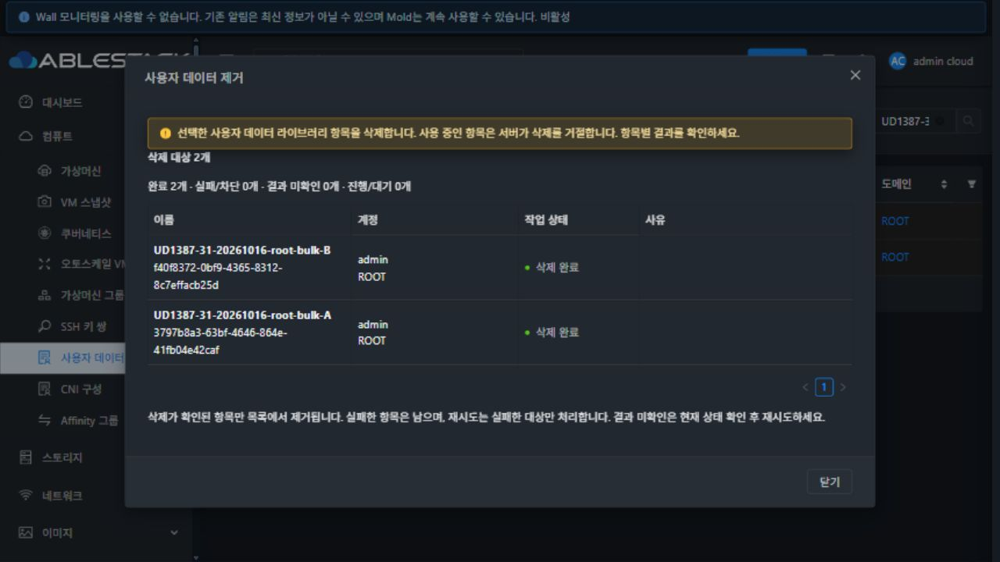
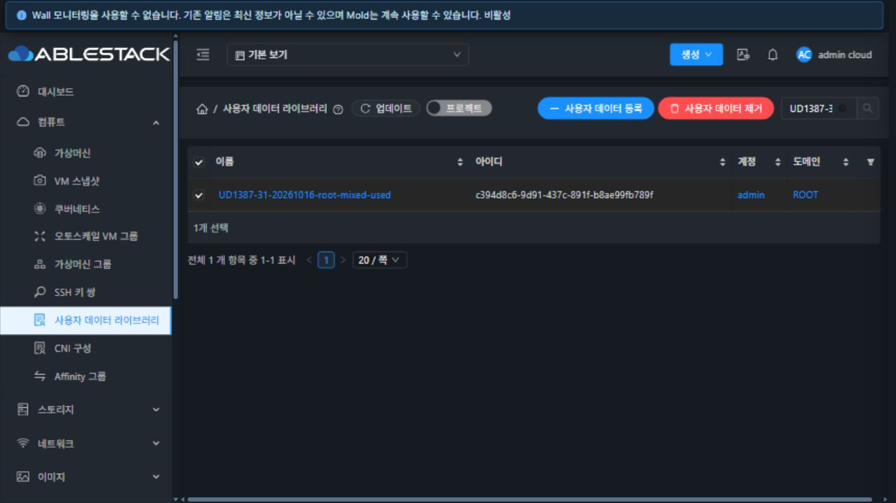
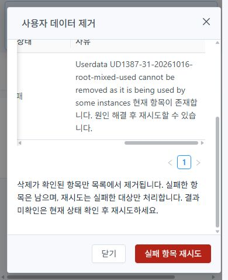

<!-- Licensed to the Apache Software Foundation (ASF) under one or more
contributor license agreements. See the NOTICE file distributed with this work
for additional information regarding copyright ownership. The ASF licenses this
file to you under the Apache License, Version 2.0 (the "License"); you may not use
this file except in compliance with the License. You may obtain a copy at
http://www.apache.org/licenses/LICENSE-2.0 . Unless required by applicable law or
agreed to in writing, software distributed under the License is distributed on
an "AS IS" BASIS, WITHOUT WARRANTIES OR CONDITIONS OF ANY KIND, either express
or implied. See the License for the specific language governing permissions
and limitations under the License. -->
# UD-06 #1387 사용자 데이터 일괄 삭제 검증 보고서

작성일 2026-10-16 KST. Epic #1381 / 누적 Draft PR #1393. 최신 upstream Europa `4bd1a2cff50c83089dc23ff1c83def631a343e3d` 기준의 전용 작업 트리를 사용했다.
구현/배포 대상 UI 소스는 `1a9553261a7d45a3acf079f21d0ba7db360492f6`이다. 서버 변경은 없으며 이전 UD-05의 JAR과9개 클래스를 보존한다.

## 확인된 문제와 개선

수정 전 실제 UI에서 미사용 항목2개를 선택해도2개 선택만 보이고 삭제 버튼이 없었다(`before-selected.png/txt`).
`toolbarLabel`을 보완하여 기존 ActionButton의 권한 필터·선택 툴바에 명시적인 삭제를 표시한다.
단건·일괄 모두 SSH 삭제와 같은 selfManagedDialog/MoldDialog 패턴을 사용한다. 별도 모달 프레임워크나 색상 세트를 만들지 않았다.

확인창을 열 때 UUID·이름·account/domain 또는 project를 불변 스냅샷으로 고정한다. 계정 항목에는 `ignoreproject`를 지정해 공통 요청기의 전역 프로젝트 주입을 막는다.
각 항목을 POST 직전 조회하고 UUID·소유 범위를 대조한다. 성공 항목은 다시 제출하지 않고 실패만 재시도한다.
서버/통신 오류 후 현재 상태를 조회한다. 삭제된 UUID 조회의431만으로 부재를 단정하지 않고 완전한 소유 범위/이름 조회로 확인한다.
불완전 목록·조회 실패는 결과 미확인/차단이며 현재 상태 확인 후 재시도한다. 동일 이름의 새 UUID로 대상을 바꾸지 않는다.
권한·로그인·프로젝트·전체 프로젝트 보기·route 변경은 이후 요청을 중단한다. 실제 삭제 결과와 추측을 구분한다.

## 소스·검사

- DeleteUserData, userDataDeletion 유틸리티, compute 작업 메타데이터, Autogen 진입/결과 선택 정리를 변경했다.
- 기존 공통 Alert/Table/Badge/Button·MoldDialog·i18n과 일반/다크 테마를 재사용한다. 메뉴 전용 CSS는 표의 긴 UUID/오류 줄바꿈뿐이다.
- 사용자 데이터 삭제/등록/재설정/선택기·SSH 삭제5 suites/137 tests와 공통 액션/포커스/ActionButton/MoldDialog4 suites/155 tests, 합계9 suites/292 tests 통과.
- 전역 프로젝트 주입 보완 후 삭제29건을 최종 소스에서 재실행했다. 변경 파일 ESLint 통과. 테스트 환경의 기존 아이콘 중복 등록·개발모드 안내는 제품 검증과 구분한다.
- 최종 WSL ext4 Node14.21.3/npm6 production UI build 결과는 `build-results.json`을 따른다. 초기 OpenSSL legacy 옵션은 Node14에서 거절되어 제거했다. 프로젝트 주입 보완 전 중간 빌드는 중단했으며 성공 근거로 사용하지 않는다.
- 서버 소스를 변경하지 않아 Maven 모듈 빌드를 실행하지 않았다. 전체 Cloud 빌드·수동 GitHub Actions·qemu 빌드·PR 병합도 실행하지 않았다.

## 31번 실환경 기능 검증

[정량 판정](qualification-summary.json)은 UD-06 범위 PASS다. `qualify.py`가 원시 화면·요청·DB·배포 증거를 대조한다.

| 조합 | 실제 UI/API 결과 | 근거 |
|---|---|---|
| 수정 전/후 선택 작업 | 수정 전2개 선택만 표시 → 명시적 사용자 데이터 제거 버튼 | before-selected, toolbar-selected |
| 취소·지연 | 취소 DELETE0. 첫 POST 지연 중 닫기/취소 비활성·Escape 후 창 유지·성공 UUID 재전송 없음 | cancel-qualified, bulk-pending, bulk-first-attempt, bulk-retry-success |
| 미사용2개 | root 최초 배치의 조회 시간초과 후 현재 확인/실패만 재시도로2개 완료. 일반 사용자·도메인 관리자·프로젝트는 각2개를 한 배치로 모두 성공 | bulk-success, user/domainadmin/project-bulk-success |
| 실제 VM 사용 혼합 | 사용중1건530, 미사용1건성공. 서버 사유 보존, 닫으면 실패한1건만 목록과 선택에 남음 | mixed-failure, mixed-retained-list, after-mixed |
| 참조 해제·재시도 | 전용 정지 VM의 수동 본문 reset으로 userdataid=NULL 확인 후 같은 실패 UUID만 재시도 성공 | unreference, used-retry-success |
| 사전 조회503 | 대상 확인 차단, DELETE0. 조회 복구→현재 상태 확인→실패 대상1건 재시도 성공 | lookup-blocked, lookup-retry-success |
| 제출 권한 오류 | 제어 HTTP403/Cloud432 본문의 한글 사유와 현재 존재 상태 유지. 복구 후1건재시도 성공 | permission-failed, permission-retry-success |
| 응답 유실·불확실 | 실제 POST200 응답을 ConnectionClosed로 유실시키고 후속 조회503. 결과 미확인1건 유지, 현재 상태 확인만으로 부재 확인, DELETE 재전송0 | lost-response-fault/unknown/confirmed |
| 같은 이름 재등록 | 확인창의 원래 UUID를 API로 삭제하고 다른 본문/새 UUID로 같은 이름 재등록. UI는 원래 항목 이미없음, DELETE0, 새 UUID는목록에남음 | replacement-confirm-old/protected/remains-list, replaced-before-submit |
| 상세 단건 | 같은 공통 확인/결과창으로1건삭제, 닫으면 라이브러리 목록 복귀 | single-confirm/success, single-detail-delete |
| 실제 역할/프로젝트 | 일반·도메인 관리자 각2개소유항목 및 프로젝트2개삭제. UUID와 소유 account/domain 또는 projectid가 실제 요청에서 일치 | prepared, *-bulk-*-requests |
| 권한 제한 | 타인 항목3건 API531. 전용 임시 조회 역할은 UI 삭제 버튼0, listApis에delete없음, 직접API432 | acl-denied, readonly-role, readonly-selected |

삭제 요청17건에는 실제 UI로 삭제된 서로 다른 UUID14개, 사용중 거절2건과 제어된 권한 거절1건이 포함된다.
원래 UUID의 사전 삭제1건은 CLI/API로 수행한 교체 경합 시험이며 UI 일괄 삭제 성공 수에 더하지 않았다.
실패 결과를 성공 건수에 더하지 않는다. 사용중 VM의 참조는 API와 DB로 대조했고 DB는 실제 삭제된15개(교체 시험 포함)의 제거 표시와 남은3개를 확인했다.
프로젝트는 기본 목록과 별도 범위이므로 API 스냅샷에 전용 projectid 조회를 합친다. 최초 `after-mixed.json`은 비프로젝트 목록이며 총 잔여의 근거로 사용하지 않았다.
최종 `after-functional-db.json`은 모든 시험 UUID와9종 자원의 활성 수를 조회한다.

누락/잘림 없는 요청 구간18개에서 JavaScript 예외0건이다. 이는 전체 로그인 세션·대시보드·메뉴 전체의 예외0건을 의미하지 않는다.
초기 취소 구간의 오래된 커서가 잘린 기록은 제외하고 `cancel-qualified`로 재기록했다. 요청 구간이 겹친 응답 유실 기록도 정확한 시작 커서로 다시 내보냈다.
요청 제어 도구의 제한을 확인하는 동안 후속 조회가 오래 멈춘 첫 배치는 실제로1성공/1차단이었다. 이를 일괄 성공으로 표시하지 않았고,
현재 확인→재시도로 남은 원래 UUID만 삭제되는 결과를 확인했다. `bulk-pending`, `bulk-first-attempt`는 진행 중 화면이며 완료 증거가 아니다.
진단 구분은 `harness-diagnostics.json`을 따른다.

## UI 표준과 테마

공통 lg 대화상자의 Header/Footer 고정·Body만 auto 스크롤, 취소→위험 삭제 및32px/padding4px15px 버튼을 실제 computed style로 확인했다.
일반·다크 각각1440×1000·1280×720·390×844·390×480의8개 화면은 `qualified-*.png/json/txt`에 있다. 모든 버튼이 viewport안에 있고 긴 이름/UUID/오류는 줄바꿈한다.
다크는 혼합 결과2행, 일반은 닫기 후 남은 사용중1행의 오류 화면이다. 둘 다 같은 최종 소스/배포 app을 명시적으로 기록했다.
390×480에서 표를 실제 가로 스크롤하여 left438/client322/scrollWidth760, 본문scrollTop210을 확인했다. 전후 Header/Footer의 위치가 같고 오류 사유도 읽을 수 있다(`mobile-error-scrolled`, `mobile-scroll.json`).
취소 시 호출자 버튼 포커스 복원과 진행 중 닫기/중복 제출 가드는 집중 검사와 실제 UI로 확인했다. beforeunload 이벤트 차단은 단위 검사로 검증했으며 브라우저 새로고침 확인창은 이번에 실환경에서 별도 시험하지 않았다.
390px 표 가로 스크롤 후 화면 아래에도 가로 스크롤바가 보였다. 대화상자 Header/Footer와 버튼 위치는 유지됐다. 배경 목록/공통 모달의 가로 스크롤 전파 여부는 #1392에서 확인한다.
전체 접근성 대비/200% 확대나 모든 공통 화면을 완전 준수로 판정하지 않는다.
전체 메뉴의 최종 UI 적합성·200% 확대 검토는 #1392에 남는다. 사용 VM 탭과 템플릿/ISO 참조 안내는 #1388이다.

## 배포·정리

정적 파일858개를 활성 `/usr/share/cloudstack-management/webapp`에 배포했다. `index.html`은 마지막에 갱신하고 WEB-INF/META-INF/config를 보존했다.
백업 `/root/ud1387-ui-20261016-110743`, WSL 아티팩트 `/home/ablecloud/work/ud1387-ui-1a95532.tgz`, 관리 스테이지 `/var/tmp/ud1387-ui-1a95532`다.
최종 재검증에서858정적 해시·기존9클래스 해시·JAR `27adb5fc8310905fc0b8fea6a8406c772fe398c9abff82b144f7acf54e436f74`가 일치한다.
활성 app `js/app.028b9b59.js`, SHA256 `de58f66dcbbd9682e96275831bd092829643b14cf37bb0cf4f65c9d6fd47b6df`.
WEB-INF inode67111992와 config SHA를 보존했고 관리 PID1236420 유지, `mold active`, `/client/200`이다. 서비스 재시작은 하지 않았다.
배포와 최종 근거는 `deployment.json`, `manifest.json`, `runtime-final.json`, `verify_runtime.py`에 있다.

시험 생성량은 사용자 데이터18개(최초16+같은이름교체1+조회역할1), 정지 VM/볼륨/네트워크 각1개, 계정2개, 도메인·프로젝트·내부 프로젝트계정 각1개와 임시 역할1개다.
기본 역할은 수정하지 않았으며 전용 사용자만 임시 역할을 지정하고 원래 역할을 복원했다. UI삭제14개, 교체사전API삭제1개와 남은3개를 정리했다.
`cleanup.json`은 기존 라이브러리1건 전체 응답 정확히 동일, API 시험잔여0을 확인했다. `cleanup-db.json`은9종 자원의 활성 잔여가 모두0이며 삭제 이력 행은 남긴다.
전용 VM은 기동하지 않았고 본문/참조 조작은 해당 VM에만 수행했다. 기존 VM·운영 라이브러리는 수정하지 않았다.
관리자·기본 프로젝트 보기·원래 다크모드를 복원하고 임시 viewport/캐시 설정/요청 가로채기를 해제했다. `cleanup-browser`와 `cleanup-ui.json`에 원래 라이브러리만 남은 화면과 활성 소스를 기록했다.

## 다음 이슈

1. #1388: 전용 사용 가상머신 탭·템플릿/ISO 참조·삭제 차단 이유와 해제 경로.
2. #1389: 목록·상세·본문 탭의 VM UI 표준/일반·다크.
3. #1390 → #1391: VM 저장 데이터 조회 UI, 복제·버전·변경 정책.
4. #1392: 전체 UI 최종 통합 검토와 남은 회귀 검증.
