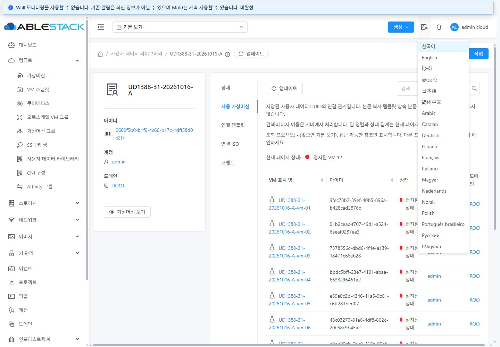
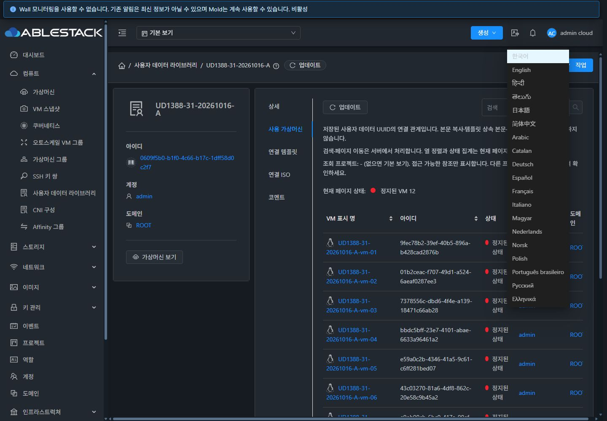
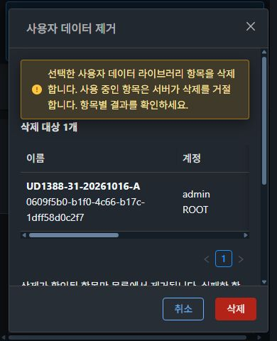

<!-- Licensed to the Apache Software Foundation (ASF) under one or more contributor license agreements. See the NOTICE file distributed with this work for additional information regarding copyright ownership. The ASF licenses this file to you under the Apache License, Version 2.0. You may obtain a copy at http://www.apache.org/licenses/LICENSE-2.0 . Unless required by applicable law or agreed to in writing, software distributed under the License is distributed on an AS IS BASIS, WITHOUT WARRANTIES OR CONDITIONS OF ANY KIND. -->
# #1388 사용자 데이터 참조 구현·31번 배포·검증 보고

2026-10-16, upstream Europa `4bd1a2cff50c83089dc23ff1c83def631a343e3d`에서 이어진 Epic #1381 / Draft PR #1393의 UD-07 범위다. 사용 가상머신·연결 템플릿·연결 ISO 탭과 삭제 전 참조/해제 경로를 구현했다. 전체 메뉴 UI 최종 판정은 #1392에 남긴다.

## 구현과 관계 계약

- `ResourceView/ResourceLayout/InfoCard/ListView/Status/MoldDialog`와 공통 AntD·테마·32px 버튼을 재사용한다. 기존 외부 가상머신 보기와 템플릿/ISO 편집 경로를 유지한다.
- VM은 `listVirtualMachines(userdataid=UUID)`를 사용한다. `listTemplates/listIsos`에도 UUID 필터를 추가하여 기존 ACL·검색과 AND로 결합하고 SQL count/page 전에 적용한다. `showunique=true`로 존 중복을 제외한다. 일부 페이지만 클라이언트에서 걸러 전체인 것처럼 표시하지 않는다.
- 관리자에게 허용된 다른 계정의 참조를 라이브러리 소유자로 재필터링하지 않는다. 라이브러리 프로젝트 우선, 그 외 현재 프로젝트 또는 기본 보기다. 다른 프로젝트는 보기 전환이 필요하며 템플릿/ISO는 기존 관리자 `all` / 일반 사용자 `executable` 필터의 조회 범위를 따른다.
- 표시명·UUID·상태·account/project/domain·상세 링크와 템플릿/ISO 정책을 제공한다. 검색·건수·페이지는 서버 기준, 열 정렬과 상태 집계는 현재 페이지 기준이라고 화면에 명시한다. 탭별 검색/페이지 URL과 브라우저 뒤로 가기를 보존한다.
- 관계는 저장된 UUID다. 전용 템플릿 및 ISO에서 생성한 정지 VM은 A와 같은 본문을 상속했지만 UUID는 없었고 A 참조 12건에 포함되지 않았다. 이 목록은 게스트 cloud-init 실행 증거가 아니다.
- 동일 범위 갱신은 성공한 빈 목록을 포함하여 이전 데이터를 보존한다. 오류·권한·미확인과 0건을 구분하고, 세션·프로젝트·탭·조건 변경 후 지연 응답을 폐기한다. 필터 권한/메타데이터가 없거나 UUID가 유효하지 않으면 무필터 요청을 보내지 않는다.
- 삭제창은 현재 ACL/보기의 참조 건수와 탭 링크·해제 안내를 제공한다. 사전 조회 중 제출을 막고 처리 중에는 닫기/참조 링크를 비활성화한다. 조회 실패는 미확인으로 표시하며 서버가 최종 삭제 여부를 결정한다. #1387의 UUID/소유 범위 고정·부분 실패·재확인 계약을 유지한다.
- 템플릿/ISO 편집의 빈 연결 해제 선택지에는 `설정 안함` 레이블을 붙였다. 강제 삭제는 추가하지 않았다.

[설계](design.md) · [증거 검사 46항목](qualification.json)

## 소스·빌드·배포

| 항목 | 확인 결과 |
| --- | --- |
| UI 소스 | `f6396f8cf4360e899677f21b7be64381d09447b3` |
| 백엔드 소스 | `8591ec822a568aa40f21171351a8678f589a41e5` (이후 백엔드 소스 변경 없음) |
| 변경 Maven 모듈 | WSL ext4에서 `api install`·`server test/package` 성공. server SQL 경계 테스트 3건. api 테스트는 생략하고 실제 API 메타데이터/호출을 검증 |
| UI 집중 검사 | 2 suites / 44 tests·변경 파일 ESLint·production build 성공. Jest `--forceExit`와 종료 대기 경고가 있으며 UI build는 asset/entrypoint 크기 경고 2개·Browserslist 안내 포함 |
| 활성 app | `js/app.325357a9.js`, SHA256 `9a4f972f50de48c07081e97b336a9403490c5e6f7c12afebde4dd9919e04fa78` |
| 정적 파일 | 활성 webapp 861개 SHA256 전부 일치 |
| 서버 JAR | SHA256 `bf53fc37aee0431dd53377526523fcfa2b650e1a32ce9524e243438bab3be7c1` |
| 클래스 | 신규 변경 3개만 교체, 기존 9개 해시 보존. 최종 12개 재확인 |
| 운영 확인 | `mold active`, `/client/` 200, WEB-INF inode와 config.json 해시 보존. 백엔드 배포 후 PID `1247065`, UI 배포에서는 PID 보존 |
| 백업 | 서버 `/root/ud1388-20261016-114125`, UI `/root/ud1388-ui-20261016-115701` |

전체 Cloud 빌드·수동 GitHub Actions·qemu 배포·PR 병합은 실행하지 않았다. 집중 검사와 실제 클러스터 증거를 전체 CI 통과로 계산하지 않는다.

[최종 런타임](runtime-final.json) · [정적 파일 명세](ui-manifest.json) · [백엔드 배포](backend-deployment.json) · [UI 배포](ui-deployment.json) · [UI 테스트](tests-ui.txt) · [서버 테스트](tests-server.txt)

## 실제 기능 검증

| 검증 | 결과와 근거 |
| --- | --- |
| VM 목록·검색·페이지 | A 12건, 페이지 10+2건의 UUID 합집합이 API와 일치. 검색 1건/0건, VM 상세와 뒤로 가기의 검색 조건 복원. 기존 외부 보기 링크 유지 |
| 참조 API | VM/템플릿/ISO UUID·count·page·검색·0건, 템플릿/ISO id와 UUID의 AND, ACL·프로젝트 등 11개 행렬 항목 통과 |
| UI 실제 연결 | 전용 VM을 UI로 생성하여 A 연결. UI 재설정으로 A→B 시 A11/B1, 해제 시 A11/B0. 새 탭에서 같은 UUID·건수 확인 |
| 이미지 연결 | 참조 탭에서 ISO/템플릿 상세로 이동. ISO A→B는 A1/B1, UI 해제 후 B0. 템플릿 UI 해제 후 A1, 복원 후 각각 2건 |
| 권한 | 일반 사용자 자신의 VM1, 도메인 관리자 도메인 VM1, 프로젝트 VM1. 다른 일반 사용자는 라이브러리/VM을 보지 못함. 임시 역할에서 listVM API 미노출·직접 API432와 참조 확인 불가 안내를 확인하고 원래 역할 복원 |
| 관리자 교차 소유 | 관리자에 의해 다른 계정 VM이 A를 참조할 때 A13건으로 정확히 포함. 시험 후 원래 연결 복원 |
| 오류·지연 | 제어503에서 이전12건과 오래된 결과 안내 유지·재시도, 제어403/Cloud432에서 권한 오류와 0건 구분. 빈 결과 갱신 유지, 검색 변경 후 늦은 빈 응답이 최신12건을 덮지 않음 |
| 삭제 사전 안내 | A VM12/템플릿2/ISO2와 링크. 조회 중 삭제 비활성, 일부 조회503은 미확인. 처리 중 footer/참조 링크 비활성 |
| 실제 삭제 경합 | B 참조0 사전 조회 후 VM을 연결. 실제 삭제530 거절·현재 존재 확인·참조 새로고침1·관련 VM으로 이동·UI 해제·탭0·삭제 성공·목록 복귀 |
| 서버 보호 | 실제 VM/ISO 사용 중 삭제530, 템플릿 참조에 의한 최종530 사유 유지. 강제 삭제 없음 |
| 테마·반응형 | 일반/다크 × 1440×1000·1280×720·390×844·390×480. 목록8/삭제창8 화면과 computed style 저장. 문서 가로 넘침 없음, 표는 내부 가로 스크롤, 취소/삭제32px·padding4px15px. 390×480에서 Header/Footer 유지와 Body 스크롤 |

[API 행렬](api-results.json) · [기능 검증 후 API](functional-final-api.json) · [DB 관계](functional-final-db.json) · [삭제 경합](actual-delete-race-requests.json)

## 공통 전환 오류와 증거 범위

프로젝트 전환 구간에 `Uncaught (in promise)` 1건을 포착했다. 새 참조 컴포넌트가 0개인 목록/프로젝트/대시보드 전환에서도 같은 취소 예외를 분리 재현했고, 스택을 실제 번들과 대조하여 이번 변경에 포함되지 않은 `AutogenView.beforeRouteLeave → utils/request CancelToken.cancel` 경로임을 확인했다. 이 공통 취소 처리와 전체 UI 표준 최종 회귀는 #1392에 전달한다. #1388 범위의 참조 목록 결과·ACL·삭제 보호는 위 검증으로 확인했고 전체 세션 무오류로 보고하지 않는다.

완전한 요청 구간 6개 중 5개에서 JS 예외가 없었고, 나머지 프로젝트 구간의 위 예외는 그대로 보존했다. 긴 역할 전환 구간 1개는 이벤트 버퍼의 과거 이력이 잘렸으므로 완전한 요청/예외 증거로 사용하지 않았다. 역할의 API 권한 응답과 실제 화면은 별도 증거다. 텍스트 증거는 UTF-8/LF 및 줄 끝 공백만 정리했다. 줄바꿈 링크의 중앙 클릭과 viewport 전환 직후 메뉴 관찰은 다시 확인했으며, 확정된 VM 링크/뒤로 가기와 로딩 완료 화면을 판정에 사용한다.

[분리 재현 스택](dashboard-cancellation-isolation.json) · [#1392 후속](followup-1392.md) · [원래 예외 구간](user-project-acl-requests.json)

## 정리 및 다음 작업

전용 라이브러리5개·VM/볼륨16개씩·템플릿2/ISO2·네트워크3·계정3·도메인/프로젝트/프로젝트 내부 계정·임시 역할을 정리했다. 분리 재현용 추가 빈 프로젝트도 제거했다. DB 10종 활성 잔여0, API VM/네트워크0이며 기존 사용자 데이터1개의 전체 API 응답은 시작 시점과 같다. 관리자·다크·기본 보기·viewport·가로채기·캐시 설정을 복원하고 시험 탭만 닫는다. 기존 운영 VM은 변경하지 않았다.

[API 정리](cleanup.json) · [DB 정리](cleanup-db.json) · [브라우저 복원](cleanup-browser.json) · [분리 시험 정리](navigation-probe-cleanup.json)

다음은 **#1389** 목록·상세·본문 탭의 VM 표준/테마 정비다. 이어 #1390 VM 저장 데이터 조회, #1391 복제·버전·변경 정책, 마지막 #1392 전체 UI 표준과 위 공통 취소 예외를 검토한다. Epic은 7/11 구현 완료, 나머지4개와 Epic은 OPEN, PR #1393은 Draft를 유지한다.
