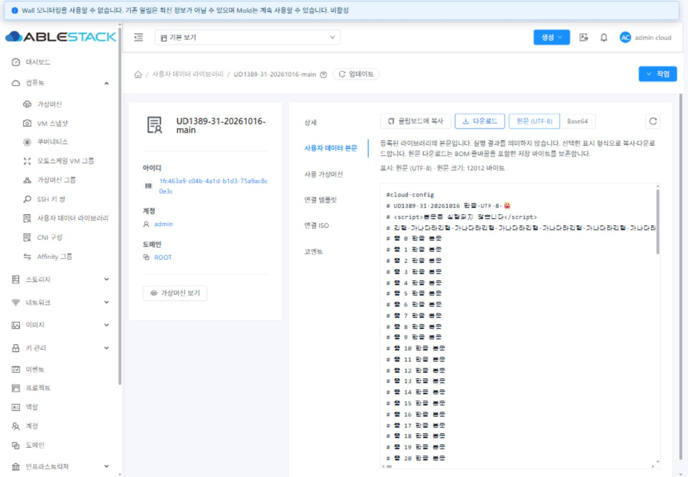
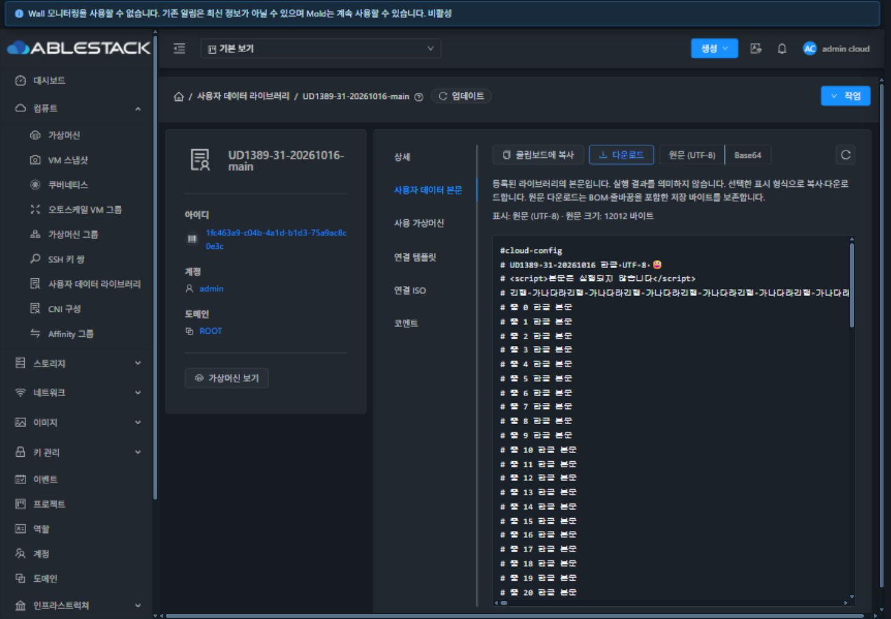
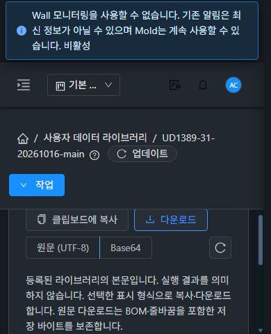
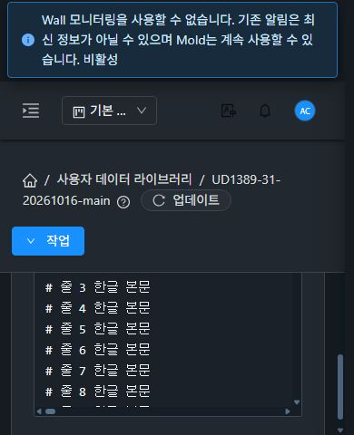
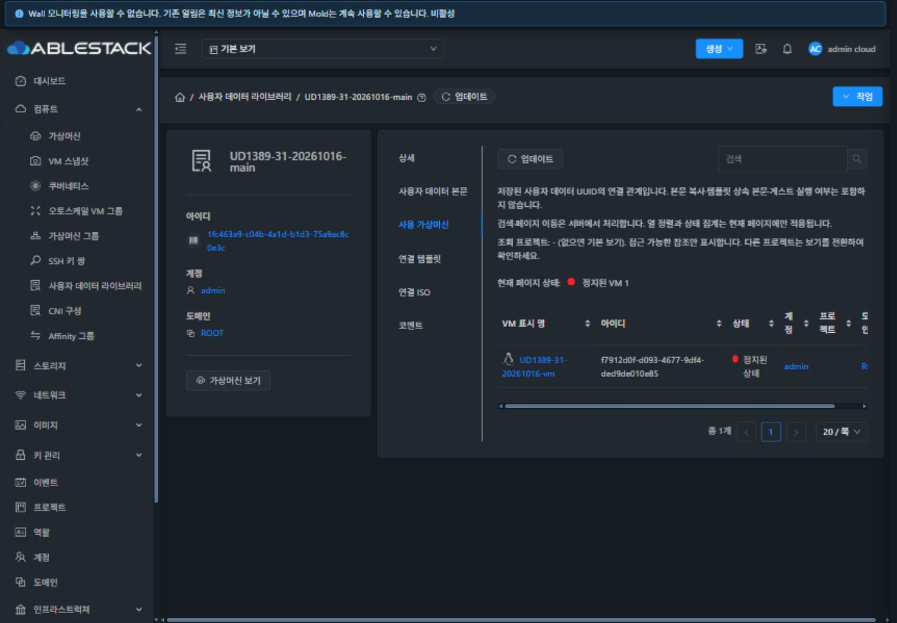

<!-- Licensed to the Apache Software Foundation (ASF) under one or more contributor license agreements. See the NOTICE file distributed with this work for additional information regarding copyright ownership. The ASF licenses this file to you under the Apache License, Version 2.0. You may obtain a copy at http://www.apache.org/licenses/LICENSE-2.0 . Unless required by applicable law or agreed to in writing, software distributed under the License is distributed on an AS IS BASIS, WITHOUT WARRANTIES OR CONDITIONS OF ANY KIND. -->

# UD-08 #1389 구현·31번 배포·검증

메타데이터·본문·참조·코멘트의 책임을 분리하고, 기존 VM 공통 UI 안에 본문 도구와 API 검색을 연결했다. #1389의 네 완료 조건을 검증했다. Epic #1381은 8/11이며 #1390·#1391·#1392와 Epic PR #1393은 후속 작업을 위해 열린 상태를 유지한다.

## 설계와 변경

- 기존 ResourceLayout·InfoCard·ResourceView·DetailsTab·ListView·SearchView와 공통 AntD/테마 토큰을 재사용한다. 상세 → 사용자 데이터 본문 → 사용 가상머신 → 연결 템플릿 → 연결 ISO → 코멘트 순서다. 메타데이터는 ID·이름·소유 범위·프로젝트·동적 파라미터 키를 표시하며 CNI 구성은 보존한다.
- 읽기 전용 본문은 엄격한 Base64/UTF-8 해석과 원문/Base64 선택, 실제 클립보드 쓰기·파일 다운로드를 제공한다. BOM·CRLF·한글·emoji·긴 행·끝 줄바꿈을 보존한다. 바이너리는 Base64로 안내하며 잘못된 인코딩을 원문으로 추측하지 않는다.
- UUID 검색은 API id, 일반 텍스트는 기존 이름 keyword, 고급 필터는 ID·정확한 이름·도메인·계정에 연결한다. 프로젝트는 공통 상단 보기로 선택하며 현재 페이지 정렬임을 안내한다.
- 본문 조회는 UUID·소유 범위를 고정하고 응답 식별을 검증한다. 같은 범위 갱신 중 본문·표시 선택을 유지하고 내보내기를 잠근다. 일시 오류는 stale 안내, 권한·삭제·불일치는 본문 제거, 빈 본문·형식 오류는 별도 상태다. 늦은 응답 폐기와 중복 조회 병합을 적용했다.
- 실제 검증에서 찾은 복사 성공 안내만 나타나던 문제, 아이콘 전용 버튼 패딩으로 SVG 너비가 0이 되던 문제, 등록되지 않은 빈 상태 컴포넌트, 라우터의 목록 안내 전달 누락도 수정했다.

[설계](design.ko.md) · [검증 행렬](test-plan.ko.md)

## 검증 결과

| 구분 | 결과와 근거 |
| --- | --- |
| 소스 검사 | 변경 파일 ESLint, UI production build 통과. [린트](lint-final.txt) · [빌드](build-final.txt) |
| 기능 회귀 | 본문·참조·삭제 3 suites / 77 tests 통과. 전체 소스 coverage 수집을 끈 집중 검사다. [테스트](unit-final.txt) |
| API | UUID·이름·계정/도메인·검색 0건·서버 count/page·일반/도메인 관리자/별도 계정·프로젝트 14항목. [행렬](api-matrix.json) |
| 본문 실제 내보내기 | 원문 복사/다운로드 각각 **12,012바이트**, SHA256 `679125bcb621db778e1bfc27e72374a370a255725d5a6d44902b124b6598500f`. Base64 복사/다운로드 각각 **16,016바이트**, 저장 Base64 및 디코딩 원문 일치. [정량 비교](content-exports.json) |
| 테마/반응형 | 일반·다크 × 1440×1000·1280×720·390×844·390×480에서 목록·메타데이터·본문·사용 VM·오류의 **40개 화면**과 모바일 코드 영역을 캡처·실측. 문서 가로 넘침 없음, 코드/표 내부 스크롤, 본문 버튼 32px·텍스트 버튼 padding 4px 15px·새로고침 SVG 16px 확인. [예: 일반](body-light-1440x1000.json) · [다크](body-dark-1440x1000.json) · [모바일](body-dark-390x480.json) |
| 공통 대화상자 | VM 기준 취소/확인 32px·padding 4px 15px와 등록창 취소/등록 동일 규격을 비교했다. 최종 번들 데스크톱·390×480 회귀 확인. 이 작업에서 전체 대화상자 감사를 완료한 것으로 계산하지 않는다. [VM 기준](vm-dialog-standard-dark.json) · [등록창](final-registration-dark-mobile.json) |
| 탭·권한·오류 | 6개 탭 이름/URL/콘텐츠, 뒤/앞/새로고침, VM/템플릿/ISO 전용 목록, 일반 사용자·도메인 관리자·프로젝트·API 거절 역할, 지연·503·403·삭제·빈 본문·잘못된 Base64·식별 불일치와 표시 선택 보존 확인. 전용 라이브러리를 실제 삭제한 뒤 본문 제거도 확인. [역할](final-roles.json) · [지연](final-late-response.json) · [실제 삭제](final-actual-deleted-target.json) |
| 증거 정합성 | **181항목 통과**. [검증 결과](qualification.json) · [검사 스크립트](qualify.py) |

오류 상태 중 503·403·빈 본문·손상 Base64·식별 불일치는 실제 XHR 응답을 제어한 시험이다. DB에 잘못된 본문을 넣거나 서버의 자연 장애가 발생한 것으로 보고하지 않는다. 별도로 실제 API 권한 432 거절과 실제 삭제 후 오류도 확인했다. 저장 UUID 연결을 게스트 실행 성공으로 해석하지 않는다.

검증용 원문/인코딩 파일은 `.bin`과 이 폴더의 Git 속성으로 바이트를 그대로 보존하며, 체크아웃 시 BOM·CRLF가 정규화되지 않는다.

## 배포와 보존

- UI 소스: `8629c06d37a4f51c0acb7b9cb084e7bc744c37e1`. 최종 app `js/app.50a3be37.js` / SHA256 `63f621dcdc33467265f766fd910c282fb274345575e5ea91f97efef778fe9387`.
- 정적 파일 **864개**와 기존 백엔드 **12개 클래스** 해시 일치. JAR `bf53fc37aee0431dd53377526523fcfa2b650e1a32ce9524e243438bab3be7c1` 보존. Java/API 변경은 없으므로 새 Maven 모듈 빌드가 필요하지 않았다.
- 활성 경로 `/usr/share/cloudstack-management/webapp`의 정적 자산만 갱신했다. `WEB-INF` inode·config 해시·META-INF 상태, PID `1247065`를 보존했으며 mold active, `/client/` HTTP 200을 최종 재확인했다.
- 최종 백업 `/root/ud1389-ui-20261016-150050`, 이전 시험 UI 백업 `/root/ud1389-ui-20261016-143659`.
- [배포 기록](deployment.json) · [최종 런타임](runtime-final.json) · [정적 파일 manifest](manifest.json)

## 정리와 검증 한계

라이브러리 21개(삭제 상태 시험 1개 포함), 정지 VM/볼륨/네트워크 각 1개, 템플릿·ISO 각 1개, 계정 3개·프로젝트 및 내부 계정·도메인·역할을 정리했다. DB 10종의 활성 잔여는 모두 0이며 기존 라이브러리 `AS-PROD-31-AS01-HTTP`의 전체 API 응답 값이 동일하다. 관리자·기본 보기·다크 테마와 브라우저 viewport/네트워크 시험 설정을 복원하고 전용 탭·시험 다운로드를 정리했다. [API 정리](cleanup.json) · [DB 정리](db-after.json) · [브라우저](browser-restoration.json)

완전한 최종 요청/예외 기록 **27구간 중 25구간은 JS 예외 0**, 프로젝트 진입/이탈 2구간은 기존 공통 `CanceledError / ERR_CANCELED` 각 1건이다. 전체 스택이 `AutogenView.beforeRouteLeave → sourceToken.cancel`을 가리킨다. #1388에서 새 사용자 데이터 컴포넌트 없이 분리 재현한 같은 경로의 후속이며 **#1392에서 해결·회귀 검증할 항목**으로 유지한다. 새로고침 UI 이력은 정상이나 네트워크 이벤트가 잘린 1구간과 개발 중 불완전한 기록은 예외 0건 집계에서 제외했다. 전체 세션에 JS 예외가 없었다고 보고하지 않는다. [프로젝트 예외](network-final-role-project.json) · [복귀 예외](network-final-role-domainadmin.json) · [잘린 새로고침 기록](network-incomplete-final-reload.json)

빌드의 자산 크기 경고 2개·Browserslist 안내와 Jest forceExit 종료 대기 안내가 남는다. 집중 테스트·실환경 검증은 전체 Cloud CI와 구분한다. 전체 Cloud 빌드, 수동 Actions, qemu/호스트 배포, PR 병합은 수행하지 않았다.

## 다음 이슈

1. [#1390](https://github.com/ablecloud-team/ablestack-cloud/issues/1390): VM 저장 사용자 데이터 조회 경로, 라이브러리 원본/VM 저장본 구분, 본문 도구·MoldDialog 재사용.
2. [#1391](https://github.com/ablecloud-team/ablestack-cloud/issues/1391): 라이브러리 복제·버전·변경 정책.
3. [#1392](https://github.com/ablecloud-team/ablestack-cloud/issues/1392): 전체 목록·상세·모든 탭/대화상자·테마·반응형 최종 감사 및 공통 취소 예외·기존 미검증 범위 회귀. #1389의 범위 내 적합성을 전체 UI 최종 승인으로 대체하지 않는다.

