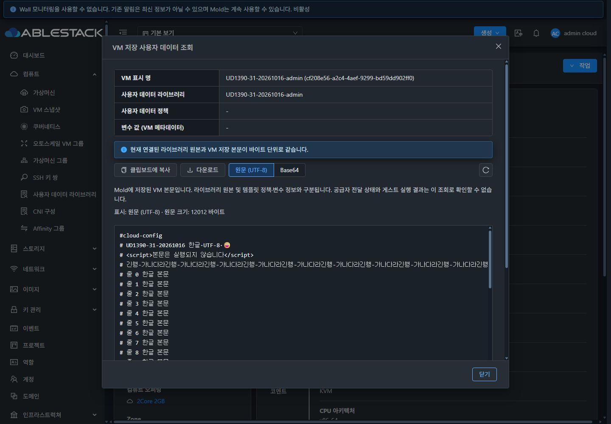

<!-- Licensed to the Apache Software Foundation (ASF) under one or more contributor license agreements. See the NOTICE file distributed with this work for additional information regarding copyright ownership. The ASF licenses this file to you under the Apache License, Version 2.0 (the "License"); you may not use this file except in compliance with the License. You may obtain a copy at http://www.apache.org/licenses/LICENSE-2.0 . Unless required by applicable law or agreed to in writing, software distributed under the License is distributed on an "AS IS" BASIS, WITHOUT WARRANTIES OR CONDITIONS OF ANY KIND. See the License for the specific language governing permissions and limitations. -->

# UD-09 #1390 구현·배포·검증 보고

2026-10-16 / 31번 클러스터 / Epic #1381 · Draft PR #1393. VM 저장 사용자 데이터 조회를 설계·구현하고 테스트 클러스터에 배포했다. **집중 테스트 102개와 최종 실환경 근거 118항목을 통과**했다. 전체 UI 최종 판정은 #1392의 별도 범위이다.

## 구현과 사용 경로

- **VM 상세 → 작업 → VM 저장 사용자 데이터 조회**. 라이브러리의 **사용 가상머신 탭 → VM 상세 링크 → 같은 작업**으로도 접근한다. 새 행 작업이나 별도 UI 프레임워크를 만들지 않는다.
- 실제 API 발견 정보의 `getVirtualMachineUserData`와 `virtualmachineid` 매개변수로 노출한다. 역할 이름이나 VM 정지 상태로 읽기 권한을 고정하지 않는다. VM 소유권은 서버의 기존 접근 검사가 최종 판단한다.
- 기존 `UserDataContent`를 VM/라이브러리에 재사용하고 `MoldDialog size=lg`·기존 작업 메뉴·공통 테마 토큰과 32px 버튼을 사용한다. 원문/Base64, 엄격 UTF-8, 복사·다운로드, 바이너리·빈 상태·오류·재시도를 공유한다.
- VM 이름/UUID, 연결 라이브러리, 정책과 **변수 값 (VM 메타데이터)**를 본문과 구분한다. 공급자 전달과 게스트 실행 성공은 이 읽기 API로 확인할 수 없다고 명시한다.
- UUID/소유자/프로젝트와 본문·참조·정책·변수의 revision을 조회 전후 및 원본 조회 후 확인한다. 변경/삭제·다른 VM·프로젝트/사용자/세션/경로·해제 뒤 결과가 섞이지 않는다. 원본 조회가 허용되지 않아도 독립적으로 허용된 VM 저장본은 표시하며 비교 불가로 안내한다.

[설계](design.ko.md) · [VM 조회 유틸리티](https://github.com/dhslove/ablestack-cloud/blob/8d79de0db24b0e432a381b8c532e4fb361ffaa12/ui/src/utils/vmUserData.js) · [재사용 본문](https://github.com/dhslove/ablestack-cloud/blob/8d79de0db24b0e432a381b8c532e4fb361ffaa12/ui/src/views/compute/UserDataContent.vue) · [MoldDialog 래퍼](https://github.com/dhslove/ablestack-cloud/blob/8d79de0db24b0e432a381b8c532e4fb361ffaa12/ui/src/views/compute/ViewVmUserData.vue)

## 검증 결과

| 구분 | 실제 결과와 근거 |
| --- | --- |
| 소스 검사 | Jest 4 suites / **102 tests**, 변경 파일 ESLint, production UI build 통과. [테스트](tests-final.txt) · [린트](lint-final.txt) · [빌드](build-final.txt) |
| API↔DB | 전용 정지 VM 10개의 저장 본문을 get API / list API / DB 바이트 크기·SHA256과 대조했다. [API](api-matrix.json) · [프로젝트 ACL](api-project.json) · [DB](db-before.json) |
| 원본 의미 | 단순 연결은 동일, 템플릿 APPEND 저장본은 다름, 인라인/빈 본문은 직접 참조 없음. 변수 메타데이터만 있는 저장본의 placeholder는 그대로였으며 게스트 치환/실행을 주장하지 않는다. [APPEND 화면](case-append.png) · [본문 사례](case-binary.json) |
| 실제 내보내기 | 원문 **12,012바이트**, Base64 **16,016바이트**의 실제 클립보드·다운로드를 원본 바이트와 대조했다. BOM·CRLF·한글·emoji·긴 행·마지막 줄바꿈을 보존한다. [원문 복사](clipboard-raw.bin) · [원문 다운로드](download-raw.bin) · [Base64](download-base64.bin) |
| 권한 UI | 관리자, 일반 사용자, 도메인 관리자, 프로젝트 구성원 조회. get API 거부 역할은 메뉴 없음(실제 API 432), 원본 API만 거부한 역할은 저장본 표시+비교 불가. 다른 소유자 접근은 실제 531 거부. [일반 사용자](role-user.png) · [프로젝트](role-project.png) · [원본 거부](role-source-denied.png) · [API 거부](role-get-denied.png) |
| 오류·지연 | CDP 응답 단계에서 의도적으로 주입한 503/403/손상 Base64를 구분한다. 통신 오류는 이전 본문을 보존하되 내보내기를 막고, 권한/손상/삭제/변경은 본문을 지운다. 닫힌 VM의 실제 지연 응답이 다른 VM에 섞이지 않는다. [503](error-503-dark.png) · [403](error-403-dark.png) · [지연](late-new-vm.json) |
| 실제 변경·삭제 | 전용 VM 저장본을 API로 실제 변경한 뒤 지연 응답을 재개하여 mismatch 차단→재조회 새 본문을 확인했다. 본문 있는 VM을 실제 삭제하고 431과 UI 본문 제거를 확인했다. [변경 API](actual-vm-change.json) · [변경 UI](actual-vm-changed.png) · [삭제 API](actual-vm-deletion.json) · [삭제 UI](actual-vm-deleted.png) |
| VM 표준·테마 | 일반/다크 × 1440×1000·1280×720·390×844·390×480 **8개 조합**. 중심 오차 1px 이내, 32px 버튼, Body 내부 스크롤·고정 Header/Footer, 긴 코드 내부 스크롤. 코드 텍스트 대비 일반 약14.68:1 / 다크 약14.56:1. [일반](light-1440x1000.png) · [다크](dark-1440x1000.png) · [작은 모바일](dark-mobile-scrolled.png) |
| 포커스·회귀 | Escape 닫기→기존 VM 작업 버튼 복귀, 모달 안 Tab 범위, 2px 코드 포커스 표시를 실제 검증했다. 공유 라이브러리 본문도 바이트 일치와 VM 정보 미노출을 확인했다. [포커스](focus-code-detail.json) · [키보드](keyboard-trap.json) · [라이브러리 회귀](library-body-regression-data.json) |

최종 UI 상태 이미지 **38개**, [정량 검증 118항목](qualification.json). `initial-ui/`는 최초 기능 번들 `142ead6b43b76a134017bbacb63fc7ee59cad540`의 개발 단계 증거이고, 루트의 최종 화면/네트워크 근거와 구분한다. 최종 번들에서 위 기능/권한/오류/실제 변경·삭제와 전체 8개 화면 조합을 다시 검증했다.

## 배포와 런타임 보존

- UI 소스 `8d79de0db24b0e432a381b8c532e4fb361ffaa12`, `js/app.6abf6820.js`, SHA256 `3de47529dd3b22369c9fc5cb0a2486fcddacdd29131551e2f17c5e413e5f5979`.
- 정적 파일 **867개** 전체 해시 일치, 기존 backend **12클래스**와 JAR 해시 유지. JAR SHA256 `bf53fc37aee0431dd53377526523fcfa2b650e1a32ce9524e243438bab3be7c1`.
- WEB-INF inode `67111992`, config SHA256 `b7de5f6a1f7a3a17310ee7d34ca801bb316fc6f841039f865fbabf154cd59a13`, META-INF 부재 상태와 PID `1247065`를 보존했다. `mold active`, `/client/ HTTP 200`.
- 활성 `/usr/share/cloudstack-management/webapp`의 정적 파일만 갱신하고 index를 마지막에 교체했다. 백업 `/root/ud1390-ui-20261016-155809`를 남겼다. [배포 기록](deployment.json) · [867개 manifest](ui-manifest.json) · [최종 런타임](runtime-final.json).
- Java 변경이 없어 Maven 모듈 빌드는 하지 않았다. 전체 Cloud 빌드·수동 GitHub Actions·qemu/호스트 배포·PR 병합은 수행하지 않았다. CI 확인 결과는 [PR 상태](pr-source-state.json)의 빈 check 목록이며, 집중 검증을 전체 CI 통과로 해석하지 않는다. 빌드의 자산 크기 경고 2개/Browserslist 안내와 Jest forceExit 안내는 로그에 보존했다.

## 잔여와 다음 작업

- 최종 수집 구간 **21개**가 모두 완전하다. 19구간의 JS 예외는 0건이고, 프로젝트 진입/종료 2구간은 공통 `CanceledError / ERR_CANCELED`가 각1건이다. 전체 스택의 `AutogenView.beforeRouteLeave → request.cancel`을 #1392에 전달한다. 전 세션 예외 0 또는 전체 UI 최종 적합성을 주장하지 않는다. [진입](network-role-project.json) · [종료](network-project-leave.json).
- **#1391**: 기존 참조를 보존하는 복제·새 버전 등록, 중복/변수·출처/차이·전환/복원 정책. 부수적으로 발견한 BOM 본문의 APPEND MIME 병합 530 제한도 입력·형식 정책에 반영한다. 기존 backend `CloudInitUserDataProvider`의 형식 인식 제약이며 VM 조회 UI 변경이 아니다. [실제 530/VM 미생성](append-bom-policy.json).
- **#1392**: #1391 적용 후 목록·상세·전체 탭/콘텐츠·모든 대화상자, 일반/다크·확대·접근성·역할별 최종 통합 검토. 이번 공통 취소 예외와 이전 미검증 범위도 포함한다.

## 정리

전용 라이브러리 8개, 정지 VM/루트 볼륨 각10개, 네트워크5개, 템플릿1개, 계정3개, 프로젝트/내부 계정/도메인 각1개, 역할2개를 정리했다. API의 테스트 VM/네트워크 0건, DB 10분류 활성 잔여 모두0이다. 제거된 VM의 이력 행은 removed 표시가 있는 정상 상태로 남는다. 기존 `AS-PROD-31-AS01-HTTP` 전체 API 응답은 시작 전과 정확히 같다. 관리자·기본 프로젝트·다크 모드, viewport/cache/진단/포커스 에뮬레이션·클립보드를 복원하고 전용 탭과 시험 다운로드를 정리했다. 백업과 배포 artifact는 복구 근거로 유지한다.

[API 정리](cleanup.json) · [DB 잔여0](db-after.json) · [목록1개](cleanup-library-list.png) · [브라우저 복원](browser-restored.json)

