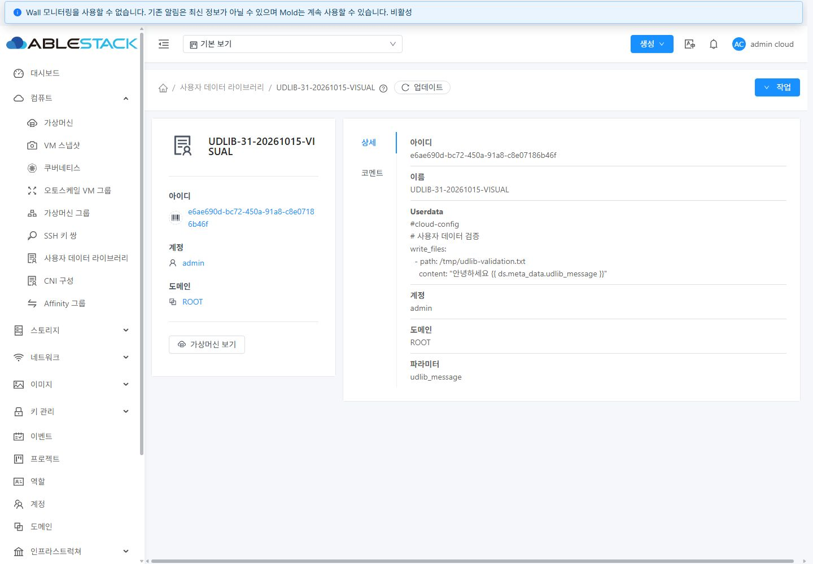
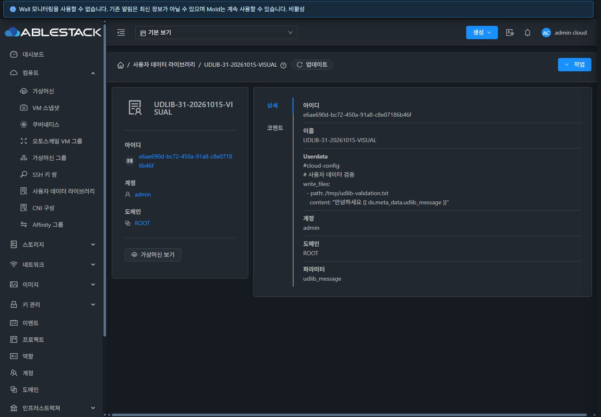
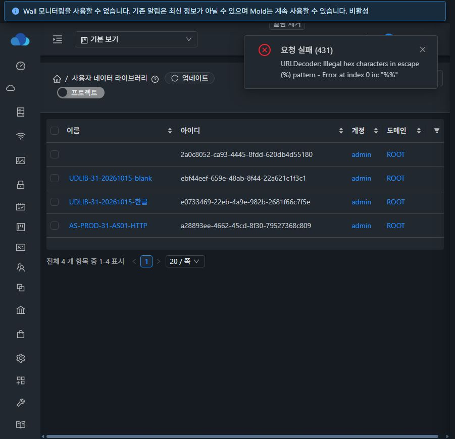
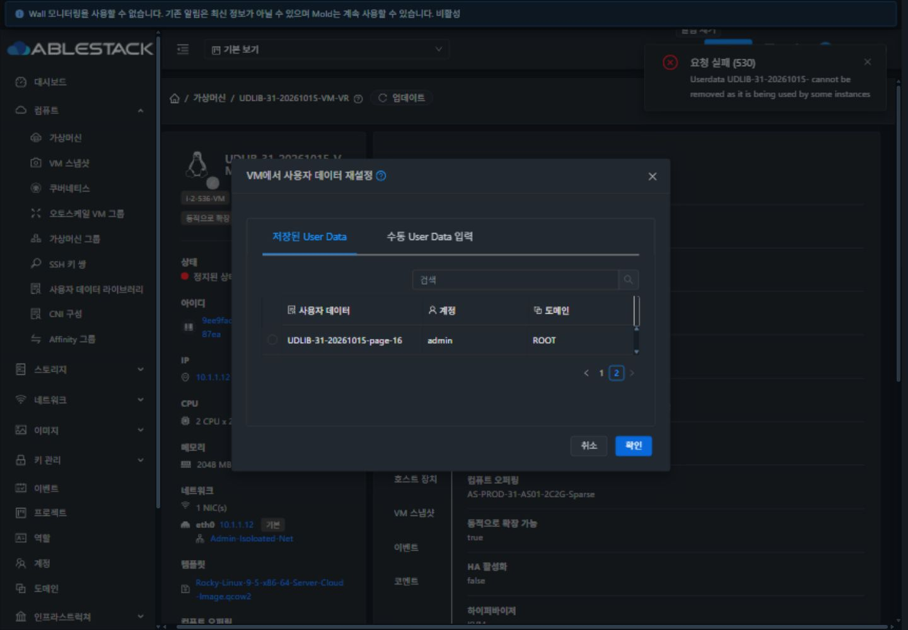
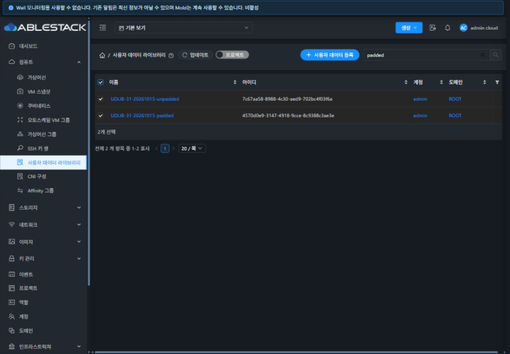
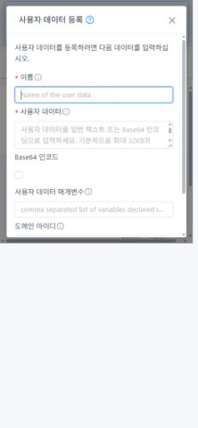
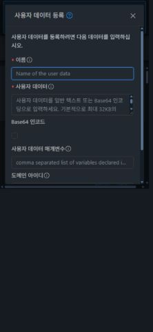

<!--
Licensed to the Apache Software Foundation (ASF) under one
or more contributor license agreements. See the NOTICE file
distributed with this work for additional information
regarding copyright ownership. The ASF licenses this file
to you under the Apache License, Version 2.0 (the
"License"); you may not use this file except in compliance
with the License. You may obtain a copy of the License at

  http://www.apache.org/licenses/LICENSE-2.0

Unless required by applicable law or agreed to in writing,
software distributed under the License is distributed on an
"AS IS" BASIS, WITHOUT WARRANTIES OR CONDITIONS OF ANY
KIND, either express or implied. See the License for the
specific language governing permissions and limitations
under the License.
-->

# 사용자 데이터 라이브러리 기능 검증 및 개선 계획

31번 Mold에서 라이브러리 등록·조회·사용 관계·삭제, VM 재설정, 템플릿/ISO 연결, 소유 범위와 일반/다크 UI를 검증했다. 기본 CRUD와 연결 정책은 동작하지만 입력 검증, 실패 후 상태, 선택기의 검색·페이지 처리, 일괄 작업, 대화상자에 재현 가능한 결함이 있다. 기존 VM 공통 목록·상세·탭 레이아웃은 재사용하고 결함 6개 작업과 기능/UX 확장 4개 작업으로 분리한다.

## 기준과 범위

- 검증일: 2026-10-15 (Asia/Seoul), 테스트 대상 31번 클러스터.
- 소스: upstream/ablestack-europa `4bd1a2cff50c83089dc23ff1c83def631a343e3d`. dhslove 별도 clean worktree에서 분석했다. 배포된 제품의 정확한 빌드 커밋은 이 소스 SHA와 같다고 단정하지 않는다. 실제 배포 UI에서 발생한 예외와 API/관리 로그를 함께 확인했다.
- UI: 로그인 → 사용자 데이터 라이브러리, 전용 VM 2개, 전용 템플릿/ISO, 전용 프로젝트. 일반 사용자 권한은 API 로그인으로 별도 확인했다.
- 기본 라이브러리 1개는 수정하지 않았다. 기능 검증용 사용자 데이터 31개(기본 계정 29, 일반 사용자 1, 프로젝트 1)와 스타일 촬영용 데이터 1개, 정지 VM 2개, direct-download 템플릿/ISO 각 1개, 일반 계정/프로젝트 각 1개, 코멘트 1개를 생성했다. 템플릿/ISO는 새 메타데이터로 등록했고 VM 부팅/디스크 이미지 다운로드는 하지 않았다.
- 1440×1000, 390×844, 390×480에서 실제 화면과 DOM/computed style을 수집했다. 테마 전체 상태의 정량 대비 검사·200% 확대·전체 역할 조합·신규 VM 생성 wizard 제출·게스트 cloud-init 실행은 후속 완료 검증 대상이다.
- 제품 소스 수정·빌드·배포는 이번 작업에 포함하지 않는다. 전체 Cloud/GitHub Actions 빌드를 실행하지 않았다.

## API와 UI 대응

| API | 현재 UI | 판정/개선 |
| --- | --- | --- |
| listUserData | 목록, 상세, VM/템플릿/ISO 선택 | 목록 페이지/이름 검색 정상. VM 선택기 검색·페이지 결함. UUID는 keyword가 아닌 id API가 필요 |
| registerUserData | 등록, 일반 텍스트/Base64, 변수, 계정/도메인, 전역 프로젝트 범위 | 한글과 Base64 정상. 공백/정규화 중복 검증 및 실패 후 입력 유지 필요 |
| deleteUserData | 상세 제거, groupAction 선언 | 미사용 프로젝트 데이터 UI 삭제 정상. 사용 중 보호 정상. 목록 선택 후 일괄 실행 버튼 누락 |
| linkUserDataToTemplate | 템플릿/ISO 등록·편집에서 연결/해제·정책 | 실제 템플릿 연결→APPEND 변경→해제, ISO DENYOVERRIDE 연결 및 API 해제 정상. 라이브러리 쪽 참조 가시성 부족 |
| resetUserDataForVirtualMachine | VM 작업 메뉴 | VR 네트워크 정지 VM의 저장/공급자 적용 정상. 모드 전환·설정 안함·실패 원자성 결함 |
| getVirtualMachineUserData | UI 호출 경로 없음 | 전용 VM API 실제 본문 반환. 권한 기반 읽기 UI 보완 필요 |
| 수정/복제/버전 API | 없음 | 단순한 UI 누락으로 분류하지 않음. 변경 정책과 API 설계를 별도 과제로 분리 |

## 기능 점검 결과

| 항목 | 결과 | 근거 |
| --- | --- | --- |
| 관리자 로그인 및 실제 API 6종 발견 | 정상 | baseline.json |
| 목록 30건의 20/10건 서버 페이지 | 정상 | library-page2-dom.txt |
| 목록 이름 검색 page-01 | 정상 | library-search-dom.txt |
| 한글 본문/줄바꿈/변수 등록·상세 왕복 | 정상 | api-tests.json, detail-dom.txt |
| Base64 선택 등록 | 정상 | 전용 base64 데이터 및 후속 ISO 연결 |
| UI 빈 필수값 검사 | 정상 | 이름/본문 필수 오류 확인 |
| 잘못된 Base64 제출 후 입력 유지 | 결함 | 431 오류 후 창 닫힘, invalid-base64-dom.txt |
| 동일 이름/동일 Base64 본문 거절 | 정상 | duplicate-name/content, api-tests.json |
| API 공백 이름/공백 본문 | 결함 | 성공하여 비정상 행 생성, api-tests.json |
| Base64 표기 정규화 후 중복 검사 | 결함 | eA==/eA가 같은 본문으로 별도 저장, canonical-content.json |
| 구성된 32768 Base64 제한 초과 | 정상 거절 | 24577 원문 바이트 → 32772 인코딩 바이트, 431 |
| 상세/코멘트 탭 및 뒤로/앞으로/새로고침 | 정상 | tab-content-match.json |
| 코멘트 등록·삭제 | 정상 | 전용 코멘트 등록 후 제거 |
| 일반 사용자 본인 CRUD/타 계정 read 격리 | 정상(API 범위) | owner-tests.json |
| 프로젝트 UI 등록·상세·삭제 | 정상 | project-detail-light, project-delete-dom.txt |
| 템플릿 세 정책 API와 UI 연결/변경/해제 | 정상(Cloud 계약) | template-api-tests.json, template-*-ui-dom.txt |
| ISO UI 연결·DENYOVERRIDE 및 API 해제 | 정상(Cloud 계약) | iso-link-ui-dom.txt, cleanup-summary.json |
| UserData 지원 VR VM에 UI 재설정 | 정상(Cloud 계약) | vm-vr-applied-dom.txt, vm-vr-effective-userdata.json |
| 사용 VM 링크/API 2건 대조 | 정상 | related-vms-dom.txt |
| VM/템플릿 사용 중 삭제 제한 | 정상 | delete-in-use-dom.txt, template-api-tests.json |
| VM 선택기 전체 페이지 접근 | 결함 | 서버 첫 10건을 다시 로컬 2페이지로 표시 |
| VM 선택기 검색 | 결함 | handleSearchFilter is not a function, browser-errors.json |
| VM 라이브러리→수동 입력 전환 | 결함 | userdata와 userdataid 동시 전송, 431 |
| VM 설정 안함 선택 | 결함 | 번역 문구가 userdataid로 전송되어 431 |
| 미지원 L2 VM 적용 실패의 저장 상태 | 결함 | 530 실패지만 userdataid/변수 저장, 관리 로그와 API 대조 |
| 목록 2개 선택 후 일괄 작업 | 결함 | 선택 수만 표시, 삭제 작업 없음, bulk-selected.png |
| 일반/다크 기본 목록·상세·탭의 공통 레이아웃 | 정상/재사용 | 데스크톱 좌측 탭, 모바일 상단 탭. 전면 재작성 불필요 |
| 등록 창 고정 Footer/짧은 화면 | 결함 | Footer 없음, 390×480에서 확인 top=518px로 Body 안 스크롤 |

## VM UI 표준 검토와 재사용 방안

| 영역 | 현재 확인 | 보완 방향 |
| --- | --- | --- |
| 목록 | ListView 공통 표/툴바/선택/페이지 사용 | 일괄 작업 복구, 명시적 ID·소유 범위 검색, 정렬 범위 안내 |
| 상세 | ResourceLayout+InfoCard+ResourceView 재사용 | 소유 범위와 내용 요약을 보완하고 긴 본문을 전용 탭으로 분리 |
| 탭 | 상세/코멘트 매칭과 이력 복원 정상 | 상세→사용자 데이터→사용 VM→연결 템플릿/ISO→코멘트의 의미별 콘텐츠 계약 |
| 본문 | 디코딩 후 pre-wrap 텍스트 | 읽기 전용 코드/텍스트 컴포넌트, 원문/Base64, copy/download, 긴 행 내부 스크롤 |
| 사용 관계 | 외부 VM 목록 링크만 존재 | 공통 목록으로 VM/템플릿/ISO 참조와 정책·상세 링크·삭제 차단 원인 표시 |
| 대화상자 | legacy a-modal, Body 내부 버튼, 32px 버튼 | 기존 MoldDialog/VM 제목·Header·Footer 재사용, Body만 스크롤, 실패 보존 |
| 일반/다크 | 기존 공통 테마 적용 | 정상 토큰/레이아웃 보존. 신규 코드 영역·팝업·오류·선택·비활성 상태까지 재검증 |

## 개선 작업과 순서

1. UD-01~UD-06: 재현 결함부터 처리한다. 입력 검증/오류 복구, 선택기 검색·페이지, 재설정 모드, 실패 시 상태, 일괄 삭제를 각각 검증한다.
2. UD-07~UD-08: 참조 조회 계약을 먼저 정리하고 라이브러리의 목록·상세·본문·사용 관계 탭에 적용한다. 기존 공통 스타일과 정상 탭 동작을 유지한다.
3. UD-09~UD-10: VM 저장본 읽기 UI와 복제/버전 정책을 확장한다. API 저장값과 공급자 전달·게스트 실행을 구분하고 기존 참조를 자동 변경하지 않는다.

모든 UI 변경은 일반/다크, VM 공통 컴포넌트 재사용, 탭/URL/콘텐츠 일치, 공통 대화상자 표준을 완료 조건으로 적용한다. [Mold 모달 표준 #1213](https://github.com/ablecloud-team/ablestack-cloud/issues/1213)과 기존 SSH 키 사용 VM 탭·대화상자의 패턴도 참고한다.

## 정리 결과

- 기능 검증용 기본 계정 데이터 29건, 일반 사용자 데이터 1건, 프로젝트 데이터 1건 및 코멘트 1건을 제거했다. 이후 같은 내용의 스타일 촬영용 데이터 1건도 제거하고 기존 응답과의 정확한 일치를 재확인했다.
- 정지 VM 2개는 destroy/expunge 비동기 작업의 성공을 확인했고, 두 VM의 listVirtualMachines/listVolumes 결과는 빈 목록이다.
- 전용 템플릿/ISO는 연결 해제 후 삭제했고 전용 계정/프로젝트도 제거했다. 최종 조회에서 활성 테스트 개체가 없다.
- 기존 라이브러리 1개의 전체 API 응답은 시작 시점과 정확히 일치했다. 공개 요약에는 기존 본문 대신 SHA256만 남겼다.
- 제품 소스·관리 JAR·호스트 스크립트·UI 번들은 변경하거나 배포하지 않았다. 테마는 시작 시점의 다크 모드로 돌려놓았다.
- 근거: [정리 검증 요약](cleanup-summary.json).

## 실제 화면 근거

## 업스트림 Epic과 하위 이슈

[Epic #1381](https://github.com/ablecloud-team/ablestack-cloud/issues/1381)에 하위 11개 이슈가 GitHub sub-issue로 연결되어 있다. 결함 수정 6개, 기능/UX 보완 4개, 최종 UI 표준 검토 1개다. UD-01 #1382는 [Epic PR #1393](https://github.com/ablecloud-team/ablestack-cloud/pull/1393)에서 설계·구현·31번 배포·범위 내 검증을 완료했다. [구현 검증 보고서](../userdata-1382-20261015/report.ko.md). 나머지 10개 이슈와 Epic 전체 UI 최종 검토는 계속 진행 대상으로 유지한다. 아래 초기 결함/실화면 증거는 구현 전 조사 결과다.

| 작업 | 우선순위 | 이슈 |
| --- | --- | --- |
| UD-01 | P1 | [[UD-01][Europa][P1][사용자 데이터] 등록 입력 검증과 Base64 정규화 정합성 개선](https://github.com/ablecloud-team/ablestack-cloud/issues/1382) |
| UD-02 | P1 | [[UD-02][Europa][P1][사용자 데이터] 등록 대화상자 오류 복구와 공통 모달 표준 적용](https://github.com/ablecloud-team/ablestack-cloud/issues/1383) |
| UD-03 | P1 | [[UD-03][Europa][P1][사용자 데이터] VM 사용자 데이터 선택기 검색과 서버 페이지 처리 복구](https://github.com/ablecloud-team/ablestack-cloud/issues/1384) |
| UD-04 | P1 | [[UD-04][Europa][P1][사용자 데이터] VM 재설정 입력 모드와 설정 안함 및 현재값 복원 정합성 개선](https://github.com/ablecloud-team/ablestack-cloud/issues/1385) |
| UD-05 | P1 | [[UD-05][Europa][P1][사용자 데이터] 사용자 데이터 적용 실패의 VM 상태 정합성과 지원 조건 검증](https://github.com/ablecloud-team/ablestack-cloud/issues/1386) |
| UD-06 | P1 | [[UD-06][Europa][P1][사용자 데이터] 목록 선택 후 일괄 삭제 작업 노출과 결과 처리 복구](https://github.com/ablecloud-team/ablestack-cloud/issues/1387) |
| UD-07 | P1 | [[UD-07][Europa][P1][사용자 데이터] 사용 VM 및 템플릿 ISO 참조와 삭제 차단 사유 가시화](https://github.com/ablecloud-team/ablestack-cloud/issues/1388) |
| UD-08 | P1 | [[UD-08][Europa][P1][사용자 데이터] 목록 상세 본문 탭의 VM UI 표준과 일반 다크 테마 일치](https://github.com/ablecloud-team/ablestack-cloud/issues/1389) |
| UD-09 | P2 | [[UD-09][Europa][P2][사용자 데이터] VM 저장 사용자 데이터 조회 API의 UI 접근 경로 제공](https://github.com/ablecloud-team/ablestack-cloud/issues/1390) |
| UD-10 | P2 | [[UD-10][Europa][P2][사용자 데이터] 라이브러리 복제와 버전 관리 및 변경 정책 수립](https://github.com/ablecloud-team/ablestack-cloud/issues/1391) |
| UD-11 | P1 | [[UD-11][Europa][P1][사용자 데이터] 전체 UI 표준 준수 최종 통합 검토 및 회귀 검증](https://github.com/ablecloud-team/ablestack-cloud/issues/1392) |

## 후속 요구 반영 — 사용 가상머신 탭과 최종 UI 표준 검토

라이브러리를 적용한 VM 목록은 기존 UD-07 #1388 및 UD-08 #1389에 포함되어 있었다. 다만 UD-07의 “탭 또는 공통 목록” 표현을 **선택한 라이브러리 상세 화면의 전용 `사용 가상머신` 탭**으로 구체화했다. 외부 VM 목록 이동 링크만으로 대체하지 않으며, 라이브러리 UUID 필터·계정/도메인/프로젝트 ACL·서버 총 건수/페이지·VM 상세 링크·연결/변경/해제 후 갱신을 완료 기준에 추가했다. 목록은 Cloud 연결 관계를 의미하며 게스트 cloud-init 실행 성공과 구분한다.

UD-11 #1392는 관련 구현 통합 후 목록·상세·모든 탭의 이름/URL/실제 콘텐츠·대화상자를 VM 기준과 최종 대조하는 별도 검토 이슈다. 일반/다크, 공통 컴포넌트/스타일 재사용, 반응형/200% 확대, 키보드 접근성, MD-01~MD-12 및 실제 좌표/대비 측정·UI/API 회귀 증거를 포함한다. Epic의 마지막 단계와 완료 조건에 연결했으며, 범위 내 미준수/미검증이 남으면 완료 처리하지 않는다.

이번 후속 작업은 기존 이슈의 요구사항 보완과 최종 검토 이슈 등록이다. 제품 구현·추가 배포 또는 최종 UI 표준 적합성 검증이 완료된 것은 아니다.

## 구현 후속 — UD-02 #1383

2026-10-15: UD-01 #1382에 이어 UD-02 #1383의 공통 등록 모달·오류 복구·31번 배포 검증을 완료했다. 누적 Epic Draft PR은 [#1393](https://github.com/ablecloud-team/ablestack-cloud/pull/1393)이며 구현 진행은 2/11이다. 초기 진단의 모달 Footer 결함과 최종 보완 결과는 [UD-02 보고서](../userdata-1383-20261015/report.ko.md)에 구분해 기록했다. 나머지 9개 하위 이슈와 전체 UI 최종 감사 #1392는 계속 OPEN이다.
